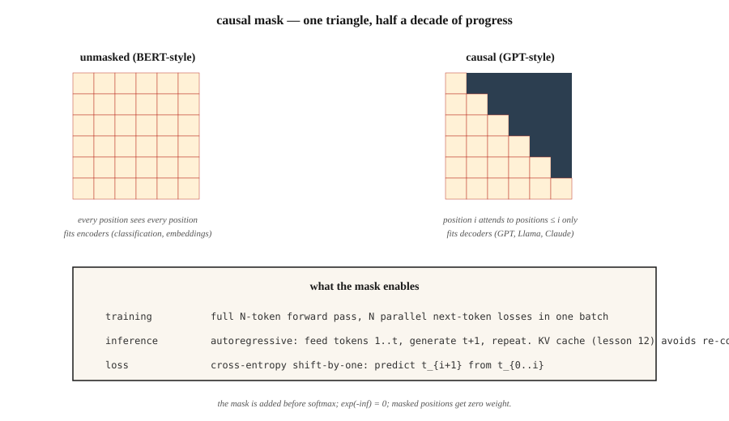

<!-- local-zh-machine-draft: English source is canonical; prose translated automatically, code/math preserved. -->

<a id="gpt--causal-language-modeling"></a>

# GPT — 因果语言建模

> BERT 看到双方。 GPT 只看到过去。三角形掩模是现代人工智能中最重要的单行代码。

**类型：** 构建
**语言：** Python
**先决条件：** 第 7 期·02 (Self-Attention)、第 7·05 期 (完整 Transformer)、第 7·06 期 (BERT)
**时间：** ~75分钟

<a id="the-problem"></a>

## 问题

语言模型回答一个问题：给定第一个 `t-1` tokens，token `t` 上的概率分布是什么？训练该信号（下一个 token 预测），您将获得一个可以一次生成任意文本 token 的模型。

要在整个序列上并行地进行端到端训练，您需要每个位置的预测仅依赖于较早的位置。否则模型就会通过查看答案来作弊。

因果面具就是这样做的。它是 `-inf` 值添加到 softmax 之前的 attention 分数的单个上三角矩阵。在 softmax 之后，这些位置变为 0。每个位置只能处理其自身和更早的位置。因为您将其应用于整个序列一次，所以您可以在一个 forward pass 中获得 N 个并行的 next-token 预测。

GPT-1 (2018)、GPT-2 (2019)、GPT-3 (2020)、GPT-4 (2023)、GPT-5 (2025)、Claude、Llama、Qwen、Mistral、DeepSeek、Kimi — 它们都是 decoder 的唯一因果关系transformers 与核心循环相同。它们的区别在于数据质量、规模和架构改进以及训练后（SFT、RLHF、DPO 及其后继者）。

<a id="the-concept"></a>

## 概念



<a id="the-mask"></a>

### 面具

给定一个长度为 `N` 的序列，构建一个 `N × N` 矩阵：

```
M[i, j] = 0       if j <= i
M[i, j] = -inf    if j > i
```

将 `M` 添加到 softmax 之前的原始 attention 分数中。 `exp(-inf) = 0`，因此屏蔽位置贡献为零 weight。 attention 矩阵的每一行仅是先前位置的概率分布。

实施成本：一次 `torch.tril()` 调用。计算时间：纳秒。对领域的影响：一切。

<a id="where-the-triangle-comes-from"></a>

### 三角形从哪里来

该面罩通常以螺栓固定在 attention 上的 patch 形式呈现。从另一个方向运行推导，它就不再神秘了：attention 是前缀平均值的第三次细化，三角形是该平均值的循环边界，写为矩阵。

**阶段 1 — 前缀平均值。** 序列的最愚蠢的因果总结：位置 `i` 成为位置 `0…i` 的平均值。作为循环，即 `out[i] = X[:i+1].mean(0)`。相同的计算是一个矩阵乘法。取一个下三角矩阵，将每一行除以其计数，然后乘以：

```python
import numpy as np

A = np.tril(np.ones((n, n)))
A = A / A.sum(axis=1, keepdims=True)
out = A @ X
```

`A` 的行 `i` 是 `[1/(i+1), …, 1/(i+1), 0, …, 0]`。对角线上方的零是因果关系。关于未来的一切都没有被掩盖；未来从来不在于总和。

**阶段 2 — 学习 weights.** 统一平均值将过去的每个 token 视为同等相关。将其替换为学习得分矩阵 `S`。现在，通过构造，行的总和不再为 1，因此使用 softmax 标准化每一行，而不是除以计数。 Softmax 永远不会输出精确的零，这会破坏因果关系 - 除非未来的分数以 `-inf` 的形式输入，因为 `exp(-inf) = 0`：

```python
def softmax(x, axis):
    e = np.exp(x - np.max(x, axis=axis, keepdims=True))
    return e / e.sum(axis=axis, keepdims=True)

S = S + np.triu(np.full((n, n), -np.inf), k=1)
A = softmax(S, axis=1)
out = A @ X
```

相同的三角形，相同的行随机矩阵，相同的 matmul。 `-inf` 面罩不是新机械。它是阶段 1 的零条目，转换为 softmax 的输入域。

**阶段 3 — 内容相关 weights.** 在阶段 2 中，`S` 在训练后固定：位置 7 始终对位置 3 进行相同的权重，无论 tokens 怎么说。让分数取决于 tokens 本身：`S = Q @ K.T / sqrt(d_k)`。其他什么都没有改变。掩码，softmax，matmul — 相同。

三个阶段，一个不变量：下三角行随机矩阵乘以序列。均匀平均，学到静态weights，内容依赖weights。该掩码从未添加到 attention 中。它从平均水平中幸存下来。

```figure
mask-derivation
```

<a id="parallel-training-serial-inference"></a>

### 并行训练，序列号inference

训练：将整个 `(N, d_model)` 序列前向传递一次，计算 N 个 cross-entropy 损失（每个位置一个）、总和、反向传播。沿序列平行。这就是 GPT 训练规模的原因 - 您可以在一次 GPU 传递中批量处理 1M tokens。

Inference：您通过token生成token。喂入 `[t1, t2, t3]`，得到 `t4`。喂入 `[t1, t2, t3, t4]`，得到 `t5`。喂入 `[t1, t2, t3, t4, t5]`，得到 `t6`。 KV cache（第 12 课）保存 `t1…tn` 的隐藏状态，这样您就不必每一步重新计算它们。但 inference 处的串行深度 = 输出长度。这就是 autoregressive 税，以及为什么解码是每个 LLM 的延迟瓶颈。

<a id="the-loss--shift-by-one"></a>

### 损失——逐一移动

给定 tokens `[t1, t2, t3, t4]`：

- 输入：`[t1, t2, t3]`
- 目标：`[t2, t3, t4]`

对于每个位置 `i`，计算 `-log P(target_i | inputs[:i+1])`。和。这是整个序列的 cross-entropy。

每一个 transformer LM 你都听说过这种损失的火车。预训练，fine-tuning，SFT——相同的损失，不同的数据。

<a id="decoding-strategies"></a>

### Decoding strategies

经过训练，sampling的选择比人们想象的更重要。

| 方法 | 它的作用 | 何时使用 |
|--------|--------------|-------------|
| 贪婪 | 每一步Argmax | 确定性任务、代码完成 |
| Temperature | 将 logits 除以 T，样本 | 创造性任务，更高的 T = 更多多样性 |
| 前k | 仅来自 top-k tokens 的样本 | 杀死低概率的尾巴 |
| Top-p（核） | 从累积概率 ≥ p 的最小集合中抽取样本 | 2020+默认；适应分布形状 |
| 最小p | 保留 tokens 与 `p > min_p * max_p` | 2024+；比 top-p 更擅长拒绝长尾 |
| Speculative decoding | 草案模型提出N tokens，大模型验证 | 相同质量下延迟减少 2-3 倍 |

2026 年，对于 open-weights 模型，min-p + temperature 0.7 是合理的默认值。 Speculative decoding 是任何生产 inference 堆栈的基本要求。

<a id="what-made-the-gpt-recipe-work"></a>

### 是什么让“GPT食谱”发挥作用

1. **Decoder-仅限。** 无 encoder 开销。每层一次 attention + FFN。
2. **Scaling.** 124M → 1.5B → 175B → 万亿。 Chinchilla 缩放定律（第 13 课）告诉您如何使用计算。
3. **In-context learning.** 于 6B–13B 左右出现。该模型可以遵循 few-shot 示例，无需 fine-tuning。
4. **RLHF.** 针对人类偏好的后训练将原始预训练文本转换为聊天助手。
5. **Pre-norm + RoPE + SwiGLU.** 大规模稳定训练。

自GPT-2以来，核心架构没有太大变化。所有有趣的事情都发生在数据、规模和训练后。

```figure
causal-mask
```

<a id="build-it"></a>

## 动手实现

<a id="step-1-the-causal-mask"></a>

### 第一步：因果面具

参见 `code/main.py`。一行：

```python
def causal_mask(n):
    return [[0.0 if j <= i else float("-inf") for j in range(n)] for i in range(n)]
```

将其添加到 softmax 之前的 attention 分数中。这就是整个机制。

<a id="step-2-a-2-layer-gpt-ish-model"></a>

### 步骤2：2层GPT-ish模型

堆叠两个 decoder 块（屏蔽 self-attention + FFN，无 cross-attention）。添加 token embedding、位置编码和取消嵌入（绑定到 token embedding 矩阵 - 自 GPT-2 以来的标准技巧）。

<a id="step-3-next-token-prediction-end-to-end"></a>

### 步骤3：next-token预测，端到端

在 20-token 玩具词汇上，在每个位置生成 logits。计算 cross-entropy 相对于移一目标的损失。否 gradient — 这是前向传递健全性检查。

<a id="step-4-sampling"></a>

### 步骤4：sampling

实现贪婪，temperature，top-k，top-p，min-p。在固定的 prompt 上运行每个并比较输出。一个sampling函数有10行。

<a id="use-it"></a>

## 实际应用

PyTorch，2026成语：

```python
from transformers import AutoModelForCausalLM, AutoTokenizer
model = AutoModelForCausalLM.from_pretrained("meta-llama/Llama-3.2-3B-Instruct")
tok = AutoTokenizer.from_pretrained("meta-llama/Llama-3.2-3B-Instruct")

prompt = "Attention is all you need because"
inputs = tok(prompt, return_tensors="pt")
out = model.generate(
    **inputs,
    max_new_tokens=64,
    temperature=0.7,
    top_p=0.9,
    do_sample=True,
)
print(tok.decode(out[0]))
```

在后台，`generate()` 运行 forward pass，拉出最终位置 logits，对下一个 token 进行采样，将其附加并重复。每个生产 LLM inference 堆栈（vLLM、TensorRT-LLM、llama.cpp、Ollama、MLX）都实现相同的重循环优化——批量prefill、continuous batching、KV cache分页、speculative decoding。

**GPT 与 BERT，每行一行：** GPT 预测 `P(x_t | x_{<t})`。 BERT 预测 `P(x_masked | x_unmasked)`。损失决定了模型能否生成。

<a id="ship-it"></a>

## 交付成果

参见 `outputs/skill-sampling-tuner.md`。该技能选择 sampling parameters 进行新一代任务，并在需要确定性解码时进行标记。

<a id="exercises"></a>

## 练习

1. **Easy.** 运行 `code/main.py` 并验证因果 attention 矩阵在 softmax 之后是下三角矩阵。抽查：第 3 行应仅在第 0-3 列中包含 weights。
2. **Medium.** 对宽度 4 实施波束搜索。比较波束 4 的 perplexity 与 10 短 prompts 上的贪婪。比姆总是赢吗？ （提示：通常用于翻译，不适用于开放式聊天。）
3. **Hard.** 实现 speculative decoding：使用微型 2 层模型作为草稿，使用 6 层模型作为验证器。测量长度为 64 的 100 次完成时的挂钟加速。确认输出与验证器的贪婪匹配。

<a id="key-terms"></a>

## 关键术语

| 术语 | 人们怎么说 | 它实际上意味着什么 |
|------|-----------------|-----------------------|
| 因果面具 | “三角形” | 将上三角 `-inf` 矩阵添加到 attention 分数中，因此位置 `i` 只能看到位置 `≤ i`。 |
| 下一篇-token预测 | “损失” | 模型的分布 Cross-entropy 在每个位置都与真实的下一个 token 相对应。 |
| Autoregressive | “一次生成一个” | 反馈输出作为输入；仅在训练期间并行，而不是在生成期间并行。 |
| Logits | “预softmax分数” | softmax之前LM头的原始输出； sampling 发生在这些上。 |
| Temperature | “创意旋钮” | 将 logits 除以 T； T→0 = 贪婪，T→∞ = 均匀。 |
| Top-p | "Nucleus sampling" | 将分布截断为最小集合，总和≥p；从剩下的东西中取样。 |
| 最小p | “比top-p更好” | 保留tokens，其中`p ≥ min_p × max_p`；使截断适应分布的锐度。 |
| Speculative decoding | “起草+审核” | 廉价型号建议N tokens；大模型并行验证。 |
| 老师强迫 | 《训练技巧》 | 在训练期间，输入真实的先前 token，而不是模型的预测。每个 seq2seq LM 的标准。 |

<a id="further-reading"></a>

## 进一步阅读

- [Radford 等人。 （2018）。通过生成预训练提高语言理解](https://cdn.openai.com/research-covers/language-unsupervised/language_understanding_paper.pdf) — GPT-1。
- [Radford 等人。 （2019）。语言模型是无监督多任务学习者](https://cdn.openai.com/better-language-models/language_models_are_unsupervised_multitask_learners.pdf) — GPT-2。
- [Brown 等人。 （2020）。语言模型为 Few-Shot Learners](https://arxiv.org/abs/2005.14165) — GPT-3 和 in-context learning。
- [利维坦、卡尔曼、马蒂亚斯 (2023)。通过 Speculative Decoding](https://arxiv.org/abs/2211.17192) 从 Transformers 快速 Inference — 规范解码论文。
- [HuggingFace `modeling_llama.py`](https://github.com/huggingface/transformers/blob/main/src/transformers/models/llama/modeling_llama.py) — 规范因果LM参考代码。
