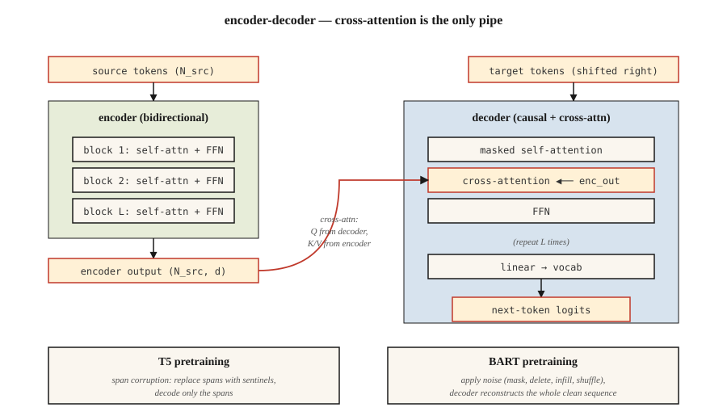

<!-- local-zh-machine-draft: English source is canonical; prose translated automatically, code/math preserved. -->

<a id="t5-bart--encoder-decoder-models"></a>

# T5、BART——Encoder-Decoder 模型

> Encoders 了解。 Decoders 生成。将它们重新组合在一起，您就得到了一个为输入→输出任务构建的模型：翻译、总结、重写、转录。

**类型：** 了解
**语言：** Python
**先决条件：** 第7·05期（完整Transformer），第7·06期（BERT），第7·07期（GPT）
**时间：** ~45分钟

<a id="the-problem"></a>

## 问题

仅 Decoder GPT 和仅 encoder BERT 各自出于不同的目标而剥离了 2017 年架构。但许多任务自然是输入-输出：

- 翻译：英语 → 法语。
- 摘要：5,000-token 文章 → 200-token 摘要。
- 语音识别：audio tokens→文字tokens。
- 结构化提取：散文 → JSON。

对于这些，encoder-decoder 是最合适的。 encoder 生成源的密集表示。 decoder 生成输出，并在每一步交叉处理该表示。训练在输出侧是逐一进行的。与 GPT 相同的损耗，只是以 encoder 输出为条件。

两篇论文定义了现代剧本：

1. **T5**（Raffel 等人，2019）。 “文本到文本传输 Transformer。”每个 NLP 任务都被重新定义为文本输入、文本输出。单一架构，单一vocabulary，单一损耗。对屏蔽跨度预测进行预训练（输入中的跨度损坏，在输出中对其进行解码）。
2. **BART**（Lewis 等人，2019）。 “双向和自回归 Transformer。”去噪自动编码器：以多种方式损坏输入（洗牌、掩码、删除、旋转），要求 decoder 重建原始数据。

到 2026 年，encoder-decoder 格式将取决于输入结构：

- Whisper（语音→文字）。
- 谷歌的翻译堆栈。
- 一些具有不同上下文和编辑结构的代码完成/修复模型。
- 用于结构化推理任务的 Flan-T5 和变体。

Decoder-只赢得了聚光灯，但encoder-decoder从未消失。

<a id="the-concept"></a>

## 概念



<a id="the-forward-loop"></a>

### 前向循环

```
source tokens ─▶ encoder ─▶ (N_src, d_model)  ──┐
                                                 │
target tokens ─▶ decoder block                   │
                 ├─▶ masked self-attention       │
                 ├─▶ cross-attention ◀───────────┘
                 └─▶ FFN
                ↓
              next-token logits
```

至关重要的是，encoder 每个输入运行一次。 decoder 以自回归方式运行，但在每一步交叉参与 *same* encoder 输出。缓存 encoder 输出可以为长输入提供免费加速。

<a id="t5-pretraining--span-corruption"></a>

### T5 pretraining —跨度损坏

选择输入的随机跨度（平均长度 3 tokens，总计 15%）。用唯一的哨兵替换每个范围：`<extra_id_0>`、`<extra_id_1>` 等。decoder 仅输出损坏的范围及其哨兵前缀：

```
source: The quick <extra_id_0> fox jumps <extra_id_1> dog
target: <extra_id_0> brown <extra_id_1> over the lazy
```

比预测整个序列更便宜的信号。在T5论文的消融方面与MLM（BERT）和前缀-LM（UniLM）竞争。

<a id="bart-pretraining--multi-noise-denoising"></a>

### BART pretraining — 多噪声去噪

BART 尝试了五种噪声函数：

1. Token 屏蔽。
2. Token 删除。
3. 文本填充（屏蔽跨度，decoder 插入正确的长度）。
4. 句子排列。
5. 文档轮换。

结合文本填充+句子排列产生了最好的下游数字。 decoder 始终重建原始内容。 BART 的输出是完整序列，而不仅仅是损坏的跨度 - 因此 pretraining 计算高于 T5。

<a id="inference"></a>

### Inference

autoregressive 代与 GPT 相同。贪心/光束/顶p sampling 适用。集束搜索（宽度 4-5）是翻译和摘要的标准，因为输出分布比聊天窄。

<a id="when-to-pick-each-variant-in-2026"></a>

### 2026 年何时选择每个变体

| 任务 | Encoder-decoder? | 为什么 |
|------|------------------|-----|
| 翻译 | 是的，通常 | 清晰的源序列；固定输出分配；波束搜索工程 |
| 语音转文字 | 是的（小声） | 输入 modality 与输出不同； encoder 塑造音频 features |
| 聊天/推理 | 否，仅 decoder | 没有持久的“输入”——对话就是顺序 |
| 代码完成 | 通常没有 | Decoder-仅长上下文获胜；像 Qwen 2.5 Coder 这样的代码模型仅限 decoder |
| 总结 | 要么有效 | BART、PEGASUS 击败了早期仅包含 decoder 的基线；现代 decoder-仅 LLMs 匹配它们 |
| 结构化提取 | 要么 | T5 很干净，因为“文本→文本”吸收任何输出格式 |

自 2022 年以来的趋势：decoder-only 接管 encoder-decoder 曾经拥有的任务，因为 (a) 指令调整的 decoder-only LLMs 通过提示泛化到任何东西，(b) 一种架构比两个更容易缩放，(c) RLHF 假设为 decoder。 Encoder-decoder 在输入 modality 不同的地方（语音、图像）或波束搜索质量很重要的地方保持不变。

```figure
encoder-decoder
```

<a id="build-it"></a>

## 动手实现

参见 `code/main.py`。我们为玩具语料库实现了 T5 风格的跨度损坏——这是本课程中最有用的部分，因为它出现在此后的每个 encoder-decoder pretraining 配方中。

<a id="step-1-span-corruption"></a>

### 第一步：消除腐败

```python
def corrupt_spans(tokens, mask_rate=0.15, mean_span=3.0, rng=None):
    """Pick spans summing to ~mask_rate of tokens. Return (corrupted_input, target)."""
    n = len(tokens)
    n_mask = max(1, int(n * mask_rate))
    n_spans = max(1, int(round(n_mask / mean_span)))
    ...
```

目标格式是 T5 约定：`<sent0> span0 <sent1> span1 ...`。损坏的输入在跨度位置将未更改的 tokens 与哨兵 tokens 交错。

<a id="step-2-verify-round-trip"></a>

### 第 2 步：验证往返

给定损坏的输入和目标，重建原始句子。如果您的损坏是可逆的，则 forward pass 是明确定义的。这是一项健全性检查——真正的训练永远不会这样做，但测试很便宜，并且可以在跨度簿记中发现一个微小的错误。

<a id="step-3-bart-noising"></a>

### 步骤 3：BART 噪音

五个功能：`token_mask`、`token_delete`、`text_infill`、`sentence_permute`、`document_rotate`。组合其中两个并显示结果。

<a id="use-it"></a>

## 实际应用

拥抱脸参考：

```python
from transformers import T5ForConditionalGeneration, T5Tokenizer
tok = T5Tokenizer.from_pretrained("google/flan-t5-base")
model = T5ForConditionalGeneration.from_pretrained("google/flan-t5-base")

inputs = tok("translate English to French: Attention is all you need.", return_tensors="pt")
out = model.generate(**inputs, max_new_tokens=32)
print(tok.decode(out[0], skip_special_tokens=True))
```

T5 技巧：任务名称进入输入文本。同一模型可以处理数十个任务，因为每个任务都是文本输入、文本输出。 2026 年，这种模式已被仅指令调整的 decoder 模型所推广，但 T5 首先对其进行了编码。

<a id="ship-it"></a>

## 交付成果

参见 `outputs/skill-seq2seq-picker.md`。该技能在 encoder-decoder 和 decoder 之间进行选择 - 仅针对给定输入输出结构、延迟和质量目标的新任务。

<a id="exercises"></a>

## 练习

1. **Easy.** 运行 `code/main.py`，将跨度损坏应用于 30-token 句子，验证将非哨兵源 tokens 与解码的目标跨度连接是否会重现原始内容。
2. **Medium.** 实现 BART 的 `text_infill` 噪声：用单个 `<mask>` token 替换随机跨度，并且 decoder 必须推断正确的跨度长度加上内容。展示一个例子。
3. **Hard.** 在一个小型英语 → 猪拉丁语语料库（200 对）上微调 `flan-t5-small`。在保留的 50 对组上测量 BLEU。在具有相同计算的相同数据上与 fine-tuning `Llama-3.2-1B` 进行比较。

<a id="key-terms"></a>

## 关键术语

| 术语 | 人们怎么说 | 它实际上意味着什么 |
|------|-----------------|-----------------------|
| Encoder-decoder | “Seq2seq transformer” | 两个堆栈：双向 encoder 用于输入，因果 decoder 和 cross-attention 用于输出。 |
| Cross-attention | “来源与目标对话的地方” | Decoder 的 Q × encoder 的 K/V。唯一的地方encoder信息进入decoder。 |
| 跨度腐败 | 《T5的pretraining绝招》 | 用哨兵 tokens 替换随机跨度； decoder 输出跨度。 |
| 去噪目标 | “BART 的游戏” | 对输入应用噪声函数，训练 decoder 来重建干净的序列。 |
| 哨兵token | “`<extra_id_N>` 占位符” | 特殊的 tokens 在源中标记损坏的范围并在目标中重新标记它们。 |
| 果馅饼 | “指令调整T5” | T5 针对超过 1,800 个任务进行了微调；使 encoder-decoder 在指令遵循方面具有竞争力。 |
| 集束搜索 | "Decoding strategy" | 每一步保留top-k部分序列；翻译/摘要标准。 |
| 老师强迫 | “训练时间输入” | 在训练期间，将真实的先前输出 token 馈送到 decoder，而不是采样的输出。 |

<a id="further-reading"></a>

## 进一步阅读

- [Raffel 等人。 （2019）。使用统一的文本到文本探索 Transfer Learning 的局限性 Transformer](https://arxiv.org/abs/1910.10683) — T5。
- [Lewis 等人。 （2019）。 BART：用于自然语言生成、翻译和理解的去噪序列到序列预训练](https://arxiv.org/abs/1910.13461) — BART。
- [Chung 等人。 （2022）。缩放指令-微调语言模型](https://arxiv.org/abs/2210.11416) — Flan-T5。
- [Radford 等人。 （2022）。通过大规模弱监督实现鲁棒语音识别](https://arxiv.org/abs/2212.04356) — Whisper，规范的 2026 encoder-decoder。
- [HuggingFace `modeling_t5.py`](https://github.com/huggingface/transformers/blob/main/src/transformers/models/t5/modeling_t5.py) — 参考实现。
