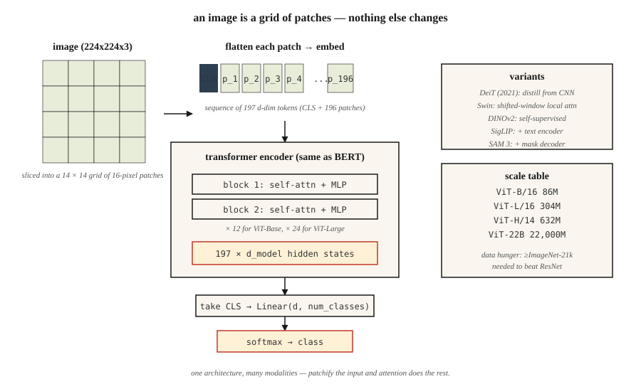

<!-- local-zh-machine-draft: English source is canonical; prose translated automatically, code/math preserved. -->

<a id="vision-transformers-vit"></a>

# Vision Transformers (ViT)

> 图像是 patches 的网格。一个句子就是一个tokens的网格。同一个 transformer 两者都吃。

**类型：** 构建
**语言：** Python
**先决条件：** 第 7 期·05（完整 Transformer）、第 4·03 期（CNNs）、第 4·14 期（Vision Transformers 简介）
**时间：** ~45分钟

<a id="the-problem"></a>

## 问题

2020 年之前，计算机视觉意味着卷积。 ImageNet、COCO 和检测基准上的每个 SOTA 都使用 CNN 主干网。 Transformers 代表语言。

多索维茨基等人。 (2020) — “一张图像值得 16x16 个单词” — 表明您可以完全放弃卷积。将图像切片为固定大小的 patches，将每个 patch 线性投影到 embedding，将序列馈送到普通 transformer encoder。在足够的规模下（ImageNet-21k pretraining 或更大），ViT 匹配或击败基于 ResNet 的模型。

ViT 是 2026 年更广泛模式的开始：一个架构，多个 modalities。 Whisper 对音频进行标记。 ViT 对图像进行标记。针对机器人技术的行动 tokens。用于视频的像素 tokens。 transformer 并不关心——给它一个序列，它就会学习。

到 2026 年，ViT 及其后代（DeiT、Swin、DINOv2、ViT-22B、SAM 3）拥有大部分视觉。 CNNs 在边缘设备和延迟敏感任务方面仍然获胜。其他所有东西在堆栈中的某个地方都有一个 ViT 。

<a id="the-concept"></a>

## 概念



<a id="step-1--patchify"></a>

### 第 1 步——修补

将 `H × W × C` 图像拆分为平面 patches 的 `N × (P·P·C)` 序列。典型设置：`224 × 224` 图像、`16 × 16` patches → 196 个 patches，每个有 768 个值。

```
image (224, 224, 3) → 14 × 14 grid of 16x16x3 patches → 196 vectors of length 768
```

Patch 尺寸是杠杆。更小的 patches = 更大的 tokens，更好的分辨率，二次 attention 成本。更大的 patches = 更粗糙，更便宜。

<a id="step-2--linear-embedding"></a>

### 步骤 2 — 线性 embedding

单个学习矩阵将每个平面 patch 投影到 `d_model`。相当于内核大小 `P` 和步长 `P` 的卷积。在 PyTorch 中，这实际上是 `nn.Conv2d(C, d_model, kernel_size=P, stride=P)` — 2 行实现。

<a id="step-3--prepend-cls-token-add-positional-embeddings"></a>

### 步骤 3 — 前置 `[CLS]` token，添加位置 embeddings

- 预先添加可学习的 `[CLS]` token。它的最终隐藏状态是用于分类的图像表示。
- 添加可学习的位置 embeddings（ViT-原始）或正弦 2D（后续变体）。
- 2024+ RoPE 扩展到 2D 位置，有时没有明确的 embeddings。

<a id="step-4--standard-transformer-encoder"></a>

### 步骤 4 — 标准 transformer encoder

`LayerNorm → Self-Attention → + → LayerNorm → MLP → +` 的堆栈 L 块。与BERT相同。没有特定于视觉的层。这是本文的教学要点。

<a id="step-5--head"></a>

### 第五步——头部

分类：取`[CLS]`隐藏状态→线性→softmax。对于DINOv2或SAM，丢弃`[CLS]`，直接使用patch embeddings。

<a id="variants-that-mattered"></a>

### 重要的变体

| 模型 | 年份 | 改变 |
|-------|------|--------|
| ViT | 2020 | 原来的。 固定的patch尺寸，全全球attention。 |
| 德伊特 | 2021 | 蒸馏；仅可在 ImageNet-1k 上训练。 |
| 斯文 | 2021 | 带有移动窗口的分层结构。固定次方成本。 |
| 恐龙v2 | 2023 | 自我监督（无标签）。最佳普通视力 features。 |
| ViT-22B | 2023 | 22B参数；缩放法则适用。 |
| 西格利普 | 2023 | ViT + 语言对，sigmoid 对比损失。 |
| 萨姆3 | 2025 | 分割任何东西； ViT-大+提示面罩decoder。 |

<a id="why-it-took-a-while"></a>

### 为什么花了一段时间

ViT 需要 * 大量 * 数据来匹配 CNNs，因为它没有 CNN inductive biases （平移不变性、局部性）。如果没有超过 1 亿的标记图像或强大的自监督 pretraining，CNNs 仍然在匹配计算方面获胜。 DeiT 在 2021 年通过蒸馏技巧解决了这个问题； DINOv2 通过自我监督于 2023 年永久修复了该问题。

```figure
n5-patch-stream
```

<a id="build-it"></a>

## 动手实现

参见 `code/main.py`。纯stdlib patchify +线性embedding +健全性检查。无需训练 - 任何实际规模的 ViT 都需要 PyTorch 和 GPU 数小时的时间。

<a id="step-1-fake-image"></a>

### 第一步：假图像

24 × 24 RGB 图像，作为 `(R, G, B)` 元组的行列表。我们每个使用 6×6 patches → 16 patches，108-d embedding 向量。

<a id="step-2-patchify"></a>

### 第二步：打补丁

```python
def patchify(image, P):
    H = len(image)
    W = len(image[0])
    patches = []
    for i in range(0, H, P):
        for j in range(0, W, P):
            patch = []
            for di in range(P):
                for dj in range(P):
                    patch.extend(image[i + di][j + dj])
            patches.append(patch)
    return patches
```

栅格顺序：整个网格的行优先。每个 ViT 都使用此排序。

<a id="step-3-linear-embed"></a>

### 步骤3：线性嵌入

将每个平面 patch 乘以随机 `(patch_flat_size, d_model)` 矩阵。在添加 `[CLS]` 后验证输出形状是否为 `(N_patches + 1, d_model)`。

<a id="step-4-count-parameters-for-a-realistic-vit"></a>

### 步骤4：计算parameters为真实的ViT

打印 ViT-Base 的参数计数：12 层，12 个头，d=768，patch=16。与 ResNet-50 (~25M) 相比。 ViT-Base降落在~86M。 ViT-大~307M。 ViT-巨大~632M。

<a id="use-it"></a>

## 实际应用

```python
from transformers import ViTImageProcessor, ViTModel
import torch
from PIL import Image

processor = ViTImageProcessor.from_pretrained("google/vit-base-patch16-224-in21k")
model = ViTModel.from_pretrained("google/vit-base-patch16-224-in21k")

img = Image.open("cat.jpg")
inputs = processor(img, return_tensors="pt")
out = model(**inputs).last_hidden_state   # (1, 197, 768): [CLS] + 196 patches
cls_emb = out[:, 0]                       # image representation
```

**DINOv2 embeddings 是图像 features.** 的 2026 默认值 冻结骨干，训练小头。适用于分类、检索、检测、字幕。 Meta 的 DINOv2 checkpoints 在每项非文本视觉任务上都优于 CLIP。

**Patch尺寸挑选。** 小型号使用16×16（ViT-B/16）。密集预测（分割）使用8×8或14×14（SAM、DINOv2）。非常大的模型使用 14×14。

<a id="ship-it"></a>

## 交付成果

参见 `outputs/skill-vit-configurator.md`。该技能为给定数据集大小、分辨率和计算预算的新视觉任务选择 ViT 变体和 patch 大小。

<a id="exercises"></a>

## 练习

1. **Easy.** 运行`code/main.py`。验证 patches 的编号等于 `(H/P) * (W/P)`，并且平面 patch 尺寸等于 `P*P*C`。
2. **Medium.** 实现 2D 正弦位置 embeddings — 每个 patch 的 `row` 和 `col` 的两个独立正弦代码，连接起来。将它们输入微型 PyTorch ViT 中，并在 CIFAR-10 上比较精度与可学习位置 embeddings。
3. **Hard.** 构建 3 层 ViT (PyTorch)，使用 4×4 patches 在 1,000 张 MNIST 图像上进行训练。测量测试精度。现在在相同的 1,000 张图像上添加 DINOv2 pretraining（简化：只需训练 encoder 即可从屏蔽的 patches 预测 patch embeddings）。准确度有提高吗？

<a id="key-terms"></a>

## 关键术语

| 术语 | 人们怎么说 | 它实际上意味着什么 |
|------|-----------------|-----------------------|
| Patch | 《愿景-transformer token》 | 图像 `P × P × C` 区域的像素值的平面向量。 |
| 修补 | “切+压扁” | 将图像切片为不重叠的 patches，将每个图像展平为向量。 |
| `[CLS]` token | 「图像概要」 | 前置可学习 token；其最终的embedding是图像表示。 |
| Inductive bias | “模型假设什么” | ViT 的先验数比 CNNs 少；需要更多的数据来弥补差距。 |
| 恐龙v2 | “自我监督ViT” | 使用图像增强+动量教师进行无标签训练。 2026 年最佳通用图像 features。 |
| 西格利普 | “CLIP的继任者” | ViT + 文本 encoder 使用 sigmoid 对比损失进行训练；在匹配计算上优于 CLIP。 |
| 斯文 | “窗口化 ViT” | 分层 ViT 与本地 attention + 移位窗口；次二次方。 |
| 注册 tokens | 《2023绝招》 | 一些额外可学习的 tokens 吸收了 attention 水槽；改进了 DINOv2 features。 |

<a id="further-reading"></a>

## 进一步阅读

- [Dosovitskiy 等人。 （2020）。一张图像值得 16x16 个单词：Transformers 用于大规模图像识别](https://arxiv.org/abs/2010.11929) — ViT 论文。
- [Touvron 等人。 （2021）。训练数据高效图像 transformers 并通过 attention](https://arxiv.org/abs/2012.12877) 进行蒸馏 — DeiT。
- [Liu 等人。 （2021）。 Swin Transformer：使用移位 Windows 的分层 Vision Transformer](https://arxiv.org/abs/2103.14030) — Swin。
- [Oquab 等人。 （2023）。 DINOv2：在没有监督的情况下学习鲁棒视觉 Features](https://arxiv.org/abs/2304.07193) — DINOv2。
- [Darcet 等人。 （2023）。 Vision Transformers 需要寄存器](https://arxiv.org/abs/2309.16588) — DINOv2 的寄存器 token 修复。
