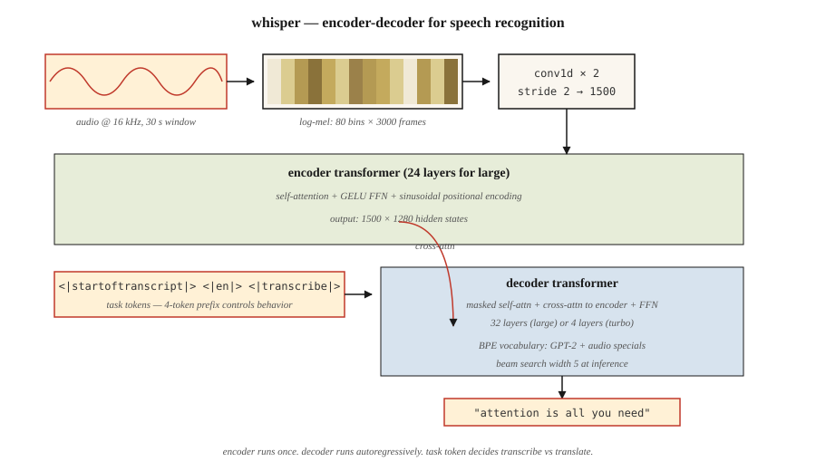

<!-- local-zh-machine-draft: English source is canonical; prose translated automatically, code/math preserved. -->

<a id="audio-transformers--whisper-architecture"></a>

# 音频 Transformers — Whisper 架构

> 音频是频率随时间变化的图像。 Whisper 是一个 ViT，它会吃梅尔频谱图并说话。

**类型：** 了解
**语言：** Python
**先决条件：** 第 7·05 阶段（完整 Transformer），第 7·08 阶段（Encoder-Decoder），第 7·09 阶段(ViT)
**时间：** ~45分钟

<a id="the-problem"></a>

## 问题

在 Whisper（OpenAI，Radford 等人，2022）之前，最先进的 automatic speech recognition (ASR) 意味着 wav2vec 2.0 和 HuBERT — 自监督 feature 提取器加上微调头。高质量、昂贵的数据管道，域脆弱。多语言语音识别需要每个语系单独的模型。

Whisper下了三个赌注：

1. **培训一切。** 从互联网上抓取的 97 种语言的 680,000 小时的弱标签音频。没有干净的学术语料库。没有音素标签。
2. **多任务单一模型。** 一个decoder通过任务tokens在转录、翻译、语音活动检测、语言ID和时间戳方面进行联合训练。
3. **标准 encoder-decoder transformer.** Encoder 使用 log-mel 频谱图。 Decoder 自回归生成文本 tokens。没有声码器、没有 CTC、没有 HMM。

结果：Whisper large-v3 在口音、噪音和零干净标记数据的语言中具有鲁棒性。到 2026 年，它将成为每个开源语音助手和大多数商业语音助手的默认语音前端。

<a id="the-concept"></a>

## 概念



<a id="step-1--resample--window"></a>

### 步骤 1 — 重新采样 + 窗口

音频频率为 16 kHz。剪辑/垫至 30 秒。计算对数梅尔谱图：80 个梅尔箱，10 毫秒步长 → ~3,000 帧 × 80 features。这就是 Whisper 看到的“输入图像”。

<a id="step-2--convolutional-stem"></a>

### 步骤 2 — 卷积茎

两个具有内核 3 和步长 2 的 Conv1D 层将 3,000 帧减少到 1,500 帧。将序列长度减半，而不添加大量 parameters。

<a id="step-3--encoder"></a>

### 步骤 3 — encoder

24 层（大型）transformer encoder 超过 1,500 个时间步长。正弦位置编码，self-attention，GELU FFN。产生 1,500 × 1,280 个隐藏状态。

<a id="step-4--decoder"></a>

### 步骤 4 — decoder

24层transformer decoder。 它自回归产生tokens从一个BPE vocabulary这是一个超集GPT-2 带有一些特定于音频的特殊内容tokens。

<a id="step-5--task-tokens"></a>

### 步骤 5 — 任务 tokens

decoder prompt 从控制 tokens 开始，告诉模型要做什么：

```
<|startoftranscript|>  <|en|>  <|transcribe|>  <|0.00|>
```

或

```
<|startoftranscript|>  <|fr|>  <|translate|>   <|0.00|>
```

该模型是根据该约定进行训练的。您可以通过前缀控制任务。 2026 相当于指令调整，但应用于语音。

<a id="step-6--output"></a>

### 第 6 步 — 输出

具有对数概率阈值的波束搜索（宽度为 5）。当 `<|notimestamps|>` token 不存在时，每 0.02 秒音频预测一次时间戳。

<a id="whisper-sizes"></a>

### Whisper尺寸

| 模型 | 参数 | 层数 | d_model | 头 | 显存 (fp16) |
|-------|--------|--------|---------|-------|-------------|
| 微小的 | 39M | 4 | 384 | 6 | 〜1 GB |
| 基地 | 74M | 6 | 512 | 8 | 〜1 GB |
| 小号 | 244M | 12 | 768 | 12 | 〜2GB |
| 中等 | 769M | 24 | 1024 | 16 | 〜5GB |
| 大号 | 1550M | 32 | 1280 | 20 | 〜10GB |
| 大v3 | 1550M | 32 | 1280 | 20 | 〜10GB |
| 大型 v3 涡轮增压 | 809M | 32 | 1280 | 20 | ~6 GB（4 层 decoder） |

Large-v3-turbo (2024) 将 decoder 从 32 层削减到 4. 8 倍，解码速度加快，WER 点回归小于 1。这种解码速度解锁就是为什么 Whisper-turbo 成为 2026 年实时语音 agents 的默认设置。

<a id="what-whisper-does-not-do"></a>

### Whisper 不做什么

- 没有分类（谁在说话）。与 pyannote 配对。
- 本身没有实时 streaming — 30 秒的窗口是固定的。现代包装纸（`faster-whisper`、`WhisperX`）通过 VAD + 重叠固定在 streaming 上。
- 如果没有外部 chunking，则没有超过 30 秒的长格式上下文。在实践中效果很好，因为人类语音很少需要远程上下文来进行转录。

<a id="2026-landscape"></a>

### 2026风景

| 任务 | 模型 | 注释 |
|------|-------|-------|
| 英语自动语音识别 | Whisper涡轮增压、月光 | Moonshine 边缘速度快 4 倍 |
| 多语言 ASR | Whisper大v3 | 97 种语言 |
| Streaming ASR | 更快的耳语+VAD | 可实现 150 毫秒延迟目标 |
| 语音合成 | 派珀、XTTS-v2、Kokoro | Encoder-decoder 图案，但Whisper形状 |
| 音频+语言 | AudioLM、SeamlessM4T | 文本 tokens + audio tokens 合二为一 transformer |

```figure
n5-mel-decode
```

<a id="build-it"></a>

## 动手实现

参见 `code/main.py`。我们不训练 Whisper — 我们构建 log-mel 频谱图管道 + 任务 token prompt 格式化程序。这些是您在生产中实际接触到的部分。

<a id="step-1-synthesize-audio"></a>

### 第 1 步：合成音频

生成 440 Hz 的 1 秒正弦波，采样频率为 16 kHz。 16,000 个样本。

<a id="step-2-log-mel-spectrogram-simplified"></a>

### 第 2 步：对数梅尔谱图（简化）

全梅尔频谱图需要 FFT。我们做了一个简化的框架+每帧能量版本，无需 `librosa` 即可显示管道：

```python
def frame_signal(x, frame_size=400, hop=160):
    frames = []
    for start in range(0, len(x) - frame_size + 1, hop):
        frames.append(x[start:start + frame_size])
    return frames
```

帧 = 25 毫秒，跳数 = 10 毫秒。与 Whisper 的窗口相匹配。每帧能量代表教学法中的梅尔箱。

<a id="step-3-pad-to-30-s"></a>

### 第 3 步：垫至 30 秒

Whisper 始终处理 30 秒的块。将频谱图填充（或剪辑）到 3,000 帧。

<a id="step-4-build-the-prompt-tokens"></a>

### 步骤4：构建prompt tokens

```python
def whisper_prompt(lang="en", task="transcribe", timestamps=True):
    tokens = ["<|startoftranscript|>", f"<|{lang}|>", f"<|{task}|>"]
    if not timestamps:
        tokens.append("<|notimestamps|>")
    return tokens
```

这就是整个任务控制界面。 4-token 前缀。

<a id="use-it"></a>

## 实际应用

```python
import whisper
model = whisper.load_model("large-v3-turbo")
result = model.transcribe("meeting.wav", language="en", task="transcribe")
print(result["text"])
print(result["segments"][0]["start"], result["segments"][0]["end"])
```

更快，OpenAI 兼容：

```python
from faster_whisper import WhisperModel
model = WhisperModel("large-v3-turbo", compute_type="int8_float16")
segments, info = model.transcribe("meeting.wav", vad_filter=True)
for s in segments:
    print(f"{s.start:.2f} - {s.end:.2f}: {s.text}")
```

** 2026年什么时候选择Whisper：**

- 一种模型的多语言 ASR。
- 嘈杂、多样化的音频的稳健转录。
- 研究/原型 ASR — 最快的起点。

**何时选择其他东西：**

- 超低延迟 streaming 处于优势 — Moonshine 以匹配的质量击败 Whisper。
- 实时对话 AI 需要 <200 毫秒 - 专用 streaming ASR。
- 说话者二值化——Whisper 不这样做；螺栓上 pyannote。

<a id="ship-it"></a>

## 交付成果

参见 `outputs/skill-asr-configurator.md`。该技能选择 ASR 模型，解码 parameters，并为新的语音应用程序进行预处理管道。

<a id="exercises"></a>

## 练习

1. **Easy.** 运行`code/main.py`。确认 16 kHz、10 ms 跳频的 1 秒信号的帧计数约为 100 帧。 30 秒：约 3,000 帧。
2. **Medium.** 使用 `numpy.fft` 构建完整的对数梅尔谱图。验证 80 个梅尔箱与 `librosa.feature.melspectrogram(n_mels=80)` 在数值误差范围内匹配。
3. **Hard.** 实现 streaming inference：将音频分块到 10 秒的窗口中，并有 2 秒的重叠，在每个块上运行 Whisper，合并转录本。测量 5 分钟播客样本中的单词错误率与单次传递的情况。

<a id="key-terms"></a>

## 关键术语

| 术语 | 人们怎么说 | 它实际上意味着什么 |
|------|-----------------|-----------------------|
| 梅尔谱图 | “音频图像” | 2D 表示：一个轴上的频率仓，另一轴上的时间帧；每个细胞的对数能量。 |
| 对数梅尔 | 《Whisper看到了什么》 | 梅尔谱图通过日志；近似人类对响度的感知。 |
| 框架 | “一次切片” | 25 ms 的样本窗口；以 10 毫秒的步幅重叠。 |
| 任务 token | “Prompt 语音前缀” | 特别的tokens，如decoder prompt中的`<\|transcribe\|>` / `<\|translate\|>`。 |
| 语音活动检测 (VAD) | “找到演讲” | 在 ASR 之前消除静音的门；大幅削减成本。 |
| CTC | 《联结主义时间分类》 | alignment 无训练的经典 ASR 损失； Whisper 不使用它。 |
| Whisper涡轮增压 | “小decoder，全encoder” | 大-v3 encoder + 4 层 decoder；解码速度提高 8 倍。 |
| 更快的耳语 | “生产包装” | CTranslate2 重新实现； int8 quantization;比 OpenAI 的参考快 4 倍。 |

<a id="further-reading"></a>

## 进一步阅读

- [Radford 等人。 （2022）。通过大规模弱监督的鲁棒语音识别](https://arxiv.org/abs/2212.04356) — Whisper paper。
- [OpenAI Whisper repo](https://github.com/openai/whisper) — 参考代码 + 型号 weights。阅读 `whisper/model.py` 以查看 Conv1D 词干 + encoder + decoder 从上到下大约 400 行。
- [OpenAI Whisper — `whisper/decoding.py`](https://github.com/openai/whisper/blob/main/whisper/decoding.py) — 步骤 5-6 中描述的波束搜索 + 任务 token 逻辑在这里； 500行，完全可读。
- [Baevski 等人。 （2020）。 wav2vec 2.0：语音表示自监督学习框架](https://arxiv.org/abs/2006.11477) — 前体；在某些设置中仍然是 SOTA features。
- [SYSTRAN/faster-whisper](https://github.com/SYSTRAN/faster-whisper) — 生产包装器，比参考快 4 倍。
- [Jia 等人。 （2024）。 Moonshine：实时转录和语音命令的语音识别](https://arxiv.org/abs/2410.15608) - 2024 年边缘友好型 ASR，Whisper形状但更小。
- [HuggingFace 博客 — “使用 🤗 Transformers 微调多语言 ASR 的 Whisper”](https://huggingface.co/blog/fine-tune-whisper) — 规范的 fine-tuning 配方，包括梅尔频谱图预处理器和token-时间戳处理。
- [HuggingFace `modeling_whisper.py`](https://github.com/huggingface/transformers/blob/main/src/transformers/models/whisper/modeling_whisper.py) — 全面实施（encoder、decoder、cross-attention、 Generation）反映了课程的架构图。
