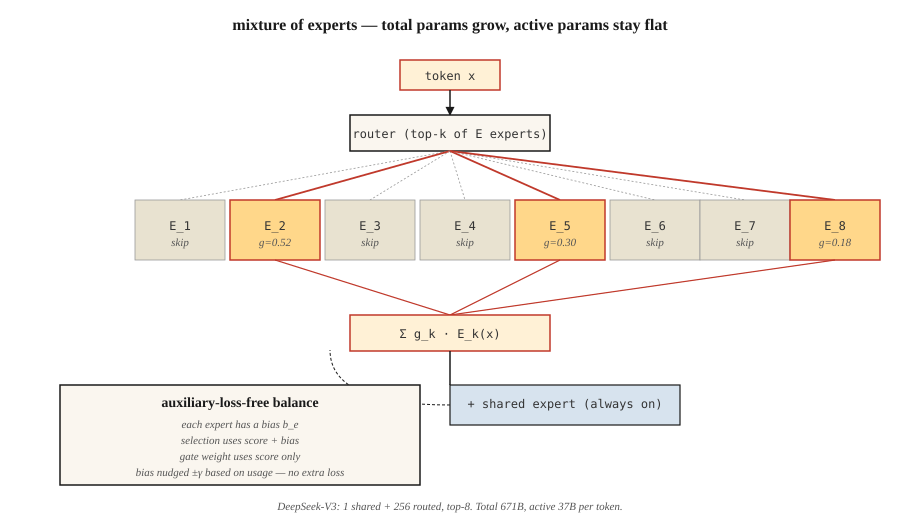

<!-- local-zh-machine-draft: English source is canonical; prose translated automatically, code/math preserved. -->

<a id="mixture-of-experts-moe"></a>

# 专家混合 (MoE)

> 密集的 70B transformer 会为每个 token 激活每个 parameter。 671B MoE 每个 token 仅激活 37B，并在每个基准测试中击败它。稀疏性是这十年来最重要的扩展思想。

**类型：** 构建
**语言：** Python
**先决条件：** 第 7 阶段·05（完整 Transformer）、第 7 阶段·07（GPT）
**时间：** ~45分钟

<a id="the-problem"></a>

## 问题

密集 transformer 在 inference 处的 FLOP 等于其 parameter 计数（forward pass 的 2 倍）。扩大密集模型，每个 token 都会支付全额费用。到 2024 年，前沿技术已经遇到计算瓶颈：为了变得更加智能，每个 token 需要指数级更多的 FLOP。

专家的混合打破了这种联系。将每个 FFN 替换为 `E` 独立专家 + 一个根据 token 选择 `k` 专家的路由器。总计 parameters = `E × FFN_size`。有效 parameters 每个 token = `k × FFN_size`。典型 2026 配置：`E=256`、`k=8`。存储通过 `E` 进行扩展，计算通过 `k` 进行扩展。

2026年前沿几乎全部是MoE：DeepSeek-V3（总共671B / 37B活跃），Mixtral 8×22B，Qwen2.5-MoE，Llama 4，Kimi K2， gpt-oss。在Artificial Analysis的独立排行榜上，排名前10的开源模型均为MoE。

<a id="the-concept"></a>

## 概念

 选择 k 个 E 专家

<a id="the-ffn-swap"></a>

### FFN 交换

密集transformer块：

```
h = x + attn(norm(x))
h = h + FFN(norm(h))
```

MoE区块：

```
h = x + attn(norm(x))
scores = router(norm(h))              # (N_tokens, E)
top_k = argmax_k(scores)              # pick k of E per token
h = h + sum_{e in top_k}(
        gate(scores[e]) * Expert_e(norm(h))
    )
```

每个专家都是一个独立的FFN（通常为SwiGLU）。路由器是单个线性层。每个 token 选择自己的 `k` 专家并获得其输出的门控混合。

<a id="the-load-balancing-problem"></a>

### 负载均衡问题

如果路由器将 tokens 的 90% 通过专家 3，则其他专家就会挨饿。已尝试三种修复方法：

1. **辅助负载均衡损耗**（交换机Transformer，Mixtral）。添加与专家使用差异成比例的惩罚。有效，但添加了 hyperparameter 和第二个 gradient 信号。
2. **专家能力+token下降**（早期交换机）。每个专家最多处理 `C × N/E` tokens；溢出 tokens 跳过该层。有损品质。
3. **辅助无损耗平衡**（DeepSeek-V3）。添加学习到的每个专家偏差，以改变路由器的 top-k 选择。偏差在训练损失之外更新。对主要目标没有惩罚。 2024 年的大解锁。

DeepSeek-V3的方法：在每个训练步骤之后，对于每个专家，检查其使用率是否高于或低于目标。通过 `±γ` 微调偏差。选择使用`scores + bias`。用于门控的专家概率是原始 `scores` 不变。将路由与表达式解耦。

<a id="shared-experts"></a>

### 共享专家

DeepSeek-V2/V3还将专家分为*shared*和*routed*。每个token都经过所有共享专家。路由专家是通过 top-k 挑选的。共享专家获取共同知识；路由专家专注。 V3 运行 1 名共享专家以及 256 名路由中的前 8 名。

<a id="fine-grained-experts"></a>

### 细粒度专家

经典MoE（GShard，Switch）：每个专家的宽度与完整的FFN一样。 `E` 较小（8–64），`k` 较小（1–2）。

现代细粒度MoE（DeepSeek-V3、Qwen-MoE）：每个专家更窄（1/8 FFN大小）。 `E` 较大（256+），`k` 较大（8+）。总数相同 parameters，但组合扩展速度更快。 `C(256, 8) = 400 trillion` 根据 token 可能的“专家”。质量提高，延迟保持平稳。

<a id="the-cost-profile"></a>

### 成本概况

根据 token，每层：

| 配置 | 有效参数 / token | 总参数 |
|--------|-----------------------|--------------|
| 混合8×22B | 〜39B | 141B |
| Llama 3 70B（密） | 70B | 70B |
| DeepSeek-V3 | 37B | 671B |
| 基米K2 (MoE) | ～32B | 1T |

DeepSeek-V3 在几乎每个基准测试中都击败了 Llama 3 70B（密集），同时 ** 每个 token** 的活动 FLOP 更少。更多 parameters = 更多知识。更活跃的 FLOP = 每个 token 的更多计算。 MoE 将它们解耦。

<a id="the-catch-memory"></a>

### 陷阱：记忆

所有专家都住在 GPU 上，无论哪一个火了。 671B 型号需要约 1.3 TB 的 VRAM 用于 fp16 weights。 Frontier MoE 部署需要 expert parallelism — 跨 GPUs 的分片专家，通过网络路由 tokens。延迟主要由所有到所有的通信决定，而不是矩阵相乘。

```figure
expert-routing
```

<a id="build-it"></a>

## 动手实现

参见 `code/main.py`。纯 stdlib 中的紧凑 MoE 层具有：

- `n_experts=8` SwiGLU-ish 专家（每个线性，用于说明）
- top-k=2路由
- softmax-归一化门控 weights
- 通过专家偏差实现辅助无损失平衡

<a id="step-1-the-router"></a>

### 第一步：路由器

```python
def route(hidden, W_router, top_k, bias):
    scores = [sum(h * w for h, w in zip(hidden, W_router[e])) for e in range(len(W_router))]
    biased = [s + b for s, b in zip(scores, bias)]
    top_idx = sorted(range(len(biased)), key=lambda i: -biased[i])[:top_k]
    # softmax over ORIGINAL scores of the chosen experts
    chosen = [scores[i] for i in top_idx]
    m = max(chosen)
    exps = [math.exp(c - m) for c in chosen]
    s = sum(exps)
    gates = [e / s for e in exps]
    return top_idx, gates
```

偏差影响选择，而不影响门 weight。这就是 DeepSeek-V3 技巧 - 偏差纠正负载不平衡而不控制模型的预测。

<a id="step-2-run-100-tokens-through-the-router"></a>

### 步骤2：通过路由器运行100 tokens

跟踪哪些专家解雇的频率。如果没有偏见，使用就会出现偏差。通过偏差更新循环（`-γ` 表示过度使用的专家，`+γ` 表示未充分使用），使用率在几次迭代后收敛到均匀分布。

<a id="step-3-param-count-comparison"></a>

### 步骤3：参数数量比较

打印 MoE 配置的“密集等效项”。 DeepSeek-V3形：256个路由+1个共享，8个活动，d_model=7168。 parameter 的总数令人眼花缭乱。活动计数是密集 Llama 3 70B 的七分之一。

<a id="use-it"></a>

## 实际应用

拥抱脸部加载：

```python
from transformers import AutoModelForCausalLM, AutoTokenizer
model = AutoModelForCausalLM.from_pretrained("mistralai/Mixtral-8x22B-v0.1")
```

2026年生产inference：vLLM原生支持MoE路由。 SGLang 拥有最快的专家并行路径。两者都自动处理 top-k 选择和 expert parallelism。

**何时选择 MoE:**
- 您想要较低的前沿质量inference每成本token。
- 您拥有 VRAM/专家并行基础设施。
- 您的工作负载是 token 重（聊天、代码）而不是上下文重（长文档）。

**何时不选择MoE:**
- 边缘部署——您为任何活动的 FLOP 支付全部存储费用。
- 对延迟至关重要的单用户服务 - 专家路由会增加开销。
- 小型模型 (<7B) — MoE 的质量优势仅出现在计算阈值以上（~6B 活动参数）。

<a id="ship-it"></a>

## 交付成果

参见 `outputs/skill-moe-configurator.md`。给定 parameter 预算、训练 tokens 和部署目标，该技能为新的 MoE 选择 E、k 和共享专家布局。

<a id="exercises"></a>

## 练习

1. **Easy.** 运行`code/main.py`。观看辅助无损偏差更新如何在 50 次迭代中平衡专家使用情况。
2. **Medium.** 将学习的路由器替换为基于哈希的路由器（确定性，无学习）。比较质量和平衡。为什么学习到的路由器更好？
3. **Hard.** 实现 GRPO 风格的“rollout 匹配路由”（DeepSeek-V3.2 技巧）：记录在 inference 期间触发的专家，强制gradient 计算期间的相同路由。衡量对玩具政策 gradient 设置的影响。

<a id="key-terms"></a>

## 关键术语

| 术语 | 人们怎么说 | 它实际上意味着什么 |
|------|-----------------|-----------------------|
| 专家 | “众多 FFN 中的一个” | 独立的前馈网络； parameters 专用于 FFN 计算的稀疏切片。 |
| 路由器 | 「大门」 | 一个微小的线性层，针对每个专家对每个 token 进行评分； top-k 选择。 |
| Top-k 路由 | “根据 token 有 k 位活跃专家” | 每个 token 的 FFN 计算都经过恰好 k 个专家，并按门进行加权。 |
| 辅助损耗 | “负载平衡惩罚” | 额外损失项，惩罚不正确的专家使用。 |
| 辅助无损耗 | 《DeepSeek-V3的绝招》 | 仅通过每个专家对路由器选择的偏见进行平衡；没有多余的gradient。 |
| 共享专家 | “永远在线” | 每个token都经过的额外专家；捕捉常识。 |
| Expert parallelism | “专家碎片” | 将不同的专家分配到不同的GPUs；通过网络路由 tokens。 |
| 稀疏性 | “活动参数 < 总参数” | 比值`k × expert_size / (E × expert_size)`； DeepSeek-V3 为 37/671 ≈ 5.5%。 |

<a id="further-reading"></a>

## 进一步阅读

- [Shazeer 等人。 （2017）。极其庞大的神经网络：稀疏门控专家混合层](https://arxiv.org/abs/1701.06538)——这个想法。
- [Fedus、Zoph、Shazeer (2022)。交换机 Transformer：可扩展到万亿级 Parameter 模型，具有简单高效的稀疏性](https://arxiv.org/abs/2101.03961) — 交换机，经典的 MoE。
- [Jiang 等人（2024）。专家混合](https://arxiv.org/abs/2401.04088) — 混合8×7B。
- [DeepSeek-AI（2024）。 DeepSeek-V3技术报告](https://arxiv.org/abs/2412.19437) — MLA+辅助无损MoE+MTP。
- [Wang 等人。 （2024）。专家混合的辅助无损负载平衡策略](https://arxiv.org/abs/2408.15664) — 基于偏差的平衡论文。
- [Dai 等人。 （2024）。 DeepSeekMoE：在专家混合语言模型中迈向终极专家专业化](https://arxiv.org/abs/2401.06066) - 本课路由器使用的细粒度+共享专家分割。
- [Kim 等人。 （2022）。 DeepSpeed-MoE：推进专家混合 Inference 和 Training](https://arxiv.org/abs/2201.05596) — 原始共享专家论文。
