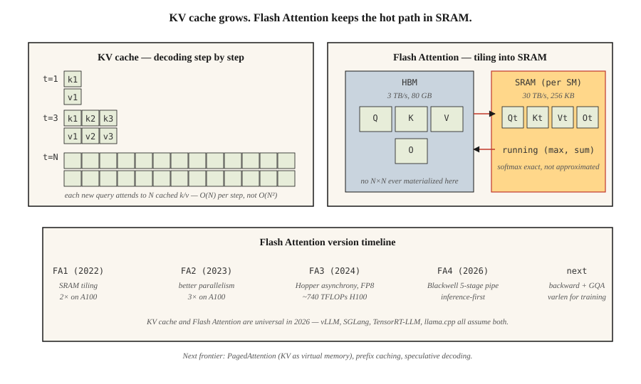

<!-- local-zh-machine-draft: English source is canonical; prose translated automatically, code/math preserved. -->

<a id="kv-cache-flash-attention--inference-optimization"></a>

# KV Cache、Flash Attention 与 Inference 优化

> 训练是并行的并且受限于 FLOP。 Inference 是串行且受内存限制的。不同的瓶颈，不同的技巧。

**类型：** 构建
**语言：** Python
**先决条件：** 第 7 期·02 (Self-Attention)、第 7·05 期 (完整 Transformer)、第 7·07 期 (GPT)
**时间：** ~75分钟

<a id="the-problem"></a>

## 问题

天真的 autoregressive decoder 会通过 `O(N²)` 生成 `N` tokens：在每一步中，它都会在完整前缀上重新计算 attention。对于 4K-token 响应，即 16M attention 操作，其中大部分是冗余的。前缀 token 的每个隐藏状态一旦计算出来就是确定性的 - 您只需针对之前所有内容的缓存键和值运行新的 token 查询。

最重要的是，attention 本身会移动大量数据。标准 attention 实现了 N×N 分数矩阵、N×d softmax 输出、N×d 最终输出 — 对 HBM 的读取和写入次数过多。对于 N≥2K，attention 在变为 FLOP 限制之前先变为内存限制。经典 attention 内核未充分利用现代 GPUs 4-10 倍。

Dao 等人的两项优化将前沿 inference 从“慢”推向“快”：

1. **KV cache.** 存储每个前缀token的K和V向量。每个新的 token 的 attention 都是针对缓存密钥的一个查询。每个生成步骤 Inference 从 `O(N²)` 减少到 `O(N)`。
2. **Flash Attention.** 平铺 attention 计算，以便完整的 N×N 矩阵永远不会命中 HBM。所有 softmax + matmul 都发生在 SRAM 中。 A100 上的挂钟加速为 2–4 倍；使用 FP8 的 H100 为 5–10×。

到 2026 年，两者都将普及。每个生产 inference 堆栈（vLLM、TensorRT-LLM、SGLang、llama.cpp）都采用它们。每个 Frontier 型号均已启用 Flash Attention。

<a id="the-concept"></a>

## 概念



<a id="kv-cache-math"></a>

### KV cache 数学

每 decoder 层，每 token，每头：

```
bytes_per_token_per_layer = 2 * d_head * dtype_size
                          ^
                          K and V
```

对于32层、32个头的7B模型，d_head=128，fp16：

```
per token per layer = 2 * 128 * 2 = 512 bytes
per token (32 layers) = 16 KB
per 32K context = 512 MB
```

对于 Llama 3 70B（80 层，d_head=128，GQA 具有 8 KV 头）：

```
per token per layer = 2 * 8 * 128 * 2 = 4096 bytes (4 KB)
per 32K context = 10.4 GB
```

这 10 GB 就是为什么 128K 上下文中的 Llama 3 70B 需要大部分 40 GB A100 仅用于 batch size 1 中的 KV cache。

**GQA 是 KV 缓存 win。** 具有 64 个头的 MHA 将是 32 GB。 MLA 进一步压缩。

拖动尺寸并观察缓存大小的变化。将序列长度或批次增加，看看它通过单个 GPU 的速度有多快：

```figure
kv-cache-sizer
```

<a id="flash-attention--the-tiling-trick"></a>

### Flash Attention — 平铺技巧

标准attention：

```
S = Q @ K^T          (HBM read, N×N, HBM write)
P = softmax(S)       (HBM read, HBM write)
O = P @ V            (HBM read, HBM write)
```

三个 HBM 往返。在H100上，HBM带宽为3TB/s； SRAM 为 30 TB/s。与将所有内容都保留在芯片上相比，每次 HBM 行程都会减慢 10 倍。

闪存Attention：

```
for each block of Q (tile size ~128 × 128):
    load Q_tile into SRAM
    for each block of K, V:
        load K_tile, V_tile into SRAM
        compute S_tile = Q_tile @ K_tile^T     (SRAM)
        running softmax aggregation             (SRAM)
        accumulate into O_tile                  (SRAM)
    write O_tile to HBM
```

每块 HBM 行程一次。总内存占用量从 `O(N²)` 下降到 `O(N)`。 Backward pass 重新计算 forward pass 中的一些值，而不是存储它们 - 另一个内存胜利。

**数值技巧。** 运行 softmax 可以跨图块保持 `(max, sum)`，因此最终的 normalization 是准确的。不是近似值 — Flash Attention 计算与标准 attention 相同的位输出（模 fp16 非关联性）。

**版本演变：**

| 版本 | 年份 | 关键变化 | 参考硬件的加速 |
|---------|------|-----------|-------------------------------|
| Flash 1 | 2022 | 平铺 SRAM 内核 | A100 上 2 倍 |
| Flash 2 | 2023 | 更好的并行性、因果优先顺序 | A100 上 3 倍 |
| Flash 3 | 2024 | 料斗异步，FP8 | H100 上为 1.5–2×（~740 TFLOPs FP16） |
| Flash 4 | 2026 | Blackwell 5 级管道，软件 exp2 | Inference-first（仅最初转发） |

Flash 4 仅在启动时才进行前向传递。训练仍使用 Flash 3。对 Flash 4 的 GQA 和 varlen 支持正在等待中（2026 年中）。

<a id="speculative-decoding--the-other-latency-win"></a>

### Speculative decoding — 另一个延迟优势

廉价型号建议N tokens。大模型并行验证所有 N。如果验证接受k个tokens，则您支付了k代1个大型号forward pass。对于代码和散文，典型的 k=3–5。

2026 年默认值：
- **EAGLE 2 / Medusa.** 共享验证器隐藏状态的集成绘图头。 2-3 倍加速且无质量损失。
- **Speculative decoding 与草稿模型。** 消费类硬件加速 2–4 倍。
- **Lookahead解码。**雅可比迭代；不需要草稿模型。小众但免费。

<a id="continuous-batching"></a>

### Continuous batching

经典批处理 inference：等待最慢的序列完成，然后开始新的批处理。当短响应提前完成时会浪费 GPU。

Continuous batching（首先在 Orca 中发布，现在在 vLLM、TensorRT-LLM、SGLang 中发布）：旧请求完成后立即将新请求交换到批次中。典型聊天工作负载的吞吐量提高 5-10 倍。

<a id="pagedattention--kv-cache-as-virtual-memory"></a>

### PagedAttention — KV cache 作为虚拟内存

vLLM的标题feature。 KV cache 分配在 16-token 块中；页表将逻辑位置映射到物理块。允许您跨并行样本（束搜索、并行 sampling）、prompt 缓存的热插拔前缀以及碎片整理内存共享 KV。与简单的连续分配相比，吞吐量提高了 4 倍。

```figure
flash-attention-memory
```

<a id="build-it"></a>

## 动手实现

参见 `code/main.py`。我们实施：

1. 一个简单的 `O(N²)` 增量 decoder。
2. `O(N)` KV 缓存的 decoder。
3. 模拟 Flash Attention 的 running-max 算法的平铺 softmax。

<a id="step-1-kv-cache"></a>

### 步骤一：KV cache

```python
class KVCache:
    def __init__(self, n_layers, n_heads, d_head):
        self.K = [[[] for _ in range(n_heads)] for _ in range(n_layers)]
        self.V = [[[] for _ in range(n_heads)] for _ in range(n_layers)]

    def append(self, layer, head, k, v):
        self.K[layer][head].append(k)
        self.V[layer][head].append(v)

    def read(self, layer, head):
        return self.K[layer][head], self.V[layer][head]
```

简单：在每层、每头列表中不断增长每 token K、V 向量。

<a id="step-2-tiled-softmax"></a>

### 步骤2：平铺softmax

```python
def tiled_softmax_dot(q, K, V, tile=4):
    """Flash-attention-style softmax(qK^T)V with running max/sum."""
    m = float("-inf")
    s = 0.0
    out = [0.0] * len(V[0])
    for start in range(0, len(K), tile):
        k_block = K[start:start + tile]
        v_block = V[start:start + tile]
        scores = [sum(qi * ki for qi, ki in zip(q, k)) for k in k_block]
        new_m = max(m, *scores)
        exp_old = math.exp(m - new_m) if m != float("-inf") else 0.0
        exp_new = [math.exp(sc - new_m) for sc in scores]
        s = s * exp_old + sum(exp_new)
        for j in range(len(out)):
            out[j] = out[j] * exp_old + sum(e * v[j] for e, v in zip(exp_new, v_block))
        m = new_m
    return [o / s for o in out]
```

一次性输出到 `softmax(qK) V` 的位相同，但任何时候工作集都是 `tile × d_head` 块，而不是完整的 `N × d_head`。

<a id="step-3-compare-naive-vs-cached-decoding-on-100-token-generation"></a>

### 第 3 步：比较 100-token 一代的原始解码与缓存解码

计数 attention 操作。天真的：`O(N²)` = 5050。缓存：`O(N)` = 100。代码打印两者。

<a id="use-it"></a>

## 实际应用

```python
# HuggingFace transformers auto-enables KV cache on decoder-only generate().
from transformers import AutoModelForCausalLM
model = AutoModelForCausalLM.from_pretrained(
    "meta-llama/Llama-3.2-3B",
    attn_implementation="flash_attention_2",  # use FA3 if Hopper
    torch_dtype="bfloat16",
)
# generate() uses KV cache automatically
```

vLLM 生产：

```bash
pip install vllm
vllm serve meta-llama/Llama-3.1-70B-Instruct \
    --tensor-parallel-size 4 \
    --max-model-len 32768 \
    --enable-prefix-caching \
    --kv-cache-dtype fp8
```

跨请求的 Prefix caching 是 2026 年的一大胜利——相同的 system prompt、few-shot 示例或长上下文文档在调用之间重用 KV。对于使用重复工具 prompts 的 agent 工作负载，prefix caching 通常会带来 5 倍的吞吐量增益。

<a id="ship-it"></a>

## 交付成果

参见 `outputs/skill-inference-optimizer.md`。该技能为新的 inference 部署选择 attention 实施、KV cache 策略、quantization 和 speculative decoding。

<a id="exercises"></a>

## 练习

1. **Easy.** 运行`code/main.py`。确认原始和缓存的 decoders 产生相同的输出；注意操作数差异。
2. **Medium.** 实现 prefix caching：给定一个 prompt P 和多个完成，在 P 上运行一个 forward pass 来填充 KV cache，然后branch 每次完成。测量每个参数的加速与重新编码 P 的比较。
3. **Hard.** 在具有空闲列表的固定 16-token 块中实现玩具 PagedAttention：KV cache。当一个序列完成时，将其块返回到池中。模拟 1,000 次不同长度的聊天完成。比较内存碎片与连续分配。

<a id="key-terms"></a>

## 关键术语

| 术语 | 人们怎么说 | 它实际上意味着什么 |
|------|-----------------|-----------------------|
| KV cache | “加快解码速度的技巧” | 存储每个前缀 token 的 K 和 V；新的查询会处理它们而不是重新计算。 |
| HBM | “GPU主存储器” | 高带宽内存； H100 为 80 GB，B200 为 192 GB。 ~3 TB/s 带宽。 |
| 静态随机存储器 | “片上存储器” | 每个 SM 快速内存，H100 上每个 SM 约为 256 KB。 ~30 TB/s 带宽。 |
| FlashAttention | “平铺 attention 内核” | 计算 attention，而不在 HBM 中具体化 N×N。 |
| Continuous batching | “无需等待批处理” | 将完成的序列换出，换入新序列，无需耗尽批次。 |
| 分页注意力 | “vLLM的头条” | KV cache 分配在带有页表的固定块中；消除碎片。 |
| Prefix caching | “重复使用长prompts” | 缓存 KV 以实现跨请求共享前缀； agents 的重大成本削减。 |
| Speculative decoding | “起草+审核” | 廉价草案模型建议tokens；大模型一次性验证 k。 |

<a id="further-reading"></a>

## 进一步阅读

- [Dao 等人。 （2022）。 FlashAttention：具有 IO 感知功能的快速且内存高效的精确 Attention](https://arxiv.org/abs/2205.14135) — Flash 1。
- [Dao (2023)。 FlashAttention-2：更快的 Attention，具有更好的并行性和工作分区](https://arxiv.org/abs/2307.08691) — Flash 2。
- [Shah 等人。 （2024）。 FlashAttention-3：快速准确的 Attention 具有异步和低精度](https://arxiv.org/abs/2407.08608) — Flash 3。
- [FlashAttention-4 发行说明（Dao-AILab，2026）](https://github.com/Dao-AILab/flash-attention) — Blackwell 5 级管道和 software-exp2 技巧；阅读存储库自述文件，了解本课提到的仅向前启动注意事项。
- [Kwon 等人。 （2023）。大型语言的高效内存管理 Model Serving 与 PagedAttention](https://arxiv.org/abs/2309.06180) — vLLM 论文。
- [Leviathan 等人。 （2023）。通过 Speculative Decoding](https://arxiv.org/abs/2211.17192) 从 Transformers 快速 Inference — 规范解码。
- [Li 等人。 （2024）。 EAGLE：推测性 Sampling 需要重新思考 Feature 不确定性](https://arxiv.org/abs/2401.15077) — EAGLE-1/2 论文，用于课程引用的综合草案方法。
- [Cai 等人。 （2024）。 Medusa：简单 LLM Inference 具有多个解码头的加速框架](https://arxiv.org/abs/2401.10774) — 与 EAGLE 一起引用的 Medusa 方法。
- [vLLM 文档 — PagedAttention](https://docs.vllm.ai/en/latest/design/kernel/paged_attention.html) — 16-token 块和页表设计的规范深入研究。
