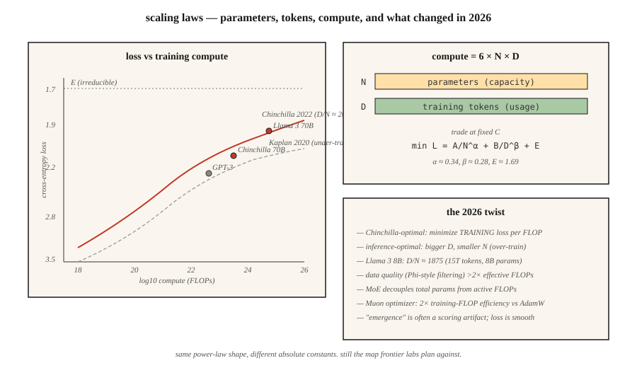

<!-- local-zh-machine-draft: English source is canonical; prose translated automatically, code/math preserved. -->

<a id="scaling-laws"></a>

# Scaling Laws（规模定律）

> 2020年的Kaplan论文说：更大的模型，更低的损失。 2022 年的霍夫曼论文说：你训练不足。计算分为两个部分：parameters 和 tokens，而且划分并不明显。

**类型：** 了解
**语言：** Python
**先决条件：** 第 7 阶段·05（完整 Transformer）、第 7 阶段·07（GPT）
**时间：** ~45分钟

<a id="the-problem"></a>

## 问题

当您进行 C 次 FLOOP 训练计算并想要获得最佳模型时，您将面临两个难题：

1. ** parameters (N)有多少个？** 型号越大，容量越大。
2. ** 训练多少 tokens (D)？** 更多数据，更好利用容量。

FLOP 规模大约为 `6 × N × D`。您可以向上推 N，向下推 D，或者向上推 D，向下推 N。哪个更好？

2022年之前，答案是“用力推N”。 GPT-3 (2020) 是在 ~300B tokens 上训练的 175B parameters。每 parameter 的比率约为 1.7 tokens。卡普兰缩放定律支持了这一点。

霍夫曼等人。 （2022），训练一个名为 Chinchilla 的小模型系列时，发现了一些不同的东西：每个 parameter** 的最佳比率更接近 **20 tokens。 GPT-3 训练不足 10 倍。 Chinchilla（70B 参数，1.4T tokens）在每个基准测试中都击败了 GPT-3（175B，300B tokens），inference 成本降低了 2.5 倍。

2026 年是龙猫的世界——有一个重要的转折。 Llama 3 8B 在 15 万亿个 tokens 上进行训练，每个 parameter 的比率为 1,875 个 tokens。超过龙猫最佳状态九十四倍。 Inference 成本比大规模使用的模型的训练成本更重要，因此对于较小的可部署足迹的过度训练（过去的 Chinchilla）是 2026 年的默认情况。

<a id="the-concept"></a>

## 概念



<a id="the-hoffmann-law"></a>

### 霍夫曼定律

根据 Chinchilla 论文，损失如下：

```
L(N, D) = A / N^α + B / D^β + E
```

- `N` = parameters（非embedding）。
- `D` = 训练 tokens。
- `α ≈ 0.34`，`β ≈ 0.28`（大致对称）。
- `E ≈ 1.69`，不可约损失上限。
- `A ≈ 406`, `B ≈ 411`.

当您扩展时，两个术语会相互交换。取导数 w.r.t. `N` 在固定计算 (C = 6ND) 下并求解：

```
N_opt ≈ 0.6 × (C/6)^0.5
D_opt ≈ 0.6 × (C/6)^0.5
D_opt / N_opt ≈ 20
```

计算最优：每个 parameter 20 个 tokens。

<a id="why-over-training-anyway"></a>

### 为什么要过度训练

Chinchilla-optimal 可最大程度地减少每次训练 FLOP 的训练损失。但您支付一次训练费用； inference 永远花费。

对于每月服务万亿 tokens 的聊天机器人来说，inference 在总成本中占主导地位。 Llama的方法：火车更小、更长。 15T 时的 8B tokens 进行了深度 inference 优化：

- 适用于消费者 GPUs。
- 延迟仅为 70B Chinchilla 最佳延迟的一小部分。
- 质量足以完成大多数任务。

DeepMind 2024 年的论文（“过度训练是新的最优”）正式阐述了这一点。对于 inference 为主的工作负载，正确的比率接近于每个 parameter 100–500 tokens，具体取决于服务量。

<a id="emergence-vs-smoothness"></a>

### 涌现与平滑

声称：某些能力（算术、多步推理、chain-of-thought 以下）在一定程度上突然“出现”。

谢弗等人。 (2023) 认为这是一个测量工件：紧急指标使用不连续评分（exact match，阈值准确度），隐藏了底层 logits 的平滑改进。连续指标 (cross-entropy) 显示平滑的曲线。

2026 年的共识是：通过连续损失进行的预测是可靠的。基准跳跃通常是得分者的产物。根据连续指标规划预算。

<a id="the-2026-picture"></a>

### 2026年的图景

缩放法则仍然有效，但是：

| 因素 | 改变方式 |
|--------|-------------|
| 数据质量 | 策划“好”tokens（Phi 风格）将曲线移动 >2× 有效计算 |
| MoE | 总参数与活动 FLOP 解耦；每活动 FLOP 的缩放定律 |
| 培训后 | 某些功能（instruction following，代码）随 SFT+RLHF 的变化多于 pretraining |
| 多模态 | 图片+文字tokens一起缩放；每个 modality 的单独曲线 |
| 综合数据 | 模型生成训练数据；有效的计算可以复合 |

Muon optimizer（Kimi Moonlight，2024）在匹配数据上显示出比 AdamW 约 2 倍的有效计算增益。一些 2026 训练运行默认使用 Muon。改变比例定律中的绝对常数，而不是其形状。

```figure
scaling-laws
```

<a id="build-it"></a>

## 动手实现

参见 `code/main.py`。我们实现了 Chinchilla 损失方程，并在多个计算预算中的每一个上求解计算最优 `(N, D)`。

<a id="step-1-chinchilla-loss"></a>

### 第一步：龙猫损失

```python
def chinchilla_loss(N, D, A=406.4, B=410.7, alpha=0.34, beta=0.28, E=1.69):
    return A / N ** alpha + B / D ** beta + E
```

将 `L` 绘制为固定 `C = 6ND` 处 `(N, D)` 上的轮廓。求最小值。

<a id="step-2-compute-optimal-frontier"></a>

### 步骤 2：计算最优前沿

对于从 `1e17` 到 `1e25` FLOP 的计算预算，找到 `(N, D)`，它可以最大限度地减少 `6ND = C` 的损失。验证比率 `D/N ≈ 20`。

<a id="step-3-over-training-cost"></a>

### 第三步：过度训练成本

计算训练 10 倍小模型所付出的额外损失（最佳 N 的 1/10，最佳 D 的 10 倍）。报告 inference FLOP 节省（与 N 成比例）作为交换。

<a id="step-4-compare-to-real-models"></a>

### 第四步：与真实模型进行比较

删除 GPT-3、Chinchilla、Llama 3 8B、DeepSeek-V3（活动参数）的已知 `(N, D)` 对，并比较预测与报告的损失。

<a id="use-it"></a>

## 实际应用

您不太可能自己训练前沿模型。但缩放定律告诉你：

1. ** 您的微调是否有足够的数据。** 如果您的任务特定数据低于基本模型每个参数 20 tokens，则预计 saturation 处于某个损失底限。
2. **是否选择更大的基础模型。** 如果您将所有预算都花在 inference 上，请选择更小、训练时间更长的模型。
3. ** 回报减少的地方。** 超过 1000× Chinchilla 最优，对数损失变化变成噪音。

**2026年研究轨迹：**

- **数据约束机制。** 网络上的高质量 tokens 数量有限（过滤后约 5-10 万亿英语）。 Frontier pretraining 正在接近这个天花板。合成数据、多语言、多模式和 RLHF 规模的 fine-tuning 是下一个杠杆。
- **计算乘数技巧。** Muon optimizer、MoE，更好的数据管理——每个都改变绝对常数，而不是渐近线。
- ** RL 的缩放定律。** 开放问题。早期证据表明 RL 样本存在幂律，但指数与 pretraining 非常不同。

<a id="ship-it"></a>

## 交付成果

参见 `outputs/skill-training-budget-estimator.md`。在给定计算预算、部署约束和目标损失的情况下，该技能选择 `(N, D, hours, GPU)` 进行新的训练运行。

<a id="exercises"></a>

## 练习

1. **Easy.** 运行`code/main.py`。打印计算预算 `1e20`、`1e22`、`1e24` 的 Chinchilla 最优 `(N, D)`。与真实模型表进行比较。
2. **Medium.** 实现霍夫曼损失计算函数曲线。绘制损失与 `log10(C)` 的计算最优前沿图。确定法律何时预测我们需要 `>10^28` FLOP 来实现 cross-entropy 的下一个 0.1 减少。
3. **Hard.** 在同一数据集上训练的 5 个微型模型（100K 到 10M 参数）上拟合您自己的缩放定律。估计`α`和`E`。您的指数与已发布指数的匹配程度如何？

<a id="key-terms"></a>

## 关键术语

| 术语 | 人们怎么说 | 它实际上意味着什么 |
|------|-----------------|-----------------------|
| Parameters (N) | 「型号尺寸」 | 非embedding weight计数；决定容量。 |
| Tokens (D) | 「训练数据」 | 训练次数tokens；决定 parameters 的使用情况。 |
| 计算（C） | “花费的失败次数” | 标准 transformer 约为 `6 × N × D`。 |
| 龙猫-最佳 | "D/N ≈ 20" | pretraining 的每 FLOP 损失最小化的比率。 |
| 过度训练 | 《过去的龙猫》 | 花费额外的训练 FLOP 来节省 inference FLOP；日/夜 >> 20。 |
| 不可减少的损失 | “地板” | 缩放定律中的 `E` 项；数据本身的熵。 |
| 应急能力 | “规模突然跳跃” | 常常是得分神器；连续损失是平滑的。 |
| 有效计算 | “培训效率倍增” | 更好的数据/optimizer/架构可以使 FLOP 的运行距离成倍增加。 |

<a id="further-reading"></a>

## 进一步阅读

- [Kaplan 等人。 （2020）。神经语言模型的缩放定律](https://arxiv.org/abs/2001.08361)——第一篇缩放定律论文；训练不足。
- [Hoffmann 等人。 （2022）。训练计算最优大型语言模型](https://arxiv.org/abs/2203.15556) — Chinchilla。
- [Schaeffer 等人。 （2023）。大型语言模型的涌现能力是海市蜃楼吗？](https://arxiv.org/abs/2304.15004)——作为测量工件的涌现。
- [Sardana，弗兰克尔（2024）。超越龙猫最优：在语言模型缩放法则中考虑 Inference](https://arxiv.org/abs/2401.00448) — 为什么 Llama 的过度训练适合其工作负载。
- [乔丹等人。 （2024）。 Muon：用于神经网络中隐藏层的 optimizer](https://kellerjordan.github.io/posts/muon/) — 2× 计算乘数。
