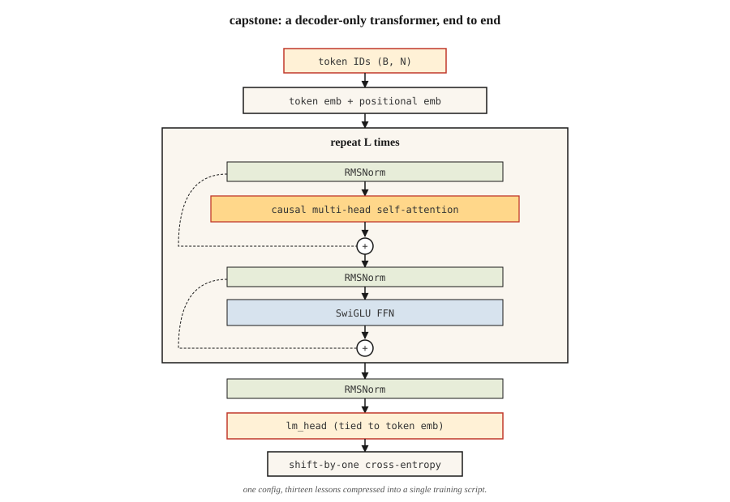

<!-- local-zh-machine-draft: English source is canonical; prose translated automatically, code/math preserved. -->

<a id="build-a-transformer-from-scratch--the-capstone"></a>

# 从零构建 Transformer——综合项目

> 十三课。一种型号。没有捷径。

**类型：** 构建
**语言：** Python
**先决条件：** 第 7 阶段 · 01 到 13。不要跳过。
**时间：** ~120 分钟

<a id="the-problem"></a>

## 问题

你已经阅读了每一篇论文。您已经实现了 attention、多头分割、位置编码、encoder 和 decoder 块、BERT 和 GPT 损失、MoE、 KV cache。现在让他们一起完成一项实际任务。

顶峰：在字符级语言建模任务上端到端训练一个小型 decoder transformer。上面写着莎士比亚。它产生了新的莎士比亚。它足够小，可以在 10 分钟内在笔记本电脑上进行训练。交换更大的数据集和更长的训练时间可以让你获得真正的 LM，这是足够正确的。

这就是课程的“nanoGPT”。它不是原创的 — Karpathy 的 2023 nanoGPT 教程是每个学生至少编写一次的参考实现。我们提升形状并围绕我们所覆盖的内容重新调整它。

<a id="the-concept"></a>

## 概念



该架构，注释：

```
input tokens (B, N)
   │
   ▼
token embedding + positional embedding  ◀── Lesson 04 (RoPE option)
   │
   ▼
┌──── block × L ────────────────────┐
│  RMSNorm                          │  ◀── Lesson 05
│  MultiHeadAttention (causal)      │  ◀── Lesson 03 + 07 (causal mask)
│  residual                         │
│  RMSNorm                          │
│  SwiGLU FFN                       │  ◀── Lesson 05
│  residual                         │
└────────────────────────────────── ┘
   │
   ▼
final RMSNorm
   │
   ▼
lm_head (tied to token embedding)
   │
   ▼
logits (B, N, V)
   │
   ▼
shift-by-one cross-entropy            ◀── Lesson 07
```

<a id="what-we-ship"></a>

### 我们运送什么

- `GPTConfig` — 配置所有 hyperparameters 的一处。
- `MultiHeadAttention` — 因果、批量、具有可选的 Flash 式路径（PyTorch 的 `scaled_dot_product_attention`）。
- `SwiGLUFFN` — 现代 FFN。
- `Block` — 预规范，残差包装 attention + FFN。
- `GPT` — embeddings，堆叠块，LM 头，generate()。
- 使用 AdamW、余弦 LR、gradient clipping 进行训练循环。
- 莎士比亚文本上的字符级 tokenizer。

<a id="what-we-dont-ship"></a>

### 我们不运送什么

- RoPE — 在第 04 课中概念性地实现。为了简单起见，这里我们使用学习的位置 embeddings。练习要求您交换 RoPE。
- 生成期间的 KV cache — 每个生成步骤都会在完整前缀上重新计算 attention。更慢但更简单。练习要求您添加 KV cache。
- Flash Attention — PyTorch 2.0+ 如果输入匹配则自动调度；我们使用`F.scaled_dot_product_attention`。
- MoE — 每个块单个 FFN。您在第 11 课中看到了 MoE。

<a id="target-metrics"></a>

### 目标指标

在 Mac M2 笔记本电脑上，4 层、4 头、d_model=128 GPT 在 `tinyshakespeare.txt` 上训练 2,000 步：

- 训练损失在大约 6 分钟内从 ~4.2（随机）收敛到 ~1.5。
- 采样的输出看起来像莎士比亚式的：古老的单词、换行符、诸如“ROMEO：”之类的专有名称出现。
- Val 损失（保留文本的最后 10%）密切跟踪训练损失；在这个尺寸/预算下没有 overfitting。

```figure
n5-block-stack
```

<a id="build-it"></a>

## 动手实现

本课使用PyTorch。安装 `torch` （CPU 构建没问题）。参见 `code/main.py`。该脚本处理：

- 如果丢失则下载 `tinyshakespeare.txt`（或读取本地副本）。
- 字节级字符 tokenizer。
- 训练/验证比例为 90/10。
- 在支持的硬件上使用 bf16 自动广播进行训练循环。
- 训练完成后 Sampling。

<a id="step-1-data"></a>

### 第一步：数据

```python
text = open("tinyshakespeare.txt").read()
chars = sorted(set(text))
stoi = {c: i for i, c in enumerate(chars)}
itos = {i: c for c, i in stoi.items()}
encode = lambda s: [stoi[c] for c in s]
decode = lambda xs: "".join(itos[x] for x in xs)
```

65 个独特的角色。小vocabulary。适合 4 字节 vocab_ 大小。没有BPE，没有tokenizer戏剧。

<a id="step-2-model"></a>

### 第二步：模型

参见 `code/main.py`。该块是第 05 课的教科书 — 预范数、RMSNorm、SwiGLU、因果 MHA。 Parameter 4/4/128 计数：~800K。

<a id="step-3-training-loop"></a>

### 第 3 步：训练循环

获取一批随机长度为 256 token 的窗口。向前。移一位 cross-entropy。落后。 AdamW 步骤。日志。重复。

```python
for step in range(max_steps):
    x, y = get_batch("train")
    logits = model(x)
    loss = F.cross_entropy(logits.view(-1, vocab_size), y.view(-1))
    loss.backward()
    torch.nn.utils.clip_grad_norm_(model.parameters(), 1.0)
    opt.step()
    opt.zero_grad()
```

<a id="step-4-sample"></a>

### 第四步：样品

给定 prompt，重复转发，从 top-p logits 中采样，追加并继续。 500 tokens 后停止。

<a id="step-5-read-the-output"></a>

### 第5步：读取输出

2,000 步后：

```
ROMEO:
Away and mild will not thy friend, that thou shalt wit:
The chief that well shame and hath been his friends,
...
```

不是莎士比亚。但莎士比亚形状。在笔记本电脑上，大约 800K parameters 和 6 分钟的明显胜利。

<a id="use-it"></a>

## 实际应用

这个综合项目是一个参考架构。三个扩展将其变为现实：

1. **交换tokenizer.** 使用BPE（例如`tiktoken.get_encoding("cl100k_base")`）。词汇量从 65 个跃升至约 50,000 个。模型容量需要扩大以进行补偿。
2. **在更大的语料库上进行训练。** 使用`OpenWebText`或`fineweb-edu` (HuggingFace)。对于 125M 参数 GPT，单个 A100 上的 10B tokens 大约需要 24 小时。
3. **Add RoPE + KV cache + Flash Attention.** 下面的练习将引导您完成每个练习。

最终生成 125M-parameter GPT，生成流利的英语。不是前沿模型。但 Karpathy、EleutherAI 和艾伦研究所使用相同的代码路径（只是更大）来训练 2026 年的研究 checkpoints。

<a id="ship-it"></a>

## 交付成果

参见 `outputs/skill-transformer-review.md`。该技能会审查 transformer 从头开始​​实施的所有 13 节课程的正确性。

<a id="exercises"></a>

## 练习

1. **Easy.** 运行`code/main.py`。验证训练模型的最后一步验证损失是否低于 2.0。将 `max_steps` 从 2,000 更改为 5,000 — val 损失是否持续改善？
2. **Medium.** 将学习位置 embeddings 替换为 RoPE。将旋转应用于 `MultiHeadAttention` 内的 Q 和 K。训练并验证 val 损失至少同样低。
3. **Medium.** 在 sampling 循环中实现 KV cache。生成 500 个 tokens（带缓存和不带缓存）。笔记本电脑上的挂钟应该提高 5-20 倍。
4. **Hard.** 向模型添加第二个头，用于预测下一个加一 token（MTP — 来自 DeepSeek-V3 的多 Token 预测）。共同训练。有帮助吗？
5. **Hard.** 将每个块的单个 FFN 替换为 4 专家 MoE。路由器+top-2路由。查看匹配的活动 parameters 的 val 损失如何变化。

<a id="key-terms"></a>

## 关键术语

| 术语 | 人们怎么说 | 它实际上意味着什么 |
|------|-----------------|-----------------------|
| 纳米GPT | “Karpathy 的教程仓库” | 最小 decoder-仅 transformer 训练代码，~300 LOC；规范参考。 |
| 小莎士比亚 | “标准玩具语料库” | ~1.1 MB 文本；自 2015 年以来的每个角色 LM 教程都使用它。 |
| 捆绑 embeddings | “共享输入/输出矩阵” | LM头weight = token embedding矩阵的转置；保存 parameters，提高质量。 |
| BF16 自动施放 | 《训练精准技巧》 | bf16中向前/向后运行，fp32中保持optimizer状态；自 2021 年起执行标准。 |
| Gradient clipping | “停止尖峰” | 将全球毕业生标准上限设置为 1.0；防止训练失败。 |
| 余弦 LR 时间表 | “2020+默认” | LR 线性上升 (warmup)，然后以余弦形衰减至峰值的 10%。 |
| 微量元素单位 | “模型 FLOP 利用率” | 达到 FLOPs/理论峰值； 40% 密集，30% MoE 2026 年较强。 |
| 价值损失 | “保留损失” | Cross-entropy 模型从未见过的数据；过拟合检测器。 |

<a id="further-reading"></a>

## 进一步阅读

- [带注释的Transformer（哈佛NLP）](https://nlp.seas.harvard.edu/annotated-transformer/) - 经典的带注释的实现。
