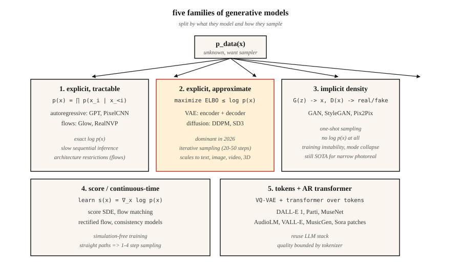

<!-- local-zh-machine-draft: English source is canonical; prose translated automatically, code/math preserved. -->

<a id="generative-models--taxonomy--history"></a>

# 生成模型——分类法和历史

> 每个图像模型、文本模型、视频模型和 3D 模型都适合五个桶之一。如果选错了桶，你将与数学作斗争数周。选择正确的一个，该领域过去 12 年的进展就会清晰地浮现在您的脑海中。

**类型：** 了解
**语言：** Python
**先决条件：** 第 2 阶段（机器学习基础知识）、第 3 阶段（深度学习核心）、第 7·14 阶段 (Transformers)
**时间：** ~45分钟

<a id="the-problem"></a>

## 问题

生成模型完成一项工作：给定从某个未知分布 `p_data(x)` 中提取的训练样本，输出看起来来自同一分布的新样本。面孔、句子、MIDI 文件、蛋白质结构——如果你眯着眼睛看，这些都是同样的问题。

问题是 `p_data` 生活在一个具有数百万维度的空间中（512x512 RGB 图像约为 786k 维度），样本位于该空间内的薄流形上，而您可能只有 10M 个样本。暴力破解密度是没有希望的。每个生成模型都是一种折衷方案，用一个困难问题换取一个稍微不那么困难的问题。

过去十二年里，有五个家庭幸存下来。了解每个家庭做出的妥协可以告诉你为什么它在某些任务上获胜而在另一些任务上失败。

<a id="the-concept"></a>

## 概念



**1。显式密度，易于处理。** 将`log p(x)` 写为您可以实际评估的总和。 Autoregressive 模型（PixelCNN、WaveNet、GPT）分解 `p(x) = ∏ p(x_i | x_<i)`。标准化流（RealNVP、Glow）将 `p(x)` 构建为简单基数的可逆变换。优点：准确的可能性，干净的训练损失。缺点：autoregressive inference 是顺序的（长序列缓慢），流需要可逆架构（架构限制）。

**2。显式密度，近似值。** 从下方绑定 `log p(x)` (ELBO) 并优化绑定。 VAEs（Kingma 2013）使用具有变分后验的 encoder-decoder。 Diffusion models（DDPM，Ho 2020）训练隐式优化加权 ELBO 的降噪器。扩散将成为 2026 年图像、视频和 3D 的主导支柱。

**3。隐式密度。** 完全跳过密度；学习一个生成样本的生成器 `G(z)` 和一个辨别真假的鉴别器 `D(x)`。 GANs（古德费罗 2014 年）。 inference 速度很快（一个 forward pass），但在训练过程中却非常不稳定。即使到 2026 年，StyleGAN 1/2/3 仍然是固定域真实感（脸部、卧室）的最先进技术。

**4. 基于分数/连续时间。**学习gradient对数密度`∇_x log p(x)`（分数）直接。 Song & Ermon (2019) 表明，分数匹配将扩散推广到 SDE。 流匹配 (Lipman 2023) 是 2024-2026 年的热点：无模拟训练、更直的路径、速度提高 4-10 倍sampling比 DDPM 。 Stable Diffusion 3、Flux、AudioCraft 2 都使用流量匹配。

**5。基于 Token 的离散代码 autoregressive。** 使用 VQ-VAE 或残差量化器将高亮度数据压缩为离散 tokens 的短序列，然后使用Transformer 对 token 序列进行建模。 Parti、MuseNet、AudioLM、VALL-E、Sora的patch tokenizer都用这个。这是存储桶 1 加上学习到的 tokenizer。

<a id="a-brief-history"></a>

## 简史

| 年份 | 模型 | 为什么这很重要 |
|------|-------|-----------------|
| 2013 | VAE (金马) | 第一个具有可用训练损失的深度生成模型。 |
| 2014 | GAN（古德费洛） | 隐含密度，没有可能性——样本极其清晰。 |
| 2015 | 绘图、像素CNN | 顺序图像生成。 |
| 2017 | 发光，RealNVP | 可逆流；具有深度的精确可能性。 |
| 2017 | 进取GAN | 第一张百万像素面孔。 |
| 2019 | StyleGAN / StyleGAN2 | 在这一领域，逼真的面孔仍然难以匹敌。 |
| 2020 | DDPM (何) | 扩散变得实用。 |
| 2021 | 剪辑、DALL-E 1、VQGAN | 文本到图像成为主流。 |
| 2022 | Imagen、稳定扩散 1、DALL-E 2 | 潜在扩散+文本调节=商品。 |
| 2022 | 控制网，LoRA | 对预训练扩散的精细控制。 |
| 2023 | SDXL、Midjourney v5、流程匹配 | 规模+更好的训练动力。 |
| 2024 | 索拉，稳定扩散3，Flux.1 | 视频扩散；流量匹配获胜。 |
| 2025 | Veo 2、Kling 1.5、Runway Gen-3、Nano Banana | 生产级视频。 |
| 2026 | 一致性+修正流程 | 来自扩散主干的一步sampling。 |

<a id="the-five-question-triage"></a>

## 五问分类

当一篇新的生成模型论文发布时，在阅读方法部分之前回答这五个问题。

1. ** 正在建模什么？** 像素、潜在、离散 tokens、3D 高斯、网格、波形？
2. ** 密度是显式的还是隐式的？** 他们写下`log p(x)` 吗？
3. **Sampling：一次性还是迭代？** 迭代意味着较慢 inference；一次性通常意味着对抗性或精炼。
4. **条件：无条件、类别、文本、图像、姿势？** 这决定了损失和架构脚手架。
5. **Evaluation：FID、CLIP 分数、IS、人类偏好、任务准确性？** 每个都有已知的故障模式（请参阅第 14 课）。

您将在本阶段的每节课中重新回答这五个问题。到最后，他们就会条件反射。

```figure
autoencoder-bottleneck
```

<a id="build-it"></a>

## 动手实现

本课程的代码是一个轻量级可视化：使用三种玩具方法（核密度、离散直方图和最近样本“GAN-ish”生成器）拟合样本中的一维混合高斯函数，这样您就可以在一个屏幕上打印的问题上看到显式密度与隐式密度之间的差异。

运行`code/main.py`。它从二模高斯混合中提取 2000 个样本，然后打印：

```
explicit density (histogram): p(x in [-0.5, 0.5]) ≈ 0.38
approximate density (KDE):     p(x in [-0.5, 0.5]) ≈ 0.41
implicit (nearest-sample gen): 20 new samples printed, no p(x)
```

注意：前两个让你问“这一点的可能性有多大？”第三个不能。这是 * 显式与隐式 * 的区别，对于未来的每一课都很重要。

<a id="use-it"></a>

## 实际应用

2026 年，哪个家庭、执行哪个任务？

| 任务 | 最好的家庭 | 为什么 |
|------|-------------|-----|
| 照片真实面孔，窄域 | 样式GAN 2/3 | 仍然是最锋利、最快的 inference。 |
| 一般文本转图像 | 潜扩散+流量匹配 | SD3、Flux.1、DALL-E 3。 |
| 快速文本转图像 | 精馏+蒸馏 | SDXL-Turbo、SD3-Turbo、LCM。 |
| 文字转视频 | 扩散Transformer+流量匹配 | 索拉、维奥 2、克林。 |
| 演讲+音乐 | Token基于AR（AudioLM、VALL-E、MusicGen）或流程匹配（AudioCraft 2） | 分立式 tokens 秤价格便宜。 |
| 3D场景 | 高斯泼溅拟合，扩散先验 | 3D-GS 用于重建，扩散用于新颖视图。 |
| 密度估计（无 sampling） | 流量 | 唯一具有精确 `log p(x)` 的系列。 |
| 模拟/物理 | 流量匹配，评分SDE | 直线路径，平滑矢量场。 |

<a id="ship-it"></a>

## 交付成果

保存为 `outputs/skill-model-chooser.md`。

该技能需要任务描述和输出：(1) 要使用哪个系列，(2) 三个开放选项和三个托管选项的排名列表，(3) 您应该注意的可能故障模式，以及 (4) 计算/时间预算。

<a id="exercises"></a>

## 练习

1. **Easy.** 对于这五种产品中的每一种，请确定其系列和主干：ChatGPT 映像、Midjourney v7、Sora、Runway Gen-3、ElevenLabs。证据应来自公开技术报告。
2. **Medium.** 您明天将要阅读的论文声称 sampling 比扩散快 100 倍。写下三个问题来检查加速是否能够承受调节和高分辨率。
3. **Hard.** 选择您关心的一个领域（例如蛋白质结构、CAD、分子、轨迹）。回答该领域当前 SOTA 模型的五个问题分类，并概述更好的模型会改变什么。

<a id="key-terms"></a>

## 关键术语

| 术语 | 人们怎么说 | 它实际上意味着什么 |
|------|-----------------|-----------------------|
| 生成模型 | “它创造了新东西” | 学习 `p_data(x)` 的采样器，可选择公开 `log p(x)`。 |
| 显式密度 | “你可以评价一下” | 模型提供了封闭形式或易处理的`log p(x)`。 |
| 隐含密度 | “GAN式” | 只有采样器 - 无法评估给定点的 `p(x)`。 |
| 埃尔博 | “证据下限” | `log p(x)` 上易于处理的下界； VAEs 和扩散对其进行优化。 |
| 分数 | “对数密度的 Gradient” | `∇_x log p(x)`;扩散和 SDE 模型学习这一领域。 |
| 流形假说 | “数据存在于表面” | 高维数据集中在低维流形上；为什么降维有效。 |
| Autoregressive | “预测下一个作品” | 将联合因式分解为条件条件的乘积。 |
| 潜伏 | “压缩代码” | decoder 可以从中重建输入的低暗度表示。 |

<a id="production-note-five-families-five-inference-shapes"></a>

## 生产说明：五个系列，五个 inference 形状

每个系列映射到不同的 inference 服务器成本曲线。制作-inference文献框架LLM inference为prefill +解码；同样的分解也适用于这里：

- **Autoregressive（存储桶 1 和 5）。** 顺序解码主导延迟； KV-cache、continuous batching和speculative decoding都直接应用。
- **VAE /扩散/流量匹配（桶2和4）。** LLM意义上没有解码。成本 = `num_steps × step_cost`，并且 `step_cost` 是完全潜在分辨率的 transformer 或 U-Net 转发。生产旋钮包括步数（DDIM/DPM-Solver/distillation）、batch size 和精度（bf16/fp8/int4）。
- **GAN（桶3）。** 1个forward pass。没有时间表，没有 KV 缓存。 TTFT ≈ 总延迟。这就是为什么 StyleGAN 仍然在窄域用户体验方面获胜。

当您在论文摘要中看到“比扩散更快”时，请将其翻译为“更少的步骤×相同的步骤成本”或“相同的步骤×更便宜的步骤成本”。其他一切都是营销。

<a id="further-reading"></a>

## 进一步阅读

- [古德费洛等人。 （2014）。 生成对抗网络](https://arxiv.org/abs/1406.2661)- 这GAN纸。
- [Kingma & Welling (2013)。自动编码变分贝叶斯](https://arxiv.org/abs/1312.6114) — VAE 论文。
- [Ho、Jain、Abbeel (2020)。去噪扩散概率模型](https://arxiv.org/abs/2006.11239) — DDPM 论文。
- [Song 等人。 （2021）。通过 SDE 进行基于分数的生成建模](https://arxiv.org/abs/2011.13456) — 作为 SDE 的扩散。
- [Lipman 等人。 （2023）。生成建模的流匹配](https://arxiv.org/abs/2210.02747) — 流匹配论文。
- [Esser 等人。 （2024）。用于高分辨率图像合成的缩放整流流 Transformers](https://arxiv.org/abs/2403.03206) — 稳定扩散 3.
