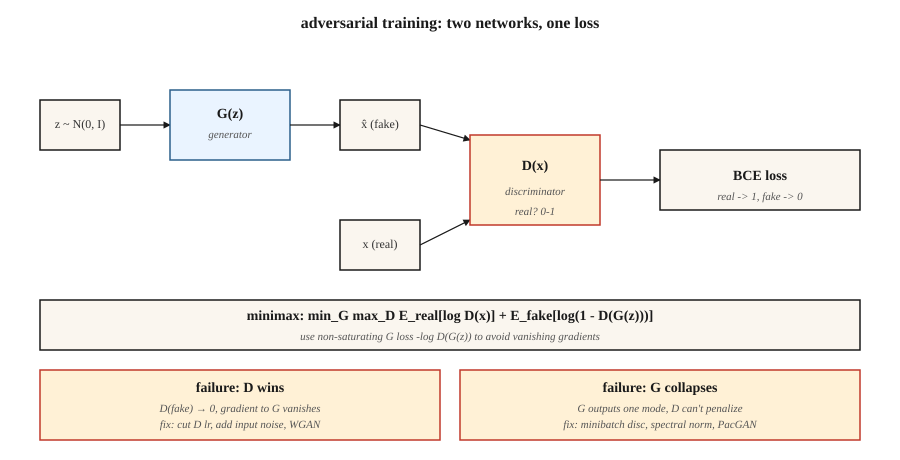

<!-- local-zh-machine-draft: English source is canonical; prose translated automatically, code/math preserved. -->

<a id="gans--generator-vs-discriminator"></a>

# GANs — 生成器与鉴别器

> Goodfellow 在 2014 年的技巧是完全跳过密度。两个网络。一个人做假货。一个人抓住他们。他们一直战斗到假货与真货无法区分为止。它不应该工作。但通常情况并非如此。当它发生时，这些样本仍然是窄域文献中最清晰的。

**类型：** 构建
**语言：** Python
**先决条件：** 第 3 阶段·02（反向传播）、第 3 阶段·08 (Optimizers)、第 8 阶段·02 (VAE)
**时间：** ~75分钟

<a id="the-problem"></a>

## 问题

VAEs 产生模糊样本，因为它们的 MSE decoder 损失对于 *mean* 图像来说是贝叶斯最优的 - 并且许多可信数字的平均值是模糊数字。您想要一种奖励 *plausibility* 的损失，而不是与任何一个目标的像素级接近度。不存在合理性的封闭形式。你必须学习它。

Goodfellow 的想法：训练一个分类器 `D(x)` 来区分真实图像和赝品。训练一个生成器 `G(z)` 来欺骗 `D`。 `G` 的损失信号是 `D` 当前认为使某些东西看起来真实的任何信号。该信号随着 `G` 的改进而更新，追逐移动目标。如果两个网络收敛，`G` 就已经了解了数据分布，而无需写下 `log p(x)`。

这就是对抗性训练。数学是一个极小极大游戏：

```
min_G max_D  E_real[log D(x)] + E_fake[log(1 - D(G(z)))]
```

2026 年，GANs 不再是 SOTA 生成器（扩散和流量匹配吞噬了那个王冠）。但 StyleGAN 2/3 仍然是有史以来最清晰的人脸模型，GAN 判别器在扩散训练中用作 * 感知损失 *，而对抗性训练则支持快速的 1 步蒸馏（SDXL-Turbo、SD3-Turbo、LCM），让您可以发货实时扩散。

<a id="the-concept"></a>

## 概念



**Generator `G(z)`.** 将噪声向量 `z ~ N(0, I)` 映射到样本 `x̂`。 decoder 形网络（密集或转置卷积）。

**Discriminator `D(x)`.** 将样本映射到标量概率（或分数）。真→1，假→0。

**Loss.** 两个交替更新：

- **火车`D`：** `loss_D = -[ log D(x) + log(1 - D(G(z))) ]`。二进制 cross-entropy 真实 = 1，假 = 0。
- **火车`G`：** `loss_G = -log D(G(z))`。这是Goodfellow使用的*非饱和*形式（当`D`有信心时，原始`log(1 - D(G(z)))`饱和并杀死gradients）。

**训练循环。** `D`的一步，`G`的一步。重复。

**为什么有效。** 如果 `G` 与 `p_data` 完美匹配，那么 `D` 不能做得比机会更好，并且到处输出 0.5； `G` 不再获得 gradient。平衡。

**为什么会坏。** 模式崩溃（`G`找到一种模式`D`无法分类并永远铸造），消失gradient（`D`学习太快，`log D` 饱和），训练不稳定（learning rates，batch sizes，任何东西）。

<a id="variants-that-made-gans-work"></a>

## 使 GANs 工作的变体

| 年份 | 创新 | 修复 |
|------|------------|-----|
| 2015 | DCGAN | 卷积/反卷积、批量归一化、LeakyReLU——第一个稳定的架构。 |
| 2017 | WGAN、WGAN-GP | 将 BCE 替换为 Wasserstein 距离 + gradient 惩罚。修复了 gradient 消失的问题。 |
| 2017 | 光谱normalization | 利普希茨束缚了鉴别器。 2026 年鉴别器仍在使用。 |
| 2018 | 进取GAN | 首先训练低分辨率，然后添加图层。第一个百万像素结果。 |
| 2019 | StyleGAN / StyleGAN2 | 映射网络+自适应实例规范。固定域真实感的最先进技术。 |
| 2021 | 样式GAN3 | 无别名、翻译等效 — 仍然是 2026 年的面部黄金标准。 |
| 2022 | StyleGAN-XL | 有条件、有阶级意识、规模较大。 |
| 2024 | R3GAN | 通过更强的正则化进行品牌重塑；无需任何技巧即可在 1024² 上运行。 |

```figure
gan-minimax
```

<a id="build-it"></a>

## 动手实现

`code/main.py` 在一维数据上训练一个微小的 GAN：两个高斯的混合。生成器和鉴别器是单隐藏层 MLP。我们手动实现前向、后向和极小极大循环。目标是在两种关键故障模式（模式崩溃+消失 gradient）发生时看到它们。

<a id="step-1-non-saturating-loss"></a>

### 步骤1：非饱和损失

当 D 以高置信度将 G 的赝品分类为赝品时，普通 Goodfellow 损失 `log(1 - D(G(z)))` 变为 0。此时 G 的 gradient 基本上为零——G 无法改进。非饱和形式 `-log D(G(z))` 具有相反的渐近线：当 D 有信心时它会爆炸，给 G 一个强烈的信号。

```python
def g_loss(d_fake):
    # maximize log D(G(z))  <=>  minimize -log D(G(z))
    return -sum(math.log(max(p, 1e-8)) for p in d_fake) / len(d_fake)
```

<a id="step-2-one-discriminator-step-per-generator-step"></a>

### 第 2 步：每个生成器步骤一个判别器步骤

```python
for step in range(steps):
    # train D
    real_batch = sample_real(batch_size)
    fake_batch = [G(z) for z in sample_noise(batch_size)]
    update_D(real_batch, fake_batch)

    # train G
    fake_batch = [G(z) for z in sample_noise(batch_size)]  # fresh fakes
    update_G(fake_batch)
```

G 的新鲜假货，否则 gradients 是陈旧的。

<a id="step-3-watch-for-mode-collapse"></a>

### 第 3 步：观察模式崩溃

```python
if step % 200 == 0:
    samples = [G(z) for z in sample_noise(500)]
    mode_a = sum(1 for s in samples if s < 0)
    mode_b = 500 - mode_a
    if min(mode_a, mode_b) < 50:
        print("  [!] mode collapse: one mode is starved")
```

典型症状：两个实模之一停止生成。鉴别器停止纠正它，因为它从未被视为假货。

<a id="pitfalls"></a>

## 陷阱

- **Discriminator 太强。** 将 D 的 learning rate 削减 2-5 倍，或添加实例/层噪声。如果D达到>95%的准确度，G就死了。
- **Generator 会记住一个模式。** 将噪声添加到 D 输入，使用小批量鉴别器层，或切换到 WGAN-GP。
- **Batch范数泄漏统计。** 流经同一BN层的真实批次+假批次混合了它们的统计数据。请改用实例范数或谱范数。
- **Inception-score games.** FID 和 IS 在低样本计数下有噪声。评估时使用 ≥10k 样本。
- **One-shot sampling 是条件任务的谎言。** 您仍然需要 CFG 尺度、截断技巧和重新 sampling 才能获得可用的输出。

<a id="use-it"></a>

## 实际应用

2026 GAN 堆栈：

| 情况 | 挑选 |
|-----------|------|
| 照片真实的人脸，固定姿势 | StyleGAN3（最清晰，最小） |
| 动漫/风格化面孔 | StyleGAN-XL 或稳定扩散 LoRA |
| 图像到图像的翻译 | Pix2Pix / CycleGAN（第 8 阶段·04）或 ControlNet（第 8 阶段·08） |
| 快速 1 步文本到图像 | 扩散的对抗蒸馏（SDXL-Turbo、SD3-Turbo） |
| 扩散训练器内的知觉损失 | 图像裁剪上的小型 GAN 鉴别器 |
| 任何多模式、开放式的事物 | 不要使用扩散或流量匹配 |

GANs 锋利但狭窄。一旦您的域打开 - 照片、任意文本 prompts、视频 - 切换到扩散。对抗性技巧作为一个组件（感知损失、蒸馏）存在，而不是一个独立的生成器。

<a id="ship-it"></a>

## 交付成果

保存`outputs/skill-gan-debugger.md`。 Skill 接受失败的 GAN 运行（损失曲线、样本网格、数据集大小），并输出可能原因的排名列表、单行修复和重新运行协议。

<a id="exercises"></a>

## 练习

1. **Easy.** 使用库存设置运行 `code/main.py`。然后设置`D_LR = 5 * G_LR`并重新运行。 G 的损失以多快的速度崩溃为常数？
2. **Medium.** 将 Goodfellow BCE 损失替换为 WGAN 损失：`loss_D = E[D(fake)] - E[D(real)]`、`loss_G = -E[D(fake)]`，并将 D 的 weights 剪辑为 `[-0.01, 0.01]`。训练更稳定吗？比较挂钟收敛。
3. **Hard.** 将一维示例扩展到二维数据（环上 8 个高斯的混合）。跟踪发生器在 1k、5k、10k 步捕获的 8 种模式中有多少种。实施小批量判别并重新测量。

<a id="key-terms"></a>

## 关键术语

| 术语 | 人们怎么说 | 它实际上意味着什么 |
|------|-----------------|-----------------------|
| 发电机 | “G” | 噪声样本网络，`G: z → x̂`。 |
| 鉴别器 | “D” | 分类器 `D: x → [0, 1]`，真品与假品。 |
| 极小极大 | “游戏” | `min_G max_D` 联合目标。 |
| 非饱和损耗 | “修复” | G 使用 `-log D(G(z))` 而不是 `log(1 - D(G(z)))`。 |
| 模式崩溃 | “G记住了一件事” | 尽管数据多种多样，但生成器产生的不同输出却很少。 |
| 广域网 | “瓦瑟斯坦” | 将 BCE 替换为 Earth-Mover 距离 + gradient 惩罚；更平滑gradient。 |
| 谱范数 | “利普希茨把戏” | 约束 D 的 weight 范数来限制其斜率；稳定训练。 |
| 风格GAN | “有效的那个” | 测绘网络+AdaIN；仍然是 2026 年，面部方面最好的。 |

<a id="production-note-one-shot-inference-is-gans-lasting-advantage"></a>

## 制作说明：一次性inference是GAN的持久优势

GANs 不再在开放域生成的样本质量上获胜，但他们仍然在 inference 成本上获胜。生产中-inference文献vocabulary GAN有：

- **无 prefill，无解码阶段。** 单个 `G(z)` forward pass。 TTFT ≈ 总延迟。
- **无KV缓存压力。** 唯一的状态是weights。 Batch size 受激活内存限制，而不是缓存。
- **Trivial continuous batching.** 由于每个请求都采用相同的固定 FLOP，因此服务器目标占用率的静态批处理通常是最佳的。无需飞行调度程序。

这就是为什么 GAN 蒸馏（SDXL-Turbo、SD3-Turbo、ADD、LCM）是 2026 年快速文本到图像的主导技术：它将 20-50 步扩散管道折叠成 1-4 个 GAN 式 forward passes，同时保持扩散的分布基地。对抗性损失作为训练时间旋钮而存在，用于将慢速生成器变成快速生成器。

<a id="further-reading"></a>

## 进一步阅读

- [Goodfellow 等人。 （2014）。生成对抗网络](https://arxiv.org/abs/1406.2661) — 原始 GAN 论文。
- [Radford 等人。 （2015）。使用 DCGAN](https://arxiv.org/abs/1511.06434) 进行无监督表示学习 — 第一个稳定的架构。
- [Arjovsky，Chintala，Bottou（2017）。 Wasserstein GAN](https://arxiv.org/abs/1701.07875) — WGAN。
- [Miyato 等人。 （2018）。 Normalization 的光谱 GANs](https://arxiv.org/abs/1802.05957) — SN。
- [Karras 等人。 （2020）。分析和提高 StyleGAN](https://arxiv.org/abs/1912.04958) 的图像质量 — StyleGAN2。
- [Karras 等人。 （2021）。无别名生成对抗网络](https://arxiv.org/abs/2106.12423) — StyleGAN3。
- [Sauer 等人。 （2023）。对抗性扩散蒸馏](https://arxiv.org/abs/2311.17042) — SDXL-Turbo。
