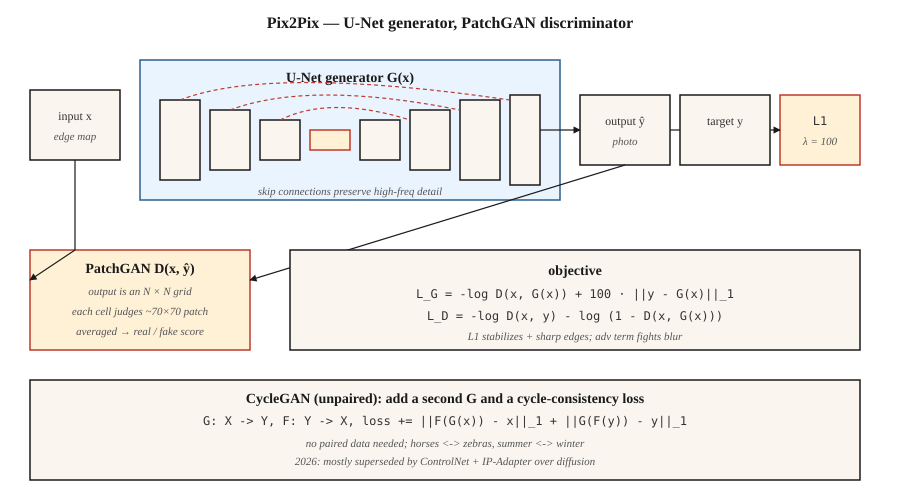

<!-- local-zh-machine-draft: English source is canonical; prose translated automatically, code/math preserved. -->

<a id="conditional-gans--pix2pix"></a>

# 有条件 GANs & Pix2Pix

> 2014-2017 年的第一个重大解锁是控制 GAN 的制作。附加标签、图像或句子。 Pix2Pix 做了图像版本，它在狭窄的图像到图像任务上仍然击败了所有通用的文​​本到图像模型。

**类型：** 构建
**语言：** Python
**先决条件：** 第 8·03 期 (GANs)、第 4·06 期 (U-Net)、第 3·07 期 (CNNs)
**时间：** ~75分钟

<a id="the-problem"></a>

## 问题

无条件 GAN 对任意面进行采样。对于演示有用，在生产中没用。您想要： * 将草图映射到照片*、* 将地图映射到航拍照片*、* 将白天场景映射到夜间*、 *对灰度图像进行着色*。在所有这些中，您都会获得一个输入图像 `x`，并且必须输出 `y` 并具有一些语义对应关系。每个 `x` 有许多看似合理的 `y`。均方误差将它们压扁成糊状。对抗性损失则不然，因为“看起来真实”是尖锐的。

有条件的GAN（Mirza & Osindero，2014）添加了一个条件`c`作为两者的输入`G`和`D`。 Pix2Pix（Isola et al., 2017）对此进行了专门化：条件是完整的输入图像，生成器是 U-Net，鉴别器是*patch-基于*分类器（PatchGAN），损失是对抗性+ L1。 即使在 2026 年，该方法在狭窄的图像到图像领域也优于从头开始的文本到图像模型，因为它是在*配对数据*— 您拥有所需的信号。

<a id="the-concept"></a>

## 概念



**有条件G.** `G(x, z) → y`。在 Pix2Pix 中，`z` 是 G 内部的 dropout（无输入噪声 - Isola 发现显式噪声被忽略）。

**有条件D.** `D(x, y) → [0, 1]`。输入是 *pair*（条件，输出）。这是关键的区别：D必须判断`y`是否与`x`一致，而不仅仅是`y`看起来是否真实。

**U-Net 生成器。** Encoder-decoder 具有跨越瓶颈的跳过连接。对于输入和输出共享低级结构（边缘、轮廓）的任务至关重要。如果没有跳跃，高频细节就会消失。

**PatchGAN 判别器。** D 输出一个 `N×N` 网格，而不是输出单个真/假分数，其中每个单元格判断约 70×70 像素的感受野。平均。这是马尔可夫随机场假设：现实主义是局部的。训练速度更快，parameters 更少，输出更清晰。

**损耗.**

```
loss_G = -log D(x, G(x)) + λ · ||y - G(x)||_1
loss_D = -log D(x, y) - log (1 - D(x, G(x)))
```

L1 项稳定训练并将 G 推向已知目标。 L1 提供比 L2 更锐利的边缘（中位数，而不是均值）。 `λ = 100` 是 Pix2Pix 的默认值。

<a id="cyclegan--when-you-dont-have-pairs"></a>

## CycleGAN——当你没有配对时

Pix2Pix 需要配对的 `(x, y)` 数据。 CycleGAN（Zhu et al., 2017）以额外损失为代价放弃了这一要求：*cycle 一致性* 损失。两台发电机 `G: X → Y` 和 `F: Y → X`。训练它们为 `F(G(x)) ≈ x` 和 `G(F(y)) ≈ y`。这使您可以将马翻译为斑马，将夏天翻译为冬天，而无需配对示例。

到 2026 年，不配对的图像到图像主要是通过扩散（ControlNet、IP-Adapter）而不是 CycleGAN 完成的，但循环一致性的想法几乎在每一篇不配对的域适应论文中都存在。

```figure
gx-patchgan
```

<a id="build-it"></a>

## 动手实现

`code/main.py`在一维数据上实现了一个微小的条件GAN。条件 `c` 是类标签（0 或 1）。任务：根据给定类别的条件分布生成样本。

<a id="step-1-append-condition-to-both-g-and-d-inputs"></a>

### 步骤 1：将条件附加到 G 和 D 输入

```python
def G(z, c, params):
    return mlp(concat([z, one_hot(c)]), params)

def D(x, c, params):
    return mlp(concat([x, one_hot(c)]), params)
```

One-hot 编码是最简单的方法。较大的模型使用学习的 embeddings、FiLM 调制或 cross-attention。

<a id="step-2-train-conditional"></a>

### 第2步：训练条件

```python
for step in range(steps):
    x, c = sample_real_conditional()
    noise = sample_noise()
    update_D(x_real=x, x_fake=G(noise, c), c=c)
    update_G(noise, c)
```

生成器必须与给定条件 * 的真实分布 * 匹配，而不是边际分布。

<a id="step-3-verify-per-class-output"></a>

### 第 3 步：验证每个类的输出

```python
for c in [0, 1]:
    samples = [G(noise, c) for noise in batch]
    mean_c = mean(samples)
    assert_near(mean_c, real_mean_for_class_c)
```

<a id="pitfalls"></a>

## 陷阱

- **条件被忽略。** G 学会边缘化，D 从不惩罚，因为条件信号很弱。修复：条件 D 更积极（早期层，而不仅仅是后期），使用投影鉴别器（Miyato & Koyama 2018）。
- **L1 weight 太低。** G 漂移到任意真实的输出，而不是忠实的输出。对于 Pix2Pix 风格的任务，从 λ≈100 开始。
- **L1 weight 太高。** G 产生模糊输出，因为 L1 仍然是 L_p 范数。一旦训练稳定，就进行退火。
- ** D.** 中的真实泄漏 将 `(x, y)` 连接为 D 输入，而不仅仅是 `y`。没有这个 D 就无法检查一致性。
- **按类折叠方式。** 每个类可以独立折叠。运行类条件多样性检查。

<a id="use-it"></a>

## 实际应用

2026 年图像到图像任务的状态：

| 任务 | 最佳方法 |
|------|---------------|
| 草图 → 照片、相同域、配对数据 | Pix2Pix / Pix2PixHD（仍然快，仍然锐利） |
| 素描 → 照片，未配对 | 具有 Scribble 调节模型的 ControlNet |
| 语义段 → 照片 | SPADE / GauGAN2 或 SD + ControlNet-Seg |
| 风格转移 | 使用 IP 适配器或 LoRA 进行扩散； GAN 方法是遗留方法 |
| 深度 → 照片 | 稳定扩散上的 ControlNet 深度 |
| 超分辨率 | Real-ESRGAN (GAN)、ESRGAN-Plus 或 SD-Upscale（扩散） |
| 着色 | ColTran、基于扩散的着色器或 Pix2Pix-color |
| 白天→夜间、季节、天气 | 基于 CycleGAN 或 ControlNet |

当 (a) 您有数千个配对示例，(b) 任务范围窄且可重复，以及 (c) 您需要快速 inference 时，Pix2Pix 仍然是正确的工具。在通用的开放域任务中，扩散获胜。

<a id="ship-it"></a>

## 交付成果

保存`outputs/skill-img2img-chooser.md`。 Skill 采用任务描述、数据 availability（配对与不配对、N 个样本）以及延迟/质量预算，然后输出：方法（Pix2Pix、CycleGAN、ControlNet 变体、SDXL + IP 适配器）、训练数据要求、inference 成本和评估协议（LPIPS、FID、特定于任务）。

<a id="exercises"></a>

## 练习

1. **Easy.** 修改 `code/main.py` 添加第三个类。确认 G 仍然将每个类别的噪声映射到正确的模式。
2. **Medium.** 将 L1 替换为一维设置中的感知式损失（例如，一个小的冻结 D 充当 feature 提取器）。它会改变条件分布的锐度吗？
3. **Hard.** 在一维设置中绘制一个 CycleGAN：两个分布、两个生成器、循环损失。证明它能够在没有配对数据的情况下学会在它们之间进行映射。

<a id="key-terms"></a>

## 关键术语

| 术语 | 人们怎么说 | 它实际上意味着什么 |
|------|-----------------|-----------------------|
| 有条件 GAN | “GAN 带标签” | G(z,c)，D(x,c)。两个网络都可以看到这种情况。 |
| 像素到像素 | “图像到图像 GAN” | 将 cGAN 与 U-Net G 和 PatchGAN D + L1 损失配对。 |
| 优网 | “Encoder-decoder 带料斗” | 对称转换网络；跳过保留高频。 |
| 补丁GAN | “局部现实主义分类器” | D 输出每个 patch 分数而不是全局分数。 |
| 循环GAN | “未配对的图像翻译” | 两个 G + 循环一致性损失；没有配对数据。 |
| 黑桃 | “高甘” | 使用语义图规范中间激活；分割到图像。 |
| 菲勒姆 | “Feature方向线性调制” | Per-feature 从条件仿射变换；便宜的空调。 |

<a id="production-note-pix2pix-as-a-latency-bound-baseline"></a>

## 生产说明：Pix2Pix 作为延迟限制基线

当您拥有配对数据和狭窄任务（草图 → 渲染、语义图 → 照片、白天 → 夜晚）时，Pix2Pix 的一次性 inference 在延迟方面比扩散快一个数量级。生产比较通常是：

| 路径 | 步骤 | 单层 L4 上的典型延迟为 512² |
|------|-------|----------------------------------------|
| Pix2Pix（U-Net转发） | 1 | 〜30毫秒 |
| SD-Inpaint 或 SD-Img2Img | 20 | 〜1.2秒 |
| SDXL-Turbo Img2Img | 1-4 | ~0.15-0.35 秒 |
| ControlNet + SDXL 底座 | 20-30 | 〜3-5秒 |

Pix2Pix 在静态批次的吞吐量上获胜（每个请求都是相同的 FLOP）。扩散赢得质量和普遍性。现代游戏通常是为狭窄的任务提供 Pix2Pix 风格的蒸馏模型，并为尾部输入提供扩散回退。

<a id="further-reading"></a>

## 进一步阅读

- [米尔扎和奥辛德罗 (2014)。条件生成对抗网络](https://arxiv.org/abs/1411.1784) — cGAN 论文。
- [Isola 等人。 （2017）。使用条件对抗网络进行图像到图像的转换](https://arxiv.org/abs/1611.07004) — Pix2Pix。
- [Zhu 等人。 （2017）。使用循环一致对抗网络的不成对图像到图像转换](https://arxiv.org/abs/1703.10593) - CycleGAN。
- [Wang 等人。 （2018）。有条件的高分辨率图像合成 GANs](https://arxiv.org/abs/1711.11585) — Pix2PixHD。
- [Park 等人。 （2019）。使用空间自适应 Normalization](https://arxiv.org/abs/1903.07291) 进行语义图像合成 — SPADE / GauGAN。
- [宫藤和小山（2018）。带有投影鉴别器的 cGAN](https://arxiv.org/abs/1802.05637) — 投影 D。
