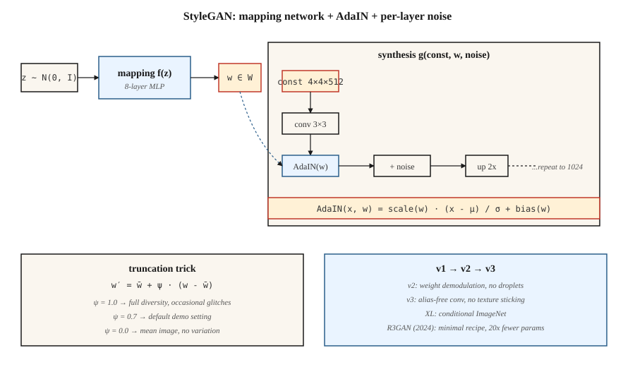

<!-- local-zh-machine-draft: English source is canonical; prose translated automatically, code/math preserved. -->

<a id="stylegan"></a>

# 风格GAN

> 大多数发生器同时将 `z` 搅拌到每一层中。 StyleGAN 将其分开：首先将 `z` 映射到中间 `w`，然后通过 AdaIN 在每个分辨率级别映射 *inject* `w`。这一单一的改变解决了 latent space 的问题，并使照片级真实面孔连续七年成为一个解决的问题。

**类型：** 构建
**语言：** Python
**先决条件：** 第 8·03 期 (GANs)、第 4·08 期 (Normalization)、第 3·07 期 (CNNs)
**时间：** ~45分钟

<a id="the-problem"></a>

## 问题

DCGAN 通过一堆转置卷积将 `z` 映射到图像。问题：`z` 控制一切——姿势、灯光、身份、背景——纠缠在一起。沿`z`的一个轴移动，四个都发生变化。您不能要求模型“同一个人，不同的姿势”，因为表示不会以这种方式考虑。

卡拉斯等人。 （2019，NVIDIA）建议：停止喂食`z`直接进入转换层。 喂一个常数`4×4×512` tensor作为网络输入。 学习映射的 8 层 MLP`z ∈ Z → w ∈ W`。 注入`w`在每个分辨率下通过*自适应实例normalization*(AdaIN)：标准化每个转换feature映射，然后通过仿射投影进行缩放和移动`w`。 添加每层噪声以获得随机细节（皮肤毛孔、发丝）。

结果：`W` 对于“高级风格”（姿势、身份）与“精细风格”（灯光、颜色）具有大致正交的轴。您可以使用图像 A 的 `w` 表示低分辨率级别，使用图像 B 的 `w` 表示高分辨率级别，从而在两个图像之间交换样式。这解锁了编辑、跨域风格化和整个“StyleGAN-inversion”研究线。

<a id="the-concept"></a>

## 概念



**映射网络。** `f: Z → W`，8层MLP。 `Z = N(0, I)^512`。 `W` 并不强制为高斯分布——它学习数据适应的形状。

**综合网络。** 从学习常数 `4×4×512` 开始。每个分辨率块：`upsample → conv → AdaIN(w_i) → noise → conv → AdaIN(w_i) → noise`。分辨率加倍：4、8、16、32、64、128、256、512、1024。

**AdaIN.**

```
AdaIN(x, y) = y_scale · (x - mean(x)) / std(x) + y_bias
```

其中 `y_scale` 和 `y_bias` 来自 `w` 的仿射投影。根据 feature 地图进行标准化，然后重新设计样式。这里的“样式”是feature图的一阶和二阶统计。

**每层噪声。** 添加到每个 feature 映射的单通道高斯噪声，按学习的每通道因子进行缩放。控制随机细节而不影响全局结构。

**截断技巧。** 在inference，采样`z`，计算`w = mapping(z)`，然后`w' = ŵ + ψ·(w - ŵ)`，其中`ŵ` 是许多样本的平均值 `w`。 `ψ < 1` 以多样性换取质量。几乎每个 StyleGAN 演示都使用 `ψ ≈ 0.7`。

<a id="stylegan-1--2--3"></a>

## 样式GAN 1 → 2 → 3

| 版本 | 年份 | 创新 |
|---------|------|------------|
| 风格GAN | 2019 | 映射网络+AdaIN+噪声+渐进式增长。 |
| StyleGAN2 | 2020 | Weight解调取代AdaIN（修复水滴伪影）；跳过/剩余架构；路径长度正则化。 |
| 样式GAN3 | 2021 | 无别名卷积+等变核；消除了纹理粘附在像素网格上。 |
| StyleGAN-XL | 2022 | 类条件，1024²，ImageNet。 |
| R3GAN | 2024 | 更强大的品牌重塑；使用减少 20 倍的参数缩小 FFHQ-1024 上的扩散差距。 |

到 2026 年，StyleGAN3 仍然是 (a) 高 FPS 下的窄域真实感、(b) few-shot 域适应（在具有 100 张图像的新数据集上训练，冻结映射）、(c) 基于反转的编辑（找到重建真实照片的 `w`，然后编辑它）的默认设置`w`）。对于开放域文本到图像，它不是工具，扩散才是。

```figure
gx-stylegan-mapping
```

<a id="build-it"></a>

## 动手实现

`code/main.py` 以一维方式实现了一个玩具“style-GAN lite”：一个映射 MLP，一个合成函数，它采用学习的常数向量并使用 `w` 导出的比例/偏差和每层噪声对其进行调制。它表明通过仿射调制注入 `w` 匹配或击败将 `z` 连接到生成器的输入。

<a id="step-1-mapping-network"></a>

### 第 1 步：绘制网络

```python
def mapping(z, M):
    h = z
    for i in range(num_layers):
        h = leaky_relu(add(matmul(M[f"W{i}"], h), M[f"b{i}"]))
    return h
```

<a id="step-2-adaptive-instance-normalization"></a>

### 步骤2：适配实例normalization

```python
def adain(x, w_scale, w_bias):
    mu = mean(x)
    sd = std(x)
    x_norm = [(xi - mu) / (sd + 1e-8) for xi in x]
    return [w_scale * xi + w_bias for xi in x_norm]
```

每个 feature 地图比例和偏差通过线性投影来自 `w`。

<a id="step-3-per-layer-noise"></a>

### 步骤3：每层噪声

```python
def add_noise(x, sigma, rng):
    return [xi + sigma * rng.gauss(0, 1) for xi in x]
```

每个通道的 Sigma 是可学习的。

<a id="pitfalls"></a>

## 陷阱

- **液滴伪影。**StyleGAN 1 在feature地图是因为 AdaIN 将平均值归零。 StyleGAN 2 的weight解调通过缩放卷积来修复它weights反而。
- **纹理粘贴。** StyleGAN 1和2纹理遵循像素坐标，而不是对象坐标（插值时可见）。 StyleGAN 3 的无混叠卷积通过加窗 sinc 滤波器解决了这个问题。
- **模式覆盖。** 截断 `ψ < 0.7` 看起来很干净，但样本来自窄锥体；如果您需要多样性，请使用 `ψ = 1.0`。
- **Inversion 是有损的。** 将真实照片反转为 `W` 通常是通过优化或 encoder（e4e、ReStyle、HyperStyle）来完成。结果在多次迭代中发生漂移。

<a id="use-it"></a>

## 实际应用

| 应用场景 | 方法 |
|----------|----------|
| 照片真实的人脸（动漫、产品、狭窄） | StyleGAN3 FFHQ / 自定义微调 |
| 从照片中编辑脸部 | e4e 反演 + StyleSpace / InterFaceGAN 方向 |
| 换脸/重演 | StyleGAN + encoder + 混合 |
| 阿凡达管道 | StyleGAN3 w/ ADA 用于低数据微调 |
| 一些图像的域适应 | 冻结映射网络，微调合成 |
| 多模式或文本条件生成 | 不要——使用扩散 |

对于答案是“人脸照片”的产品级演示，StyleGAN 在 inference 成本（单个 forward pass，在 4090 上<10ms）和相同质量条的清晰度上击败了扩散。

<a id="ship-it"></a>

## 交付成果

保存`outputs/skill-stylegan-inversion.md`。 Skill 拍摄真实照片并输出：反演方法（e4e / ReStyle / HyperStyle）、预期潜在损失、编辑预算（在 `W` 中您可以在伪影之前移动多远）以及已知良好的编辑方向列表（年龄、表情、姿势）。

<a id="exercises"></a>

## 练习

1. **Easy.** 使用 `adain_on=True` 和 `adain_on=False` 运行 `code/main.py`。比较固定潜在变量与扰动潜在变量的输出分布。
2. **Medium.** 实现混合正则化：对于训练批次，计算 `w_a`、`w_b`，并在合成的前半部分应用 `w_a`，在合成的前半部分应用 `w_b`下半场。 decoder 是否学习解缠结样式？
3. **Hard.** 采用预训练的 StyleGAN3 FFHQ 模型 (ffhq-1024.pkl)。通过在标记样本上训练SVM，找到控制“微笑”的`w`方向；报告在身份漂移之前你能走多远。

<a id="key-terms"></a>

## 关键术语

| 术语 | 人们怎么说 | 它实际上意味着什么 |
|------|-----------------|-----------------------|
| 测绘网络 | “MLP” | `f: Z → W`，8层，将潜在几何与数据统计解耦。 |
| W空间 | 「风格空间」 | 映射网络的输出；大致解开。 |
| 阿达因 | “自适应实例规范” | 标准化 feature 地图，然后通过 `w` 投影进行缩放 + 移动。 |
| 截断技巧 | “PSI” | `w = mean + ψ·(w - mean)`, ψ<1 以多样性换取质量。 |
| 路径长度正则化 | “PL 规则” | 惩罚 `w` 中每单位变化图像的较大变化；使`W`更加流畅。 |
| Weight解调 | “StyleGAN2 修复” | 标准化转换 weights 而不是激活；消除液滴伪影。 |
| 无别名 | 《StyleGAN3 的技巧》 | 带窗 sinc 滤波器；消除了纹理粘附在像素网格上。 |
| 反转 | “寻找真实图像的 w” | 优化或编码 `x → w` 为 `G(w) ≈ x`。 |

<a id="production-note-why-stylegan-still-ships-in-2026"></a>

## 生产说明：为什么 StyleGAN 仍会在 2026 年出货

4090 上的 StyleGAN3 在 10 毫秒内生成 1024² FFHQ 人脸 — `num_steps = 1`，无 VAE 解码，无 cross-attention 通过。在生产方面，这是任何图像生成器的底层延迟。相同分辨率下的 50 步 SDXL + VAE 解码管道大约需要 3 秒。这是一个 **300×gap**，对于窄域产品（化身服务、身份证件管道、股票面孔生成），它在 TCO 上获胜。

两个操作后果：

- **没有调度程序，没有批处理程序。** 目标占用率下的静态批处理是最佳的。 Continuous batching（对于 LLMs 和扩散至关重要）提供零收益，因为每个请求都采用相同的 FLOP。
- **截断 `ψ` 是安全旋钮。** `ψ < 0.7` 从映射网络范围的窄锥体中采样。这是服务层具有超过样本方差的唯一杠杆。在峰值负载时降低 `ψ`，为高级用户提高它。

<a id="further-reading"></a>

## 进一步阅读

- [Karras 等人。 （2019）。 GANs](https://arxiv.org/abs/1812.04948) 的基于样式的生成器架构 — StyleGAN。
- [Karras 等人。 （2020）。分析和提高 StyleGAN](https://arxiv.org/abs/1912.04958) 的图像质量 — StyleGAN2。
- [Karras 等人。 （2021）。无别名生成对抗网络](https://arxiv.org/abs/2106.12423) — StyleGAN3。
- [Tov 等人。 （2021）。为 StyleGAN 图像操作设计 Encoder](https://arxiv.org/abs/2102.02766) — e4e 反转。
- [Sauer 等人。 （2022）。 StyleGAN-XL：将 StyleGAN 扩展到大型多样化数据集](https://arxiv.org/abs/2202.00273) — StyleGAN-XL。
- [Huang 等人。 （2024）。 R3GAN：GAN 已死； GAN 万岁！](https://arxiv.org/abs/2501.05441) — 现代最小 GAN 食谱。
