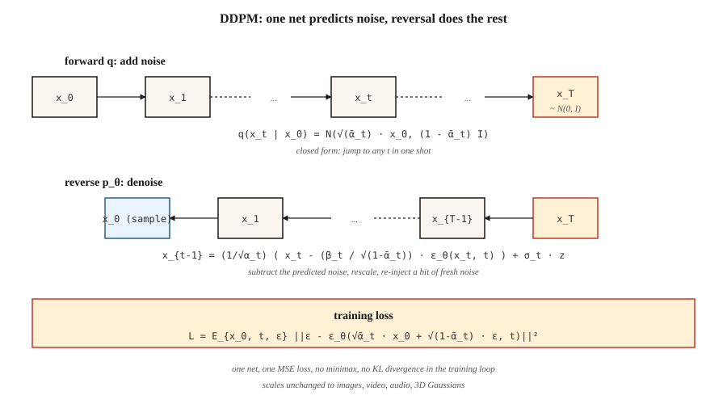

<!-- local-zh-machine-draft: English source is canonical; prose translated automatically, code/math preserved. -->

<a id="diffusion-models--ddpm-from-scratch"></a>

# Diffusion Models — 从头开始的 DDPM

> Ho, Jain, Abbeel (2020) 给了这个领域一个无法放弃的秘诀。用超过一千个小步骤的噪音来破坏数据。训练一个神经网络来预测噪声。在 inference 处反转该过程。如今，每个主流图像、视频、3D 和音乐模型都在这个循环上运行，可能还带有流匹配或一致性技巧。

**类型：** 构建
**语言：** Python
**先决条件：** 第 3 阶段·02（反向传播）、第 8 阶段·02 (VAE)
**时间：** ~75分钟

<a id="the-problem"></a>

## 问题

您需要 `p_data(x)` 的采样器。 GANs 玩一个经常发散的极小极大游戏。 VAEs 从高斯 decoder 生成模糊样本。你真正想要的是一个训练目标，它是 (a) 单一稳定损失（没有鞍点，没有极小极大），(b) `log p(x)` 的下限（因此你有可能性），以及 (c) 与 SOTA 质量匹配的样本。

索尔-迪克斯坦等人。 （2015）有一个理论答案：定义一个逐渐添加高斯噪声的马尔可夫链 `q(x_t | x_{t-1})`，并训练一个反向链 `p_θ(x_{t-1} | x_t)` 去噪。 Ho、Jain、Abbeel（2020）表明，损失可以简化为一行——预测噪声——并清理了数学。在 2020 年，这是一个好奇心。 2021 年，它生产出了最先进的样品。 2022 年，它变成了稳定扩散。 2026年它是基板。

<a id="the-concept"></a>

## 概念



**前向过程`q`.** 在`T`小步中添加高斯噪声。封闭形式——数学易于处理的原因——是累积步骤也是高斯的：

```
q(x_t | x_0) = N( sqrt(α̅_t) · x_0,  (1 - α̅_t) · I )
```

其中 `α̅_t = ∏_{s=1..t} (1 - β_s)` 表示 `β_t` 的时间表。在 T=1000 步内从 1e-4 到 0.02 线性选取 `β_t`，`x_T` 大约为 `N(0, I)`。

**逆向过程 `p_θ`.** 学习一个神经网络 `ε_θ(x_t, t)` 来预测添加的噪声。给定 `x_t`，通过以下方式降噪：

```
x_{t-1} = (1 / sqrt(α_t)) · ( x_t - (β_t / sqrt(1 - α̅_t)) · ε_θ(x_t, t) )  +  σ_t · z
```

其中 `σ_t` 是 `sqrt(β_t)` 或学习的方差。这个表达式很难看，但它只是代数——给定后验 `q(x_{t-1} | x_t, x_0)` 求解 `x_{t-1}` 并用其噪声预测估计替换 `x_0`。

**训练损失.**

```
L_simple = E_{x_0, t, ε} [ || ε - ε_θ( sqrt(α̅_t) · x_0 + sqrt(1 - α̅_t) · ε,  t ) ||² ]
```

从数据中采样 `x_0`，随机选择一个 `t`，采样 `ε ~ N(0, I)`，通过封闭形式一次性计算出噪声 `x_t`，并对噪声进行回归。一次损失，没有极小极大，没有 KL，没有重新参数化技巧。

**Sampling.** 启动`x_T ~ N(0, I)`。将反向步骤从 `t = T` 迭代到 `1`。完毕。

<a id="why-it-works"></a>

## 为什么它有效

三个直觉：

1. **去噪很容易； ** 在`t=T`，数据是纯粹的噪声——网络必须解决一个微不足道的问题。在 `t=0` 中，网络只需清理几个像素。在中间 `t` 处，问题很困难，但网络上有许多 gradients 从每个噪声级别流过相同的 weights。

2. **Score 变相匹配。** Vincent (2011) 证明预测噪声相当于估计 `∇_x log q(x_t | x_0)`，即 *score*。反向 SDE 使用此分数来提升密度 gradient — 向高概率区域引导的随机游走。

3. **The ELBO 简化为简单的 MSE。** 完整变分下界每个时间步都有一个 KL 项。通过 DDPM 的参数化，这些 KL 项可简化为具有特定系数的噪声预测的 MSE； Ho 放弃了系数（称之为“简单”损失）和质量 *improved*。

```figure
diffusion-denoise
```

<a id="build-it"></a>

## 动手实现

`code/main.py` 实现一维 DDPM。数据是两种模式的混合。 “网络”是一个微小的 MLP，它采用 `(x_t, t)` 并输出预测的噪声。训练是单线损失。 Sampling 迭代反向链。

<a id="step-1-the-forward-schedule-closed-form"></a>

### 第 1 步：远期时间表（封闭式）

```python
betas = [1e-4 + (0.02 - 1e-4) * t / (T - 1) for t in range(T)]
alphas = [1 - b for b in betas]
alpha_bars = []
cum = 1.0
for a in alphas:
    cum *= a
    alpha_bars.append(cum)
```

<a id="step-2-sample-x_t-in-one-shot"></a>

### 第2步：一次性采样`x_t`

```python
def forward_sample(x0, t, alpha_bars, rng):
    a_bar = alpha_bars[t]
    eps = rng.gauss(0, 1)
    x_t = math.sqrt(a_bar) * x0 + math.sqrt(1 - a_bar) * eps
    return x_t, eps
```

<a id="step-3-one-training-step"></a>

### 第 3 步：一个训练步骤

```python
def train_step(x0, model, alpha_bars, rng):
    t = rng.randrange(T)
    x_t, eps = forward_sample(x0, t, alpha_bars, rng)
    eps_hat = model_forward(model, x_t, t)
    loss = (eps - eps_hat) ** 2
    return loss, gradient_step(model, ...)
```

<a id="step-4-reverse-sampling"></a>

### 第四步：反向sampling

```python
def sample(model, alpha_bars, T, rng):
    x = rng.gauss(0, 1)
    for t in range(T - 1, -1, -1):
        eps_hat = model_forward(model, x, t)
        beta_t = 1 - alphas[t]
        x = (x - beta_t / math.sqrt(1 - alpha_bars[t]) * eps_hat) / math.sqrt(alphas[t])
        if t > 0:
            x += math.sqrt(beta_t) * rng.gauss(0, 1)
    return x
```

对于具有 40 个时间步长和 24 单元 MLP 的一维问题，它在大约 200 个时期内学习两种模式混合。

<a id="time-conditioning"></a>

## 时间调节

网络需要知道它在哪个时间步去噪。两个标准选项：

- **正弦 embedding.** 与 Transformer 位置编码类似。 `embed(t) = [sin(t/ω_0), cos(t/ω_0), sin(t/ω_1), ...]`。通过MLP，广播到网络中。
- **Film / 组规范调节。** 将 embedding 投影到每个块的每通道比例/偏差 (FiLM)。

我们的玩具代码使用正弦 → concat。生产 U-Net 使用 FiLM。

<a id="pitfalls"></a>

## 陷阱

- **Schedule 非常重要。** 线性 `β` 是 DDPM 默认值，但余弦调度（Nichol & Dhariwal，2021）为相同的计算提供了更好的 FID。如果质量停滞不前，请切换时间表。
- **时间步长embedding是脆弱的。**通过原始`t`因为浮点数适用于玩具一维，但不适用于图像； 始终使用正确的embedding。
- **V-预测与ε-预测。** 对于狭窄的范围（非常小或非常大的t），`ε` 的信噪比很差。 V-预测（`v = α·ε - σ·x`）更稳定； SDXL、SD3 和 Flux 使用它。
- **无分类器指导。** 在 inference 处，计算条件和无条件 `ε`，然后使用 `w ≈ 3-7` 计算 `ε_cfg = (1 + w) · ε_cond - w · ε_uncond`。第 08 课中介绍过。
- **1000 个步骤很多。** 生产使用 DDIM（20-50 个步骤）、DPM-Solver（10-20 个步骤）或蒸馏（1-4 个步骤）。参见第 12 课。

<a id="use-it"></a>

## 实际应用

| 角色 | 2026 年的典型堆栈 |
|------|-----------------------|
| 图像像素空间扩散（小，玩具） | DDPM + U-Net |
| 图像潜扩散 | VAE encoder + U-Net 或 DiT（第 07 课） |
| 视频潜扩散 | 时空 DiT（Sora、Veo、WAN） |
| 音频潜扩散 | 编码器+扩散transformer |
| 科学（分子、蛋白质、物理学） | 等变扩散（EDM、RFdiffusion、AlphaFold3） |

扩散是普遍的生成支柱。流程匹配（第 13 课）是 2024-2026 年的竞争对手，通常在相同质量的情况下以 inference 速度获胜。

<a id="ship-it"></a>

## 交付成果

保存`outputs/skill-diffusion-trainer.md`。 Skill 采用数据集+计算预算和输出：时间表（线性/余弦/sigmoid）、预测目标（ε/v/x）、步骤数、指导规模、采样器系列和评估协议。

<a id="exercises"></a>

## 练习

1. **Easy.** 将`code/main.py`中的T从40更改为10。样本质量（输出的视觉直方图）如何降低？双模结构在什么 T 时崩溃？
2. **Medium.** 从 ε 预测切换到 v 预测。重新推导相反的步骤。比较最终样品的质量。
3. **Hard.** 添加无分类器指导。以类标签 `c ∈ {0, 1}` 为条件，在训练期间将其丢弃 10%，并在 sampling 时间使用 `ε = (1+w)·ε_cond - w·ε_uncond`。在 `w = 0, 1, 3, 7` 测量条件模式命中率。

<a id="key-terms"></a>

## 关键术语

| 术语 | 人们怎么说 | 它实际上意味着什么 |
|------|-----------------|-----------------------|
| 转发过程 | “添加噪音” | 修复了破坏数据的马尔可夫链 `q(x_t \| x_{t-1})`。 |
| 逆向过程 | “去噪” | 学习到重构数据的链`p_θ(x_{t-1} \| x_t)`。 |
| β时间表 | 《噪音阶梯》 | 每步方差；线性、余弦或 sigmoid。 |
| α̅ | “阿尔法酒吧” | 累计产品`∏(1 - β)`；从 `x_0` 给出闭合形式 `x_t`. |
| 简单损失 | “噪声的 MSE” | `\|\|ε - ε_θ(x_t, t)\|\|²`；所有变分推导都崩溃于此。 |
| ε-预测 | “预测噪音” | 输出是添加的噪声；标准DDPM。 |
| V-预测 | “预测速度” | 输出为`α·ε - σ·x`；更好的调节能力。 |
| DDPM | “纸” | 何等人。 2020；线性 β，1000 步，U-Net。 |
| DDIM | “确定性采样器” | 非马尔可夫采样器，20-50 个步骤，相同的训练目标。 |
| 无分类器指导 | “CFG” | 混合有条件和无条件噪声预测以放大调节。 |

<a id="production-note-diffusion-inference-is-a-step-count-problem"></a>

## 制作笔记：扩散inference是一个步数问题

DDPM 论文运行 T=1000 个反向步骤。没有人在生产中运送它。每个真正的 inference 堆栈都会选择三种策略之一 - 并且每种策略都清晰地映射到“延迟来自哪里”的生产框架：

1. **更快的采样器，相同型号。** DDIM（20-50步），DPM-Solver++（10-20），UniPC（8-16）。反向回路的直接替换；经过训练的 `ε_θ` weights 未受影响。将延迟缩短 20-50 倍。
2. **Distillation.** 用更少的步骤训练学生匹配老师：渐进蒸馏（2 → 1）、一致性模型（任意 → 1-4）、LCM、SDXL-Turbo、SD3-Turbo。将延迟时间再缩短 5-10 倍，需要重新训练。
3. **缓存和编译。** `torch.compile(unet, mode="reduce-overhead")`，TensorRT-LLM的扩散后端，`xformers`/SDPA attention，bf16 weights。将每步延迟缩短约 2 倍。与 (1) 和 (2) 堆叠。

对于生产扩散服务器，预算对话与生产文献中描述的 LLMs 相同：延迟为 `num_steps × step_cost + VAE_decode`，吞吐量为 `batch_size × (num_steps × step_cost)^-1`。 TTFT小（一步）； TPOT 等效时间是完整响应时间，因为从用户的角度来看，图像生成是“一次性”的。

<a id="further-reading"></a>

## 进一步阅读

- [Sohl-Dickstein 等人。 （2015）。使用非平衡热力学的深度无监督学习](https://arxiv.org/abs/1503.03585) - 超前的扩散论文。
- [Ho、Jain、Abbeel (2020)。去噪扩散概率模型](https://arxiv.org/abs/2006.11239) — DDPM。
- [Song、Meng、Ermon (2021)。去噪扩散隐式模型](https://arxiv.org/abs/2010.02502) — DDIM，步骤更少。
- [Nichol 和 Dhariwal (2021)。改进了 DDPM](https://arxiv.org/abs/2102.09672) — 余弦计划、学习方差。
- [Dhariwal & Nichol (2021)。 Diffusion Models 在图像合成方面击败 GANs](https://arxiv.org/abs/2105.05233) — 分类器指导。
- [Ho 和 Salimans (2022)。无分类器扩散指导](https://arxiv.org/abs/2207.12598) — CFG。
- [Karras 等人。 （2022）。阐明基于扩散的生成模型（EDM）的设计空间](https://arxiv.org/abs/2206.00364) - 统一的符号，最简洁的配方。
