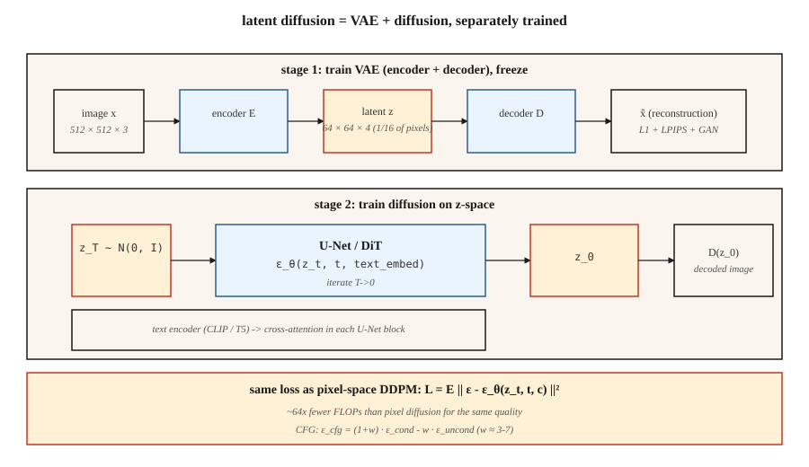

<!-- local-zh-machine-draft: English source is canonical; prose translated automatically, code/math preserved. -->

<a id="latent-diffusion--stable-diffusion"></a>

# 潜空间扩散（Latent Diffusion）与 Stable Diffusion

> 512×512 图像上的像素空间扩散是一种计算战争犯罪。罗姆巴赫等人。 (2022) 注意到您不需要所有 786k 维度来生成图像 - 您需要足够的维度来捕获语义结构，以及用于 rest 的单独 decoder。在 VAE 的 latent space 内运行扩散。这个想法就是稳定扩散。

**类型：** 构建
**语言：** Python
**先决条件：** 第 8·02 期 (VAE)、第 8·06 期 (DDPM)、第 7·09 期 (ViT)
**时间：** ~75分钟

<a id="the-problem"></a>

## 问题

512² 的像素空间扩散意味着 U-Net 在形状为 `[B, 3, 512, 512]` 的 tensors 上运行。对于 500M 参数的 U-Net，每个 sampling 步长约为 100 GFLOPS。五十步相当于每个图像 5 TFLOPS。对十亿张图像进行训练，计算费用是荒谬的。

这些 FLOP 中的大多数都用于通过网络推送感知上不重要的细节 - 有损 VAE 可以压缩掉的高频纹理。 Rombach的想法：训练一次VAE（*第一阶段*），冻结它，并完全在4通道64×64 latent space（*第二阶段）中运行扩散阶段*）。同样的U网。 1/16 像素。在同等质量下，失败次数减少约 64 倍。

这是稳定扩散配方。 SD 1.x / 2.x 在 `64×64×4` 潜伏上使用 860M U-Net，SDXL 在 `128×128×4` 上使用 2.6B U-Net，SD3 将 U-Net 替换为具有流量匹配的 Diffusion Transformer (DiT)。 Flux.1-dev（黑森林实验室，2024）发布了 12B 参数 DiT-MMDiT。所有这些都在相同的两级基板上运行。

<a id="the-concept"></a>

## 概念

 中的扩散

**两个阶段，分别训练。**

1. **阶段 1 — VAE.** Encoder `E(x) → z`、decoder `D(z) → x`。目标压缩：每个空间轴 8 倍下采样 + 调整通道，使总潜在大小约为像素数的 1/16。损失 = 重建（L1 + LPIPS 感知）+ KL（小 weight，因此 `z` 不会被迫太高斯，因为我们不需要来自 `z` 的精确 sampling）。通常使用对抗性损失进行训练，因此解码的图像非常清晰。

2. **Stage 2 — `z`.** 上的扩散 将 `z = E(x_real)` 视为数据。训练 U-Net（或 DiT）对 `z_t` 进行去噪。在 inference：通过扩散采样 `z_0`，然后是 `x = D(z_0)`。

** 文本调节。** 两个附加组件。冻结文本 encoder（用于 SD 1.x 的 CLIP-L、用于 SD 2/XL 的 CLIP-L+OpenCLIP-G、用于 SD3 和 Flux 的 T5-XXL）。 cross-attention 注入：每个 U-Net 块都采用 `[Q = image features, K = V = text tokens]` 并将它们混合在一起。tokens 是文本影响图像的唯一方式。

**loss function 与第 06 课相同。** 相同的 DDPM/流量匹配噪声 MSE。您只需交换数据域即可。

<a id="architecture-variants"></a>

## 架构变体

| 模型 | 年份 | 骨干网 | 潜形 | 短信 encoder | 参数 |
|-------|------|----------|--------------|--------------|--------|
| 标准差1.5 | 2022 | 优网 | 64×64×4 | CLIP-L (77 tokens) | 860M |
| 标清2.1 | 2022 | 优网 | 64×64×4 | OpenCLIP-H | 865M |
| SDXL | 2023 | U网+精炼机 | 128×128×4 | CLIP-L + OpenCLIP-G | 2.6B + 6.6B |
| SDXL-涡轮 | 2023 | 蒸馏的 | 128×128×4 | 一样 | 1-4步 sampling |
| SD3 | 2024 | MMDiT（多模态 DiT） | 128×128×16 | T5-XXL + CLIP-L + CLIP-G | 2B / 8B |
| Flux.1-dev | 2024 | MMDiT | 128×128×16 | T5-XXL + 夹子-L | 12B |
| Flux.1-施奈尔 | 2024 | MMDiT 蒸馏 | 128×128×16 | T5-XXL + 夹子-L | 12B，1-4步 |

趋势：用 DiT 替换 U-Net（transformer 优于潜在 patches），缩放文本 encoder（T5 在 prompt 依从性方面击败 CLIP），增加潜在通道（4 → 16 提供更多细节空间）。

```figure
noise-schedule
```

<a id="build-it"></a>

## 动手实现

`code/main.py` 在第 06 课的 DDPM 顶部堆叠一个玩具 1-D“VAE”（身份 encoder + decoder，用于演示；真正的 VAE 将是一个转换网络），并添加具有无分类器指导的类调节。它表明，无论您运行的是原始一维值还是编码值，相同的扩散损失都有效——这是关键的见解。

<a id="step-1-encoderdecoder"></a>

### 步骤一：encoder/decoder

```python
def encode(x):    return x * 0.5          # toy "compression" to smaller scale
def decode(z):    return z * 2.0
```

真正的VAE已经训练了weights。对于教育学来说，这个线性图足以表明扩散在 `z` 上进行，而不关心原始数据空间。

<a id="step-2-diffusion-in-z-space"></a>

### 步骤2：`z`-空间中的扩散

与第06课相同的DDPM。网上看到的数据是`z = E(x)`。 sampling `z_0` 之后，用 `D(z_0)` 进行解码。

<a id="step-3-classifier-free-guidance"></a>

### 步骤 3：无分类器指导

在训练期间，有 10% 的时间删除类标签（替换为空 token）。在 inference 处，计算 `ε_cond` 和 `ε_uncond`，然后：

```python
eps_cfg = (1 + w) * eps_cond - w * eps_uncond
```

`w = 0` = 无指导（完全多样性），`w = 3` = 默认，`w = 7+` = 饱和/过度锐化。

<a id="step-4-text-conditioning-concept-not-code"></a>

### 第 4 步：文本调节（概念，而非代码）

将类标签替换为冻结文本 encoder 输出。通过 cross-attention 将文本 embedding 发送到 U-Net：

```python
h = h + CrossAttention(Q=h, K=text_embed, V=text_embed)
```

这是类条件 diffusion model 和稳定扩散之间唯一的实质性区别。

<a id="pitfalls"></a>

## 陷阱

- **VAE 比例不匹配。** SD 1.x VAEs 在编码后应用了缩放常数 (`scaling_factor ≈ 0.18215`)。忘记这一点会使 U-Net 训练的潜在变量的方差极其错误。每台 checkpoint 都会发货一个。
- **Text encoder 无声地错误。** SD3 需要 T5-XXL 且 >=128 tokens，并且仅 CLIP 的回退是有损的。请务必检查 `use_t5=True` 或 prompt 保真度坑。
- **Mishing latent spaces.** SDXL、SD3、Flux均使用不同的VAEs。在 SDXL 潜伏上训练的 LoRA 不适用于 SD3。 Hugging Face 扩散器 0.30+ 拒绝加载不匹配的 checkpoints。
- **CFG 太高。** `w > 10` 产生饱和、油腻的图像，并以多样性为代价过度拟合 prompt。最佳点是 `w = 3-7`。
- **Negative prompts 泄漏。** 空负 prompt 变为 null token；填充的负值 prompt 变为 `ε_uncond`。这些并不相同；一些管道默默地默认为空。

<a id="use-it"></a>

## 实际应用

2026 年生产堆栈：

| 目标 | 推荐骨干 |
|--------|----------------------|
| 窄域、配对数据、从头开始训练模型 | SDXL 微调 (LoRA / full) — 最快发货 |
| 开放域文本转图像，打开weights | Flux.1-dev（12B，Apache/非商业）或SD3.5-Large |
| 最快inference，打开weights | Flux.1-schnell（1-4 步骤，Apache）或 SDXL-Lightning |
| 最佳 prompt 遵守，托管 | GPT-Image / DALL-E 3（静止）、Midjourney v7、Imagen 4 |
| 编辑工作流程 | Flux.1-Kontext（2024 年 12 月）— 本身接受图像 + 文本 |
| 研究，基线 | SD 1.5——古老但经过充分研究 |

<a id="ship-it"></a>

## 交付成果

保存`outputs/skill-sd-prompter.md`。 Skill 采用文本 prompt + 目标样式并输出：模型 + checkpoint、CFG 比例、采样器、负 prompt、分辨率、可选 ControlNet/IP 适配器组合以及每步 QA 检查表。

<a id="exercises"></a>

## 练习

1. **Easy.** 在 `w ∈ {0, 1, 3, 7, 15}` 指导下运行 `code/main.py`。按类别记录平均样本。在 `w` 上，类均值是否偏离真实数据均值？
2. **Medium.** 将玩具线性 encoder 替换为具有重建损失的 tanh-MLP encoder/decoder 对。重新训练新潜伏的扩散。样品质量是否发生变化？
3. **Hard.** 使用扩散器设置真正的稳定扩散 inference：加载 `sdxl-base`，在 CFG=7 的情况下运行 30 个欧拉步骤，计时。现在切换到 `sdxl-turbo`，步骤 4，CFG=0。相同的主题，不同的质量——描述发生了什么变化以及原因。

<a id="key-terms"></a>

## 关键术语

| 术语 | 人们怎么说 | 它实际上意味着什么 |
|------|-----------------|-----------------------|
| 第一阶段 | “VAE” | 训练过 encoder/decoder 对；将 512² 压缩为 64²。 |
| 第二阶段 | “U网” | Diffusion model 优于 latent space。 |
| CFG | 《指导量表》 | `(1+w)·ε_cond - w·ε_uncond`;调整调节强度。 |
| 空 token | “空 prompt 嵌入” | 用于 `ε_uncond` 的无条件嵌入。 |
| Cross-attention | “文本是如何进入的” | 每个 U-Net 块都将文本 tokens 作为 K 和 V。 |
| 迪特 | “扩散Transformer” | 将 U-Net 替换为 transformer 覆盖潜在的 patches；规模更好。 |
| MMDiT | “多模态 DiT” | SD3的架构：文本和图像流联合attention。 |
| VAE 比例因子 | 《神奇数字》 | 将潜在变量除以约 5.4，因此扩散在单位方差空间中进行。 |

<a id="production-note-running-flux-12b-on-an-8gb-consumer-gpu"></a>

## 生产说明：在 8GB 消费者 GPU 上运行 Flux-12B

参考 Flux 集成是规范的“我有一个消费者 GPU，我可以运送这个吗？”食谱。诀窍是将相同的三旋钮配方生产 inference 文献列表应用于扩散 DiT：

1. **交错加载。** Flux 具有三个不需要在 VRAM 中共存的网络：T5-XXL 文本 encoder（fp32 中约为 10 GB）、CLIP-L（小）、12B MMDiT 和VAE。首先编码prompt，*delete* encoders，加载DiT，去噪，*delete* DiT，加载VAE，解码。消费者 8GB GPUs 一次仅适合一个阶段。
2. **4位quantization通过bitsandbytes.** `BitsAndBytesConfig(load_in_4bit=True, bnb_4bit_compute_dtype=torch.bfloat16)`在T5 encoder和DiT上。内存减少 8 倍，根据 Aritra 的基准（在笔记本中链接），文本到图像的质量下降是难以察觉的。
3. **CPU 卸载。** `pipe.enable_model_cpu_offload()` 在 CPU 和 GPU 之间自动交换模块forward pass 前进。增加 10-20% 的延迟，但会使管道继续运行。

内存计算为：`10 GB T5 / 8 = 1.25 GB` 量化、`12 B params × 0.5 bytes = ~6 GB` 量化 DiT，加上激活。用 stas00 的话来说，这是 TP=1 inference 的极端——无模型并行性，最大 quantization。对于生产环境，您可以在 H100 上运行 TP=2 或 TP=4；对于一台开发笔记本电脑，这就是秘诀。

<a id="further-reading"></a>

## 进一步阅读

- [Rombach 等人。 （2022）。具有潜在特征的高分辨率图像合成 Diffusion Models](https://arxiv.org/abs/2112.10752) — 稳定扩散。
- [Podell 等人。 （2023）。 SDXL：改进潜在 Diffusion Models 以实现高分辨率图像合成](https://arxiv.org/abs/2307.01952) — SDXL。
- [Peebles 和谢 (2023)。可扩展 Diffusion Models 与 Transformers (DiT)](https://arxiv.org/abs/2212.09748) — DiT。
- [Esser 等人。 （2024）。用于高分辨率图像合成的缩放整流流 Transformers](https://arxiv.org/abs/2403.03206) — SD3、MMDiT。
- [Ho 和 Salimans (2022)。无分类器扩散指导](https://arxiv.org/abs/2207.12598) — CFG。
- [Labs (2024)。 Flux.1 — Black Forest Labs 公告](https://blackforestlabs.ai/announcing-black-forest-labs/) — Flux.1 系列。
- [Hugging Face Diffusers 文档](https://huggingface.co/docs/diffusers/index) — 上述每个 checkpoint 的参考实现。
