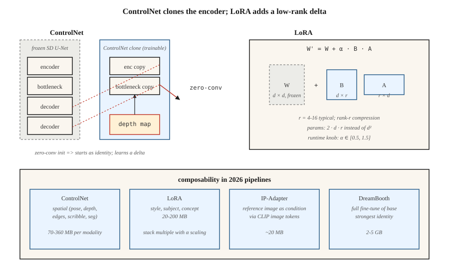

<!-- local-zh-machine-draft: English source is canonical; prose translated automatically, code/math preserved. -->

<a id="controlnet-lora--conditioning"></a>

# ControlNet、LoRA 与条件控制

> 单独的文本是一个笨拙的控制信号。 ControlNet 可让您克隆预训练的 diffusion model 并使用深度图、姿势骨架、涂鸦或边缘图像来引导它。 LoRA 可让您通过训练 1000 万个 parameters 来微调 2B-parameter 模型。他们共同将 Stable Diffusion 从玩具变成了每个机构都提供的 2026 年图像管道。

**类型：** 构建
**语言：** Python
**先决条件：** 第 8·07 阶段（潜在扩散）、第 10 阶段（LLMs 从头开始 — 用于 LoRA 基础）
**时间：** ~75分钟

<a id="the-problem"></a>

## 问题

prompt（例如“一个穿着红色连衣裙的女人在繁忙的街道上遛狗”）不会为模型提供有关 * 狗在哪里 *、* 女人所处的姿势 * 的信息，或者*街道的视角*。文本确定了指定图像所需内容的大约 10%。 rest 是视觉的，无法用语言有效地描述。

从头开始为每个信号（姿势、深度、精明、分割）训练一个新的条件模型是令人望而却步的。您想要保持 2.6B 参数 SDXL 主干冻结，附加一个读取调节的小型侧网络，并让它推动主干的中间 features。那就是控制网。

您还想向模型传授新概念（您的脸、您的产品、您的风格），而不需要重新训练整个模型。您想要一个小 100 倍的增量。这就是 LoRA — 插入现有 attention weights 的低级适配器。

ControlNet + LoRA + 文本 = 2026 年从业者工具包。大多数生产图像管道在 SDXL / SD3 / Flux 基座之上有 2-5 层 LoRAs、1-3 ControlNet 和 IP 适配器。

<a id="the-concept"></a>

## 概念



<a id="controlnet-zhang-et-al-2023"></a>

### ControlNet（Zhang 等人，2023）

采取预先训练的 SD。 *克隆*这encoderU-Net 的一半。 冻结原件。 训练克隆接受额外的调节输入（边缘、深度、姿势）。 将克隆连接回decoder原来的一半与*零卷积*跳过连接（1×1 卷积初始化为零——以无操作开始，学习增量）。

```
SD U-Net decoder:   ... ← orig_enc_features + zero_conv(controlnet_enc(condition))
```

零转换初始化意味着 ControlNet 以身份启动——即使在训练之前也没有坏处。使用标准扩散损失在 1M（prompt，条件，图像）三倍上进行训练。

Per-modality ControlNet 以小型侧面型号提供（SDXL 约为 360M，SD 1.5 约为 70M）。您可以在 inference 编写它们：

```
features += weight_a * control_a(depth) + weight_b * control_b(pose)
```

<a id="lora-hu-et-al-2021"></a>

### LoRA（胡等人，2021）

对于模型中的任何线性层 `W ∈ R^{d×d}`，冻结 `W` 并添加低秩增量：

```
W' = W + ΔW,  ΔW = B @ A,  A ∈ R^{r×d},  B ∈ R^{d×r}
```

与 `r << d`。等级 4-16 是 attention 的标准等级，等级 64-128 是重型微调。新parameters的编号：`2 · d · r`而不是`d²`。对于带有 `d=640`、`r=16` 的 SDXL attention：每个适配器 20k 参数，而不是 410k — 减少了 20 倍。在整个型号中：LoRA 通常为 20-200MB，而基础版为 5GB。

在inference，您可以缩放LoRA：`W' = W + α · B @ A`。 `α = 0.5-1.5` 正常。多个 LoRAs 相加堆叠（通常需要注意的是它们以非线性方式相互作用）。

<a id="ip-adapter-ye-et-al-2023"></a>

### IP 适配器（Ye 等人，2023）

一个微型适配器，接受 *image* 作为条件（以及文本）。使用CLIP图像encoder生成image tokens，将它们与文本tokens一起注入到cross-attention中。每个基本模型约 20MB。允许您在没有 LoRA 的情况下“生成此参考样式的图像”。

<a id="composability-matrix"></a>

## 可组合性矩阵

| 工具 | 它控制什么 | 尺寸 | 何时使用 |
|------|------------------|------|-------------|
| 控制网 | 空间结构（位姿、深度、边缘） | 70-360MB | 精确的布局、构图 |
| LoRA | 风格、主题、概念 | 20-200MB | 个性化、风格化 |
| IP适配器 | 参考图像的风格或主题 | 20MB | 没有文字可以描述它的外观 |
| 文本倒装 | 单一概念作为新 token | 10KB | 旧版，大部分被 LoRA 取代 |
| 梦想展位 | 对主题进行全面微调 | 2-5GB | 强身份、高计算能力 |
| T2I 适配器 | 更轻的 ControlNet 替代方案 | 70MB | 边缘设备，inference 预算 |

ControlNet ≈ 空间。 LoRA ≈ 语义。两者都用。

```figure
v4-controlnet-zero
```

<a id="build-it"></a>

## 动手实现

`code/main.py` 在一维上模拟两种机制：

1. **LoRA.** 预训练线性层 `W`。冷冻它。训练低秩 `B @ A` ，使 `W + BA` 与目标线性层匹配。表明 `r = 1` 足以完美学习 1 级校正。

2. **ControlNet-lite.** 一个“冻结基础”预测器和一个读取额外信号的“侧网络”。侧网络的输出由初始化为零的可学习标量（我们的零转换版本）进行门控。训练并观察闸门的上升。

<a id="step-1-lora-math"></a>

### 步骤1：LoRA数学

```python
def lora(W, A, B, x, alpha=1.0):
    # W is frozen; A, B are the trainable low-rank factors.
    return [W[i][j] * x[j] for i, j in ...] + alpha * (B @ (A @ x))
```

<a id="step-2-zero-init-side-network"></a>

### 步骤 2：零初始化侧网络

```python
side_out = control_net(x, condition)
gated = gate * side_out  # gate initialized to 0
h = base(x) + gated
```

在第 0 步，输出与基数相同。早期训练更新 `gate` 缓慢 - 没有灾难性的漂移。

<a id="pitfalls"></a>

## 陷阱

- **过度缩放 LoRAs.** `α = 2` 或 `α = 3` 是一种常见的“使其更强”黑客，会产生过度风格化/损坏的输出。保留`α ≤ 1.5`。
- **控制网weight冲突。**使用姿势 ControlNetweight1.0 和深度控制网络weight1.0 通常会超调。 总和weights≈ 1.0 是安全的默认值。
- **LoRA 的底座错误。** SDXL LoRAs 在 SD 1.5 上静默无操作，因为 attention 尺寸不匹配。扩散器将在 0.30+ 时发出警告。
- **文本反转漂移。** Tokens 在一个上训练 checkpoint 在另一个上严重漂移。 LoRA更便携。
- **LoRA weight-合并和存储。** 您可以将 LoRA 烘焙到基础模型 weights 中以加快速度inference（无运行时添加），但您失去了在运行时扩展 `α` 的能力。保留两个版本。

<a id="use-it"></a>

## 实际应用

| 目标 | 2026年管道 |
|------|---------------|
| 再现品牌艺术风格 | LoRA 在约 30 张精选图像上进行训练，排名第 32 |
| 将我的脸放入生成的图像中 | DreamBooth 或 LoRA + IP 适配器-FaceID |
| 具体姿势+prompt | ControlNet-Openpose + SDXL + 文本 |
| 深度感知构图 | ControlNet-深度 + SD3 |
| 参考+prompt | IP 适配器 + 文本 |
| 精确布局 | ControlNet-Scribble 或 ControlNet-Canny |
| 背景替换 | ControlNet-Seg + 修复（第 09 课） |
| 快速1步风格 | SDXL-Turbo 上的 LCM-LoRA |

<a id="ship-it"></a>

## 交付成果

保存`outputs/skill-sd-toolkit-composer.md`。 Skill 接受一项任务（输入资产：prompt、可选参考图像、可选姿势、可选深度、可选涂鸦）并输出工具堆栈、weights 和可重现的种子协议。

<a id="exercises"></a>

## 练习

1. **Easy.** 在 `code/main.py` 中，将 LoRA 等级 `r` 从 1 更改为 4。LoRA 在什么等级与等级 2 目标完全匹配三角洲？
2. **Medium.** 在两个目标变换上训练两个单独的 LoRAs。将它们加载在一起并显示它们的附加相互作用。相互作用何时打破线性？
3. **Hard.** 使用扩散器堆叠：SDXL-base + Canny-ControlNet (weight 0.8) + LoRA (α 0.8) + IP 适配器 (weight) 0.6）。当堆栈 weights 变化时，衡量 FID 与 prompt 依从性权衡。

<a id="key-terms"></a>

## 关键术语

| 术语 | 人们怎么说 | 它实际上意味着什么 |
|------|-----------------|-----------------------|
| 控制网 | 《空间控制》 | 克隆 encoder + 零转换跳过；读取调节图像。 |
| 零卷积 | “从身份开始” | 1×1 卷积初始化为零； ControlNet 以无操作方式启动。 |
| LoRA | “低级适配器” | `W + B @ A`，`r << d`；参数比完整微调少 100 倍。 |
| 等级r | “旋钮” | LoRA压缩； 4-16 典型，64+ 适合高度个性化。 |
| α | “LoRA实力” | LoRA 增量的运行时缩放。 |
| IP适配器 | 「参考图片」 | 通过 CLIP-image tokens 的小型图像调节适配器。 |
| 梦想展位 | “全主题微调” | 在约 30 张主题图像上训练完整模型。 |
| 文本倒装 | “新token” | 只学习一个新单词embedding；遗留下来的，大部分都被替换了。 |

<a id="production-note-lora-swaps-controlnet-lanes-multi-tenant-serving"></a>

## 生产说明：LoRA 交换、ControlNet 通道、多租户服务

真正的文本到图像 SaaS 可以为数百个 LoRAs 和同一基础 checkpoint 上的十几个 ControlNet 提供服务。服务问题看起来很像 LLM 多租户（生产文献涵盖了 continuous batching 和 LoRAX / S-LoRA 下的 LLM 案例）：

- **H热交换 LoRAs，不要合并。** 将 `W' = W + α·B·A` 合并到基础中，每步速度提高约 3-5% inference，但会冻结 `α`和基地。使 LoRAs 在 VRAM 中保持热状态，作为 R 级增量；扩散器公开 `pipe.load_lora_weights()` + `pipe.set_adapters([...], adapter_weights=[...])` 用于每个请求激活。交换成本为 `2 · d · r · num_layers` weights — MB 级，亚秒级。
- **ControlNet 作为第二个 attention 通道。** 克隆的 encoder 与基础并行运行。每个 weight 1.0 处的两个 ControlNet = 每步两个额外的 forward passes，而不是一个合并通道。批量大小的余量呈二次方下降。每个活动 ControlNet 的步数成本约为 1.5 倍。
- ** 也量化了 LoRAs。** 如果您量化了基数（请参阅第 07 课，8GB 上的 Flux），则 LoRA 增量也会干净地量化为 8 位或 4 位。 QLoRA 式加载可让您在 4 位 Flux 基础上堆叠 5-10 个 LoRAs，而不会耗尽内存。

Flux 特定：Niels 的 Flux-on-8GB 笔记本将基数量化为 4 位；在 `weight_name="pytorch_lora_weights.safetensors"` 的量化基础上堆叠样式 LoRA (`pipe.load_lora_weights("user/style-lora")`) 仍然有效。这是大多数 SaaS 机构在 2026 年推出的方案。

<a id="further-reading"></a>

## 进一步阅读

- [Zhang、Rao、Agrawala (2023)。向文本到图像添加条件控制 Diffusion Models](https://arxiv.org/abs/2302.05543) — ControlNet。
- [Hu 等人。 （2021）。 LoRA：大型语言模型的低阶适应](https://arxiv.org/abs/2106.09685) — LoRA（最初用于LLMs；扩散端口）。
- [Ye 等人。 （2023）。 IP 适配器：文本兼容图像 Prompt 适配器](https://arxiv.org/abs/2308.06721) — IP 适配器。
- [Mou 等人。 （2023）。 T2I-Adapter：学习适配器以挖掘更多可控能力](https://arxiv.org/abs/2302.08453) - ControlNet 的更轻替代品。
- [Ruiz 等人。 （2023）。 DreamBooth：微调文本到图像 Diffusion Models 用于主题驱动的生成](https://arxiv.org/abs/2208.12242) — DreamBooth。
- [HuggingFace 扩散器 — ControlNet / LoRA / IP 适配器文档](https://huggingface.co/docs/diffusers/training/controlnet) — 参考管道。
