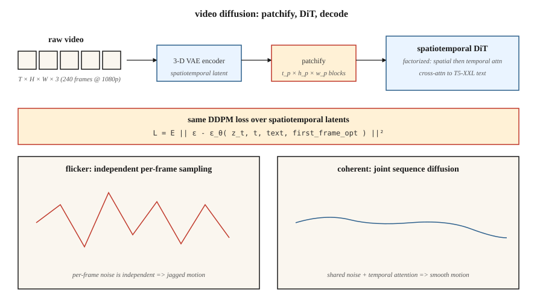

<!-- local-zh-machine-draft: English source is canonical; prose translated automatically, code/math preserved. -->

<a id="video-generation"></a>

# 视频生成

> 图像是二维 tensor。视频是 3D 视频。原理是一样的；计算难度提高了 10-100 倍。 OpenAI 的 Sora（2024 年 2 月）证明了这是可能的。到 2026 年，Veo 2、Kling 1.5、Runway Gen-3、Pika 2.0 和 WAN 2.2 将提供 1080p 文本制作视频，而开放式 weights 堆栈（CogVideoX、HunyuanVideo、Mochi-1、WAN 2.2）则落后 12 个月。

**类型：** 构建
**语言：** Python
**先决条件：** 第 8·07 期（潜伏扩散）、第 7·09 期 (ViT)、第 8·06 期 (DDPM)
**时间：** ~45分钟

<a id="the-problem"></a>

## 问题

24fps 的 10 秒 1080p 视频是 240 帧 1920×1080×3 像素。每个剪辑大约有 1.5 GB 的原始数据。像素空间扩散是不可行的。您需要：

1. **时空压缩。** 将视频（而不是帧）编码为时空序列 patches 的 VAE。
2. **时间一致性。** 框架需要在几秒钟内共享内容、照明和对象标识。网络必须对运动进行建模。
3. **计算预算。** 对于相同的模型大小，视频训练比图像贵 10-100 倍。
4. **Conditioning.** 文本、图像（第一帧）、音频或其他视频。大多数生产型号都接受这四种。

解决这个问题的架构是 **Diffusion Transformer (DiT)**，应用于时空 patches，在巨大的（prompt、标题、视频）数据集上进行训练。与第 06 课相同的扩散损失。

<a id="the-concept"></a>

## 概念



<a id="patchify"></a>

### 修补

使用 3D VAE（学习的时空压缩）对视频进行编码。潜在的形状为 `[T_latent, H_latent, W_latent, C_latent]`。拆分为大小为 `[t_p, h_p, w_p]` 的 patches。对于 Sora 风格模型，`t_p = 1`（每帧 patches）或 `t_p = 2`（每两帧）。 10 秒 1080p 视频压缩至约 20,000-100,000 patches。

<a id="spatiotemporal-dit"></a>

### 时空DiT

transformer 处理 patches 的平坦序列。每个 patch 都有一个 3D 位置 embedding（时间 + y + x）。 Attention 通常被分解：

- 每个帧的 patches 内的 **Spatial attention**。
- **Temporal attention** 在同一空间位置跨帧。
- **Full 3D attention** 贵 16-100 倍；仅在低分辨率或研究中使用。

<a id="text-conditioning"></a>

### 文本调节

Cross-attention，带有大文本 encoder（Sora 为 T5-XXL，CogVideoX-5B 使用 T5-XXL）。长 prompts 很重要 — Sora 的训练集有 GPT 生成的密集字幕，平均每个剪辑有 200 个 tokens。

<a id="training"></a>

### 培训

时空潜伏的标准扩散损失（ε 或 v 预测）。数据：网络视频 + 约 1 亿精选剪辑 + 合成文本字幕。计算：即使是小型研究运行也需要 10,000+ GPU 小时；空级为100,000+。

<a id="the-2026-production-landscape"></a>

## 2026年生产格局

| 模型 | 日期 | 最长持续时间 | 最大分辨率 | 打开weights？ | 值得注意的 |
|-------|------|--------------|---------|---------------|---------|
| 索拉 (OpenAI) | 2024-02 | 60年代 | 1080p | 否 | 第一个大规模显示世界模拟器属性的模型 |
| 索拉涡轮 | 2024-12 | 20多岁 | 1080p | 否 | 生产 Sora 速度提高 5 倍 inference |
| Veo 2（谷歌） | 2024-12 | 8秒 | 4K | 否 | 2025 年最高质量 + 物理 |
| 维奥3 | 2025年第三季度 | 15秒 | 4K | 否 | 原生音频和更强的相机控制 |
| 克林1.5 / 2.1（快手） | 2024-2025 | 10秒 | 1080p | 否 | 2025 年第一季度最佳人体动作 |
| 跑道 Gen-3 Alpha | 2024-06 | 10秒 | 768p | 否 | 顶部专业视频工具 |
| 鼠兔2.0 | 2024-10 | 5秒 | 1080p | 否 | 最强的角色一致性 |
| CogVideoX (THUDM) | 2024 | 10秒 | 720p | 是（2B、5B） | 首次公开5B级视频 |
| 混源视频（腾讯） | 2024-12 | 5秒 | 720p | 是 (13B) | 2024 年末开放 SOTA |
| Mochi-1（玄武） | 2024-10 | 5.4秒 | 480p | 是（10B） | 最宽松的许可 |
| 广域网2.2（阿里巴巴） | 2025-07 | 5秒 | 720p | 是的 | 2025年中期最强开放模型 |

开放 weights 正在比图像领域更快地缩小差距：HunyuanVideo + WAN 2.2 LoRAs 已经在 2026 年中期为大多数开源工作流程提供支持。

```figure
video-diffusion-denoise
```

<a id="build-it"></a>

## 动手实现

`code/main.py` 模拟核心时空 DiT 思想：修补一个小型合成视频，添加每个 patch 位置 embedding，并使用 transformer 风格的 attention 对整个序列进行降噪patches。无numpy；纯Python。我们表明，当相邻帧 patches 共享降噪器和位置 embeddings 时，即使在一维中也会出现时间相干性。

<a id="step-1-patchify-a-synthetic-1-d-video"></a>

### 第 1 步：修补合成的一维“视频”

```python
def make_video(T_frames=8, rng=None):
    # a "video" is a sequence of 1-D values following a smooth trajectory
    base = rng.gauss(0, 1)
    return [base + 0.3 * t + rng.gauss(0, 0.1) for t in range(T_frames)]
```

<a id="step-2-position-embedding-per-frame"></a>

### 步骤2：每帧定位embedding

```python
def pos_embed(t, dim):
    return sinusoidal(t, dim)
```

<a id="step-3-denoiser-sees-the-whole-sequence"></a>

### 第 3 步：降噪器查看整个序列

我们的微型网络不是独立地对每个帧进行去噪，而是连接所有帧值+它们的位置 embeddings 并联合预测所有帧的噪声。

<a id="step-4-temporal-coherence-test"></a>

### 步骤4：时间相干性测试

训练后，对视频进行采样。测量帧间增量。如果模型已经学习了时间结构，则每个帧的增量保持小于 sampling 。

<a id="pitfalls"></a>

## 陷阱

- ** 每帧独立 sampling = 闪烁。** 如果分别对每个帧运行图像扩散，则输出会闪烁，因为每个帧的噪声是独立的。视频扩散通过 attention 或共享噪声耦合帧来解决此问题。
- **Naive 3D attention = OOM.** Full 3D attention 在 10 秒 1080p 上潜在的是数千亿次操作。分解为空间+时间。
- ** 数据字幕比大小更重要。** Sora 相对于之前的工作的主要升级是对大约 10 倍详细的字幕进行培训（GPT-4 重新标记的剪辑）。 OpenAI的技术报告对此有明确说明。
- ** 第一帧调节。** 大多数生产型号也接受图像作为第一帧。这是“图像转视频”模式；训练包括这个变体。
- **物理漂移。** 长剪辑（>10s）会积累微妙的不一致。滑动窗口生成+关键帧锚定有帮助。

<a id="use-it"></a>

## 实际应用

| 应用场景 | 2026年选秀 |
|----------|-----------|
| 最高质量的文本转视频，托管 | Veo 3 或 Sora |
| 摄像机控制的电影 | 带运动画笔的 Runway Gen-3 |
| 剪辑中的字符一致性 | 鼠兔 2.0 或克林 2.1 |
| 打开weights，快速微调 | 广域网2.2+LoRA |
| 图像到视频 | WAN 2.2-I2V、Kling 2.1 I2V 或跑道 |
| 音频到视频唇形同步 | Veo 3（原生音频）或专用唇形同步模型 |
| 视频编辑 | 《跑道第二幕》、Kling Motion Brush、Flux-Kontext（静止帧） |

2024 年至 2026 年间，同等质量视频的每秒成本下降了 20 倍。

<a id="ship-it"></a>

## 交付成果

保存`outputs/skill-video-brief.md`。 Skill 获取视频简介（时长、长宽比、风格、摄像机计划、主题一致性、音频）并输出：模型 + 托管、prompt 脚手架（摄像机语言、主题描述、运动描述符）、种子 + 再现性协议和帧级 QA 检查表。

<a id="exercises"></a>

## 练习

1. **Easy.** 在 `code/main.py` 中，比较 (a) 独立每帧 sampling 的帧间增量，(b) 联合序列 sampling。报告增量的均值和方差。
2. **Medium.** 添加第一帧条件：将帧 0 固定为给定值并对 rest 进行采样。测量固定值如何传播。
3. **Hard.** 使用 HuggingFace 扩散器在本地 GPU 上运行 CogVideoX-2B。时间 20 inference 以 720p 步进，播放 6 秒剪辑。分析时空 attention 以识别瓶颈。

<a id="key-terms"></a>

## 关键术语

| 术语 | 人们怎么说 | 它实际上意味着什么 |
|------|-----------------|-----------------------|
| 视频 VAE | “3-D VAE” | Encoder 压缩 `(T, H, W, C)` → 时空潜伏。 |
| Patches | “tokens” | 固定大小的 3D 潜在块；输入到 DiT。 |
| 因式分解 attention | “空间+时间” | 在空间上运行attention，然后在时间上运行；跳过完整的 3-D attention。 |
| 图像到视频 (I2V) | “将这张照片动画化” | 模型采用图像+文本，输出从其开始的视频。 |
| 关键帧调节 | “锚框” | 固定特定帧来控制视频的弧线。 |
| 运动笔刷 | 《方向提示》 | UI 输入，用户将运动矢量绘制到图像上。 |
| 重新字幕 | “密集字幕” | 使用 LLM 使用详细的 prompts 重新标记训练剪辑。 |
| 闪烁 | 《时空神器》 | 帧与帧不一致；通过耦合降噪进行修复。 |

<a id="production-note-video-latents-are-a-memory-bandwidth-problem"></a>

## 制作说明：视频潜伏是一个内存带宽问题

24 fps 的 10 秒 1080p 剪辑为 240 帧 × 1920 × 1080 × 3 ≈ 1.5 GB 原始像素。经过 4 倍视频 VAE 压缩 (`2 × spatial × 2 × temporal`) 后，每个请求的潜在值约为 100 MB。通过时空 DiT 在批次 1 中运行 30 个步骤，您将通过 HBM 移动约 3 GB/步 — 瓶颈是内存带宽，而不是 FLOP。

三个生产旋钮，全部直接来自生产-inference文献inference章节：

- DiT.** 文本到视频模型的 **TP 通常≥10B 参数。 4 个 H100 中 TP=4 是标准；对于 405B 级型号，PP=2 × TP=2。每步的延迟随着 TP 大致呈线性下降，直至达到 all-reduce 墙。
- **帧批处理 = continuous batching.** 在生成时，视频在概念上是由 attention 链接的一批帧。 Continuous batching（飞行中调度）适用：如果模型架构允许滑动窗口生成，则在返回帧 `t-1` 时开始渲染帧 `t+1`。
- **剪辑级 prefill 缓存。** 对于图像到视频，第一帧调节类似于 LLM 的 prompt prefill：一次，跨时间 decoder 通道重复使用。这实际上是视频的 KV 缓存。

<a id="further-reading"></a>

## 进一步阅读

- [布鲁克斯等人。 （2024）。视频生成模型作为世界模拟器](https://openai.com/index/video-generation-models-as-world-simulators/) — Sora 技术报告。
- [Yang 等人。 （2024）。 CogVideoX：与专家合作的文本到视频 Diffusion Models Transformer](https://arxiv.org/abs/2408.06072) — CogVideoX。
- [Kong 等人。 （2024）。 HunyuanVideo：大型视频生成模型的系统框架](https://arxiv.org/abs/2412.03603) — HunyuanVideo。
- [Genmo (2024)。 Mochi-1 技术报告](https://www.genmo.ai/blog/mochi) — Mochi-1。
- [阿里巴巴（2025）。 WAN 2.2](https://wanvideo.io/) — 2025 年中期开放 SOTA。
- [Ho、Salimans、Gritsenko 等人。 （2022）。视频 Diffusion Models](https://arxiv.org/abs/2204.03458) — 开创性的视频扩散论文。
- [Blattmann 等人。 （2023）。对齐您的潜伏（视频 LDM）](https://arxiv.org/abs/2304.08818) — 稳定视频扩散的祖先。
