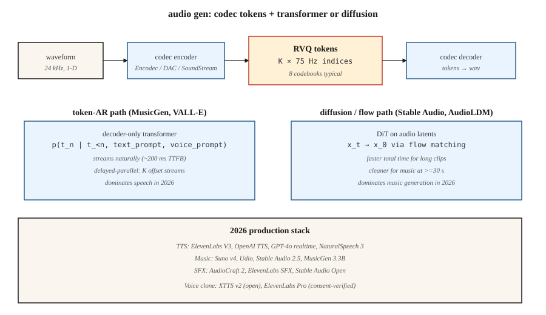

<!-- local-zh-machine-draft: English source is canonical; prose translated automatically, code/math preserved. -->

<a id="audio-generation"></a>

# 音频生成

> 音频是 16-48 kHz 的一维信号。 5 秒的剪辑包含 80-240k 个样本。没有 transformer 直接参与该序列。 2026 年每个生产音频模型的解决方案都是相同的：神经编解码器（Encodec、SoundStream、DAC）将音频压缩为 50-75 Hz 的离散 tokens，transformer 或 diffusion model 生成 tokens。

**类型：** 构建
**语言：** Python
**先决条件：** 阶段 6·02（音频 Features）、阶段 6·04（ASR）、阶段 8·06（DDPM）
**时间：** ~45分钟

<a id="the-problem"></a>

## 问题

三个音频生成任务：

1. **文本转语音。** 给定文本，产生语音。干净的语音是窄带的，并且具有很强的语音结构——transformer-over-tokens很好地解决了这一问题。 VALL-E（微软）、NaturalSpeech 3、ElevenLabs、OpenAI TTS。
2. **音乐生成。** 给定一个prompt（文本、旋律、和弦进行、流派），制作音乐。分布更广泛。 MusicGen（元）、稳定音频 2.5、Suno v4、Udio、Riffusion。
3. **音频效果/声音设计。** 给定一个prompt，产生环境声音或拟音。 AudioGen、AudioLDM 2、稳定音频打开。

这三者都在同一基板上运行：神经音频编解码器 + token-AR 或扩散发生器。

<a id="the-concept"></a>

## 概念



<a id="neural-audio-codecs"></a>

### 神经音频编解码器

编码解码器（Meta，2022）、SoundStream（Google，2021）、描述音频编解码器（DAC，2023）。卷积 encoder 将波形压缩为每个时间步向量；残差向量 quantization (RVQ) 将每个向量转换为 K 个码本索引的级联。 Decoder 反转它。 2 kbps 下的 24 kHz 音频，使用 75 Hz 下的 8 个 RVQ 码本 = 600 tokens/秒。

```
waveform (16000 samples/sec)
    └─ encoder conv ─┐
                     ├─ RVQ layer 1 → indices at 75 Hz
                     ├─ RVQ layer 2 → indices at 75 Hz
                     ├─ ...
                     └─ RVQ layer 8
```

<a id="two-generative-paradigms-on-top"></a>

### 最上面的两种生成范式

**Token-autoregressive.** 将 RVQ tokens 压平为序列，仅运行 decoder transformer。 MusicGen 使用“延迟并行”来与每个流偏移并行发出 K 个码本流。 VALL-E 从文本 prompt + 3 秒语音样本生成语音 tokens。

**潜在扩散。** 将编解码器 tokens 打包为连续潜伏或使用分类扩散对其进行建模。 Stable Audio 2.5 在连续音频潜伏上使用流匹配。 AudioLDM 2 使用文本到梅尔到音频的扩散。

2024-2026 年趋势：流匹配在音乐方面获胜（更快的 inference，更干净的样本），而 token-AR 仍然主导语音，因为它具有自然因果关系并且流式传输良好。

<a id="production-landscape"></a>

## 生产景观

| 系统 | 任务 | 骨干网 | 延迟 |
|--------|------|----------|---------|
| 十一实验室 V3 | 语音合成 | Token-AR + 神经声码器 | 第一个 ~300ms token |
| OpenAI GPT-4o音频 | 全双工语音 | 端到端多模态 AR | 〜200毫秒 |
| 自然语音3 | 语音合成 | 潜流匹配 | 非streaming |
| 稳定音频2.5 | 音乐/特效 | DiT + 音频潜在流匹配 | 1 分钟剪辑约 10 秒 |
| 苏诺v4 | 完整歌曲 | 未公开； token-AR 疑似 | 每首歌曲约 30 秒 |
| 音频v1.5 | 完整歌曲 | 未公开 | 每首歌曲约 30 秒 |
| 音乐生成器3.3B | 音乐 | Token-AR 编码器 32kHz | 实时 |
| 音频工艺2 | 音乐+音效 | 流量匹配 | 5 秒剪辑约 5 秒 |
| 扩散 v2 | 音乐 | 谱图扩散 | 〜10秒 |

```figure
score-matching
```

<a id="build-it"></a>

## 动手实现

`code/main.py`模拟核心思想：训练一个微小的下一个-token transformer关于合成“audio token“由两种不同的“风格”（交替的低和高）生成的序列tokens对于样式 A，单调斜坡对于样式 B）。 款式和样品条件。

<a id="step-1-synthetic-audio-tokens"></a>

### 步骤1：合成audio tokens

```python
def make_tokens(style, length, vocab_size, rng):
    if style == 0:  # "speech-like": alternating
        return [i % vocab_size for i in range(length)]
    # "music-like": ramp
    return [(i * 3) % vocab_size for i in range(length)]
```

<a id="step-2-train-a-tiny-token-predictor"></a>

### 第 2 步：训练一个小型 token 预测器

以风格为条件的二元模型预测器。重点是模式：编解码器 tokens → cross-entropy 训练 → autoregressive sampling。

<a id="step-3-sample-conditionally"></a>

### 第 3 步：有条件采样

给定样式 token 和起始 token，从预测分布中采样下一个 token。继续前往 20-40 tokens。

<a id="pitfalls"></a>

## 陷阱

- **Codec 质量限制了输出质量。** 如果编解码器不能忠实地表示声音，那么生成器质量再多也无济于事。 DAC是目前开放最好的。
- **RVQ 误差累积。** 每个 RVQ 层都会对前一层的残差进行建模。第 1 层上的错误传播。较高层上的 Sampling 和 temperature 0 会有所帮助。
- **音乐结构。** tokens 30秒在75 Hz时为20k+ tokens。很难transformers。 MusicGen使用滑动窗口+prompt延续；稳定音频使用较短的剪辑+交叉淡入淡出。
- ** 边界处的伪影。** 生成的剪辑之间的淡入淡出需要仔细的重叠添加。
- **干净的数据胃口。** 音乐生成器需要数万小时的授权音乐。 Suno / Udio RIAA 诉讼（2024 年）使这一点浮出水面。
- **语音克隆伦理。** 3秒的样本加上文本prompt足以让VALL-E / XTTS / ElevenLabs克隆语音。每个生产模型都需要滥用检测+选择退出列表。

<a id="use-it"></a>

## 实际应用

| 任务 | 2026 堆栈 |
|------|------------|
| 商业 TTS | ElevenLabs、OpenAI TTS 或 Azure 神经网络 |
| 语音克隆（经过同意验证） | XTTS v2（开放）或 ElevenLabs Pro |
| 背景音乐，节奏快 | 稳定音频 2.5 API、Suno 或 Udio |
| 音乐与歌词 | Suno v4 或 Udio v1.5 |
| 音效/拟音 | AudioCraft 2、ElevenLabs SFX 或稳定音频开放 |
| 实时语音 agent | GPT-4o实时或Gemini直播 |
| 打开-weights音乐研究 | MusicGen 3.3B、稳定音频开放 1.0、AudioLDM 2 |
| 配音/翻译 | HeyGen、ElevenLabs 配音 |

<a id="ship-it"></a>

## 交付成果

保存`outputs/skill-audio-brief.md`。 Skill 需要音频简介（任务、持续时间、风格、语音、许可证）和输出：模型 + 托管、prompt 格式（流派标签、风格描述符、结构标记）、编解码器 + 生成器 + 声码器链、种子协议和评估计划（MOS / CLAP 分数 / TTS / 用户 A/B 的 CER）。

<a id="exercises"></a>

## 练习

1. **Easy.** 运行 `code/main.py` 并显式设置样式。验证生成的序列与样式的模式匹配。
2. **Medium.** 添加延迟并行解码：模拟 tokens 的 2 个流，必须保持 1 步偏移。训练联合预测器。
3. **Hard.** 使用 HuggingFace transformers 在本地运行 MusicGen-small。使用三个不同的prompts生成一个10秒的剪辑； A/B 表示风格坚持。

<a id="key-terms"></a>

## 关键术语

| 术语 | 人们怎么说 | 它实际上意味着什么 |
|------|-----------------|-----------------------|
| 编解码器 | 《神经压缩》 | Encoder / decoder 用于音频；典型输出为 50-75 Hz tokens。 |
| RVQ | “剩余VQ” | K 个量化器级联；每个模型都是前一个模型的残差。 |
| Token | “一个编解码器符号” | 码本的离散索引；典型值为 1024 或 2048。 |
| 延迟并行 | “偏移码本” | 发出 K 个 token 流，具有交错偏移量以减少序列长度。 |
| 流量匹配 | “2024 年音频的胜利” | 扩散的更直路径替代方案；更快的sampling。 |
| 语音 prompt | “3秒样本” | 引导克隆语音的扬声器 embedding 或 token 前缀。 |
| 梅尔谱图 | “视觉” | 对数幅度感知频谱图；被许多 TTS 系统使用。 |
| 声码器 | “梅尔挥手” | 将梅尔频谱图转换回音频的神经组件。 |

<a id="production-note-audio-is-a-streaming-problem"></a>

## 制作说明：音频是streaming问题

音频是 modality 用户期望在生成时到达 * 的一种输出 *，而不是一次全部输出。从生产角度来说，这意味着 TPOT 很重要 (Time Per Output Token)，因为用户的收听速度是目标吞吐量，而不是阅读速度。对于以 ~75 tokens/秒（编码解码器）标记的 16kHz 音频，服务器必须为每个用户生成 ≥75 tokens/秒才能保持播放流畅。

两个架构后果：

- **Flow 匹配的音频模型无法轻松进行流式传输。** Stable Audio 2.5 和 AudioCraft 2 一次渲染固定剪辑长度。为了进行流式传输，您需要对剪辑进行分块并重叠边界（例如滑动窗口扩散），与编解码器 AR 模型相比，会增加 100-300 毫秒的延迟开销。

如果产品是“实时语音聊天”或“实时音乐延续”，请选择编解码器 AR 路径。如果是“提交时渲染 30 秒的剪辑”，则流匹配在质量和总延迟方面获胜。

<a id="further-reading"></a>

## 进一步阅读

- [Défossez 等人。 （2022）。编码器：高保真神经音频压缩](https://arxiv.org/abs/2210.13438) — 编解码器标准。
- [Zeghidour 等人。 （2021）。 SoundStream](https://arxiv.org/abs/2107.03312) — 第一个广泛使用的神经音频编解码器。
- [Kumar 等人。 （2023）。采用改进的 RVQGAN (DAC) 的高保真音频压缩](https://arxiv.org/abs/2306.06546) — DAC。
- [Wang 等人。 （2023）。神经编解码器语言模型是 Zero-Shot 文本到语音合成器 (VALL-E)](https://arxiv.org/abs/2301.02111) — VALL-E。
- [Copet 等人。 （2023）。简单可控的音乐生成（MusicGen）](https://arxiv.org/abs/2306.05284) — MusicGen.
- [Liu 等人。 （2023）。 AudioLDM 2：通过自我监督学习整体音频生成 Pretraining](https://arxiv.org/abs/2308.05734) — AudioLDM 2。
- [稳定人工智能（2025）。稳定音频 2.5](https://stability.ai/news-updates/stability-ai-introduces-stable-audio-25-the-first-audio-model-built-for-enterprise-sound-production-at-scale) — 2025 具有流程匹配的文本到音乐。
