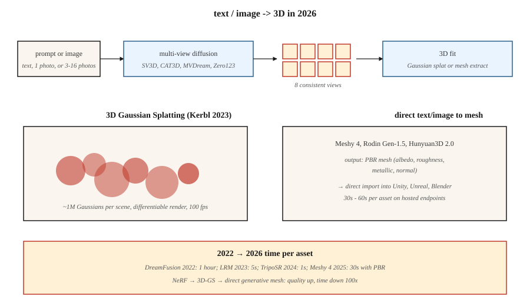

<!-- local-zh-machine-draft: English source is canonical; prose translated automatically, code/math preserved. -->

<a id="3d-generation"></a>

# 3D生成

> 3D 是 modality，其中 2D 到 3D 的杠杆作用最强。 2023 年的突破是 3D 高斯泼溅。 2024-2026 生成推动层多视图扩散+顶部的 3D 重建，从单个 prompt 或照片生成对象和场景。

**类型：** 了解
**语言：** Python
**先决条件：** 第 4 期（视觉）、第 8·07 期（潜伏扩散）
**时间：** ~45分钟

<a id="the-problem"></a>

## 问题

3D 内容很痛苦：

- **Representation.** 网格、点云、体素网格、符号距离场 (SDF)、神经辐射场 (NeRF)、3D 高斯。每个都有权衡。
- **数据稀缺。** ImageNet有14M图像。最大的干净 3D 数据集（Objaverse-XL，2023）有约 1000 万个对象，质量最低。
- **Memory.** 一个512立方体素网格为128M体素；一个有用的场景 NeRF 需要 1M 样本/射线。生成比重建更难。
- **Supervision.** 对于 2D 图像，您拥有像素。对于 3D，您通常有少量 2D 视图，并且必须提升到 3D。

2026 堆栈将这两个问题分开。首先，用diffusion model生成*2D多视图图像*。其次，将 *3D 表示 *（通常是高斯分布）拟合到这些图像。

<a id="the-concept"></a>

## 概念



<a id="representation-3d-gaussian-splatting-kerbl-et-al-2023"></a>

### 表示形式：3D 高斯泼溅（Kerbl 等人，2023）

将场景表示为约 1M 3D 高斯云。每个都有 59 个 parameters：位置 (3)、协方差（6 或四元数 4 + 比例 3）、不透明度 (1)、球谐颜色（3 阶为 48，0 阶为 3）。

渲染 = 投影 + Alpha 合成。快速（4090 上 1080p 时约 100 fps）。可微分。通过 gradient descent 与地面真实照片进行拟合。一个场景在消费者 GPU 上需要 5-30 分钟。

2023-2024 年的两项创新最重要：
- **生成高斯图。** LGM、LRM、InstantMesh 等模型直接从一张或多张图像预测高斯云。
- **4D 高斯溅射。** 高斯，具有动态场景的每帧偏移。

<a id="multi-view-diffusion"></a>

### 多视角扩散

微调预训练图像 diffusion model，以从文本 prompt 或单个图像生成同一对象的多个一致视图。 Zero123（Liu 等人，2023）、MVDream（Shi 等人，2023）、SV3D（稳定性，2024）、CAT3D（Google，2024）。通常输出物体周围的 4-16 个视图，通过高斯溅射或 NeRF 提升为 3D。

<a id="text-to-3d-pipelines"></a>

### 文本到 3D 管道

| 模型 | 输入 | 输出 | 时间 |
|-------|-------|--------|------|
| 梦想融合 (2022) | 文本 | NeRF 通过 SDS | 每个资产约 1 小时 |
| 魔幻3D | 文本 | 网格+纹理 | 约40分钟 |
| E型（OpenAI，2023） | 文本 | 隐式3D | 约 1 分钟 |
| SJC / 多产梦想家 | 文本 | NeRF/网格 | 约 30 分钟 |
| LRM（元，2023） | 图像 | 三翼飞机 | 〜5秒 |
| 即时网格 (2024) | 图像 | 网格 | 〜10秒 |
| SV3D（稳定性，2024） | 图像 | 新颖的观点 | 约 2 分钟 |
| CAT3D（谷歌，2024） | 1-64 张图片 | 3D神经射频 | 约 1 分钟 |
| 特里波SR (2024) | 图像 | 网格 | 〜1秒 |
| 网格 4 (2025) | 文字+图像 | PBR网格 | 〜30秒 |
| 罗丹 Gen-1.5 (2025) | 文字+图像 | PBR网格 | 〜60秒 |
| 腾讯混元3D 2.0 (2025) | 图像 | 网格 | 〜30秒 |

2025-2026年方向：使用适合游戏引擎的PBR材质的直接文本到网格模型。多视图扩散中间步骤仍然是一般对象的最佳表现方法。

<a id="nerf-for-context"></a>

### NeRF（上下文）

神经辐射场（Mildenhall 等人，2020）。一个微型 MLP 采用 `(x, y, z, view direction)` 并输出 `(color, density)`。通过沿光线积分进行渲染。质量优于基于网格的小说视图合成，但渲染速度慢 100-1000 倍。在大多数实时应用中被高斯泼溅法取代，但在研究中仍然占主导地位。

```figure
v4-3d-multiview
```

<a id="build-it"></a>

## 动手实现

`code/main.py` 实现了一个玩具 2D“高斯分布”拟合：将合成目标图像（平滑的 gradient）表示为 2D 高斯分布的总和。通过 gradient descent 优化位置、颜色和协方差以匹配目标。您会看到两个核心操作：前向渲染（splat + alpha-composite）和 gradient descent 拟合。

<a id="step-1-2d-gaussian-splat"></a>

### 第 1 步：2D 高斯分布

```python
def gaussian_at(x, y, gaussian):
    px, py = gaussian["pos"]
    sigma = gaussian["sigma"]
    d2 = (x - px) ** 2 + (y - py) ** 2
    return math.exp(-d2 / (2 * sigma * sigma))
```

<a id="step-2-render-by-summing-splats"></a>

### 第 2 步：通过求和 splats 进行渲染

```python
def render(image_size, gaussians):
    img = [[0.0] * image_size for _ in range(image_size)]
    for g in gaussians:
        for y in range(image_size):
            for x in range(image_size):
                img[y][x] += g["color"] * gaussian_at(x, y, g)
    return img
```

真正的 3D 高斯泼溅按深度和 alpha 复合按顺序对高斯进行排序。我们的 2D 玩具只是求和。

<a id="step-3-fit-by-gradient-descent"></a>

### 步骤3：通过gradient descent进行拟合

```python
for step in range(steps):
    pred = render(size, gaussians)
    loss = mse(pred, target)
    gradients = compute_grads(pred, target, gaussians)
    update(gaussians, gradients, lr)
```

<a id="pitfalls"></a>

## 陷阱

- **View 不一致。** 如果您独立生成 4 个视图，并且它们在对象结构方面存在分歧，则 3D 拟合会模糊。修复：共享 attention 的多视图扩散。
- **背面 hallucination.** 单图像 → 3D 必须发明看不见的一面。质量差异很大。
- **高斯 splat 爆炸。** 无约束训练增长到 10M splat 和过度拟合。致密化 + 修剪启发式（来自 3D-GS 原始论文）至关重要。
- **拓扑问题。** 隐式场 (SDF) 中的网格通常有孔或自相交。在发货前运行重新网格化程序（例如搅拌机的体素重新网格化）。
- **训练数据许可证。** Objaverse有混合许可证；商业用途因型号而异。

<a id="use-it"></a>

## 实际应用

| 任务 | 2026年选秀 |
|------|-----------|
| 从照片重建场景 | 高斯泼溅（3DGS、Gsplat、Scaniverse） |
| 游戏的文本到 3D 对象 | Meshy 4 或 Rodin Gen-1.5（PBR 输出） |
| 图像转 3D | 混源3D 2.0、TripoSR、InstantMesh |
| 从少量图像合成新颖的视图 | CAT3D、SV3D |
| 动态场景重建 | 4D 高斯泼溅 |
| 阿凡达/穿着衣服的人类 | 高斯头像，拥抱 |
| 研究/SOTA | 无论上周下降了什么 |

对于在游戏或电子商务管道中传送生产 3D：Mesy 4 或 Rodin Gen-1.5 输出 PBR 网格，可直接进入 Unity / Unreal。

<a id="ship-it"></a>

## 交付成果

保存`outputs/skill-3d-pipeline.md`。技能需要一份 3D 简介（输入：文本/一张图像/几张图像；输出：网格/splat/NeRF；用法：渲染/游戏/VR）和输出：管道（多视图扩散 + 拟合，或直接网格模型）、基础模型、迭代预算、拓扑后处理、所需的材质通道。

<a id="exercises"></a>

## 练习

1. **Easy.** 使用 4、16、64 高斯运行 `code/main.py`。报告最终 MSE 与目标的比较。
2. **Medium.** 扩展到颜色高斯 (RGB)。确认重建与目标颜色图案匹配。
3. **Hard.** 使用 gsplat 或 Nerfstudio，根据 50 张照片重建真实物体。报告针对保留视图的拟合时间和最终 SSIM。

<a id="key-terms"></a>

## 关键术语

| 术语 | 人们怎么说 | 它实际上意味着什么 |
|------|-----------------|-----------------------|
| 3D 高斯泼溅 | “3DGS” | 场景为 3D 高斯云；可微分的 alpha 复合渲染。 |
| 神经射频 | 《神经辐射场》 | MLP输出3D点的颜色+密度；通过光线积分渲染。 |
| 三翼飞机 | “三个二维平面” | 将 3D 分解为三个 2D 轴对齐的 feature 网格；比体积便宜。 |
| 安全数据表 | “分数蒸馏sampling” | 使用 2D 扩散分数作为伪 gradient 来训练 3D 模型。 |
| 多视角扩散 | “同时查看多个视图” | Diffusion model，输出一批一致的相机视图。 |
| 策略性BR | “基于物理的渲染” | 具有反照率、粗糙度、金属、法线通道的材质。 |
| 致密化 | “长出斑点” | 3DGS 训练启发式：在高 gradient 区域中分割/克隆 splats。 |

<a id="production-note-3d-has-no-shared-substrate-yet"></a>

## 生产说明：3D尚无共享基板

与图像（潜在扩散 + DiT）和视频（时空 DiT）不同，3D 在 2026 年没有单一的主导运行时间。生产决策树在表示上分叉：

- **NeRF/三翼飞机。** Inference是光线行进 + 每个样本的 MLP 前向。 512² 渲染需要数百万个 MLP 转发。 积极地对射线样本进行批处理； SDPA/xformers 适用。
- **多视图扩散+LRM重建。** 两级管道。第 1 阶段（多视图 DiT）是一个扩散服务器，就像第 07 课一样。第 2 阶段 (LRM transformer) 是视图上的一次性 forward pass。整体延迟概况是“扩散+一次性”——相应地选择每阶段服务原语。
- **SDS / DreamFusion.** 每资产优化，而不是 inference。构建作业，而不是请求处理程序。

对于大多数 2026 产品，正确的答案是“根据请求运行多视图 diffusion model，异步重建为 3DGS，为 3DGS 提供实时查看服务”。这可以在 GPU-inference 服务器（快速）和离线 optimizer（慢速）之间干净地划分工作负载。

<a id="further-reading"></a>

## 进一步阅读

- [Mildenhall 等人。 （2020）。 NeRF：将场景表示为神经辐射场](https://arxiv.org/abs/2003.08934) - NeRF。
- [Kerbl 等人。 （2023）。用于实时辐射场渲染的 3D 高斯溅射](https://arxiv.org/abs/2308.04079) — 3DGS。
- [Poole 等人。 （2022）。 DreamFusion：使用 2D Diffusion](https://arxiv.org/abs/2209.14988) 进行文本转 3D — SDS。
- [Liu 等人。 （2023）。零 1 到 3：Zero-shot 一张图像到 3D 对象](https://arxiv.org/abs/2303.11328) — Zero123。
- [Shi 等人。 （2023）。 MVDream](https://arxiv.org/abs/2308.16512) — 多视图扩散。
- [hong 等人。 （2023）。 LRM：单个图像到 3D](https://arxiv.org/abs/2311.04400) 的大型重建模型 — LRM。
- [Gao 等人。 （2024）。 CAT3D：使用多视图以 3D 方式创建任何内容 Diffusion Models](https://arxiv.org/abs/2405.10314) — CAT3D。
- [稳定人工智能（2024）。稳定视频 3D (SV3D)](https://stability.ai/research/sv3d-novel-multi-view-synthesis-and-3d-generation-from-a-single-image-using-latent-video-diffusion) — SV3D。
