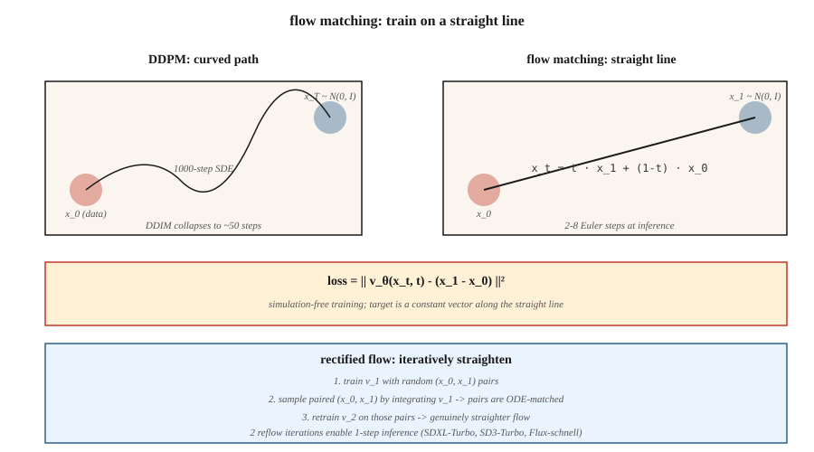

<!-- local-zh-machine-draft: English source is canonical; prose translated automatically, code/math preserved. -->

<a id="flow-matching--rectified-flows"></a>

# Flow Matching 与 Rectified Flows

> Diffusion models 需要 20-50 sampling 步，因为它们从噪声到数据走一条弯曲的路径。流匹配（Lipman et al., 2023）和修正流（Liu et al., 2022）训练直线路径。更直的路径意味着更少的步骤意味着更快 inference。 Stable Diffusion 3、Flux.1 和 AudioCraft 2 都在 2024 年切换到流匹配。

**类型：** 构建
**语言：** Python
**先决条件：** 第 8 阶段·06 (DDPM)，第 1 阶段·微积分
**时间：** ~45分钟

<a id="the-problem"></a>

## 问题

DDPM的逆向过程是从`N(0, I)`回到数据分布的1000步随机行走。 DDIM 将其缩减为 20-50 个确定性步骤。您想要更少的步骤——最好是一步。阻碍因素是求解逆过程的 ODE 是僵硬的；路径是弯曲的。

如果您可以训练模型，使从噪声到数据的路径为 * 直线 *，则从 `t=1` 到 `t=0` 的单个欧拉步骤就可以工作。流匹配直接构建此：定义从 `x_1 ∼ N(0, I)` 到 `x_0 ∼ data` 的直线插值，训练向量场 `v_θ(x, t)` 以匹配其时间导数，在 inference 处积分。

整流流 (Liu 2022) 更进一步：通过回流过程迭代地拉直路径，产生逐渐接近线性的 ODE。经过两次回流迭代后，2 步采样器可与 50 步 DDPM 质量相匹配。

<a id="the-concept"></a>

## 概念



<a id="straight-line-flow"></a>

### 直线流

定义：

```
x_t = t · x_1 + (1 - t) · x_0,   t ∈ [0, 1]
```

其中 `x_0 ~ data` 和 `x_1 ~ N(0, I)`。沿这条直线的时间导数是常数：

```
dx_t / dt = x_1 - x_0
```

定义一个神经向量场 `v_θ(x_t, t)` 并训练它以匹配该导数：

```
L = E_{x_0, x_1, t} || v_θ(x_t, t) - (x_1 - x_0) ||²
```

这是 ** 条件流匹配 ** 损失（Lipman 2023）。训练无需模拟：您无需展开 ODE。只需采样 `(x_0, x_1, t)` 并回归即可。

<a id="sampling"></a>

### Sampling

在inference处，对学习到的向量场*backwards*进行及时积分：

```
x_{t-Δt} = x_t - Δt · v_θ(x_t, t)
```

从 `x_1 ~ N(0, I)` 开始，欧拉步降到 `t=0`。

<a id="rectified-flow-liu-2022"></a>

### 整流流（Liu 2022）

直线流有效，但学习到的路径是 * 实际上不是直的 * — 它们是曲线，因为许多 `x_0` 可以映射到相同的 `x_1`。修正流程的回流步骤：

1. 使用随机配对训练流模型 v_1。
2. 通过将来自 `x_1` 的 v_1 集成到其着陆 `x_0`，样本 N 对 `(x_1, x_0)`。
3. 在这些配对示例上训练 v_2。因为这些对现在是“ODE 匹配的”，所以它们之间的直线插值确实更加平坦。
4. 重复。

实际上，2 次回流迭代可以使您接近线性，从而实现 2-4 步 inference。 SDXL-Turbo、SD3-Turbo、LCM 都是从流量匹配中提取的模型。

<a id="why-this-won-for-images-in-2024"></a>

### 为什么它在 2024 年的图像领域获胜

三个原因：

1. **免模拟训练** - 训练期间无需展开ODE，实现起来很简单。
2. **更好的损耗几何** — 直线路径具有一致的信噪比，而 DDPM ε 损耗在时间表边缘具有较差的 SNR。
3. **Faster inference** — SDXL-Turbo 质量下的 4-8 个步骤； 1 步稠度蒸馏。

<a id="flow-matching-vs-ddpm--the-exact-connection"></a>

## 流量匹配与 DDPM — 精确连接

与高斯条件路径匹配的流是具有特定噪声时间表 * 的扩散 *。选择 `x_t = α(t) x_0 + σ(t) x_1` 时间表，流量匹配使用 `v = α'·x_0 - σ'·x_1` 恢复 Stratonovich 重新制定的扩散。对于高斯路径来说，两者在代数上是等价的。

流匹配添加了什么：目标的 *clarity*（普通速度）、更清晰的损失以及使用非高斯插值进行实验的许可。

```figure
normalizing-flow
```

<a id="build-it"></a>

## 动手实现

`code/main.py` 在二模高斯混合上实现一维流匹配。矢量场 `v_θ(x, t)` 是一个用直线目标训练的微小 MLP。在 inference，集成 1、2、4 和 20 个欧拉步骤并比较样本质量。

<a id="step-1-training-loss"></a>

### 步骤一：训练损失

```python
def train_step(x0, net, rng, lr):
    x1 = rng.gauss(0, 1)
    t = rng.random()
    x_t = t * x1 + (1 - t) * x0
    target = x1 - x0
    pred = net_forward(x_t, t)
    loss = (pred - target) ** 2
    # backprop + update
```

<a id="step-2-multi-step-inference"></a>

### 步骤2：多步inference

```python
def sample(net, num_steps):
    x = rng.gauss(0, 1)
    for i in range(num_steps):
        t = 1.0 - i / num_steps
        dt = 1.0 / num_steps
        x -= dt * net_forward(x, t)
    return x
```

<a id="step-3-compare-step-counts"></a>

### 第 3 步：比较步数

预计 4 步采样器已经与 20 步质量相匹配——这对于延迟来说是一个很大的问题。

<a id="pitfalls"></a>

## 陷阱

- **时间参数化。** 流量匹配使用 `t ∈ [0, 1]`，数据处使用 `t=0`，噪声处使用 `t=1`。 DDPM 在数据处使用 `t ∈ [0, T]` 和 `t=0`，在噪声处使用 `t=T`。方向相同，尺度不同。论文经常犯这个错误。
- **Schedule choice.** 整流流的直线是“the”流匹配计划，但您可以使用余弦或 logit-normal t-sampling（SD3 这样做）以获得更好的尺度覆盖。
- **Reflow cost.** 生成用于回流的配对数据集是每个样本的完整 inference 传递。仅当您确实需要 1-2 步骤时才进行回流 inference。
- ** 无分类器指导仍然适用。** 只需将线性组合中的 ε 替换为 v：`v_cfg = (1+w) v_cond - w v_uncond`。

<a id="use-it"></a>

## 实际应用

| 应用场景 | 2026 堆栈 |
|----------|-----------|
| 文字转图像，最佳质量 | 流量匹配：SD3、Flux.1-dev |
| 文本到图像，1-4步 | 蒸馏流量匹配：Flux.1-schnell、SD3-Turbo、SDXL-Turbo |
| 实时inference | 从流量匹配基础（LCM、PCM）中进行稠度蒸馏 |
| 音频生成 | 流程匹配：Stable Audio 2.5、AudioCraft 2 |
| 视频生成 | 流匹配与扩散混合（Sora、Veo、Stable Video） |
| 科学/物理（粒子轨迹、分子） | 流匹配+等变向量场 |

2025-2026年每当有论文说“比扩散更快”时，几乎都是流量匹配+蒸馏。

<a id="ship-it"></a>

## 交付成果

保存`outputs/skill-fm-tuner.md`。 Skill 采用扩散式模型规范并将其转换为流程匹配训练配置：计划选择、时间 sampling 分布（均匀/logit-正态）、optimizer、回流计划、目标步数、评估协议。

<a id="exercises"></a>

## 练习

1. **Easy.** 运行 `code/main.py` 并比较 1 步、20 步 MSE 与真实数据分布。
2. **Medium.** 从统一的 `t` sampling 切换到 logit-normal（在中间 t 集中 sampling）。模型质量有提高吗？
3. **Hard.** 实现一次回流迭代：通过集成第一个模型生成配对（x_0，x_1），在配对上训练第二个模型，并比较单步样本质量。

<a id="key-terms"></a>

## 关键术语

| 术语 | 人们怎么说 | 它实际上意味着什么 |
|------|-----------------|-----------------------|
| 流量匹配 | “直线扩散” | 训练 `v_θ(x, t)` 以沿着插值匹配 `x_1 - x_0`。 |
| 整流流 | “回流” | 纠正学习流的迭代过程。 |
| 速度场 | "v_θ" | 模型的输出 — 移动方向 `x_t`。 |
| 直线插值 | “路径” | `x_t = (1-t)·x_0 + t·x_1`;微不足道的目标导数。 |
| 欧拉采样器 | “一阶 ODE 求解器” | 最简单的积分器；当路径笔直时效果很好。 |
| Logit-正态 t | “SD3 sampling” | 将 `t` sampling 集中到 gradients 最强的中间值。 |
| 浓度蒸馏 | “1步采样器” | 训练学生将任何 `x_t` 直接映射到 `x_0`。 |
| CFG 与速度 | “v-CFG” | `v_cfg = (1+w) v_cond - w v_uncond`;同样的技巧，新的变量。 |

<a id="production-note-flux1-schnell-is-flow-matching-at-its-fastest"></a>

## 生产说明：Flux.1-schnell 是最快的流量匹配

流程匹配的生产胜利是 Flux.1-schnell — 一种流程匹配的 DiT，提炼为 1-4 inference 步骤，同时保持 Flux 开发级质量。 Niels 的“在 8GB 机器上运行 Flux”笔记本是参考部署配方：T5 + CLIP 编码、量化 MMDiT 降噪（schnell 为 4 个步骤，而 dev 为 50 个步骤）、VAE 解码。成本核算：

| 变体 | 步骤 | L4 延迟为 1024² | 总失败次数（相对） |
|---------|-------|------------------------|------------------------|
| Flux.1-dev（原始） | 50 | 〜15秒 | 1.0× |
| Flux.1-施奈尔 | 4 | 〜1.2秒 | 0.08×（快12×） |
| SDXL 底座 | 30 | 〜4秒 | 0.25× |
| SDXL-闪电 2 步 | 2 | 〜0.3秒 | 0.03× |

生产规则：**flow-matched base +stillation = 2026年默认的快速文本到图像。** 每个主要供应商都会提供此组合：SD3-Turbo（SD3+flow+distillation），Flux-schnell（Flux-dev + rectified-flow Straightening），CogView-4-Flash。纯扩散碱仅适用于旧版 checkpoints。

<a id="further-reading"></a>

## 进一步阅读

- [刘，龚，刘（2022）。流程直接且快速：学习使用修正流程生成和传输数据](https://arxiv.org/abs/2209.03003) — 修正流程。
- [Lipman 等人。 （2023）。生成建模的流匹配](https://arxiv.org/abs/2210.02747) — 流匹配。
- [Esser 等人。 （2024）。用于高分辨率图像合成的缩放校正流 Transformers](https://arxiv.org/abs/2403.03206) — SD3，缩放校正流。
- [Albergo，范登-艾金登 (2023)。随机插值](https://arxiv.org/abs/2303.08797) — 涵盖 FM + 扩散的通用框架。
- [Song 等人。 （2023）。一致性模型](https://arxiv.org/abs/2303.01469) — 扩散/流动的1步蒸馏。
- [Sauer 等人。 （2023）。对抗性扩散蒸馏 (SDXL-Turbo)](https://arxiv.org/abs/2311.17042) — 涡轮变体。
- [黑森林实验室（2024）。 Flux.1 型号](https://blackforestlabs.ai/announcing-black-forest-labs/) — 生产中的流量匹配。
