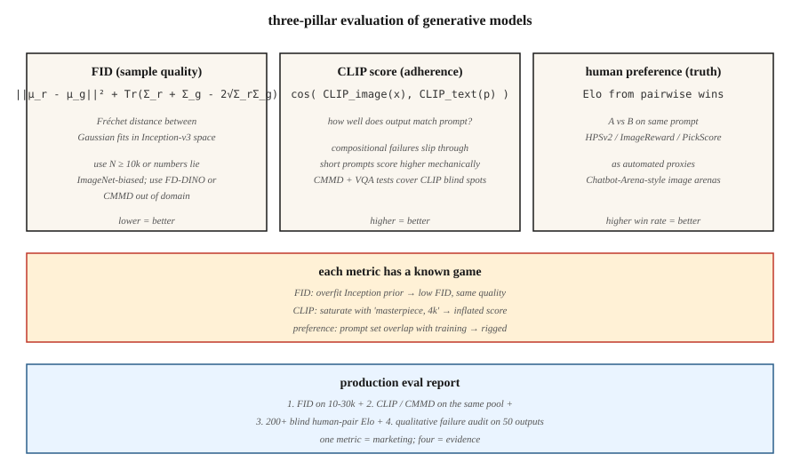

<!-- local-zh-machine-draft: English source is canonical; prose translated automatically, code/math preserved. -->

<a id="evaluation--fid-clip-score-human-preference"></a>

# Evaluation — FID、CLIP 分数、人类偏好

> 每个生成模型排行榜都会引用 FID、CLIP 分数和人类偏好竞技场的胜率。每个数字都有一个故障模式，有决心的研究人员可以进行游戏。如果您不知道故障模式，您就无法从游戏运行中看出真正的改进。

**类型：** 构建
**语言：** Python
**先决条件：** 第 8 阶段·01（分类）、第 2 阶段·04（Evaluation 指标）
**时间：** ~45分钟

<a id="the-problem"></a>

## 问题

生成模型根据 * 样本质量 * 和 * 条件依从性 * 进行判断。两者都没有封闭式措施。你的模型必须渲染 10,000 张图像；必须给它们分配编号；你必须相信跨型号系列、跨分辨率、跨架构的数字。三个指标在 2014 年至 2026 年的挑战中幸存下来：

- **FID（Fréchet Inception Distance）。** Inception 网络的 feature 空间中两个分布（真实分布和生成分布）之间的距离。越低越好。
- **CLIP 分数。** Cosine similarity 生成图像的 CLIP 图像 embedding 和 prompt 的 CLIP 文本 embedding 之间。越高越好。衡量 prompt 的遵守情况。
- **人类偏好。** 在同一个 prompt 上对两个模型进行面对面的比较，让人类（或 GPT-4 级模型）选择更好的一个，汇总为 Elo 分数。

您还将看到：IS（初始分数，大部分已退役）、KID、CMMD、ImageReward、PickScore、HPSv2、MJHQ-30k。每一个都纠正了前一个的一个失败。

<a id="the-concept"></a>

## 概念



<a id="fid--sample-quality"></a>

### FID——样品质量

赫塞尔等人。 （2017）。步骤：

1. 提取 Inception-v3 features (2048-D) 以获得 N 个真实图像并生成 N 个图像。
2. 将高斯拟合到每个池：计算平均值 `μ_r, μ_g` 和协方差 `Σ_r, Σ_g`。
3. FID = `||μ_r - μ_g||² + Tr(Σ_r + Σ_g - 2 · (Σ_r · Σ_g)^0.5)`.

解释：feature 空间中两个多元高斯之间的 Fréchet 距离。越低=分布越相似。

失效模式：
- **偏向于小 N。** FID 是 feature 分布的均方 — 小 N 低估协方差，给出错误的低 FID。始终使用 N ≥ 10,000。
- **Inception-dependent。** Inception-v3 在 ImageNet 上进行训练。远离 ImageNet 的领域（面孔、艺术、文本图像）会产生毫无意义的 FID。使用特定于域的 feature 提取器。
- **Gaming.** Overfitting 到 Inception 先验给出低 FID，但没有视觉质量改进。用 CMMD 击败它（如下）。

<a id="clip-score--prompt-adherence"></a>

### CLIP 分数 — prompt 依从性

雷德福等人。 （2021）。对于生成的图像+ prompt：

```
clip_score = cos_sim( CLIP_image(x_gen), CLIP_text(prompt) )
```

30k 生成图像的平均值 → 模型之间可比较的标量。

失效模式：
- **CLIP自己的盲点。** CLIP的构图推理很弱（“蓝色球体上的红色立方体”经常失败）。模型可以在 CLIP 分数上排名很高，而无需真正遵循复杂的 prompts。
- **Short promptbias.** Short prompts 在野外有更多的 CLIP 图像匹配。较长的 prompts 机械地具有较低的 CLIP 分数。
- **Prompt Gaming.** prompt 中包含“高品质、4k、杰作”，会夸大 CLIP 分数，但不会改善图像文本绑定。

CMMD（Jayasumana 等人，2024）修复了其中一些问题：使用 CLIP features 代替 Inception，使用最大均值差异代替 Fréchet。更擅长检测细微的质量差异。

<a id="human-preference--the-ground-truth"></a>

### 人类偏好——基本事实

选择一个 prompts 的池子。使用模型 A 和模型 B 生成。向人类（或强大的 LLM 法官）显示配对。总胜利分为 Elo 或 Bradley-Terry 分数。基准：

- **PartiPrompts (Google)**：1,600 个不同的 prompts，12 个类别。
- **HPSv2**：107k 人工注释，广泛用作自动代理。
- **ImageReward**：137k prompt-图像偏好对，MIT 许可。
- **PickScore**：根据“Pick-a-Pic”2.6M 偏好进行训练。
- **Chatbot-Arena风格的图像竞技场**：https://imagearena.ai/ 等。

失效模式：
- **判断方差。** 非专家与专家的偏好不同。两者都用。
- **Prompt 分布。** 樱桃采摘 prompts 惠一家人。始终记录。
- **LLM-法官奖励黑客攻击。** GPT-4-法官被漂亮但错误的输出所愚弄。与人类进行三角测量。

<a id="use-together"></a>

## 一起使用

生产评估报告应包括：

1. 根据保留的真实分布（样本质量）对 10-30k 样本进行 FID。
2. 相同样本的 CLIP 分数 / CMMD 与其 prompts（依从性）。
3. 与之前的模型相比，盲区的获胜率（总体偏好）。
4. 故障模式分析：50 个随机采样的输出，标记已知问题（手部解剖、文本渲染、一致的对象计数）。

任何单一指标都是谎言。三个确证指标+定性审查是一个主张。

```figure
gx-fid-distributions
```

<a id="build-it"></a>

## 动手实现

`code/main.py` 在合成“feature 向量”上实现 FID、CLIP-score-like 和 Elo 聚合（我们使用 4-D 向量作为 Inception features 的替代）。你看：

- 小 N 和大 N 上的 FID 计算 — 偏差。
- feature 池之间的“CLIP 分数”为 cosine similarity。
- 来自合成偏好流的 Elo 更新规则。

<a id="step-1-fid-in-four-lines"></a>

### 第 1 步：四行 FID

```python
def fid(real_features, gen_features):
    mu_r, cov_r = mean_and_cov(real_features)
    mu_g, cov_g = mean_and_cov(gen_features)
    mean_diff = sum((a - b) ** 2 for a, b in zip(mu_r, mu_g))
    trace_term = trace(cov_r) + trace(cov_g) - 2 * sqrt_cov_product(cov_r, cov_g)
    return mean_diff + trace_term
```

<a id="step-2-clip-style-cosine-similarity"></a>

### 第 2 步：CLIP 式余弦相似度

```python
def clip_like(image_feat, text_feat):
    dot = sum(a * b for a, b in zip(image_feat, text_feat))
    norm = math.sqrt(dot_self(image_feat) * dot_self(text_feat))
    return dot / max(norm, 1e-8)
```

<a id="step-3-elo-aggregation"></a>

### 第 3 步：Elo 聚合

```python
def elo_update(r_a, r_b, winner, k=32):
    expected_a = 1 / (1 + 10 ** ((r_b - r_a) / 400))
    actual_a = 1.0 if winner == "a" else 0.0
    r_a_new = r_a + k * (actual_a - expected_a)
    r_b_new = r_b - k * (actual_a - expected_a)
    return r_a_new, r_b_new
```

<a id="pitfalls"></a>

## 陷阱

- N=1000 时的 **FID。** 启发式在 N=10k 下不可靠。报道低氮 FID 的论文纯属游戏。
- **比较不同分辨率的FID。** Inception的299×299调整大小改变了feature分布。仅在匹配的分辨率下进行比较。
- ** 报告一粒种子。** 最少运行 3 粒种子。报告标准。
- **CLIP 通过负 prompts.** 分数膨胀一些管道通过过度拟合 prompt 来提高 CLIP。检查视觉 saturation。
- **Elo 偏差来自 prompt 重叠。** 如果两个模型在训练期间都看到基准 prompt，则 Elo 毫无意义。使用保留的 prompt 套。
- **人类评估付费人群偏向。** 多产、MTurk 注释者偏向年轻/技术友好。与招募的艺术/设计专家混合。

<a id="use-it"></a>

## 实际应用

2026 年生产评估协议：

| 支柱 | 最低 | 推荐 |
|--------|---------|-------------|
| 样品质量 | 10k 的 FID 与保留的真实金额 | + 5k 上的 CMMD + 每个类别子集上的 FID |
| Prompt 坚持 | CLIP 得分为 30k | + HPSv2 + ImageReward + VQA 式问答 |
| 偏好 | 200 对盲法与基线对比 | + 2000 配对人类 + LLM-judge + 聊天机器人竞技场 |
| 故障分析 | 50 手旗 | 500 个手动标记 + 自动安全分类器 |

一份报告中的所有四个支柱 = 主张。任何一个单独=营销。

<a id="ship-it"></a>

## 交付成果

保存`outputs/skill-eval-report.md`。 Skill 采用新模型 checkpoint + 基线并输出完整的评估计划：样本大小、指标、故障模式探测、签核标准。

<a id="exercises"></a>

## 练习

1. **Easy.** 运行`code/main.py`。比较相同合成分布上 N=100 与 N=1000 时的 FID。报告偏差程度。
2. **Medium.** 从合成 CLIP 样式 features 实现 CMMD（公式参见 Jayasumana 等人，2024）。比较对质量差异的敏感性与 FID。
3. **Hard.** 复制 HPSv2 设置：从 Pick-a-Pic 的子集中获取 1000 个图像-prompt 对，根据偏好微调基于 CLIP 的小型记分器，并测量其与保留集的一致性。

<a id="key-terms"></a>

## 关键术语

| 术语 | 人们怎么说 | 它实际上意味着什么 |
|------|-----------------|-----------------------|
| 火焰离子化检测器 | “弗雷谢起始距离” | 高斯的 Fréchet 距离适合真实与创始 features。 |
| 剪辑评分 | “文本-图像相似度” | Cosine similarity CLIP图像和文本embeddings之间。 |
| CMMD | “FID 的替代者” | CLIP-feature MMD；偏差较小，没有高斯假设。 |
| 信息系统 | 《起始分数》 | Exp KL(p(y|x) || p(y));与现代模型的相关性很差，已退役。 |
| HPSv2 / ImageReward / PickScore | “学习偏好代理” | 根据人类偏好训练的小型模型；用作自动法官。 |
| 埃洛 | 《国际象棋等级》 | 布拉德利-特里两两获胜的总和。 |
| 部分提示 | “基准 prompt 集” | Google 精选的 prompts 涉及 12 个类别，共 1,600 个。 |
| FD-恐龙 | 「自补更换」 | 使用 DINOv2 features 进行FD；更适合 ImageNet 域外。 |

<a id="production-note-evaluation-is-an-inference-workload-too"></a>

## 生产说明：evaluation 也是 inference 工作负载

对 10k 样本运行 FID 意味着生成 10k 图像。对于单个 L4 上 1024² 的 50 步 SDXL 基础，单个请求 inference 大约需要 11 小时。 Evaluation 预算是真实的，并且框架正是离线-inference 场景（最大化吞吐量，忽略 TTFT）：

- ** 批处理很难，忘记延迟。** 离线评估 = 以适合内存的最大大小进行静态批处理。 80GB H100 上的 `pipe(...).images` 和 `num_images_per_prompt=8` 的挂钟运行速度比单个请求快 4-6 倍。
- ** 缓存真实的 features.** 在真实参考集上运行 Inception (FID) 或 CLIP (CLIP-score, CMMD) feature 提取*once*，存储为`.npz`。不要根据评估重新计算。

对于 CI/回归门：在每个 PR 的 500 个样本子集上运行 FID + CLIP 评分（约 30 分钟）；每晚运行完整的 10k FID + HPSv2 + Elo。

<a id="further-reading"></a>

## 进一步阅读

- [Heusel 等人。 （2017）。 GANs 通过两个时间尺度更新规则训练收敛到局部纳什均衡 (FID)](https://arxiv.org/abs/1706.08500) — FID 论文。
- [Jayasumana 等人。 （2024）。重新思考 FID：迈向更好的 Evaluation 图像生成指标 (CMMD)](https://arxiv.org/abs/2401.09603) — CMMD。
- [Radford 等人。 （2021）。从自然语言监督中学习可迁移视觉模型（CLIP）](https://arxiv.org/abs/2103.00020) — CLIP。
- [Wu 等人。 （2023）。 HPSv2：综合人类偏好评分](https://arxiv.org/abs/2306.09341) — HPSv2。
- [Xu 等人。 （2023）。 ImageReward：学习和评估人类对文本到图像生成的偏好](https://arxiv.org/abs/2304.05977) — ImageReward。
- [Yu 等人。 （2023）。缩放 Autoregressive 模型以生成内容丰富的文本到图像（Parti + PartiPrompts）](https://arxiv.org/abs/2206.10789) — PartiPrompts。
- [Stein 等人。 （2023）。暴露生成模型的缺陷 evaluation 指标](https://arxiv.org/abs/2306.04675) — 故障模式调查。
