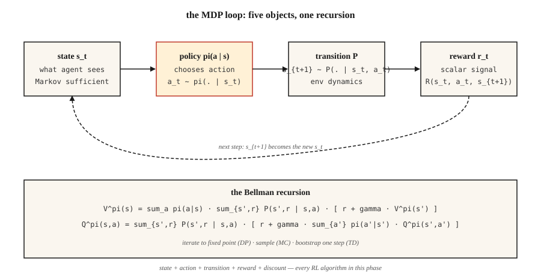

<!-- local-zh-machine-draft: English source is canonical; prose translated automatically, code/math preserved. -->

<a id="mdps-states-actions--rewards"></a>

# MDP、状态、动作与奖励

> Markov Decision Process 包含五件事：状态、动作、转换、奖励、折扣。 RL 中的所有内容 - Q-learning、PPO、DPO、GRPO - 都在此形状上进行优化。学会一次，免费阅读reinforcement learning的rest。

**类型：** 了解
**语言：** Python
**先决条件：** 第 1 阶段·06（概率与分布）、第 2 阶段·01（ML 分类）
**时间：** ~45分钟

<a id="the-problem"></a>

## 问题

您正在编写一个国际象棋机器人。或者库存计划员。或者交易agent。或者训练推理模型的 PPO 循环。四个不同的领域，一个令人惊讶的事实：所有四个领域都崩溃为同一个数学对象。

监督学习为您提供 `(x, y)` 对，并要求您拟合一个函数。 Reinforcement learning 没有给你标签——只有状态流、你采取的行动和标量奖励。此举赢得了比赛吗？补货决定省钱了吗？交易有盈利吗？刚刚产生的token和LLM是否导致了评委的更高奖励？

在将其正式化之前，您无法从该流中学习。 “我看到了什么”、“我做了什么”、“接下来发生了什么”、“那有多好”——每一个都必须成为你可以推理的对象。该形式化为 Markov Decision Process。此阶段的每个 RL 算法（包括最后的 RLHF 和 GRPO 循环）都会对此形状进行优化。

<a id="the-concept"></a>

## 概念



**五个对象。**

- **状态** `S`。包含 agent 做决策所需的全部信息。在 GridWorld 中是所在格子；在国际象棋中是棋盘局面；在 LLM 中则是 context window 加上任何记忆。
- **动作** `A`。即可以作出的选择：向上、下、左、右移动，走一步棋，或输出一个 token。
- **状态转移** `P(s' | s, a)`。给定状态 `s` 和动作 `a` 后，下一状态的概率分布。国际象棋中的转移是确定性的，库存任务中的转移是随机的，LLM 解码中的转移则近乎确定。
- **奖励** `R(s, a, s')`。一个标量信号：获胜 = +1，失败 = -1；收入减去成本；或 GRPO 中的对数似然比项。
- **折扣因子** `γ ∈ [0, 1)`。决定未来奖励相对于当前奖励的权重。`γ = 0.99` 对应约 100 步的有效时间跨度；`γ = 0.9` 对应约 10 步。

**Markov 性质** `P(s_{t+1} | s_t, a_t) = P(s_{t+1} | s_0, a_0, …, s_t, a_t)`。未来仅依赖当前状态。如果不满足这一点，说明状态表示不完整：问题出在状态表示，而不是方法本身。

**策略与回报。** 策略 `π(a | s)` 将状态映射为动作的概率分布。回报 `G_t = r_t + γ r_{t+1} + γ² r_{t+2} + …` 是未来奖励的折扣总和。价值 `V^π(s) = E[G_t | s_t = s]` 是从状态 `s` 出发、遵循策略 `π` 时的期望回报。Q 值 `Q^π(s, a) = E[G_t | s_t = s, a_t = a]` 是先执行指定动作时的期望回报。每个 RL 算法都会估计这两个量之一，再据此改进 `π`。

**Bellman equations.** 此阶段中的所有内容都使用的定点方程：

`V^π(s) = Σ_a π(a|s) Σ_{s', r} P(s', r | s, a) [r + γ V^π(s')]`
`Q^π(s, a) = Σ_{s', r} P(s', r | s, a) [r + γ Σ_{a'} π(a'|s') Q^π(s', a')]`

这些方程将期望回报分解为“当前这一步的奖励”加上“到达下一状态后的折扣价值”，形成递归关系。第 9 阶段的每个算法都会对该方程迭代至收敛（动态规划）、从中采样（Monte Carlo），或用一步自举估计（时序差分）。

```figure
discount-horizon
```

<a id="build-it"></a>

## 动手实现

<a id="step-1-a-tiny-deterministic-mdp"></a>

### 第 1 步：一个微小的确定性 MDP

一个 4×4 的 GridWorld。Agent 从左上角出发，右下角是终止状态，每走一步获得 -1 的奖励，动作集合为 `{up, down, left, right}`。参见 `code/main.py`。

```python
GRID = 4
TERMINAL = (3, 3)
ACTIONS = {"up": (-1, 0), "down": (1, 0), "left": (0, -1), "right": (0, 1)}

def step(state, action):
    if state == TERMINAL:
        return state, 0.0, True
    dr, dc = ACTIONS[action]
    r, c = state
    nr = min(max(r + dr, 0), GRID - 1)
    nc = min(max(c + dc, 0), GRID - 1)
    return (nr, nc), -1.0, (nr, nc) == TERMINAL
```

五行代码就是整个环境：确定性的状态转移、固定的每步惩罚，以及吸收式终止状态。

<a id="step-2-roll-out-a-policy"></a>

### 第 2 步：按策略生成轨迹

策略是从状态到动作概率分布的函数。最简单的策略是均匀随机选择动作。

```python
def uniform_policy(state):
    return {a: 0.25 for a in ACTIONS}

def rollout(policy, max_steps=200):
    s, total, steps = (0, 0), 0.0, 0
    for _ in range(max_steps):
        a = sample(policy(s))
        s, r, done = step(s, a)
        total += r
        steps += 1
        if done:
            break
    return total, steps
```

将随机策略运行 1000 次。在这个 4×4 棋盘上，平均回报约为 -60 到 -80。最优回报为 -6（沿最短路线向下、向右移动）。第 9 阶段的全部工作就是缩小这一差距。

<a id="step-3-compute-vπ-exactly-via-the-bellman-equation"></a>

### 步骤3：通过Bellman equation精确计算`V^π`

对于小规模 MDP，Bellman equation 是一个线性方程组。枚举所有状态，应用期望运算，反复迭代，直到价值不再变化。

```python
def policy_evaluation(policy, gamma=0.99, tol=1e-6):
    V = {s: 0.0 for s in all_states()}
    while True:
        delta = 0.0
        for s in all_states():
            if s == TERMINAL:
                continue
            v = 0.0
            for a, pi_a in policy(s).items():
                s_next, r, _ = step(s, a)
                v += pi_a * (r + gamma * V[s_next])
            delta = max(delta, abs(v - V[s]))
            V[s] = v
        if delta < tol:
            return V
```

这就是迭代式策略 evaluation。它是 Sutton 与 Barto 教材中的第一个算法，也是后续所有 RL 方法的理论基础。

<a id="step-4-γ-is-a-hyperparameter-with-physical-meaning"></a>

### 第四步：`γ`是一个有物理意义的hyperparameter

有效时间跨度约为 `1 / (1 - γ)`。`γ = 0.9` → 10 步；`γ = 0.99` → 100 步；`γ = 0.999` → 1000 步。

折扣因子过低，agent 就会目光短浅；过高，信用分配会变得嘈杂，因为许多较早的步骤都要为遥远未来的奖励承担责任。LLM 的 RLHF 通常使用 `γ = 1`，因为回合较短且有界。控制任务使用 `0.95–0.99`，长时间跨度的策略游戏使用 `0.999`。

<a id="pitfalls"></a>

## 陷阱

- **非 Markov 状态。** 如果决策需要最近三次观测，那么“状态”就不能仅包含当前观测。解决方法是叠加帧（Atari 上的 DQN 叠加 4 帧），或采用递归状态（对观测运行 LSTM/GRU）。
- **稀疏奖励。** 在大型状态空间中，只在获胜时提供奖励会让学习几乎无法进行。可以塑造奖励（提供中间信号），或通过模仿学习启动训练（第 9 阶段 · 09）。
- **Reward hacking.** 优化代理奖励通常会产生病态行为。 OpenAI 的赛艇 agent 不停地旋转，永远收集能量，而不是完成比赛。始终根据目标结果而不是代理来定义奖励。
- **折扣因子设置错误。** 在无限时间跨度任务中使用 `γ = 1`，会使每个价值变为无穷大。应始终通过有限时间跨度或 `γ < 1` 加以限制。
- **奖励尺度。** 奖励 {+100, -100} 与 {+1, -1} 会产生相同的最优策略，但 gradient 的量级差异巨大。在用于 PPO/DQN 之前，将奖励归一化到接近 `[-1, 1]` 的范围。

<a id="use-it"></a>

## 实际应用

2026 堆栈在接触代码之前将每个 RL 管道简化为 MDP：

| 情况 | 状态 | 动作 | 奖励 | γ |
|-----------|-------|--------|--------|---|
| 控制（运动、操纵） | 关节角度 + 速度 | 连续扭矩 | 任务特定形状 | 0.99 |
| 游戏（国际象棋、围棋、扑克） | 董事会+历史 | 合法搬迁 | Win=+1 / loss=-1 | 1.0（有限） |
| 库存/定价 | 库存与需求 | 订货数量 | 收入减去成本 | 0.95 |
| RLHF 适用于 LLMs | 上下文 tokens | 下一页 token | 回合结束时奖励模型的评分 | 1.0（剧集~200 tokens） |
| GRPO 用于推理 | Prompt + 部分响应 | 下一页 token | 结束时验证器给出 0/1 | 1.0 |

编写任何训练循环之前，先写清这五项定义。多数“RL 不起作用”的问题报告，都能 trace 到一份在纸面上就有缺陷的 MDP 定义。

<a id="ship-it"></a>

## 交付成果

另存为 `outputs/skill-mdp-modeler.md`：

```markdown
---
name: mdp-modeler
description: Given a task description, produce a Markov Decision Process spec and flag formulation risks before training.
version: 1.0.0
phase: 9
lesson: 1
tags: [rl, mdp, modeling]
---

Given a task (control / game / recommendation / LLM fine-tuning), output:

1. State. Exact feature vector or tensor spec. Justify Markov property.
2. Action. Discrete set or continuous range. Dimensionality.
3. Transition. Deterministic, stochastic-with-known-model, or sample-only.
4. Reward. Function and source. Sparse vs shaped. Terminal vs per-step.
5. Discount. Value and horizon justification.

Refuse to ship any MDP where the state is non-Markovian without explicit mention of frame-stacking or recurrent state. Refuse any reward that was not defined in terms of the target outcome. Flag any `γ ≥ 1.0` on an infinite-horizon task. Flag any reward range >100x the typical step reward as a likely gradient-explosion source.
```

<a id="exercises"></a>

## 练习

1. **简单。** 在 `code/main.py` 中实现 4×4 GridWorld 和随机策略 rollout。运行 10,000 个回合，报告回报的均值和标准差，并与最优回报（-6）比较。
2. **Medium.** 为统一随机策略运行 `policy_evaluation` 和 `γ ∈ {0.5, 0.9, 0.99}`。将 `V` 打印为 4×4 网格。解释为什么靠近终端的state values随着`γ`的增大而增长得更快。
3. **困难。** 将 GridWorld 改为随机环境：每个动作以概率 `p = 0.1` 偏移到相邻方向。重新评估均匀策略。`V[start]` 变好还是变差？为什么？

<a id="key-terms"></a>

## 关键术语

| 术语 | 人们怎么说 | 它实际上意味着什么 |
|------|-----------------|-----------------------|
| MDP | “Reinforcement learning设置” | 元组 `(S, A, P, R, γ)` 满足马尔可夫性质。 |
| 状态 | “agent 看到了什么” | 在所选策略类别下，描述未来动态所需的充分统计量。 |
| 策略 | “Agent的行为” | 条件分布 `π(a \| s)`，或确定性映射 `s → a`。 |
| 返回 | “总奖励” | 从当前步骤开始计算的折扣总和 `Σ γ^t r_t`。 |
| 价值 | “一个状态有多好” | 从状态 `s` 出发，遵循 `π` 时的期望回报。 |
| Q值 | “一个动作有多好” | 从状态 `s` 出发，首先执行动作 `a`，之后遵循 `π` 时的期望回报。 |
| Bellman equation | 《动态规划递归》 | 将价值 / Q 值分解为一步奖励加上后继状态折扣价值的固定点关系。 |
| 折扣 `γ` | “未来与当前” | 对遥远未来奖励施加的几何递减 weight；有效时间跨度为 `~1/(1-γ)`。 |

<a id="further-reading"></a>

## 进一步阅读

- [萨顿和巴托 (2018)。 Reinforcement Learning：简介，第二版。](http://incompleteideas.net/book/RLbook2020.pdf) — 教科书。章。 3 涵盖 MDP 和 Bellman equations；章。 1 激发了作为后续每一课基础的奖励假设。
- [贝尔曼（1957）。动态规划](https://press.princeton.edu/books/paperback/9780691146683/dynamic-programming) — Bellman equation 的起源。
- [OpenAI 旋转 — 第 1 部分：关键概念](https://spinningup.openai.com/en/latest/spinningup/rl_intro.html) — 从深度 RL 角度简明的 MDP 入门。
- [Puterman (2005)。 Markov Decision Processes](https://onlinelibrary.wiley.com/doi/book/10.1002/9780470316887) — MDP 和精确求解方法的运筹学参考。
- [利特曼（1996）。顺序决策算法（博士论文）](https://cs.brown.edu/media/filer_public/d1/a6/d1a6f66a-289a-4b81-9596-417114843489/littman.pdf) — MDP 作为动态规划专业的最简洁的推导。
