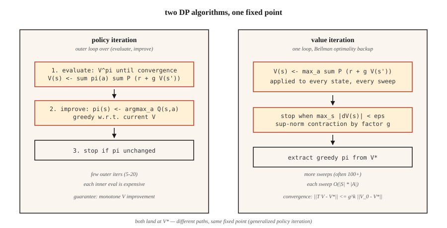

<!-- local-zh-machine-draft: English source is canonical; prose translated automatically, code/math preserved. -->

<a id="dynamic-programming--policy-iteration--value-iteration"></a>

# 动态规划——策略迭代和值迭代

> 动态规划是带有作弊行为的强化学习。您已经了解转换函数和奖励函数；您只需迭代 Bellman equation 直到 `V` 或 `π` 停止移动。这是每个基于 sampling 的方法试图接近的基准。

**类型：** 构建
**语言：** Python
**先决条件：** 9·01 阶段（MDP）
**时间：** ~75分钟

<a id="the-problem"></a>

## 问题

您有一个具有已知模型的 MDP：您可以查询 `P(s' | s, a)` 和 `R(s, a, s')` 中的任何状态-操作对。库存经理了解需求分布。棋盘游戏具有确定性的转换。网格世界是 Python 的四行。您有 * 型号 *。

无模型强化学习（Q-learning、PPO、REINFORCE）是为没有模型的情况而发明的——你只能从环境中采样。但是，当您确实拥有一种方法时，还有更快、更好的方法：动态编程。贝尔曼于 1957 年设计了它们。它们仍然定义正确性：当人们说“这个 MDP 的最优策略”时，他们的意思是 DP 策略将会回归。

您在 2026 年需要它们有三个原因。首先，强化学习研究中的每个表格环境（GridWorld、FrozenLake、CliffWalking）都使用 DP 进行求解，以产生黄金标准策略。其次，精确值让您可以使用 *debug* sampling 方法：如果 Q-learning 对 `V*(s_0)` 的估计与 DP 答案不一致 30%，则您的Q-learning 有一个错误。第三，现代离线 RL 和 planning 方法（MCTS、AlphaZero 的搜索、第 9·10 阶段基于模型的 RL）都在学习或给定模型上迭代 Bellman 备份。

<a id="the-concept"></a>

## 概念



**两种算法，都是在Bellman上进行定点迭代。**

**Policy iteration.** 交替两个步骤，直到策略停止变化。

1. *Evaluation:* 给定策略 `π`，通过重复应用 `V(s) ← Σ_a π(a|s) Σ_{s',r} P(s',r|s,a) [r + γ V(s')]` 直到收敛来计算 `V^π`。
2. *改进：*给定`V^π`，使`π`贪婪。 `V^π`：`π(s) ← argmax_a Σ_{s',r} P(s',r|s,a) [r + γ V(s')]`。

收敛性得到保证，因为 (a) 每个改进步骤要么保持 `π` 相同，要么针对某些状态严格增加 `V^π`，(b) 确定性策略的空间是有限的。即使对于大型状态空间，通常也会在约 5-20 次外部迭代中收敛。

**价值迭代。** 折叠 evaluation 并改进为一扫。应用贝尔曼 *optimality* 方程：

`V(s) ← max_a Σ_{s',r} P(s',r|s,a) [r + γ V(s')]`

重复直到`max_s |V_{new}(s) - V(s)| < ε`。最后通过采取贪婪行动来提取策略。每次迭代速度更快——没有内部 evaluation 循环——但通常需要更多迭代才能收敛。

** 广义策略迭代 (GPI)。** 统一框架。 Value function和策略被锁定在双向改进循环中；任何推动两者实现相互一致性的方法（异步值迭代、修改策略迭代、Q-learning、actor-critic、PPO）都是 GPI 的一个实例。

**为什么 `γ < 1` 很重要。** Bellman 运算符是超范数中的 `γ` 收缩：`||T V - T V'||_∞ ≤ γ ||V - V'||_∞`。收缩意味着唯一不动点和几何收敛。放弃`γ < 1`，你就失去了保证——你需要一个有限的视野或一个吸收性的终端状态。

```figure
value-iteration-gamma
```

<a id="build-it"></a>

## 动手实现

<a id="step-1-build-the-gridworld-mdp-model"></a>

### 步骤1：构建GridWorld MDP模型

使用第 01 课中相同的 4×4 GridWorld。我们添加一个随机变体：agent 以 `0.1` 的概率滑向随机垂直方向。

```python
SLIP = 0.1

def transitions(state, action):
    if state == TERMINAL:
        return [(state, 0.0, 1.0)]
    outcomes = []
    for direction, prob in action_probs(action):
        outcomes.append((apply_move(state, direction), -1.0, prob))
    return outcomes
```

`transitions(s, a)` 返回 `(s', r, p)` 的列表。这是整个模型。

<a id="step-2-policy-evaluation"></a>

### 步骤2：策略evaluation

给定策略 `π(s) = {action: prob}`，迭代 Bellman equation 直到 `V` 停止移动：

```python
def policy_evaluation(policy, gamma=0.99, tol=1e-6):
    V = {s: 0.0 for s in states()}
    while True:
        delta = 0.0
        for s in states():
            v = sum(pi_a * sum(p * (r + gamma * V[s_prime])
                              for s_prime, r, p in transitions(s, a))
                   for a, pi_a in policy(s).items())
            delta = max(delta, abs(v - V[s]))
            V[s] = v
        if delta < tol:
            return V
```

<a id="step-3-policy-improvement"></a>

### 第三步：策略完善

将 `π` 替换为贪婪策略 w.r.t. `V`。如果 `π` 没有改变，则返回 - 我们处于最佳状态。

```python
def policy_improvement(V, gamma=0.99):
    new_policy = {}
    for s in states():
        best_a = max(
            ACTIONS,
            key=lambda a: sum(p * (r + gamma * V[s_prime])
                              for s_prime, r, p in transitions(s, a)),
        )
        new_policy[s] = best_a
    return new_policy
```

<a id="step-4-stitch-them-together"></a>

### 第四步：将它们缝合在一起

```python
def policy_iteration(gamma=0.99):
    policy = {s: "up" for s in states()}   # arbitrary start
    for _ in range(100):
        V = policy_evaluation(lambda s: {policy[s]: 1.0}, gamma)
        new_policy = policy_improvement(V, gamma)
        if new_policy == policy:
            return V, policy
        policy = new_policy
```

4×4 的典型收敛：4-6 次外部迭代。输出 `V*(0,0) ≈ -6` 和严格减少步数的策略。

<a id="step-5-value-iteration-the-one-loop-version"></a>

### 第 5 步：值迭代（单循环版本）

```python
def value_iteration(gamma=0.99, tol=1e-6):
    V = {s: 0.0 for s in states()}
    while True:
        delta = 0.0
        for s in states():
            v = max(sum(p * (r + gamma * V[s_prime])
                       for s_prime, r, p in transitions(s, a))
                   for a in ACTIONS)
            delta = max(delta, abs(v - V[s]))
            V[s] = v
        if delta < tol:
            break
    policy = policy_improvement(V, gamma)
    return V, policy
```

相同的固定点，更少的代码行。

<a id="pitfalls"></a>

## 陷阱

- **忘记处理终端。** 如果您将贝尔曼应用到吸收状态，它仍然会选择一个不会改变任何内容的“最佳操作”。用 `if s == terminal: V[s] = 0` 进行防护。
- **Sup-norm vs L2 收敛。** 使用 `max |V_new - V|`，而不是平均值。理论保证是在超范数上的。
- **就地更新与同步更新。**就地更新`V[s]`（高斯-赛德尔）比单独的`V_new`字典（雅可比）收敛得更快。生产代码使用就地。
- **Policy ties.** 如果两个动作具有相同的 Q 值，`argmax` 可能会在每次迭代中以不同的方式打破关系，从而导致“策略稳定”检查振荡。使用稳定的抢七局（按固定顺序进行第一个动作）。
- **状态空间爆炸。** DP每次扫描为`O(|S| · |A|)`。最多可工作约 10⁷ 状态。除此之外，您还需要函数逼近（第 9·05 阶段开始）。

<a id="use-it"></a>

## 实际应用

2026年，DP是正确性基线，也是规划器的内循环：

| 应用场景 | 方法 |
|----------|--------|
| 精确求解小型表格 MDP | 值迭代（更简单）或策略迭代（更少的外部步骤） |
| 验证 Q-learning / PPO 实施 | 与玩具环境中的 DP 最优 V* 进行比较 |
| 基于模型的强化学习（第 9·10 阶段） | 贝尔曼备份学习的转换模型 |
| AlphaZero / MuZero 中的 Planning | Monte Carlo 树搜索 = 异步 Bellman 备份 |
| 离线强化学习（CQL、IQL） | 保守 Q 迭代 — 对 OOD 操作进行惩罚的 DP |

每次有人说“最优 value function”时，他们的意思是“DP 固定点”。当您在论文中看到 `V*` 或 `Q*` 时，想象一下这个循环。

<a id="ship-it"></a>

## 交付成果

另存为 `outputs/skill-dp-solver.md`：

```markdown
---
name: dp-solver
description: Solve a small tabular MDP exactly via policy iteration or value iteration. Report convergence behavior.
version: 1.0.0
phase: 9
lesson: 2
tags: [rl, dynamic-programming, bellman]
---

Given an MDP with a known model, output:

1. Choice. Policy iteration vs value iteration. Reason tied to |S|, |A|, γ.
2. Initialization. V_0, starting policy. Convergence sensitivity.
3. Stopping. Sup-norm tolerance ε. Expected number of sweeps.
4. Verification. V*(s_0) computed exactly. Greedy policy extracted.
5. Use. How this baseline will be used to debug/evaluate sampling-based methods.

Refuse to run DP on state spaces > 10⁷. Refuse to claim convergence without a sup-norm check. Flag any γ ≥ 1 on an infinite-horizon task as a guarantee violation.
```

<a id="exercises"></a>

## 练习

1. **Easy.** 使用 `γ ∈ {0.9, 0.99}` 在 4×4 GridWorld 上运行值迭代。直到 `max |ΔV| < 1e-6` 为止扫描了多少次？将 `V*` 打印为 4×4 网格。
2. **Medium.** 比较 *stochastic* GridWorld 上的策略迭代与值迭代（滑动概率 `0.1`）。计数：扫描、挂钟时间、最终 `V*(0,0)`。哪个在迭代中收敛得更快？在挂钟里？
3. **Hard.** 构建修改后的策略迭代：在 evaluation 步骤中，仅运行 `k` 扫描而不是收敛。为 `k ∈ {1, 2, 5, 10, 50}` 绘制 `V*(0,0)` 误差与 `k` 的对比图。该曲线告诉您有关 evaluation/改进权衡的什么信息？

<a id="key-terms"></a>

## 关键术语

| 术语 | 人们怎么说 | 它实际上意味着什么 |
|------|-----------------|-----------------------|
| 策略迭代 | 《DP算法》 | 交替 evaluation (`V^π`) 和改进（贪婪 `π` w.r.t. `V^π`），直到策略停止变化。 |
| 价值迭代 | “更快的DP” | 贝尔曼最优备份在一次扫描中应用；几何上收敛于 `V*`。 |
| 行李员接线员 | “递归” | `(T V)(s) = max_a Σ P (r + γ V(s'))`；超范数中的 `γ` 收缩。 |
| 收缩 | 《为什么DP会收敛》 | 任何具有 `\|\|T x - T y\|\| ≤ γ \|\|x - y\|\|` 的算子 `T` 都有唯一的不动点。 |
| 通用指数 | “一切都是DP” | 广义策略迭代：驱动 `V` 和 `π` 相互一致的任何方法。 |
| 同步更新 | “雅可比式” | 在整个扫描过程中使用旧的 `V`；可以清晰地分析，但速度较慢。 |
| 就地更新 | “高斯-赛德尔式” | 更新时使用`V`；实践中收敛得更快。 |

<a id="further-reading"></a>

## 进一步阅读

- [萨顿和巴托 (2018)。章。 4 — 动态编程](http://incompleteideas.net/book/RLbook2020.pdf) — 策略迭代和值迭代的规范表示。
- [Bertsekas (2019)。 Reinforcement Learning 和最优控制](http://www.athenasc.com/rlbook_athena.html) — 收缩映射参数的严格处理。
- [Puterman (2005)。 Markov Decision Processes](https://onlinelibrary.wiley.com/doi/book/10.1002/9780470316887) — 修改后的策略迭代及其收敛性分析。
- [霍华德（1960）。动态规划和马尔可夫过程](https://mitpress.mit.edu/9780262582300/dynamic-programming-and-markov-processes/) - 原始策略迭代论文。
- [Bertsekas 和 Tsitsiklis (1996)。神经动态编程](http://www.athenasc.com/ndpbook.html) — 从 DP 到近似 DP / 深度 RL 的桥梁，后续每节课都会用到。
