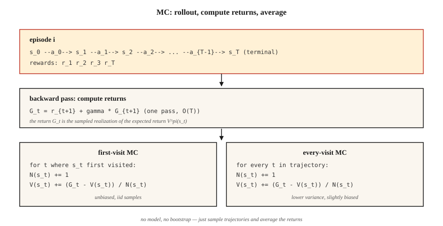

<!-- local-zh-machine-draft: English source is canonical; prose translated automatically, code/math preserved. -->

<a id="monte-carlo-methods--learning-from-complete-episodes"></a>

# Monte Carlo 方法——从完整回合中学习

> 动态规划需要一个模型。 Monte Carlo只需要剧集。运行保单，观察回报，对其进行平均。强化学习中最简单的想法——也是解锁下游所有内容的想法。

**类型：** 构建
**语言：** Python
**先决条件：** 第 9·01 阶段（MDP）、第 9·02 阶段（动态规划）
**时间：** ~75 分钟

<a id="the-problem"></a>

## 问题

动态编程很优雅，但它假设您可以查询 `P(s' | s, a)` 的每个状态和操作。现实世界中几乎没有什么是这样运作的。机器人无法分析计算关节扭矩后相机像素的分布。定价算法无法整合所有可能的客户反应。 LLM 无法枚举 token 之后的所有可能的延续。

您需要一种仅需要能够从环境中获取 *sample* 的方法。运行策略。获取轨迹`s_0, a_0, r_1, s_1, a_1, r_2, …, s_T`。用它来估计值。即Monte Carlo。

从DP到MC的转变在哲学上很重要：我们从*已知模型+精确备份*转移到*采样rollouts +平均回报*。方差跳跃式增长，但适用性却呈爆炸式增长。本课之后的每个 RL 算法（TD、Q-learning、REINFORCE、PPO、GRPO）本质上都是一个 Monte Carlo 估计器，有时在顶部有引导层。

<a id="the-concept"></a>

## 概念



**核心思想，一行：** `V^π(s) = E_π[G_t | s_t = s] ≈ (1/N) Σ_i G^{(i)}(s)`，其中观察到`G^{(i)}(s)`，在策略`π`下访问`s`后返回。

**首次访问与每次访问MC.** 给定一个多次访问状态`s`的episode，首次访问MC仅计算第一次访问的返回；每次访问 MC 都会计算所有访问次数。两者在极限内都是无偏的。首次访问更容易分析（独立同分布样本）。每次访问每集都会使用更多数据，并且在实践中通常收敛得更快。

**增量平均值。** 不是存储所有回报，而是更新运行平均值：

`V_n(s) = V_{n-1}(s) + (1/n) [G_n - V_{n-1}(s)]`

重组：`V_new = V_old + α · (target - V_old)` 与 `α = 1/n`。将 `1/n` 替换为恒定步长 `α ∈ (0, 1)`，您将获得一个跟踪 `π` 变化的非平稳 MC 估计器。这一举措是从 MC 到 TD 再到每个现代 RL 算法的整个跳跃。

**探索现在是一个问题。** DP通过枚举触及每个状态。 MC只看到各州的策略访问。如果 `π` 是确定性的，则状态空间的整个区域永远不会被采样，并且它们的值估计永远保持为零。三个修复（按历史顺序排列）：

1. **探索开始。** 从随机（s，a）对开始每集。保证覆盖范围；在实践中不现实（你不能将机器人“重置”到任意状态）。
2. **ε-greedy.** 贪婪行为当前 Q，但以 `ε` 的概率选择随机动作。所有状态-动作对都被渐近采样。
3. **Off-policy MC.** 采集行为策略 `μ` 下的数据，通过 importance sampling 了解目标策略 `π`。高方差，但它是重播缓冲区方法（如 DQN）的桥梁。

**Monte Carlo Control.** 评估→改进→评估，就像策略迭代一样，但 evaluation 是基于 sampling 的：

1. 运行`π`，获取一集。
2. 根据观察到的回报更新 `Q(s, a)`。
3. 使 `π` ε-贪婪 w.r.t. `Q`。
4. 重复。

在温和条件下以概率 1 收敛到 `Q*` 和 `π*`（每对都无限频繁地访问，`α` 满足 Robbins-Monro）。

```figure
epsilon-greedy
```

<a id="build-it"></a>

## 动手实现

<a id="step-1-rollout--list-of-s-a-r"></a>

### 步骤1：rollout → (s, a, r)列表

```python
def rollout(env, policy, max_steps=200):
    trajectory = []
    s = env.reset()
    for _ in range(max_steps):
        a = policy(s)
        s_next, r, done = env.step(s, a)
        trajectory.append((s, a, r))
        s = s_next
        if done:
            break
    return trajectory
```

没有型号，只有`env.reset()`和`env.step(s, a)`。与健身房环境相同的界面，但精简了。

<a id="step-2-compute-returns-reverse-sweep"></a>

### 第 2 步：计算回报（反向扫描）

```python
def returns_from(trajectory, gamma):
    returns = []
    G = 0.0
    for _, _, r in reversed(trajectory):
        G = r + gamma * G
        returns.append(G)
    return list(reversed(returns))
```

一通，`O(T)`。向后递归 `G_t = r_{t+1} + γ G_{t+1}` 避免重新求和。

<a id="step-3-first-visit-mc-evaluation"></a>

### 步骤3：首先访问MC evaluation

```python
def mc_policy_evaluation(env, policy, episodes, gamma=0.99):
    V = defaultdict(float)
    counts = defaultdict(int)
    for _ in range(episodes):
        trajectory = rollout(env, policy)
        returns = returns_from(trajectory, gamma)
        seen = set()
        for t, ((s, _, _), G) in enumerate(zip(trajectory, returns)):
            if s in seen:
                continue
            seen.add(s)
            counts[s] += 1
            V[s] += (G - V[s]) / counts[s]
    return V
```

三行完成工作：标记第一次访问时看到的状态、增量计数、更新运行平均值。

<a id="step-4-ε-greedy-mc-control-on-policy"></a>

### 步骤4：ε-贪心MC控制（on-policy）

```python
def mc_control(env, episodes, gamma=0.99, epsilon=0.1):
    Q = defaultdict(lambda: {a: 0.0 for a in ACTIONS})
    counts = defaultdict(lambda: {a: 0 for a in ACTIONS})

    def policy(s):
        if random() < epsilon:
            return choice(ACTIONS)
        return max(Q[s], key=Q[s].get)

    for _ in range(episodes):
        trajectory = rollout(env, policy)
        returns = returns_from(trajectory, gamma)
        seen = set()
        for (s, a, _), G in zip(trajectory, returns):
            if (s, a) in seen:
                continue
            seen.add((s, a))
            counts[s][a] += 1
            Q[s][a] += (G - Q[s][a]) / counts[s][a]
    return Q, policy
```

<a id="step-5-compare-to-dp-gold-standard"></a>

### 第 5 步：与 DP 金标准进行比较

您对 `V^π` 的 MC 估计应该与第 02 课中的 DP 结果一致，因为情节 → 无穷大。实践中：4×4 GridWorld 上的 50,000 集可以让您在 DP 答案的 `~0.1` 范围内。

<a id="pitfalls"></a>

## 陷阱

- **无限剧集。** MC要求剧集到*终止*。如果您的策略可以永远循环，请设置 `max_steps` 上限并将上限视为隐式失败。具有随机策略的 GridWorld 经常会超时——这是正常的，只要确保你计算正确即可。
- **Variance.** MC 使用全额回报。在长剧集中，差异是巨大的——最后的一个不幸的奖励使 `V(s_0)` 发生了相同的变化。 TD 方法（第 04 课）通过引导来解决这个问题。
- **状态覆盖。** 贪婪的 MC 在一个带有领带的新 Q 上只会尝试一个动作。你*必须*探索（ε-贪婪，探索开始，UCB）。
- **非平稳策略。** 如果 `π` 发生变化（如在 MC 控制中），则旧的收益来自不同的策略。 Constant-α MC 可以处理这个问题；样本平均 MC 则不然。
- **Off-policy importance sampling.** weights `π(a|s)/μ(a|s)` 在轨迹上相乘。方差随着视野的扩大而爆炸。使用按决策加权 IS 进行上限或切换到 TD。

<a id="use-it"></a>

## 实际应用

2026 Monte Carlo方法的作用：

| 应用场景 | 为什么选择MC |
|----------|--------|
| 短期游戏（二十一点、扑克） | 剧集自然结束；回报是干净的。 |
| 已记录策略下线 evaluation | 存储轨迹的平均折扣回报。 |
| Monte Carlo 树搜索（AlphaZero） | MC rollouts 来自树叶指南选择。 |
| LLM RL evaluation | 计算给定策略的样本完成情况的平均奖励。 |
| PPO 中的基线估计 | 优势目标 `A_t = G_t - V(s_t)` 使用 MC `G_t`。 |
| 强化学习教学 | 实际可行的最简单的算法——剥离引导程序以查看核心。 |

现代深度强化学习算法（PPO、SAC）通过 `n` 步返回或 GAE 在纯 MC（完全返回）和纯 TD（一步引导）之间进行插值。两个端点都是同一估计器的实例。

<a id="ship-it"></a>

## 交付成果

另存为 `outputs/skill-mc-evaluator.md`：

```markdown
---
name: mc-evaluator
description: Evaluate a policy via Monte Carlo rollouts and produce a convergence report with DP-comparison if available.
version: 1.0.0
phase: 9
lesson: 3
tags: [rl, monte-carlo, evaluation]
---

Given an environment (episodic, with reset+step API) and a policy, output:

1. Method. First-visit vs every-visit MC. Reason.
2. Episode budget. Target number, variance diagnostic, expected standard error.
3. Exploration plan. ε schedule (if needed) or exploring starts.
4. Gold-standard comparison. DP-optimal V* if tabular; otherwise a bound from a Q-learning / PPO baseline.
5. Termination check. Max-step cap, timeouts, handling of non-terminating trajectories.

Refuse to run MC on non-episodic tasks without a finite horizon cap. Refuse to report V^π estimates from fewer than 100 episodes per state for tabular tasks. Flag any policy with zero-variance actions as an exploration risk.
```

<a id="exercises"></a>

## 练习

1. **Easy.** 在4×4 GridWorld上实现均匀随机策略的首次访问MC evaluation。播放 10,000 集。将 `V(0,0)` 绘制为情节计数与 DP 答案的函数。
2. **Medium.** 使用`ε ∈ {0.01, 0.1, 0.3}`实现ε-贪婪MC控制。比较 20,000 集后的平均回报。曲线是什么样的？偏差与方差的权衡在哪里？
3. **Hard.** 使用 importance sampling 实现 *off-policy* MC：在统一随机策略下收集数据`μ`，估计确定性最优策略 `π` 的 `V^π`。比较普通 IS 与每决策 IS 与加权 IS。哪个方差最小？

<a id="key-terms"></a>

## 关键术语

| 术语 | 人们怎么说 | 它实际上意味着什么 |
|------|-----------------|-----------------------|
| Monte Carlo | “随机sampling” | 通过对分布中的独立同分布样本进行平均来估计期望。 |
| 返回 `G_t` | 《未来的奖励》 | 从步骤 `t` 到剧集结束的折扣奖励总和：`Σ_{k≥0} γ^k r_{t+k+1}`。 |
| 首次访问MC | “每个州数一次” | 只有剧集中的第一次访问才有助于价值估算。 |
| 每次来MC | “使用所有访问” | 每次访问都有贡献；略有偏差，但样本效率更高。 |
| ε-贪婪 | “探索噪音” | 选择贪婪动作，概率为 `1-ε`；随机操作，概率为 `ε`。 |
| Importance sampling | “纠正错误分布中的 sampling” | 通过 `π(a\|s)/μ(a\|s)` 产品重新加权回报，根据 `μ` 数据估算 `V^π`。 |
| On-policy | “从我自己的数据中学习” | 目标策略=行为策略。香草MC，PPO，SARSA。 |
| Off-policy | “从别人的数据中学习” | 目标策略≠行为策略。重要性采样MC，Q-learning，DQN。 |

<a id="further-reading"></a>

## 进一步阅读

- [萨顿和巴托 (2018)。章。 5 — Monte Carlo 方法](http://incompleteideas.net/book/RLbook2020.pdf) — 规范处理。
- [辛格和萨顿（1996）。 Reinforcement Learning 与替换资格 Traces](https://link.springer.com/article/10.1007/BF00114726) — 首次访问与每次访问分析。
- [Precup，萨顿，辛格（2000）。 Traces 适用于 Off-Policy 策略 Evaluation](http://incompleteideas.net/papers/PSS-00.pdf) — off-policy MC 和方差控制。
- [Mahmood 等人。 （2014）。 Off-Policy Learning](https://arxiv.org/abs/1404.6362) 的加权 Importance Sampling — 现代低方差 IS 估计器。
- [Tesauro (1995)。 TD-Gammon，一个自学双陆棋程序](https://dl.acm.org/doi/10.1145/203330.203343)——第一个大规模的MC/TD自我对弈融合到超人对弈的实证演示；本阶段后半段每节课的概念先驱。
