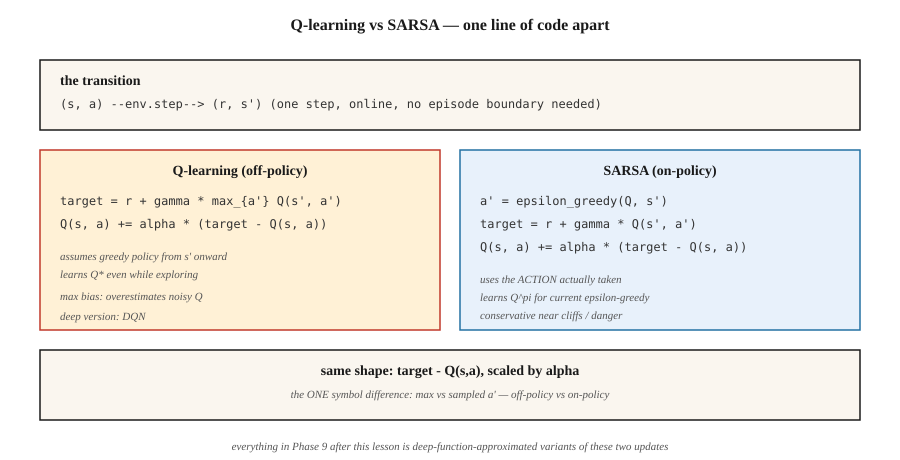

<!-- local-zh-machine-draft: English source is canonical; prose translated automatically, code/math preserved. -->

<a id="temporal-difference--q-learning--sarsa"></a>

# 时序差分——Q-Learning 与 SARSA

> Monte Carlo 等待剧集结束。 TD 在每一步之后通过引导下一个值估计进行更新。 Q-learning 是 off-policy 且乐观； SARSA 是 on-policy 和谨慎。两者都是一行代码。两者都支撑着这一阶段的所有深度强化学习方法。

**类型：** 构建
**语言：** Python
**先决条件：** 第 9·01 阶段（MDP）、第 9·02 阶段（动态编程）、第 9·03 阶段（Monte Carlo）
**时间：** ~75分钟

<a id="the-problem"></a>

## 问题

Monte Carlo 可以工作，但它有两个昂贵的要求。它需要终止的剧集，并且仅在最终返回后更新。如果您的剧集有 1,000 步，MC 会等待 1,000 步来更新任何内容。它在实践中具有高方差、低偏差和缓慢的特点。

动态编程具有相反的特征——零方差引导备份——但需要一个已知的模型。

时间差异（TD）学习将差异分开。从单个转换 `(s, a, r, s')` 开始，形成一步目标 `r + γ V(s')` 并将 `V(s)` 推向它。没有型号。没有完整的剧集。在 RHS 上使用近似 `V` 会产生偏差，但方差明显低于第一步中的 MC 和在线更新。

这是所有现代强化学习——DQN、A2C、PPO、SAC——转动的支点。第 9 阶段的 rest 是建立在您将在本课程中编写的一步 TD 更新之上的函数逼近层和技巧。

<a id="the-concept"></a>

## 概念



**V的TD(0)更新：**

`V(s) ← V(s) + α [r + γ V(s') - V(s)]`

括号内的数量是TD误差`δ = r + γ V(s') - V(s)`。它是MC中`G_t - V(s_t)`的在线模拟。收敛要求 `α` 满足 Robbins-Monro (`Σ α = ∞`, `Σ α² < ∞`) 并且所有状态被无限频繁地访问。

**Q-learning.** off-policy TD 控制方法：

`Q(s, a) ← Q(s, a) + α [r + γ max_{a'} Q(s', a') - Q(s, a)]`

这`max`假设*贪婪的*策略将遵循`s'`继续前进，无论采取什么行动agent实际上需要。 这种解耦使得Q-learning学习`Q*`而agent通过 ε-贪婪进行探索。 姆尼赫等人。 （2015）将其转换为深度Q-learning关于 Atari（第 05 课）。

**SARSA.** on-policy TD 方法：

`Q(s, a) ← Q(s, a) + α [r + γ Q(s', a') - Q(s, a)]`

名称是元组 `(s, a, r, s', a')`。 SARSA 使用 `a'` agent * 实际上是 * 接下来采取的操作，而不是贪婪的 `argmax`。对于正在运行的任何 ε 贪婪 `π`，收敛到 `Q^π`，在限制下 `ε → 0` 变为 `Q*`。

**悬崖行走差异。** 在经典的悬崖行走任务（坠落悬崖=奖励-100）上，Q-learning 学习沿着悬崖边缘的最佳路径，但在探索过程中偶尔会受到惩罚。 SARSA 学习了一条距离悬崖一步更安全的路径，因为它将探索噪声纳入其 Q 值中。通过训练，两者都达到 `ε → 0` 的最佳值。在实践中，这一点很重要：当在部署时实际进行探索时，SARSA 的行为更加保守。

**预期 SARSA.** 将 `Q(s', a')` 替换为 `π` 下的预期值：

`Q(s, a) ← Q(s, a) + α [r + γ Σ_{a'} π(a'|s') Q(s', a') - Q(s, a)]`

方差低于 SARSA（没有 `a'` 的样本），相同的 on-policy 目标。现代教科书中通常默认。

**n-step TD 和 TD(λ).** 通过在引导之前等待 `n` 步骤在 TD(0) 和 MC 之间进行插值。 `n=1`为TD，`n=∞`为MC。 TD(λ) 对所有 `n` 和几何 weights `(1-λ)λ^{n-1}` 进行平均。大多数深度强化学习使用 3 到 20 之间的 `n`。

```figure
qlearning-gridworld
```

<a id="build-it"></a>

## 动手实现

<a id="step-1-sarsa-on-ε-greedy-policy"></a>

### 步骤1：SARSA关于ε-贪婪策略

```python
def sarsa(env, episodes, alpha=0.1, gamma=0.99, epsilon=0.1):
    Q = defaultdict(lambda: {a: 0.0 for a in ACTIONS})

    def choose(s):
        if random() < epsilon:
            return choice(ACTIONS)
        return max(Q[s], key=Q[s].get)

    for _ in range(episodes):
        s = env.reset()
        a = choose(s)
        while True:
            s_next, r, done = env.step(s, a)
            a_next = choose(s_next) if not done else None
            target = r + (gamma * Q[s_next][a_next] if not done else 0.0)
            Q[s][a] += alpha * (target - Q[s][a])
            if done:
                break
            s, a = s_next, a_next
    return Q
```

八行。 *only* 与 Q-learning 的区别是目标线。

<a id="step-2-q-learning"></a>

### 步骤2：Q-learning

```python
def q_learning(env, episodes, alpha=0.1, gamma=0.99, epsilon=0.1):
    Q = defaultdict(lambda: {a: 0.0 for a in ACTIONS})
    for _ in range(episodes):
        s = env.reset()
        while True:
            a = choose(s, Q, epsilon)
            s_next, r, done = env.step(s, a)
            target = r + (gamma * max(Q[s_next].values()) if not done else 0.0)
            Q[s][a] += alpha * (target - Q[s][a])
            if done:
                break
            s = s_next
    return Q
```

`max` 将目标与行为分离。这一个符号就是 on-policy 和 off-policy 之间的区别。

<a id="step-3-learning-curves"></a>

### 第 3 步：学习曲线

跟踪每 100 集的平均回报。 Q-learning 在简单的确定性 GridWorld 上收敛得更快； SARSA对于悬崖行走比较保守。在 `code/main.py` 的 4×4 GridWorld 上，在使用 `α=0.1, ε=0.1` 进行约 2,000 集后，两者都接近最佳。

<a id="step-4-compare-to-dp-truth"></a>

### 第4步：与DP真值进行比较

运行值迭代（第 02 课）以获得 `Q*`。检查`max_{s,a} |Q_learned(s,a) - Q*(s,a)|`。健康的表格 TD agent 在 10,000 集后落在 4×4 GridWorld 上的 `~0.5` 内。

<a id="pitfalls"></a>

## 陷阱

- **初始 Q 值很重要。** 乐观初始化（`Q = 0` 用于负奖励任务）鼓励探索。悲观的 init 可能会永远陷入贪婪的策略。
- **α 时间表。** 常数 `α` 适用于非平稳问题。衰减 `α_n = 1/n` 在理论上可以收敛，但在实践中太慢——将 `α` 固定在 `[0.05, 0.3]` 中并监控学习曲线。
- **ε时间表。**开始高（`ε=1.0`），衰减到`ε=0.05`。 “GLIE”（无限探索的极限贪婪）是收敛条件。
- **Q-learning.** 中的最大偏差 当 `Q` 有噪声时，`max` 运算符向上偏置。导致高估——Hasselt 的 Double Q-learning（第 05 课中的 DDQN 使用）通过两个 Q 表修复了这个问题。
- **非终止剧集。** TD 可以在没有终端的情况下学习，但您需要限制步骤或在上限处正确处理引导程序。标准：将 cap 视为非终端，保持引导。
- **State hashing.** 如果状态是元组/tensors，请使用可哈希键（元组，而不是列表；四舍五入的浮点数元组，而不是原始的）。

<a id="use-it"></a>

## 实际应用

2026 年 TD 前景：

| 任务 | 方法 | 原因 |
|------|--------|--------|
| 小型表格环境 | Q-learning | 直接学习最优策略。 |
| On-policy 安全关键 | SARSA / 预期 SARSA | 探索过程中保持保守。 |
| 高维状态 | DQN（9·05期） | 具有重放和目标网络的神经网络 Q 函数。 |
| 持续行动 | SAC / TD3（9·07期） | Q 网络上的 TD 更新；策略网发出行动。 |
| LLM RL（基于奖励模型） | PPO / GRPO（9期·08、12期） | Actor-critic 通过 GAE 具有 TD 式优势。 |
| 离线强化学习 | CQL / IQL（阶段 9·08） | Q-learning 具有保守正则化。 |

你在 2026 年论文中读到的“RL”中，百分之九十都是对 Q-learning 或 SARSA 的一些阐述。在深入阅读之前，请先了解手指上的表格更新。

<a id="ship-it"></a>

## 交付成果

另存为 `outputs/skill-td-agent.md`：

```markdown
---
name: td-agent
description: Pick between Q-learning, SARSA, Expected SARSA for a tabular or small-feature RL task.
version: 1.0.0
phase: 9
lesson: 4
tags: [rl, td-learning, q-learning, sarsa]
---

Given a tabular or small-feature environment, output:

1. Algorithm. Q-learning / SARSA / Expected SARSA / n-step variant. One-sentence reason tied to on-policy vs off-policy and variance.
2. Hyperparameters. α, γ, ε, decay schedule.
3. Initialization. Q_0 value (optimistic vs zero) and justification.
4. Convergence diagnostic. Target learning curve, `|Q - Q*|` check if DP is possible.
5. Deployment caveat. How will exploration behave at inference? Is SARSA's conservatism needed?

Refuse to apply tabular TD to state spaces > 10⁶. Refuse to ship a Q-learning agent without a max-bias caveat. Flag any agent trained with ε held at 1.0 throughout (no exploitation phase).
```

<a id="exercises"></a>

## 练习

1. **Easy.** 在4×4 GridWorld上实现Q-learning和SARSA。绘制 2,000 集的学习曲线（每 100 集的平均回报）。谁收敛得更快？
2. **Medium.** 构建悬崖行走环境（4×12，最后一行是悬崖，奖励-100并重置开始）。比较 Q-learning 和 SARSA 最终策略。截取每个路径的屏幕截图。哪个距离悬崖更近？
3. **Hard.** 实现双 Q-learning。在噪声奖励 GridWorld 上（每步奖励添加高斯噪声 σ=5），显示 Q-learning 高估了 `V*(0,0)` 一个有意义的量，而 Double Q-learning 则没有。

<a id="key-terms"></a>

## 关键术语

| 术语 | 人们怎么说 | 它实际上意味着什么 |
|------|-----------------|-----------------------|
| TD误差 | “更新信号” | `δ = r + γ V(s') - V(s)`，自举残差。 |
| TD(0) | “一步TD” | 每次转换后仅使用下一个状态的估计进行更新。 |
| Q-learning | “Off-policy RL 101” | TD 通过 `max` 更新下一状态操作；无论行为策略如何，都会学习 `Q*`。 |
| SARSA | "On-policy Q-learning" | 使用实际的下一个动作进行 TD 更新；学习当前 ε-贪婪 π 的 `Q^π`。 |
| 预计SARSA | “低方差 SARSA” | 将采样的 `a'` 替换为 π 下的期望值。 |
| GLIE | 《正确的探索计划》 | 贪婪于极限，探索无限； Q-learning 收敛所需。 |
| 自举 | “在目标中使用当前估计” | TD 与 MC 的区别是什么？偏差来源但方差大幅减少。 |
| 最大化偏差 | “Q-learning 高估了” | `max` 在噪声估计上是向上偏差的；由 Double Q-learning 修复。 |

<a id="further-reading"></a>

## 进一步阅读

- [沃特金斯和达扬 (1992)。 Q-learning](https://link.springer.com/article/10.1007/BF00992698) — 原始论文和收敛证明。
- [萨顿和巴托 (2018)。章。 6 — 时间差异学习](http://incompleteideas.net/book/RLbook2020.pdf) — TD(0)、SARSA、Q-learning、预期 SARSA。
- [Hasselt (2010)。 Double Q-learning](https://papers.nips.cc/paper_files/paper/2010/hash/091d584fced301b442654dd8c23b3fc9-Abstract.html) — 修复最大化偏差。
- [Seijen、Hasselt、Whiteson、Wiering (2009)。预期 SARSA](https://ieeexplore.ieee.org/document/4927542) 的理论和实证分析 — 预期 SARSA 动机。
- [Rummery 和 Niranjan (1994)。使用联结主义系统的在线 Q-learning](https://www.researchgate.net/publication/2500611_On-Line_Q-Learning_Using_Connectionist_Systems) — 创造 SARSA 的论文（当时称为“修改联结主义 Q-learning”）。
- [萨顿和巴托 (2018)。章。 7 — n 步 Bootstrapping](http://incompleteideas.net/book/RLbook2020.pdf) — 将 TD(0) 推广到 TD(n)，即从 Q-learning 到资格 traces 以及后来 PPO 中的 GAE 的路径。
