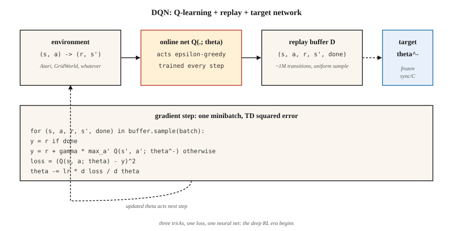

<!-- local-zh-machine-draft: English source is canonical; prose translated automatically, code/math preserved. -->

<a id="deep-q-networks-dqn"></a>

# 深Q网络（DQN）

> 2013 年：Mnih 在原始像素上训练了一个 Q-learning 网络，在七款 Atari 游戏中击败了所有经典 RL agent。 2015年：扩展至49款游戏，发表在Nature上，引发了deep-RL时代。 DQN 是 Q-learning 加上三个使函数逼近稳定的技巧。

**类型：** 构建
**语言：** Python
**先决条件：** 第 3 期·03 (Backpropagation)、第 9·04 期 (Q-learning、SARSA)
**时间：** ~75分钟

<a id="the-problem"></a>

## 问题

表格 Q-learning 需要每个（状态、动作）对都有一个单独的 Q 值。国际象棋棋盘有大约 10⁴³ 状态。 Atari 框架为 210×160×3 = 100,800 features。表格强化学习在数千个州消亡，更不用说数十亿个州了。

事后看来，修复是显而易见的：用神经网络 `Q(s, a; θ)` 替换 Q 表。但事后看来，这显然花了几十年的时间。 Q-learning 的朴素函数逼近在“致命三合一”下出现分歧——函数逼近 + 自举 + off-policy 学习。姆尼赫等人。 (2013, 2015) 确定了三个稳定学习的工程技巧：

1. **体验回放** 去相关过渡。
2. **目标网络** 冻结引导目标。
3. **奖励剪裁**标准化gradient幅度。

Atari 上的 DQN 是第一次使用单个 hyperparameter 集的单一架构解决了原始像素的数十个控制问题。此后构建的所有“深度强化学习”——DDQN、Rainbow、Dueling、Distributional、R2D2、Agent57——都堆叠在这个三招基础之上。

<a id="the-concept"></a>

## 概念



**目标。** DQN 最小化神经 Q 函数上的一步 TD 损失：

`L(θ) = E_{(s,a,r,s')~D} [ (r + γ max_{a'} Q(s', a'; θ^-) - Q(s, a; θ))² ]`

`θ`=在线网络，由gradient descent每一步更新。 `θ^-` = 目标网络，定期从 `θ` 复制（每约 10,000 步）。 `D` = 过去转换的重放缓冲区。

**这三个技巧，按重要性排序：**

**体验重播。** `~10⁶` 转换的环形缓冲区。每个训练步骤都会随机均匀地采样一个小批量。这打破了时间相关性（连续的帧几乎相同），让网络多次从罕见的奖励转换中学习，并对连续的 gradient 更新去​​相关。如果没有它，带有神经网络的 on-policy TD 在 Atari 上就会出现分歧。

**目标网络。** 在Bellman equation两侧使用相同的网络`Q(·; θ)`使得目标每次更新都会移动——“追着自己的尾巴”。修复：保留第二个网络 `Q(·; θ^-)` 并冻结 weights。每`C`步骤，复制`θ → θ^-`。这可以一次稳定数千个 gradient 步骤的回归目标。软更新`θ^- ← τ θ + (1-τ) θ^-`（用于DDPG、SAC）是一个更平滑的变体。

**奖励剪辑。** Atari 奖励幅度从 1 到 1000+ 不等。剪辑到 `{-1, 0, +1}` 可以阻止任何单个游戏主宰 gradient。当奖励的大小很重要时，这是错误的；对于只有标志很重要的雅达利来说还不错。

**Double DQN.** Hasselt (2016) 修复了最大化偏差：使用在线网络 *select* 操作，目标网络*evaluate* 它。

`target = r + γ Q(s', argmax_{a'} Q(s', a'; θ); θ^-)`

直接更换，始终如一。默认使用它。

**其他改进（Rainbow，2017）：**优先重放（更多高TD错误转换样本）、决斗架构（单独的`V(s)`和优势头）、噪声网络（学习探索）、n步返回、分布式Q (C51/QR-DQN)，多步引导。每增加几个百分点；收益大致是累加的。

```figure
f3-dqn-stability
```

<a id="build-it"></a>

## 动手实现

这里的代码仅包含 stdlib numpy - 我们在微小的连续 GridWorld 上使用手动滚动的单隐藏层 MLP，因此每个训练步骤都以微秒为单位运行。该算法在规模上与 Atari DQN 相同。

<a id="step-1-replay-buffer"></a>

### 第 1 步：重放缓冲区

```python
class ReplayBuffer:
    def __init__(self, capacity):
        self.buf = []
        self.capacity = capacity
    def push(self, s, a, r, s_next, done):
        if len(self.buf) == self.capacity:
            self.buf.pop(0)
        self.buf.append((s, a, r, s_next, done))
    def sample(self, batch, rng):
        return rng.sample(self.buf, batch)
```

Atari 容量约为 50,000； 5,000 对于我们的玩具环境来说已经足够了。

<a id="step-2-a-tiny-q-network-manual-mlp"></a>

### 第 2 步：微型 Q 网络（手动 MLP）

```python
class QNet:
    def __init__(self, n_in, n_hidden, n_actions, rng):
        self.W1 = [[rng.gauss(0, 0.3) for _ in range(n_in)] for _ in range(n_hidden)]
        self.b1 = [0.0] * n_hidden
        self.W2 = [[rng.gauss(0, 0.3) for _ in range(n_hidden)] for _ in range(n_actions)]
        self.b2 = [0.0] * n_actions
    def forward(self, x):
        h = [max(0.0, sum(w * xi for w, xi in zip(row, x)) + b) for row, b in zip(self.W1, self.b1)]
        q = [sum(w * hi for w, hi in zip(row, h)) + b for row, b in zip(self.W2, self.b2)]
        return q, h
```

Forward pass：线性→ReLU→线性。这就是整个网络。

<a id="step-3-the-dqn-update"></a>

### 步骤3：DQN更新

```python
def train_step(online, target, batch, gamma, lr):
    grads = zeros_like(online)
    for s, a, r, s_next, done in batch:
        q, h = online.forward(s)
        if done:
            y = r
        else:
            q_next, _ = target.forward(s_next)
            y = r + gamma * max(q_next)
        td_error = q[a] - y
        accumulate_grads(grads, online, s, h, a, td_error)
    apply_sgd(online, grads, lr / len(batch))
```

形状是第 04 课中的 Q-learning，有两个区别：(a) 我们通过可微分的 `Q(·; θ)` 进行反向传播，而不是对表进行索引，(b) 目标使用 `Q(·; θ^-)`。

<a id="step-4-the-outer-loop"></a>

### 第四步：外循环

对于每一集，对 `Q(·; θ)` 进行 ε 贪婪操作，将转换推入缓冲区，对小批量进行采样，采取 gradient 步骤，定期同步 `θ^- ← θ`。图案：

```python
for episode in range(N):
    s = env.reset()
    while not done:
        a = epsilon_greedy(online, s, epsilon)
        s_next, r, done = env.step(s, a)
        buffer.push(s, a, r, s_next, done)
        if len(buffer) >= batch:
            train_step(online, target, buffer.sample(batch), gamma, lr)
        if steps % sync_every == 0:
            target = copy(online)
        s = s_next
```

在我们具有 16 暗单热状态的小型 GridWorld 上，agent 在大约 500 集的时间内学习了近乎最优的策略。在 Atari 上，将其扩展到 200M 帧并添加 CNN feature 提取器。

<a id="pitfalls"></a>

## 陷阱

- **致命三联体。** 函数逼近 + off-policy + 自举可以发散。 DQN 通过目标网+重放来缓解；也不要删除。
- **Exploration.** ε 必须衰减，通常在训练的前 10% 左右从 1.0 衰减到 0.01。如果没有足够的早期勘探，Q-net 会收敛到局部盆地。
- **Overestimation.** `max` 对于噪声 Q 是向上偏置的。在生产中始终使用 Double DQN。
- **奖励规模。** 剪辑或标准化奖励； gradient 大小与奖励大小成正比。
- **重播缓冲区冷启动。** 在缓冲区有几千个转换之前不要训练。早期 gradients 对约 20 个样本的过度拟合。
- **目标同步频率。** 太频繁 ≈ 无目标网络；太罕见 ≈ 过时的目标。 Atari DQN 使用 10,000 个 env 步骤。经验法则：每隔约 1/100 的训练范围进行同步。
- **观测预处理。** Atari DQN 堆叠 4 帧来制作状态马尔可夫。任何具有速度信息的环境都需要帧堆叠或循环状态。

<a id="use-it"></a>

## 实际应用

到 2026 年，DQN 很少是最先进的，但仍然是参考 off-policy 算法：

| 任务 | 选择方法 | 为什么不是DQN？ |
|------|------------------|--------------|
| 类似 Atari 的离散操作 | 彩虹 DQN 或什锦麦片 | 相同的框架，更多的技巧。 |
| 连续控制 | SAC / TD3（9·07期） | DQN没有策略网络。 |
| On-policy / 高通量 | PPO（9·08期） | 无重播缓冲区；更容易扩展。 |
| 离线强化学习 | CQL / IQL / 决策 Transformer | 保守的 Q 目标，没有自举爆炸。 |
| 大型离散动作空间（推荐） | DQN，带有操作 embedding，或 IMPALA | 很好；装修很重要。 |
| LLM RL | PPO / GRPO | 序列级，而非步骤级；不同的损失。 |

教训仍在流传。重播和目标网络出现在 SAC、TD3、DDPG、SAC-X、AlphaZero 的自播放缓冲区和每个离线 RL 方法中。奖励剪辑作为 PPO 中的优势 normalization 存在。架构是蓝图。

<a id="ship-it"></a>

## 交付成果

另存为`outputs/skill-dqn-trainer.md`：

```markdown
---
name: dqn-trainer
description: Produce a DQN training config (buffer, target sync, ε schedule, reward clipping) for a discrete-action RL task.
version: 1.0.0
phase: 9
lesson: 5
tags: [rl, dqn, deep-rl]
---

Given a discrete-action environment (observation shape, action count, horizon, reward scale), output:

1. Network. Architecture (MLP / CNN / Transformer), feature dim, depth.
2. Replay buffer. Capacity, minibatch size, warmup size.
3. Target network. Sync strategy (hard every C steps or soft τ).
4. Exploration. ε start / end / schedule length.
5. Loss. Huber vs MSE, gradient clip value, reward clipping rule.
6. Double DQN. On by default unless explicit reason to disable.

Refuse to ship a DQN with no target network, no replay buffer, or ε held at 1. Refuse continuous-action tasks (route to SAC / TD3). Flag any reward range > 10× per-step mean as needing clipping or scale normalization.
```

<a id="exercises"></a>

## 练习

1. **Easy.** 运行`code/main.py`。绘制每集的回报曲线。运行平均值超过 -10 之前需要多少集？
2. **Medium.** 禁用目标网络（Bellman 目标两侧均使用在线网络）。衡量训练的不稳定性——回报是否振荡或发散？
3. **Hard.** 添加双倍DQN：使用在线网络挑选`argmax a'`，目标网络进行评估。在嘈杂奖励 GridWorld 上比较 1,000 集后 `Q(s_0, best_a)` 与真实 `V*(s_0)` 的偏差，以及没有 Double DQN 的情况。

<a id="key-terms"></a>

## 关键术语

| 术语 | 人们怎么说 | 它实际上意味着什么 |
|------|-----------------|-----------------------|
| DQN | “深Q-learning” | Q-learning 具有神经 Q 函数、重放缓冲区和目标网络。 |
| 体验回放 | “乱序过渡” | 环形缓冲区在每个 gradient 步骤中均匀采样；去相关数据。 |
| 目标网络 | “冻结引导程序” | Bellman 目标中使用的 Q 的定期副本；稳定训练。 |
| 致命黑社会 | 《为什么 RL 会出现分歧》 | 函数逼近 + 自举 + off-policy = 无收敛保证。 |
| 双DQN | “修复最大化偏差” | 在线网络选择行动，目标网络对其进行评估。 |
| 决斗 DQN | “V 型和 A 型头” | 分解 Q = V + A - 均值(A)；相同的输出，更好的 gradient 流量。 |
| 彩虹 | “所有的技巧” | DDQN + PER + 决斗 + n 步 + 噪声 + 分布式合二为一。 |
| PER | “优先重播” | 样本转换与 TD 误差幅度成正比。 |

<a id="further-reading"></a>

## 进一步阅读

- [Mnih 等人。 （2013）。 Playing Atari with Deep Reinforcement Learning](https://arxiv.org/abs/1312.5602) — 2013 年 NeurIPS 研讨会论文，开启了深度强化学习。
- [Mnih 等人。 （2015）。通过深度进行人性化控制 reinforcement learning](https://www.nature.com/articles/nature14236) — Nature 论文，49 场比赛 DQN。
- [Hasselt，Guez，银牌（2016）。深 Reinforcement Learning，带双 Q-learning](https://arxiv.org/abs/1509.06461) — DDQN。
- [Wang 等人。 （2016）。决斗网络架构](https://arxiv.org/abs/1511.06581) — 决斗DQN。
- [Hessel 等人。 （2018）。 Rainbow：结合 Deep RL](https://arxiv.org/abs/1710.02298) 的改进 — 堆叠技巧论文。
- [萨顿和巴托 (2018)。章。 9 — On-policy 近似预测](http://incompleteideas.net/book/RLbook2020.pdf) — DQN 的目标网络和“致命三元组”（函数逼近 + 自举 + off-policy）的教科书处理重放缓冲区旨在驯服。
- [CleanRL DQN 实现](https://docs.cleanrl.dev/rl-algorithms/dqn/) — 消融研究中使用的参考单文件 DQN；很适合与本课程的从头版本一起阅读。
