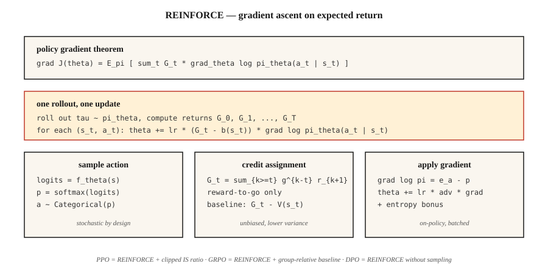

<!-- local-zh-machine-draft: English source is canonical; prose translated automatically, code/math preserved. -->

<a id="policy-gradient--reinforce-from-scratch"></a>

# Policy Gradient — REINFORCE 从头开始

> 停止估计价值。直接参数化策略，计算期望收益gradient，逐步上坡。 Williams (1992) 将其写在一个定理中。这就是为什么 PPO、GRPO 和每个 LLM RL 循环存在的原因。

**类型：** 构建
**语言：** Python
**先决条件：** 第 3·03 期 (Backpropagation)、第 9·03 期 (Monte Carlo)、第 9·04 期 (TD Learning)
**时间：** ~75分钟

<a id="the-problem"></a>

## 问题

Q-learning 和 DQN 参数化 *value* 函数。您通过 `argmax Q` 选择操作。这对于离散动作和离散状态来说很好。当动作连续时（`argmax` 超过 10 维扭矩？）或当您想要随机策略时（`argmax` 通过构造确定），它会中断。

Policy gradients 改为参数化 *policy*。 `π_θ(a | s)` 是一个输出动作分布的神经网络。从中取样并采取行动。计算相对于 `θ` 的预期收益 gradient。上坡。没有 `argmax`。没有贝尔曼递归。只是`J(θ) = E_{π_θ}[G]`上的gradient ascent。

REINFORCE 定理（Williams 1992）告诉您这个 gradient 是可计算的：`∇J(θ) = E_π[ G · ∇_θ log π_θ(a | s) ]`。运行一集。计算回报。每一步乘以 `∇ log π_θ(a | s)`。平均的。 Gradient-上升。完毕。

每一个LLM-2026年的RL算法——PPO,DPO,GRPO- 是一个细化REINFORCE。 触手可及的前提是rest本阶段以及第 10·07 阶段（RLHF实施）和第 10·08 阶段（DPO）。

<a id="the-concept"></a>

## 概念



**policy gradient 定理。** 对于由 `θ` 参数化的任何策略 `π_θ`：

`∇J(θ) = E_{τ ~ π_θ}[ Σ_{t=0}^{T} G_t · ∇_θ log π_θ(a_t | s_t) ]`

其中 `G_t = Σ_{k=t}^{T} γ^{k-t} r_{k+1}` 是步骤 `t` 的折扣回报。期望超过从 `π_θ` 采样的完整轨迹 `τ`。

**证明很短。** 在期望下区分`J(θ) = Σ_τ P(τ; θ) G(τ)`。使用`∇P(τ; θ) = P(τ; θ) ∇ log P(τ; θ)`（log-derivative trick）。因子 `log P(τ; θ) = Σ log π_θ(a_t | s_t) + environment terms that do not depend on θ`。环境术语消失了。两行代数就可以给出定理。

**减少方差的技巧。** Vanilla REINFORCE 具有致命的方差——回报是嘈杂的，`∇ log π` 是嘈杂的，他们的产品非常嘈杂。两个标准修复：

1. **基线减法。** 对于不依赖于 `a_t` 的任何基线 `b(s_t)`，将 `G_t` 替换为 `G_t - b(s_t)`。公正，因为 `E[b(s_t) · ∇ log π(a_t | s_t)] = 0`。典型选择：`b(s_t) = V̂(s_t)` 通过 critic → actor-critic（第 07 课）学习。
2. **Reward-to-go.** 将 `Σ_t G_t · ∇ log π_θ(a_t | s_t)` 替换为 `Σ_t G_t^{from t} · ∇ log π_θ(a_t | s_t)`。对于给定的行动，只有未来的回报才重要——过去的回报会带来零均值噪音。

结合起来，您将得到：

`∇J ≈ (1/N) Σ_{i=1}^{N} Σ_{t=0}^{T_i} [ G_t^{(i)} - V̂(s_t^{(i)}) ] · ∇_θ log π_θ(a_t^{(i)} | s_t^{(i)})`

这是带有基线的 REINFORCE — A2C（第 07 课）和 PPO（第 08 课）的直接祖先。

**Softmax 策略参数化。** 对于离散操作，标准选择：

`π_θ(a | s) = exp(f_θ(s, a)) / Σ_{a'} exp(f_θ(s, a'))`

其中 `f_θ` 是输出每个动作得分的任何神经网络。 gradient 有一个干净的形式：

`∇_θ log π_θ(a | s) = ∇_θ f_θ(s, a) - Σ_{a'} π_θ(a' | s) ∇_θ f_θ(s, a')`

即，所采取行动的得分减去其在策略下的预期值。

**连续行动的高斯策略。** `π_θ(a | s) = N(μ_θ(s), σ_θ(s))`。 `∇ log N(a; μ, σ)` 具有封闭形式。这就是9·07期SAC的全部需求。

```figure
policy-gradient-landscape
```

<a id="build-it"></a>

## 动手实现

<a id="step-1-softmax-policy-network"></a>

### 步骤1：softmax策略网络

```python
def policy_logits(theta, state_features):
    return [dot(theta[a], state_features) for a in range(N_ACTIONS)]

def softmax(logits):
    m = max(logits)
    exps = [exp(l - m) for l in logits]
    Z = sum(exps)
    return [e / Z for e in exps]
```

对表格环境使用线性策略（每个操作一个 weight 向量）。对于 Atari，换入 CNN 并保留 softmax 头。

<a id="step-2-sampling-and-log-probability"></a>

### 步骤 2：sampling 和对数概率

```python
def sample_action(probs, rng):
    x = rng.random()
    cum = 0
    for a, p in enumerate(probs):
        cum += p
        if x <= cum:
            return a
    return len(probs) - 1

def log_prob(probs, a):
    return log(probs[a] + 1e-12)
```

<a id="step-3-rollout-with-log-probs-captured"></a>

### 步骤 3：rollout 捕获日志概率

```python
def rollout(theta, env, rng, gamma):
    trajectory = []
    s = env.reset()
    while not done:
        logits = policy_logits(theta, s)
        probs = softmax(logits)
        a = sample_action(probs, rng)
        s_next, r, done = env.step(s, a)
        trajectory.append((s, a, r, probs))
        s = s_next
    return trajectory
```

<a id="step-4-reinforce-update"></a>

### 第四步：REINFORCE更新

```python
def reinforce_step(theta, trajectory, gamma, lr, baseline=0.0):
    returns = compute_returns(trajectory, gamma)
    for (s, a, _, probs), G in zip(trajectory, returns):
        advantage = G - baseline
        grad_log_pi_a = [-p for p in probs]
        grad_log_pi_a[a] += 1.0
        for i in range(N_ACTIONS):
            for j in range(len(s)):
                theta[i][j] += lr * advantage * grad_log_pi_a[i] * s[j]
```

gradient `∇ log π(a|s) = e_a - π(·|s)`（`a` 减去概率的一个）是 softmax policy gradients 的核心。将其刻录成肌肉记忆。

<a id="step-5-baselines"></a>

### 第 5 步：基线

最近几集中 `G` 的运行平均值足以减少方差以使 4×4 GridWorld 运行；大约需要 500 集才能收敛。将基线升级到已学习的 `V̂(s)`，您将获得 actor-critic。

<a id="pitfalls"></a>

## 陷阱

- **爆炸 gradients.** 回报可能是巨大的。在乘以 `∇ log π` 之前，始终在批次中将 `G` 标准化为 `~N(0, 1)`。
- **熵崩溃。** 策略过早收敛到近乎确定性的行动，停止探索，陷入困境。修复：将 entropy bonus `β · H(π(·|s))` 添加到目标中。
- **高方差。** Vanilla REINFORCE 需要数千集。 critic 基线（第 07 课）或 TRPO/PPO 的信任区域（第 08 课）是标准修复。
- **样本效率低下。** On-policy 意味着您在一次更新后丢弃所有转换。 Off-policy 通过 importance sampling 进行更正，以方差为代价带回数据（PPO 的比率是剪裁后的 IS weight）。
- **非平稳gradients.** 100集前的相同gradient使用旧的`π`。由于这个原因，On-policy 方法每隔几个 rollouts 就会更新一次。
- **信用分配。** 如果没有reward-to-go，过去的奖励会产生噪音。始终使用 reward-to-go。

<a id="use-it"></a>

## 实际应用

2026年，REINFORCE很少直接运行，但它的gradient公式却无处不在：

| 应用场景 | 派生方法 |
|----------|---------------|
| 连续控制 | PPO / SAC 具有高斯策略 |
| LLM RLHF | PPO 带有 KL 惩罚，运行在 token 级别的策略上 |
| LLM推理（DeepSeek） | GRPO — REINFORCE 具有组相对基线，无 critic |
| 多agent | 集中式-critic REINFORCE（MADDPG、COMA） |
| 离散动作机器人 | A2C, A3C, PPO |
| 仅首选项设置 | DPO — REINFORCE 重写为偏好似然损失，无 sampling |

当您在 2026 年训练脚本中读取 `loss = -advantage * log_prob` 时，即带有基线的 REINFORCE 。整篇论文（DPO、GRPO、RLOO）都是在这一行之上的方差减少技巧。

<a id="ship-it"></a>

## 交付成果

另存为`outputs/skill-policy-gradient-trainer.md`：

```markdown
---
name: policy-gradient-trainer
description: Produce a REINFORCE / actor-critic / PPO training config for a given task and diagnose variance issues.
version: 1.0.0
phase: 9
lesson: 6
tags: [rl, policy-gradient, reinforce]
---

Given an environment (discrete / continuous actions, horizon, reward stats), output:

1. Policy head. Softmax (discrete) or Gaussian (continuous) with parameter counts.
2. Baseline. None (vanilla), running mean, learned `V̂(s)`, or A2C critic.
3. Variance controls. Reward-to-go on by default, return normalization, gradient clip value.
4. Entropy bonus. Coefficient β and decay schedule.
5. Batch size. Episodes per update; on-policy data freshness contract.

Refuse REINFORCE-no-baseline on horizons > 500 steps. Refuse continuous-action control with a softmax head. Flag any run with `β = 0` and observed policy entropy < 0.1 as entropy-collapsed.
```

<a id="exercises"></a>

## 练习

1. **Easy.** 使用线性 softmax 策略在 4×4 GridWorld 上实现 REINFORCE。在没有基线的情况下训练 1,000 集。绘制学习曲线；测量方差（回报标准）。
2. **Medium.** 添加运行平均值基线。再次训练。将样本效率和方差与普通运行进行比较。基线将收敛步骤减少了多少？
3. **Hard.** 添加 entropy bonus `β · H(π)`。扫一扫`β ∈ {0, 0.01, 0.1, 1.0}`。绘制最终回报和策略熵。这项任务的最佳点在哪里？

<a id="key-terms"></a>

## 关键术语

| 术语 | 人们怎么说 | 它实际上意味着什么 |
|------|-----------------|-----------------------|
| Policy gradient | “直接训练策略” | `∇J(θ) = E[G · ∇ log π_θ(a\|s)]`;源自 log-derivative trick。 |
| REINFORCE | 《原创PG算法》 | 威廉姆斯（1992）； Monte Carlo 返回乘以 log-policy gradient。 |
| Log-derivative trick | 《分数函数估计器》 | `∇P(τ;θ) = P(τ;θ) · ∇ log P(τ;θ)`;使得 gradients 的期望易于处理。 |
| 基线 | “减少方差” | `G`减去任意`b(s)`；公正，因为 `E[b · ∇ log π] = 0`。 |
| Reward-to-go | “只有未来的回报才算数” | `G_t^{from t}` 而不是完整的 `G_0`；正确且低方差。 |
| Entropy bonus | “鼓励探索” | `+β · H(π(·\|s))` 术语可以防止策略崩溃。 |
| On-policy | “训练你刚刚看到的东西” | Gradient 期望是 w.r.t.当前的策略——不能直接重用旧数据。 |
| 优势 | “比平均水平好多少” | `A(s, a) = G(s, a) - V(s)`;签名数量 REINFORCE-with-baseline 相乘。 |

<a id="further-reading"></a>

## 进一步阅读

- [威廉姆斯（1992）。简单统计 Gradient-Connectionist 的以下算法 Reinforcement Learning](https://link.springer.com/article/10.1007/BF00992696) — 原始 REINFORCE 论文。
- [Sutton 等人。 （2000）。 Policy Gradient 具有函数逼近的 Reinforcement Learning 方法](https://papers.nips.cc/paper_files/paper/1999/hash/464d828b85b0bed98e80ade0a5c43b0f-Abstract.html) — 具有函数逼近的现代策略 gradient 定理。
- [萨顿和巴托 (2018)。章。 13 — Policy Gradient 方法](http://incompleteideas.net/book/RLbook2020.pdf) — 教科书演示。
- [OpenAI 旋转 — VPG / REINFORCE](https://spinningup.openai.com/en/latest/algorithms/vpg.html) — 使用 PyTorch 代码进行清晰的教学阐述。
- [Peters 和 Schaal (2008)。 Reinforcement Learning 的运动技能与 Policy Gradients](https://homes.cs.washington.edu/~todorov/courses/amath579/reading/PolicyGradient.pdf) — 方差减少和自然 gradient 视图将 REINFORCE 连接到信任区域系列（TRPO， PPO）。
