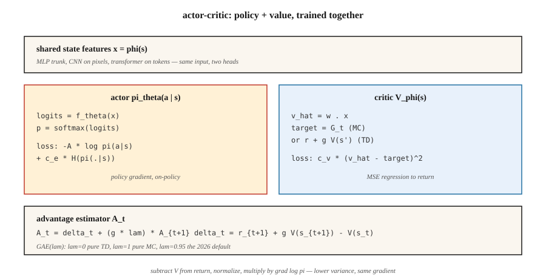

<!-- local-zh-machine-draft: English source is canonical; prose translated automatically, code/math preserved. -->

<a id="actor-critic--a2c-and-a3c"></a>

# Actor-Critic — A2C 和 A3C

> REINFORCE 很吵。添加一个学习 `V̂(s)` 的 critic，从回报中减去它，您将获得具有相同期望但方差低得多的优势。即actor-critic。 A2C 同步运行； A3C 跨线程运行它。两者都是所有现代深度强化学习方法的心理模型。

**类型：** 构建
**语言：** Python
**先决条件：** 第 9·04 期 (TD Learning)、第 9·06 期 (REINFORCE)
**时间：** ~75分钟

<a id="the-problem"></a>

## 问题

Vanilla REINFORCE 可以工作，但它的方差很糟糕。 Monte Carlo 返回 `G_t` 可以在剧集之间摆动 10 倍。将噪声乘以 `∇ log π` 并求平均值会产生一个 gradient 估计器，该估计器需要数千个情节才能将策略移动到相同的距离，而您可以用更少的 DQN 更新来移动它。

差异来自于使用原始回报。如果减去基线 `b(s_t)`（任何状态函数，包括学习值），期望将保持不变，方差会下降。最好处理的基线是 `V̂(s_t)`。现在数量乘以`∇ log π`就是*advantage*：

`A(s, a) = G - V̂(s)`

如果一项行动产生了高于平均水平的回报，那么它就是好的；如果低于则不好。 REINFORCE与学习到的critic是*actor-critic*。 critic 为 actor 提供了低方差教师。这是2015年之后的每个深度策略方法（A2C、A3C、PPO、SAC、IMPALA）。

<a id="the-concept"></a>

## 概念



**两个网络，一个共享损失：**

- **Actor** `π_θ(a | s)`：策略。采样以行动。使用 policy gradient 进行培训。
- **Critic** `V_φ(s)`：估计状态的预期回报。经过训练以最小化 `(V_φ(s) - target)²`。

**的优点。** 两种标准形式：

- *MC优势：* `A_t = G_t - V_φ(s_t)`。无偏，方差较高。
- *TD优势：* `A_t = r_{t+1} + γ V_φ(s_{t+1}) - V_φ(s_t)`。有偏差（使用 `V_φ`），方差低得多。也称为 *TD 残差 * `δ_t`。

**n-步优势。** 在两者之间插值：

`A_t^{(n)} = r_{t+1} + γ r_{t+2} + … + γ^{n-1} r_{t+n} + γ^n V_φ(s_{t+n}) - V_φ(s_t)`

`n = 1`是纯TD。 `n = ∞`是MC。 大多数实现使用`n = 5`对于雅达利来说，`n = 2048`为了PPO在 MuJoCo 上。

**广义优势估计（GAE）。** Schulman等人。 (2016) 提出了所有 n 步优势的指数加权平均值：

`A_t^{GAE} = Σ_{l=0}^{∞} (γλ)^l δ_{t+l}`

与 `λ ∈ [0, 1]`。 `λ = 0` 是 TD（低方差，高偏差）。 `λ = 1` 是 MC（高方差，无偏）。 `λ = 0.95` 是 2026 年的默认值 — 进行调整，直到偏差/方差转盘达到您想要的位置。

**A2C：同步优势 actor-critic.** 跨 `N` 并行环境收集 `T` 步骤。计算每一步的优势。更新组合批次上的 actor 和 critic。重复。 A3C 的更简单、更具可扩展性的兄弟。

**A3C：异步优势 actor-critic.** Mnih 等人。 （2016）。生成 `N` 工作线程，每个线程运行一个环境。每个工作线程在自己的 rollout 上本地计算 gradients，然后将它们异步应用到共享的 parameter 服务器。不需要重放缓冲区——工作人员通过运行不同的轨迹来解相关。 A3C 证明您可以在 CPUs 上进行大规模训练。 2026 年，基于 GPU 的 A2C（批量并行环境）占据主导地位，因为 GPUs 需要大批量。

**综合损失。**

`L(θ, φ) = -E[ A_t · log π_θ(a_t | s_t) ]  +  c_v · E[(V_φ(s_t) - G_t)²]  -  c_e · E[H(π_θ(·|s_t))]`

三个术语：策略-gradient损失，价值回归，entropy bonus。 `c_v ~ 0.5`、`c_e ~ 0.01` 是规范的起点。

```figure
actor-critic
```

<a id="build-it"></a>

## 动手实现

<a id="step-1-a-critic"></a>

### 第1步：critic

Linear critic `V_φ(s) = w · features(s)` 用 MSE 更新：

```python
def critic_update(w, x, target, lr):
    v_hat = dot(w, x)
    err = target - v_hat
    for j in range(len(w)):
        w[j] += lr * err * x[j]
    return v_hat
```

在表格环境中，critic 在几百集内收敛。在 Atari 上，将线性 critic 替换为共享 CNN 主干 + 值头。

<a id="step-2-n-step-advantage"></a>

### 第2步：n步优势

给定长度为 `T` 的 rollout 和自举最终 `V(s_T)`：

```python
def compute_advantages(rewards, values, gamma=0.99, lam=0.95, last_value=0.0):
    advantages = [0.0] * len(rewards)
    gae = 0.0
    for t in reversed(range(len(rewards))):
        next_v = values[t + 1] if t + 1 < len(values) else last_value
        delta = rewards[t] + gamma * next_v - values[t]
        gae = delta + gamma * lam * gae
        advantages[t] = gae
    returns = [a + v for a, v in zip(advantages, values)]
    return advantages, returns
```

`returns` 是 critic 目标。 `advantages` 是 `∇ log π` 的乘积。

<a id="step-3-combined-update"></a>

### 第三步：合并更新

```python
for step_i, (x, a, _r, probs) in enumerate(traj):
    adv = advantages[step_i]
    target_v = returns[step_i]

    # critic
    critic_update(w, x, target_v, lr_v)

    # actor
    for i in range(N_ACTIONS):
        grad_logpi = (1.0 if i == a else 0.0) - probs[i]
        for j in range(N_FEAT):
            theta[i][j] += lr_a * adv * grad_logpi * x[j]
```

On-policy，每次更新一个rollout，单独的learning rates为actor和critic。

<a id="step-4-parallelization-a3c-vs-a2c"></a>

### 步骤4：并行化（A3C vs A2C）

- **A3C:** 启动 `N` 线程。每个都运行自己的环境和自己的 forward pass。定期将 gradient 更新推送到共享主服务器。没有大师的锁定——比赛没问题，它们只是增加了噪音。
- **A2C:** 在单个进程中运行 `N` env 实例，将观察结果堆栈到 `[N, obs_dim]` 批处理中，批处理 forward pass，批处理backward pass。 GPU 利用率更高，具有确定性，更易于推理。默认为 2026 年。

为了清晰起见，我们的玩具代码是单线程的；重写批量A2C是numpy的三行。

<a id="pitfalls"></a>

## 陷阱

- **Critic 在 actor gradient.** 之前的偏差 如果 critic 是随机的，则其基线是无信息的，并且您正在纯噪声上进行训练。在打开 policy gradient 之前将 critic 预热几百步，或者使用慢速 actor learning rate。
- **Advantage normalization.** 将每批次的优势归一化为零均值/单位标准差。以接近零的成本大规模稳定训练。
- **Shared trunk.** 对图像输入上的 actor 和 critic 使用共享 feature 提取器。分开的头。双方共同承担 features 的损失。
- **On-policy 合约。** A2C 重复使用数据进行一次更新。更多，你的gradient是有偏见的（重要性-sampling修正是PPO添加的）。
- **熵崩溃。** 如果没有`c_e > 0`，策略在几百次更新中变得接近确定性并停止探索。
- **奖励规模。** 优势大小取决于奖励规模。标准化奖励（例如，运行标准划分），以确保跨任务的 gradient 大小一致。

<a id="use-it"></a>

## 实际应用

A2C/A3C 很少是 2026 年的最终选择，但它们是后来一切完善的架构：

| 方法 | 与 A2C 的关系 |
|--------|----------------|
| PPO | A2C + 多 epoch 更新的剪裁重要性比 |
| 因帕拉 | A3C + V-trace off-policy 校正 |
| SAC（9·07期） | Off-policy A2C 具有软值 critic（下一课） |
| GRPO（第9·12期） | A2C 没有 critic — 群体相对优势 |
| DPO | A2C 陷入偏好排名损失，没有 sampling |
| AlphaStar / OpenAI 五 | A2C 带联赛训练+模仿预训练 |

如果您在 2026 年的论文中看到“优势”，请考虑 actor-critic。

<a id="ship-it"></a>

## 交付成果

另存为 `outputs/skill-actor-critic-trainer.md`：

```markdown
---
name: actor-critic-trainer
description: Produce an A2C / A3C / GAE configuration for a given environment, with advantage estimation and loss weights specified.
version: 1.0.0
phase: 9
lesson: 7
tags: [rl, actor-critic, gae]
---

Given an environment and compute budget, output:

1. Parallelism. A2C (GPU batched) vs A3C (CPU async) and the number of workers.
2. Rollout length T. Steps per env per update.
3. Advantage estimator. n-step or GAE(λ); specify λ.
4. Loss weights. `c_v` (value), `c_e` (entropy), gradient clip.
5. Learning rates. Actor and critic (separate if using).

Refuse single-worker A2C on environments with horizon > 1000 (too on-policy, too slow). Refuse to ship without advantage normalization. Flag any run with `c_e = 0` and observed entropy < 0.1 as entropy-collapsed.
```

<a id="exercises"></a>

## 练习

1. **Easy.** 在 4×4 GridWorld 上训练具有 MC 优势的 actor-critic (`G_t - V(s_t)`)。将样本效率与第 06 课中的 REINFORCE-with-running-mean-baseline 进行比较。
2. **Medium.** 切换到TD剩余优势（`r + γ V(s') - V(s)`）。测量优势批次的方差。下降了多少？
3. **Hard.** 实现GAE(λ)。扫一扫`λ ∈ {0, 0.5, 0.9, 0.95, 1.0}`。绘制最终回报与样本效率的关系图。这项任务的偏差/方差最佳点在哪里？

<a id="key-terms"></a>

## 关键术语

| 术语 | 人们怎么说 | 它实际上意味着什么 |
|------|-----------------|-----------------------|
| Actor | 《策略网》 | `π_θ(a\|s)`，更新者为policy gradient。 |
| Critic | “价值网” | `V_φ(s)`，通过 MSE 回归更新为回报/TD 目标。 |
| 优势 | “比平均水平好多少” | `A(s, a) = Q(s, a) - V(s)` 或其估计器。 `∇ log π` 的乘数。 |
| TD残差 | "δ" | `δ_t = r + γ V(s') - V(s)`;一步优势估计。 |
| GAE | “插补旋钮” | n 步优势的指数加权和，参数化为 `λ`。 |
| A2C | “同步actor-critic” | 跨环境批处理；每个 rollout 一个 gradient 步。 |
| A3C | “异步actor-critic” | 工作线程将 gradients 推送到共享参数服务器。原纸； 2026 年将不再常见。 |
| 引导程序 | “在地平线上使用V” | 截断 rollout，添加 `γ^n V(s_{t+n})` 以关闭总和。 |

<a id="further-reading"></a>

## 进一步阅读

- [Mnih 等人。 （2016）。深度异步方法 Reinforcement Learning](https://arxiv.org/abs/1602.01783) — A3C，原始异步 actor-critic 论文。
- [Schulman 等人。 （2016）。使用广义优势估计的高维连续控制](https://arxiv.org/abs/1506.02438) — GAE。
- [萨顿和巴托 (2018)。章。 13 — Actor-Critic 方法](http://incompleteideas.net/book/RLbook2020.pdf) — 基础；将此与 Ch 配对。当 critic 是神经网络时，9 关于函数逼近。
- [Espeholt 等人。 （2018）。 IMPALA](https://arxiv.org/abs/1802.01561) — 可扩展的分布式 actor-critic，具有 V-trace off-policy 校正。
- [OpenAI 基线/稳定基线3](https://stable-baselines3.readthedocs.io/) — 生产 A2C/PPO 实现值得一读。
- [Konda 和齐齐克利斯 (2000)。 Actor-Critic 算法](https://papers.nips.cc/paper/1786-actor-critic-algorithms) — 两个时间尺度 actor-critic 分解的基本收敛结果。
