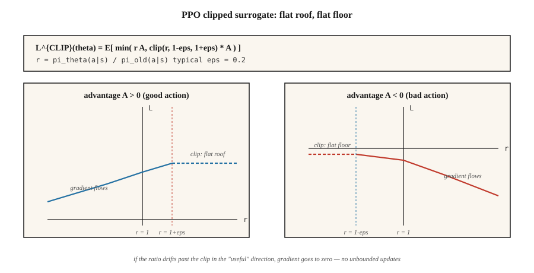

<!-- local-zh-machine-draft: English source is canonical; prose translated automatically, code/math preserved. -->

<a id="proximal-policy-optimization-ppo"></a>

# 近端策略优化（PPO）

> A2C 在一次更新后丢弃每个 rollout。 PPO 将 policy gradient 封装在一个剪裁的重要性比率中，这样您就可以对相同的数据执行 10 个以上的 epoch，而不会导致策略爆炸。舒尔曼等人。 （2017）。 2026年仍然是默认策略-gradient算法。

**类型：** 构建
**语言：** Python
**先决条件：** 第 9·06 期 (REINFORCE)、第 9·07 期 (Actor-Critic)
**时间：** ~75分钟

<a id="the-problem"></a>

## 问题

A2C（第 07 课）属于 on-policy：gradient `E_{π_θ}[A · ∇ log π_θ]` 要求数据由 `π_θ` 的 *当前* 版本采样得到。进行一次更新后，`π_θ` 就发生变化，刚用过的数据随即成为 off-policy 数据。重复使用它会使 gradient 估计产生偏差。

Rollouts 的成本很高。在 Atari 上，一次 rollout 需要 8 个环境 × 128 步 = 1024 次状态转移，以及十几秒的环境运行时间。只做一次 gradient 更新就丢弃这些数据，十分浪费。

信任区域策略优化（TRPO，Schulman 2015）是第一个修复：限制每次更新，使新旧策略之间的 KL 差异保持在 `δ` 以下。理论上是干净的，但每次更新都需要共轭 gradient 求解。到 2026 年，没有人运行 TRPO。

PPO（Schulman et al. 2017）用简单的裁剪目标取代了硬信任域约束。多一行代码。每个 rollout 十个epoch。无缀合物 gradients。足够好的理论保证。九年后，它仍然是从 MuJoCo 到 RLHF 的所有内容的默认策略 - gradient 算法。

<a id="the-concept"></a>

## 概念



**重要比例。**

`r_t(θ) = π_θ(a_t | s_t) / π_{θ_old}(a_t | s_t)`

这是新策略相对于收集数据的旧策略的似然比。`r_t = 1` 表示没有变化；`r_t = 2` 表示新策略选择 `a_t` 的概率是旧策略的两倍。

**剪辑代理。**

`L^{CLIP}(θ) = E_t [ min( r_t(θ) A_t, clip(r_t(θ), 1-ε, 1+ε) A_t ) ]`

两个术语：

- 若优势 `A_t > 0`，且概率比试图超过 `1 + ε`，裁剪会让 gradient 变为平坦区域——不要将好动作的概率推高到超过旧概率的 `+ε` 相对增幅。
- 如果优势 `A_t < 0` 和比率试图增长到超过 `1 - ε`（这意味着与修剪后的减少相比，我们更有可能做出不良动作），则剪辑会限制 gradient — 不要将不良动作推至低于 `-ε`。

`min` 处理另一个方向：如果比率已沿 *beneficial* 方向移动，您仍然会得到 gradient（不会在会伤害您的一侧进行剪切）。

典型`ε = 0.2`。将目标绘制为 `r_t` 的函数：分段线性函数，“好侧”具有平屋顶，“坏侧”具有平坦地板。

**全PPO损失。**

`L(θ, φ) = L^{CLIP}(θ) - c_v · (V_φ(s_t) - V_t^{target})² + c_e · H(π_θ(·|s_t))`

actor-critic 结构与 A2C 相同。三个系数，通常为`c_v = 0.5`、`c_e = 0.01`、`ε = 0.2`。

**训练循环。**

1. 让 `N` 个并行环境各运行 `T` 步，共收集 `N × T` 次状态转移。
2. 计算优势估计（GAE），并将其固定为常量。
3. 将 `π_{θ_old}` 固定为当前 `π_θ` 的快照。
4. 进行 `K` 轮训练，每轮遍历由 `(s, a, A, V_target, log π_old(a|s))` 组成的各个小批量：
   - 计算`r_t(θ) = exp(log π_θ(a|s) - log π_old(a|s))`。
   - 应用 `L^{CLIP}`，再加上价值损失和熵项。
   - Gradient 步骤。
5. 丢弃本次 rollout，返回第 1 步。

`K = 10` 和 64 个小批量是标准 hyperparameter 集。 PPO 非常稳健：精确的数字在 ±50% 范围内很少有影响。

**KL-惩罚变体。** 原始论文提出了一种使用自适应 KL 惩罚的替代方案：`L = L^{PG} - β · KL(π_θ || π_old)`，其中 `β` 根据观察到的 KL 进行调整。剪裁版本占据主导地位； KL 变体保留在 RLHF 中（其中参考策略的 KL 是您始终想要的单独约束）。

```figure
ppo-clip
```

<a id="build-it"></a>

## 动手实现

<a id="step-1-capture-log-π_olda--s-at-rollout-time"></a>

### 第 1 步：在 rollout 时记录 `log π_old(a | s)`

```python
for step in range(T):
    probs = softmax(logits(theta, state_features(s)))
    a = sample(probs, rng)
    s_next, r, done = env.step(s, a)
    buffer.append({
        "s": s, "a": a, "r": r, "done": done,
        "v_old": value(w, state_features(s)),
        "log_pi_old": log(probs[a] + 1e-12),
    })
    s = s_next
```

快照只在 rollout 时记录一次，在后续更新的各轮训练中保持不变。

<a id="step-2-compute-gae-advantages-lesson-07"></a>

### 步骤 2：计算 GAE 优势（第 07 课）

与A2C相同。跨批次标准化。

<a id="step-3-clipped-surrogate-update"></a>

### 第 3 步：剪辑代理更新

```python
for _ in range(K_EPOCHS):
    for mb in minibatches(buffer, size=64):
        for rec in mb:
            x = state_features(rec["s"])
            probs = softmax(logits(theta, x))
            logp = log(probs[rec["a"]] + 1e-12)
            ratio = exp(logp - rec["log_pi_old"])
            adv = rec["advantage"]
            surrogate = min(
                ratio * adv,
                clamp(ratio, 1 - EPS, 1 + EPS) * adv,
            )
            # backprop -surrogate, add value loss, subtract entropy
            grad_logpi = onehot(rec["a"]) - probs
            if (adv > 0 and ratio >= 1 + EPS) or (adv < 0 and ratio <= 1 - EPS):
                pg_grad = 0.0  # clipped
            else:
                pg_grad = ratio * adv
            for i in range(N_ACTIONS):
                for j in range(N_FEAT):
                    theta[i][j] += LR * pg_grad * grad_logpi[i] * x[j]
```

“裁剪 → gradient 为零”是 PPO 的核心模式。如果新策略已经沿有利方向偏移得过远，更新就会停止。

<a id="step-4-value-and-entropy"></a>

### 第四步：值和熵

将标准 MSE 添加到 critic 目标，并在 actor 上添加 entropy bonus，与 A2C 相同。

<a id="step-5-diagnostics"></a>

### 第 5 步：诊断

每次更新都要注意三件事：

- **平均 KL** `E[log π_old - log π_θ]`。应保持在 `[0, 0.02]` 范围内。如果远远超过 `0.1`，就降低 `K_EPOCHS` 或 `LR`。
- **裁剪比例**——概率比落在 `[1-ε, 1+ε]` 之外的样本占比。应约为 `~0.1-0.3`。如果接近 `~0`，说明裁剪从未触发 → 提高 `LR` 或 `K_EPOCHS`。如果达到 `~0.5+`，说明你正在过拟合本次 rollout → 降低这些设置。
- **解释方差** `1 - Var(V_target - V_pred) / Var(V_target)`。用于衡量 Critic 的质量。随着 critic 学习，它应逐渐接近 1。

<a id="pitfalls"></a>

## 陷阱

- **裁剪系数设置不当。** `ε = 0.2` 是事实上的标准。降到 `0.1` 会使更新过于保守；升到 `0.3+` 则容易引发不稳定。
- **训练轮数过多。** `K > 20` 常会使训练不稳定，因为策略与 `π_old` 的偏离过大。应限制训练轮数，大型网络尤其如此。
- **未对奖励进行 normalization。** 较大的奖励尺度会侵占裁剪范围。计算优势之前，先对奖励进行归一化（使用运行中的标准差）。
- **忘记对优势进行 normalization。** 每批次零均值、单位标准差的 normalization 是标准做法。在多数基准上，跳过这一步会破坏 PPO 的表现。
- **未衰减 Learning rate。** PPO 通常受益于将学习率线性衰减到零。使用固定学习率往往效果更差。
- **重要性比率计算错误。** 为保证数值稳定性，应始终使用 `exp(log_new - log_old)`，而不是 `new / old`。
- **gradient 符号错误。** 最大化替代目标，等价于 *最小化* `-L^{CLIP}`。符号弄反是最常见的 PPO 错误。

<a id="use-it"></a>

## 实际应用

PPO 是 2026 年的默认 RL 算法，涉及数量惊人的领域：

| 应用场景 | PPO 变体 |
|----------|-------------|
| MuJoCo / 机器人控制 | PPO 采用高斯策略，GAE(0.95) |
| 雅达利/独立游戏 | PPO 具有分类策略，滚动 128 步 rollouts |
| RLHF 为 LLMs | PPO 对参考模型进行 KL 惩罚，响应结束时从 RM 中获得奖励 |
| 大型游戏agents | IMPALA + PPO（AlphaStar、OpenAI 五） |
| 推理LLMs | GRPO（第 12 课）— PPO 变体，不含 critic |
| 仅偏好数据 | DPO — PPO+KL 的封闭式折叠，不在线 sampling |

PPO *loss shape*——剪裁代理+值+熵——是DPO、GRPO和几乎每个RLHF的脚手架管道。

<a id="ship-it"></a>

## 交付成果

另存为 `outputs/skill-ppo-trainer.md`：

```markdown
---
name: ppo-trainer
description: Produce a PPO training config and a diagnostic plan for a given environment.
version: 1.0.0
phase: 9
lesson: 8
tags: [rl, ppo, policy-gradient]
---

Given an environment and training budget, output:

1. Rollout size. `N` envs × `T` steps.
2. Update schedule. `K` epochs, minibatch size, LR schedule.
3. Surrogate params. `ε` (clip), `c_v`, `c_e`, advantage normalization on.
4. Advantage. GAE(`λ`) with explicit `γ` and `λ`.
5. Diagnostics plan. KL, clip fraction, explained variance thresholds with alerts.

Refuse `K > 30` or `ε > 0.3` (unsafe trust region). Refuse any PPO run without advantage normalization or KL/clip monitoring. Flag clip fraction sustained above 0.4 as drift.
```

<a id="exercises"></a>

## 练习

1. **Easy.** 在 4×4 GridWorld 上使用 `ε=0.2, K=4` 运行 PPO。在匹配的环境步骤下将样本效率与 A2C（每个 rollout 一个 epoch）进行比较。
2. **中等。** 扫描 `K ∈ {1, 4, 10, 30}`。绘制回报随环境交互步数变化的曲线，并跟踪每次更新的平均 KL。在此任务中，`K` 达到多少时 KL 会剧增？
3. **困难。** 用自适应 KL 惩罚替换裁剪替代目标（当 `KL > 2·target` 时，将 `β` 加倍；当 `KL < target/2` 时，将其减半）。比较最终回报、稳定性和无需裁剪的程度。

<a id="key-terms"></a>

## 关键术语

| 术语 | 人们怎么说 | 它实际上意味着什么 |
|------|-----------------|-----------------------|
| 重要性比率 | "r_t(θ)" | `π_θ(a\|s) / π_old(a\|s)`；表示相对于收集数据的策略的偏离程度。 |
| 裁剪替代目标 | 《PPO的主要技巧》 | `min(r·A, clip(r, 1-ε, 1+ε)·A)`；在有利方向超过裁剪边界后，gradient 变为零，目标形成平坦区域。 |
| 信赖域 | “TRPO/PPO 意图” | 限制每次更新的 KL，以保证单调改进。 |
| KL 惩罚 | “软信赖域” | 替代PPO：`L - β · KL(π_θ \|\| π_old)`。自适应`β`。 |
| 裁剪比例 | “裁剪触发的频率” | 诊断指标——应为 0.1–0.3；超出此范围说明设置不当。 |
| 多epoch培训 | “数据复用” | 每个 rollout 上的 K epoch；用方差成本换取样本效率。 |
| On-policy-ish | “主要是on-policy” | PPO 名义上是 on-policy，但 K>1 epoch 安全地使用 off-policy 数据。 |
| PPO-KL | “另一个PPO” | KL-惩罚变体；用于 RLHF，其中 KL-to-reference 已经是一个约束。 |

<a id="further-reading"></a>

## 进一步阅读

- [Schulman 等人。 （2017）。近端策略优化算法](https://arxiv.org/abs/1707.06347) — 论文。
- [Schulman 等人。 （2015）。信任域策略优化](https://arxiv.org/abs/1502.05477) — TRPO，PPO 的前身。
- [Andrychowicz 等人。 （2021）。 On-Policy RL 中什么重要？大规模实证研究](https://arxiv.org/abs/2006.05990) — 每个 PPO hyperparameter 都被消融。
- [欧阳等人。 （2022）。训练语言模型遵循人类反馈的指令](https://arxiv.org/abs/2203.02155) — InstructGPT； PPO-in-RLHF 配方。
- [OpenAI 旋转 — PPO](https://spinningup.openai.com/en/latest/algorithms/ppo.html) — 使用 PyTorch 进行干净的现代展示。
- [CleanRL PPO 实现](https://github.com/vwxyzjn/cleanrl) — 许多论文使用的参考单文件 PPO。
- [Hugging Face TRL — PPOtrainer](https://huggingface.co/docs/trl/main/en/ppo_trainer) — PPO 在语言模型上的制作配方；请与第 09 课 (RLHF) 一起阅读。
- [Engstrom 等人。 （2020）。深度实现很重要 Policy Gradients](https://arxiv.org/abs/2005.12729) — “37 种代码级优化”论文； PPO哪些招数是承重的，哪些是民间传说。
