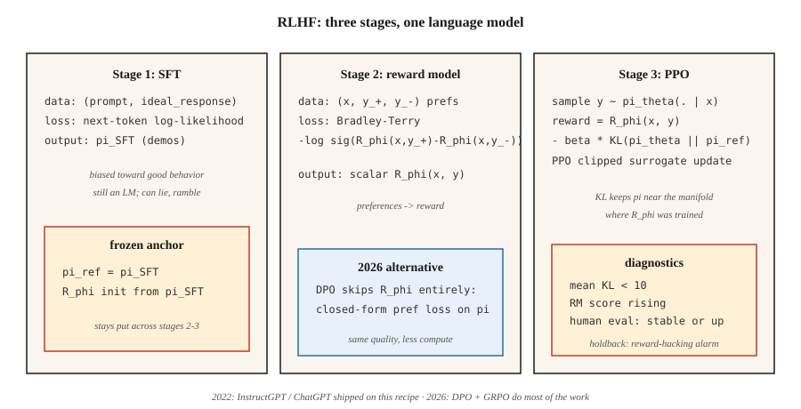

<!-- local-zh-machine-draft: English source is canonical; prose translated automatically, code/math preserved. -->

<a id="reward-modeling--rlhf"></a>

# 奖励建模 & RLHF

> 人类无法为“良好的辅助响应”编写奖励函数，但他们可以比较两个响应并选择更好的一个。将 reward model 拟合到这些比较中，然后针对它强化语言模型。 Christiano 2017。InstructGPT 2022。将 GPT-3 变成 ChatGPT 的配方。到 2026 年，它大部分会被 DPO 取代——但心智模型仍然存在。

**类型：** 构建
**语言：** Python
**先决条件：** 5·05期（情感）、9·08期（PPO）
**时间：** ~45分钟

<a id="the-problem"></a>

## 问题

您在下一个 token 预测目标上训练了语言模型。它写的是符合语法的英语。它还撒谎、胡言乱语、拒绝拒绝。你无法用更多的 pretraining 来解决这个问题——网络文本是问题所在，而不是解决办法。

您想要一个 * 标量奖励 * 表示“对于指令 X，响应 A 优于响应 B”。手动编写奖励函数是不可能的。 “乐于助人”不是 tokens 上的封闭式表达。但人类可以比较两个输出并标记偏好。大规模收集的成本很低。

RLHF（Christiano et al. 2017；Ouyang et al. 2022）将偏好转换为 reward model，然后通过 PPO 针对该奖励优化 LM。分三步：SFT → RM → PPO。该配方在 2023 年至 2025 年期间发货了 ChatGPT、Claude、Gemini 以及所有其他对齐的 LLM。

2026 年，PPO 步骤大部分被 DPO（第 10·08 阶段）取代，因为它更便宜并且几乎与 alignment 调优一样好。但 *reward model* 片段仍然是每个 Best-of-N 采样器、每个可验证奖励管道以及每个使用过程 reward model 的推理模型的基础。了解了 RLHF，你就了解了整个 alignment 堆栈。

<a id="the-concept"></a>

## 概念



**阶段 1：监督 Fine-Tuning (SFT).** 从预训练的基础模型开始。微调人工编写的目标行为演示（遵循指令的响应、有用的回复等）。结果：模型 `π_SFT` 是 * 偏向于良好行为 * 但仍然具有无限的操作空间。

**阶段 2：Reward Model 训练。**

- 收集 `(y_+, y_-)` 到 prompts `x` 的响应对，由人类标记为“y_+ 优先于 y_-”。
- 训练 reward model `R_φ(x, y)` 为 `y_+` 分配更高的分数。
- 损失：**Bradley-Terry 成对物流**：

  `L(φ) = -E[ log σ(R_φ(x, y_+) - R_φ(x, y_-)) ]`

  σ 是 sigmoid。奖励的差异意味着偏好的对数几率。 BT 自 1952 年以来一直是标准（Bradley-Terry），并且是现代 RLHF 中的主导选择。

- `R_φ` 通常从 SFT 模型初始化，顶部有一个标量头。相同的transformer主干；单个线性层输出奖励。

**阶段3：PPO对抗带有KL惩罚的RM。**

- 从 `π_SFT` 初始化可训练策略 `π_θ`。保留冻结的 *reference* `π_ref = π_SFT`。
- 回复结束奖励`y`：

  `r_total(x, y) = R_φ(x, y) - β · KL(π_θ(·|x) || π_ref(·|x))`

  KL惩罚防止`π_θ`从`π_SFT`任意漂移——它是*regularizer*，而不是硬信任区域。 `β` 通常为 `0.01`-`0.05`。
- 使用此奖励运行 PPO（第 08 课）。优势是在 token 级轨迹上计算的，但 RM 仅对完整响应进行评分。

**为什么是KL？** 如果没有它，PPO将很高兴地找到奖励黑客策略——RM只接受了分布内完成的训练。未分配的响应可能比任何人工编写的响应得分更高。 KL 将 `π_θ` 保持在 RM 接受训练的歧管附近。它是 RLHF 中最重要的一个旋钮。

**2026状态：**

- **DPO** (Rafailov 2023)：封闭式代数将第 2+3 阶段折叠成对偏好数据的单个监督损失。没有RM，没有PPO。 alignment 基准测试中的一小部分计算具有相同的质量。涵盖在第 10·08 阶段。
- **GRPO** (DeepSeek 2024–2025)：PPO 具有相对于组的基线而不是 critic，奖励来自*verifier*（代码运行/数学答案匹配）而不是人工训练的 RM。推理模型占主导地位。第 9·12 阶段涵盖。
- **Process reward models (PRM):** 对部分解（每个推理步骤）进行评分，用于 RLHF 和 GRPO 变体进行推理。
- **Constitutional AI / RLAIF：** 使用对齐的 LLM 代替人类来生成偏好。调整偏好预算。

```figure
reward-model
```

<a id="build-it"></a>

## 动手实现

本课程使用微小的合成“prompts”和表示为字符串的“响应”。 RM 是 tokens 表示形式上的线性记分器。没有真正的 LLM — 管道的 *shape* 很重要，而不是规模。参见 `code/main.py`。

<a id="step-1-synthetic-preference-data"></a>

### 第 1 步：综合偏好数据

```python
PROMPTS = ["help me", "answer me", "explain this"]
GOOD_WORDS = {"clear", "specific", "kind", "thorough"}
BAD_WORDS = {"vague", "rude", "wrong", "short"}

def make_pair(rng):
    x = rng.choice(PROMPTS)
    y_good = rng.choice(list(GOOD_WORDS)) + " " + rng.choice(list(GOOD_WORDS))
    y_bad = rng.choice(list(BAD_WORDS)) + " " + rng.choice(list(BAD_WORDS))
    return (x, y_good, y_bad)
```

在真实的 RLHF 中，这被人工贴标机取代。形状 — `(prompt, preferred_response, rejected_response)` — 是相同的。

<a id="step-2-bradley-terry-reward-model"></a>

### 步骤 2：布拉德利-特里 reward model

线性分数：`R(x, y) = w · bag(y)`。训练以最小化 BT 成对对数损失：

```python
def rm_train_step(w, x, y_pos, y_neg, lr):
    r_pos = dot(w, bag(y_pos))
    r_neg = dot(w, bag(y_neg))
    p = sigmoid(r_pos - r_neg)
    for tok, cnt in bag(y_pos).items():
        w[tok] += lr * (1 - p) * cnt
    for tok, cnt in bag(y_neg).items():
        w[tok] -= lr * (1 - p) * cnt
```

经过几百次更新后，`w` 将正值 weights 分配给好字 tokens，将负值分配给坏字。

<a id="step-3-ppo-like-policy-on-top-of-rm"></a>

### 步骤3：RM之上的类似PPO的策略

我们的玩具策略从 vocabulary 生成单个 token。我们在 RM 下对 token 进行评分，计算 `log π_θ(token | prompt)`，添加 KL 到参考惩罚，并应用剪裁后的 PPO 代理。

```python
def rlhf_step(theta, ref, w, prompt, rng, eps=0.2, beta=0.1, lr=0.05):
    logits_theta = policy_logits(theta, prompt)
    probs = softmax(logits_theta)
    token = sample(probs, rng)
    logits_ref = policy_logits(ref, prompt)
    probs_ref = softmax(logits_ref)
    reward = dot(w, bag([token])) - beta * kl(probs, probs_ref)
    # ppo-style update on theta, treating reward as the return
    ...
```

<a id="step-4-monitor-the-kl"></a>

### 第 4 步：监控 KL

跟踪平均值 `KL(π_θ || π_ref)` 每次更新。如果它悄悄超过了 `~5-10`，那么策略就已经偏离 `π_SFT` 了——较低的 `β` 正在上升，或者奖励黑客正在开始。这是真实RLHF中的顶级诊断。

<a id="step-5-the-production-recipe-with-trl"></a>

### 第5步：TRL的生产配方

一旦您了解了玩具管道，下面就是与真正的库用户编写的循环相同的循环。 Hugging Face 的 [TRL](https://huggingface.co/docs/trl) 是参考实现 — 用于第 2 阶段的 `RewardTrainer` 和用于第 3 阶段的 `PPOTrainer`（内置 KL 参考）。

```python
# Stage 2: reward model from pairwise preferences
from trl import RewardTrainer, RewardConfig
from transformers import AutoModelForSequenceClassification, AutoTokenizer

tok = AutoTokenizer.from_pretrained("meta-llama/Llama-3.1-8B-Instruct")
rm = AutoModelForSequenceClassification.from_pretrained(
    "meta-llama/Llama-3.1-8B-Instruct", num_labels=1
)

# dataset rows: {"prompt", "chosen", "rejected"} — Bradley-Terry format
trainer = RewardTrainer(
    model=rm,
    tokenizer=tok,
    train_dataset=preference_data,
    args=RewardConfig(output_dir="./rm", num_train_epochs=1, learning_rate=1e-5),
)
trainer.train()
```

```python
# Stage 3: PPO against the RM with KL penalty to the SFT reference
from trl import PPOTrainer, PPOConfig, AutoModelForCausalLMWithValueHead

policy = AutoModelForCausalLMWithValueHead.from_pretrained("./sft-checkpoint")
ref    = AutoModelForCausalLMWithValueHead.from_pretrained("./sft-checkpoint")  # frozen

ppo = PPOTrainer(
    config=PPOConfig(learning_rate=1.41e-5, batch_size=64, init_kl_coef=0.05,
                     target_kl=6.0, adap_kl_ctrl=True),
    model=policy, ref_model=ref, tokenizer=tok,
)

for batch in dataloader:
    responses = ppo.generate(batch["query_ids"], max_new_tokens=128)
    rewards   = rm(torch.cat([batch["query_ids"], responses], dim=-1)).logits[:, 0]
    stats     = ppo.step(batch["query_ids"], responses, rewards)
    # stats includes: mean_kl, clip_frac, value_loss — the three PPO diagnostics
```

图书馆为您做三件事。 `adap_kl_ctrl=True` 实现自适应β调度：如果观察到的KL超过`target_kl`，则β加倍；如果低于一半，β 减半。按照惯例，参考模型被冻结——您不能意外地将 parameters 与 `policy` 共享。并且价值头与策略位于同一主干上（`AutoModelForCausalLMWithValueHead` 附加标量 MLP 头），这就是 TRL 分别报告 `policy/kl` 和 `value/loss` 的原因。

<a id="pitfalls"></a>

## 陷阱

- **过度优化/奖励黑客。** RM不完善； `π_θ` 发现对抗性完成得分高但很差。症状：奖励无限攀升，而人类评估分数却趋于稳定或下降。修复：提前停止，提高`β`，扩大RM训练数据。
- **Length hacking。** 经过有用响应训练的 RM 通常会隐式奖励长度。该策略学会填充响应。补救措施：长度标准化奖励，或带有长度感知 RM 的 RLAIF。
- ** RM 太小。** RM 需要至少与保单一样大。微小的 RM 无法忠实地对策略的输出进行评分。
- **KL 调整。** β 太低 → 漂移和奖励黑客。 β太高→策略几乎没有变化。标准技巧是 *adaptive* β，其目标是每步固定 KL。
- **偏好数据噪声。** ~30% 的人类标签是有噪声或不明确的。通过在协议过滤数据上训练 RM 来进行校准，或在 BT 上使用 temperature。
- **Off-policy问题。** PPO数据略为off-policy在第一个epoch之后。如第 08 课中所示监视剪辑片段。

<a id="use-it"></a>

## 实际应用

2026年的RLHF是分层的：

| 图层 | 目标 | 方法 |
|-------|--------|--------|
| Instruction following，乐于助人，无害 | Alignment | DPO（阶段 10·08）优于 RLHF-PPO。 |
| 推理正确性（数学、代码） | 能力 | GRPO 具有验证者奖励（第 9·12 阶段）。 |
| 长期多步骤任务 | Agentic | PPO / GRPO 与过程 reward models 的步骤。 |
| 安全/拒绝行为 | 安全 | RLHF-PPO 具有独立的安全 RM 或宪法 AI。 |
| inference 的 N 次最佳 | 快alignment | 解码时使用RM；无需策略培训。 |
| 奖励蒸馏 | Inference 计算 | 在冰冻的 LM 顶部训练一个小型“奖励头”。 |

2022-2024 年 RLHF 为 *the* 方法。到 2026 年，生产 alignment 管道首先为 DPO，PPO 仅用于 RM 密集型或安全关键步骤。

<a id="ship-it"></a>

## 交付成果

另存为 `outputs/skill-rlhf-architect.md`：

```markdown
---
name: rlhf-architect
description: Design an RLHF / DPO / GRPO alignment pipeline for a language model, including RM, KL, and data strategy.
version: 1.0.0
phase: 9
lesson: 9
tags: [rl, rlhf, alignment, llm]
---

Given a base LM, a target behavior (alignment / reasoning / refusal / agent), and a preference or verifier budget, output:

1. Stage. SFT? RM? DPO? GRPO? With justification.
2. Preference or verifier source. Humans, AI feedback, rule-based, unit-test-pass, or reward distillation.
3. KL strategy. Fixed β, adaptive β, or DPO (implicit KL).
4. Diagnostics. Mean KL, reward stability, over-optimization guard (holdout human eval).
5. Safety gate. Red-team set, refusal rate, safety RM separate from helpfulness RM.

Refuse to ship RLHF-PPO without a KL monitor. Refuse to use an RM smaller than the target policy. Refuse length-only rewards. Flag any pipeline that does not hold back a blind human-eval set as lacking over-optimization protection.
```

<a id="exercises"></a>

## 练习

1. **Easy.** 在 500 个合成偏好对上训练 `code/main.py` 中的 Bradley-Terry reward model。测量保留的 100 对的成对准确度。应超过90%。
2. **Medium.** 使用 `β ∈ {0.0, 0.1, 1.0}` 运行玩具 PPO-RLHF 循环。对于每个更新，绘制 RM 分数与 KL 参考值的关系图。哪个运行奖励黑客？
3. **Hard.** 在相同的偏好数据上实现 DPO（封闭式偏好似然损失），并与 RLHF-PPO 管道在使用的计算和获得的最终 RM 分数中进行比较。

<a id="key-terms"></a>

## 关键术语

| 术语 | 人们怎么说 | 它实际上意味着什么 |
|------|-----------------|-----------------------|
| RLHF | “Alignment RL” | 三级SFT + RM + PPO管道（Christiano 2017，Ouyang 2022）。 |
| Reward Model (RM) | 《得分网》 | 通过 Bradley-Terry 学习的标量函数适合成对偏好。 |
| 布拉德利-特里 | “成对逻辑损失” | `P(y_+ ≻ y_-) = σ(R(y_+) - R(y_-))`；标准 RM 目标。 |
| KL 惩罚 | “靠近参考点” | 奖励中`β · KL(π_θ \|\| π_ref)`；反奖励黑客正则化器。 |
| 奖励黑客行为 | “古德哈特定律” | 策略利用 RM 缺陷；症状：奖励上升，人类评价平淡。 |
| 罗拉IF | “人工智能标记的偏好” | RLHF，其中标签来自另一个 LM 而不是人类。 |
| PRM | “进程Reward Model” | 对部分推理步骤进行评分；用于推理管道。 |
| 宪法人工智能 | 《Anthropic的方法》 | 人工智能生成的偏好由明确的规则引导。 |

<a id="further-reading"></a>

## 进一步阅读

- [克里斯蒂亚诺等人。 （2017）。来自 Human Preferences](https://arxiv.org/abs/1706.03741) 的深度 Reinforcement Learning — 启动 RLHF 的论文。
- [欧阳等人。 （2022）。 InstructGPT — 训练语言模型遵循人类反馈的指令](https://arxiv.org/abs/2203.02155) — ChatGPT 背后的秘诀。
- [Stiennon 等人。 （2020）。学习利用人类反馈进行总结](https://arxiv.org/abs/2009.01325) — 早期的 RLHF 进行总结。
- [Rafailov 等人。 （2023）。直接偏好优化](https://arxiv.org/abs/2305.18290) — DPO； 2026 年 RLHF 后的默认值。
- [Bai 等人。 （2022）。宪法人工智能：人工智能反馈的无害性](https://arxiv.org/abs/2212.08073) - RLAIF和自我批评循环。
- [Anthropic RLHF 论文（Bai 等人，2022 年）。训练一个有用且无害的助手](https://arxiv.org/abs/2204.05862) — HH 论文。
- [Hugging Face TRL库](https://huggingface.co/docs/trl) - 生产`RewardTrainer`和`PPOTrainer`。阅读训练器源代码，了解自适应 KL 和价值头的详细信息。
- [Hugging Face — 从人类反馈中说明 Reinforcement Learning](https://huggingface.co/blog/rlhf)，作者：Lambert、Castricato、von Werra、Havrilla — 用图表对三级管道进行规范演练。
- [von Werra 等人。 （2020）。 TRL：Transformer Reinforcement Learning](https://github.com/huggingface/trl) — 库； `examples/` 具有 Llama、Mistral 和 Qwen 的端到端 RLHF 脚本。
- [萨顿和巴托 (2018)。章。 17.4 — 设计奖励信号](http://incompleteideas.net/book/RLbook2020.pdf) — 奖励假设观点；考虑奖励黑客的重要先决条件。
