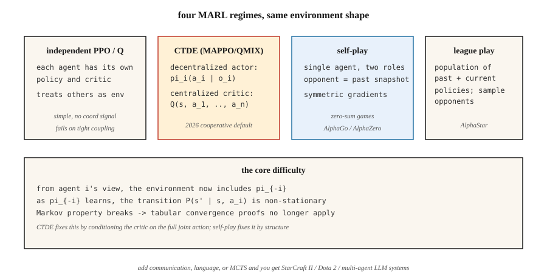

<!-- local-zh-machine-draft: English source is canonical; prose translated automatically, code/math preserved. -->

<a id="multi-agent-rl"></a>

# 多Agent RL

> Single-agent RL 假设环境是静止的。将两个学习 agents 放在同一个世界中，这个假设就被打破了：每个 agent 都是另一个环境的一部分，并且两者都在变化。 Multi-agent RL 是当马尔可夫假设不再成立时使学习收敛的一组技巧。

**类型：** 构建
**语言：** Python
**先决条件：** 第 9·04 期 (Q-learning)、第 9·06 期 (REINFORCE)、第 9·07 期 (Actor-Critic)
**时间：**约 45 分钟

<a id="the-problem"></a>

## 问题

学习在房间中导航的机器人是一个单 agent RL 问题。足球队则不然。 AlphaStar vs 星际争霸的对手不是。投标市场 agents 不是。两辆车在四向停车处协商则不然。现实世界中的多对多问题则不然。

在每个多agent设置中，从任何一个agent的角度来看，其他agents *都是*环境的一部分。当他们学习并改变自己的行为时，环境就会变得不稳定。马尔可夫属性——“下一个状态仅取决于当前状态和我的行动”——被违反，因为下一个状态还取决于 *other* agents 选择的内容，并且他们的策略正在移动目标。

这打破了表格收敛证明（Q-learning 的保证假设静态环境）。它也打破了天真的深度强化学习：agents 在循环中相互追逐，永远不会收敛到稳定的策略。您需要多种 agent 特定技术：集中训练/分散执行、反事实基线、联赛比赛、自我比赛。

2026 个应用：机器人 swarms、交通路由、自动车队、市场模拟器、多 agent LLM 系统（第 16 阶段）以及任何具有多个智能玩家的游戏。

<a id="the-concept"></a>

## 概念



**形式主义：马尔可夫博弈。** MDP的概括：状态`S`，联合行动`a = (a_1, …, a_n)`，过渡`P(s' | s, a)`，以及每agent奖励`R_i(s, a, s')`。每个 agent `i` 根据自己的策略 `π_i` 最大化自己的回报。如果奖励相同，则为**完全合作**。如果是零和，则为 **adversarial**。如果混合则为**general-sum**。

**核心挑战：**

- **非平稳性。** `P(s' | s, a_i)`来自agent `i`的视图取决于`π_{-i}`，它正在变化。
- **信用分配。** 与共享奖励，是由agent引起的吗？
- **探索协调。** Agents必须探索互补的策略，而不是重复探索相同的状态。
- **Scalability.** 联合动作空间在`n`中呈指数增长。
- **部分 observability.** 每个 agent 只看到自己的观察结果；全局状态是隐藏的。

**四种主导政权：**

**1。独立的 Q-learning / 独立的 PPO (IQL, IPPO).** 每个 agent 学习自己的 Q 或策略，将其他人视为环境的一部分。很简单，有时它会起作用（特别是当经验重放充当平滑 agent 建模技巧时）。理论收敛性：无。在实践中：对于松散耦合的任务来说很好，对于紧密耦合的任务来说则不好。

**2。集中训练，分散执行（CTDE）。** 最常见的现代范例。每个 agent 都有自己的 *policy* `π_i`，以本地观察 `o_i` 为条件——部署时的标准去中心化执行。在 *training* 期间，集中式 critic `Q(s, a_1, …, a_n)` 条件涉及完整的全局状态和联合操作。示例：
- **MADDPG**（Lowe et al. 2017）：DDPG，每个 agent 具有集中式 critic。
- **COMA**（Foerster et al. 2017）：反事实基线——问“如果我采取 `a'` 行动，我的奖励是什么？” ——孤立我的贡献。
- **MAPPO** / **IPPO** 具有共享 critic (Yu et al. 2022)：PPO 具有集中式value function。 2026 年合作 MARL 占据主导地位。
- **QMIX**（Rashid 等人，2018）：值分解 - 单调混合的 `Q_tot(s, a) = f(Q_1(s, a_1), …, Q_n(s, a_n))`。

**3。自玩。** 相同agent的两个副本互相玩。对手的策略 * 是 * 我过去快照的策略。 AlphaGo / AlphaZero / MuZero。 OpenAI 五．最适合零和博弈；训练信号是对称的。

**4。联盟比赛。** 将自我比赛扩展到一般和/对抗环境：保留过去和当前策略的群体，从联盟中抽取对手，并针对他们进行训练。添加剥削者（专门击败当前最好的）和主要剥削者（专门击败剥削者）。 AlphaStar（星际争霸 II）。当游戏允许“石头剪刀布”策略循环时需要。

**Communication.** 允许agents向对方发送学习到的消息`m_i`。在合作环境中工作。福斯特等人。 (2016) 表明可微的 agent 间通信可以进行端到端的训练。今天的基于 LLM 的多 agent 系统（第 16 阶段）基本上以自然语言进行通信。

```figure
f3-marl-orbit
```

<a id="build-it"></a>

## 动手实现

本课程使用 6×6 GridWorld 和两个合作的 agents。他们从相反的角落开始，必须达到共同的目标。共享奖励：当 agent 仍在移动时，每步 `-1`；当两者都到达时，`+10`。参见 `code/main.py`。

<a id="step-1-the-multi-agent-env"></a>

### 步骤1：多agent环境

```python
class CoopGridWorld:
    def __init__(self):
        self.size = 6
        self.goal = (5, 5)

    def reset(self):
        return ((0, 0), (5, 0))  # two agents

    def step(self, state, actions):
        a1, a2 = state
        new1 = move(a1, actions[0])
        new2 = move(a2, actions[1])
        done = (new1 == self.goal) and (new2 == self.goal)
        reward = 10.0 if done else -1.0
        return (new1, new2), reward, done
```

*joint* 操作空间为 `|A|² = 16`。全局状态有两个位置。

<a id="step-2-independent-q-learning"></a>

### 第二步：独立Q-learning

每个 agent 都运行自己的以联合状态为关键的 Q 表。在每一步：都选择 ε-贪婪动作，收集联合转换，每个都用共享奖励更新自己的 Q。

```python
def independent_q(env, episodes, alpha, gamma, epsilon):
    Q1, Q2 = defaultdict(default_q), defaultdict(default_q)
    for _ in range(episodes):
        s = env.reset()
        while not done:
            a1 = epsilon_greedy(Q1, s, epsilon)
            a2 = epsilon_greedy(Q2, s, epsilon)
            s_next, r, done = env.step(s, (a1, a2))
            target1 = r + gamma * max(Q1[s_next].values())
            target2 = r + gamma * max(Q2[s_next].values())
            Q1[s][a1] += alpha * (target1 - Q1[s][a1])
            Q2[s][a2] += alpha * (target2 - Q2[s][a2])
            s = s_next
```

之所以能完成这项任务，是因为奖励密集且一致。在紧密耦合的任务上失败（例如，一个 agent 必须为另一个 *wait* ）。

<a id="step-3-centralized-q-with-decomposed-value-update"></a>

### 步骤 3：集中 Q 并进行分解值更新

在联合操作 `Q(s, a_1, a_2)` 上使用一个 Q。共享奖励更新。通过边缘化在执行时去中心化：`π_i(s) = argmax_{a_i} max_{a_{-i}} Q(s, a_1, a_2)`。用指数联合行动空间换取 * Correct* 全局视图。

<a id="step-4-simple-self-play-adversarial-2-agent"></a>

### 第四步：简单的自我对战（对抗性2-agent）

相同的agent，两个角色。训练 agent A 与 agent B； `K` 集结束后，将 A 的 weights 复制到 B 中。对称训练，进度一致。 AlphaZero 配方的缩影。

<a id="pitfalls"></a>

## 陷阱

- **非平稳重播。** 使用独立 agents 的体验重播比单个 agent 差，因为旧的过渡是由现已过时的对手生成的。修复：按新近度重新标记或 weight。
- **信用分配模糊。** 长集后共享奖励；没有明确的方式说明哪个 agent 做出了贡献。修复：反事实基线（COMA），或根据 agent 的奖励塑造。
- **策略漂移/追逐。** 每个agent的最佳响应会随着彼此的更新而变化。修复：集中式 critic、慢速 learning rates 或一次冻结一个。
- ** 通过协调奖励黑客攻击。** Agents 发现设计者未预料到的协调攻击。拍卖 agents 收敛到出价为零。修复：仔细的奖励设计、行为约束。
- ** 探索冗余。** 两个 agents 都探索相同的状态-动作对。修复：entropy bonuses per-agent，或角色调节。
- **联赛周期。** 纯粹的自我游戏可能会陷入统治周期。修复：与不同对手的联赛。
- **爆炸样本。** `n` agents×状态空间×联合行动。用函数逼近来逼近；因子行动空间（每个 agent 一个策略输出头）。

<a id="use-it"></a>

## 实际应用

2026年MARL申请图：

| 域名 | 方法 | 注释 |
|--------|--------|-------|
| 协同导航/操纵 | MAPPO / QMIX | CTDE；共享critic + 去中心化actors。 |
| 两人游戏（国际象棋、围棋、扑克） | 使用 MCTS (AlphaZero) 进行自我对战 | 零和；对称训练。 |
| 复杂的多人游戏（Dota、星际争霸） | 联赛+仿pretraining | OpenAI 五、AlphaStar。 |
| 自动驾驶车队 | CTDE MAPPO / PPO 与 attention | 部分观测值；团队规模可变。 |
| 拍卖市场 | 博弈论均衡+强化学习 | `n` → ∞ 时的平均场 RL。 |
| LLM 多 agent 系统（第 16 期） | 自然语言交流+角色调节 | agent-planning 层的 RL 循环。 |

2026年，MARL最大的增长领域是基于LLM：语言模型agents的swarms谈判、辩论、构建软件。 RL 显示为 *trajectory-level* 输出的偏好优化，而不是 token-level（阶段 16 · 03）。

<a id="ship-it"></a>

## 交付成果

另存为 `outputs/skill-marl-architect.md`：

```markdown
---
name: marl-architect
description: Pick the right multi-agent RL regime (IPPO, CTDE, self-play, league) for a given task.
version: 1.0.0
phase: 9
lesson: 10
tags: [rl, multi-agent, marl, self-play]
---

Given a task with `n` agents, output:

1. Regime classification. Cooperative / adversarial / general-sum. Justify.
2. Algorithm. IPPO / MAPPO / QMIX / self-play / league. Reason tied to coupling tightness and reward structure.
3. Information access. Centralized training (what global info goes to the critic)? Decentralized execution?
4. Credit assignment. Counterfactual baseline, value decomposition, or reward shaping.
5. Exploration plan. Per-agent entropy, population-based training, or league.

Refuse independent Q-learning on tightly-coupled cooperative tasks. Refuse to recommend self-play for general-sum with cycle risks. Flag any MARL pipeline without a fixed-opponent eval (cherry-picked self-play numbers are common).
```

<a id="exercises"></a>

## 练习

1. **Easy.** 在2-agent合作GridWorld上训练独立的Q-learning。平均回归 > 0 之前需要多少集？绘制联合学习曲线。
2. **Medium.** 添加“协调”任务：只有当两个 agents 在同一回合踩到目标时才达到目标。独立 Q 仍然收敛吗？什么打破了？
3. **Hard.** 实现集中式 critic 进行 MAPPO 式训练，并在协调任务上将收敛速度与独立的 PPO 进行比较。

<a id="key-terms"></a>

## 关键术语

| 术语 | 人们怎么说 | 它实际上意味着什么 |
|------|-----------------|-----------------------|
| 马尔可夫博弈 | “多agent MDP” | `(S, A_1, …, A_n, P, R_1, …, R_n)`；每个agent都有自己的奖励。 |
| CTDE | “集中培训，分散执行” | 训练时关节critic；每个 agent 的策略仅使用本地 obs。 |
| 国际知识产权组织 | “独立PPO” | 每个agent单独运行PPO。简单的基线；经常被低估。 |
| MAPPO | “多agent PPO” | PPO 具有以全局状态为条件的集中式 value function。 |
| QMIX | “单值分解” | `Q_tot = f_monotone(Q_1, …, Q_n)` 允许去中心化 argmax。 |
| COMA | 《反事实多agent》 | 优势 = 我的 Q 减去预期 Q 边缘化我的行动。 |
| 自玩 | 《Agent VS 过去的自己》 | 单个agent，两个角色；零和博弈的标准。 |
| 联赛比赛 | 《人口培训》 | 缓存过去的策略，从池中抽取对手样本；处理策略周期。 |

<a id="further-reading"></a>

## 进一步阅读

- [Lowe 等人。 （2017）。用于混合合作竞争环境 (MADDPG) 的多 Agent Actor-Critic](https://arxiv.org/abs/1706.02275) — 具有集中式 critic 的 CTDE。
- [Foerster 等人。 （2017）。反事实多 Agent Policy Gradients (COMA)](https://arxiv.org/abs/1705.08926) — 学分分配的反事实基线。
- [Rashid 等人。 （2018）。 QMIX：单调 Value Function 分解](https://arxiv.org/abs/1803.11485) — 单调性值分解。
- [Yu 等人。 （2022）。 PPO 在合作多 Agent 游戏 (MAPPO)](https://arxiv.org/abs/2103.01955) 中的惊人效果 — PPO 对于 MARL 来说出奇地强大。
- [Vinyals 等人。 （2019）。 《星际争霸 II》中的宗师级别使用多 agent reinforcement learning (AlphaStar)](https://www.nature.com/articles/s41586-019-1724-z) — 大规模联赛。
- [Silver 等人。 （2017）。在没有人类知识的情况下掌握围棋游戏（AlphaGo Zero）](https://www.nature.com/articles/nature24270) - 零和博弈中的纯粹自我对弈。
- [萨顿和巴托 (2018)。章。 15 — 神经科学与章节。 17 — Frontiers](http://incompleteideas.net/book/RLbook2020.pdf) — 包括教科书对多个 agent 设置的简短处理以及 CTDE 旨在解决的非平稳性问题。
- [Zhang、Yang 和 Başar (2021)。多 Agent Reinforcement Learning：选择性概述](https://arxiv.org/abs/1911.10635) — 涵盖合作、竞争和混合 MARL 的调查，具有收敛结果。
