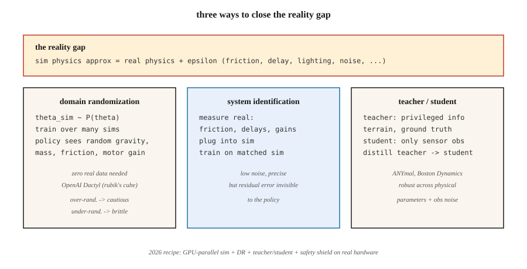

<!-- local-zh-machine-draft: English source is canonical; prose translated automatically, code/math preserved. -->

<a id="sim-to-real-transfer"></a>

# 从仿真到现实的迁移

> 在模拟器中训练但在硬件上失败的策略是记忆模拟器的策略。域随机化、域自适应和系统识别是使学习控制器跨越现实差距的三个工具。

**类型：**学习
**语言：** Python
**先决条件：** 第 9·08 阶段 (PPO)、第 2·10 阶段（偏差/方差）
**时间：** ~45分钟

<a id="the-problem"></a>

## 问题

训练真正的机器人是缓慢、危险且昂贵的。两足动物需要数百万次训练才能学会走路；真正的两足动物一旦损坏硬件就会摔倒。模拟为您提供无限的重置、确定性的再现性、并行环境，并且没有物理损坏。

但模拟器是错误的。轴承比 MuJoCo 型号具有更大的摩擦力。相机具有模拟器不包含的镜头畸变。电机有延迟、齿隙和 saturation，99% 的 sim 模型都会跳过。风、灰尘和可变照明破坏了无菌渲染的策略。 **现实差距**——模拟分布和真实分布之间的系统差异——是机器人部署强化学习的核心问题。

您需要一个 * 稳健到模拟真实 distribution shift* 的策略。三种历史方法：随机化模拟器（域随机化），用少量真实数据调整策略（域适应/fine-tuning），或识别真实系统的parameters并匹配它们（系统识别）。 2026 年，主流方案将这三者与大规模并行模拟结合起来（GPU 上的 Isaac Sim、Isaac Lab、Mujoco MJX）。

<a id="the-concept"></a>

## 概念



**域随机化 (DR)。** Tobin 等人。 2017，彭等人。 2018. 在训练期间，随机化每个可能与真实机器人不同的 sim parameter：质量、摩擦系数、电机 PD 增益、传感器噪声、相机位置、照明、纹理、接触模型。该策略学习“今天在哪个模拟中”的条件分布，并在整个范围内进行概括。如果真实的机器人落入训练范围内，该策略就会起作用。

- **上行：** 不需要真实数据。一种食谱，多种机器人。
- **缺点：** 过度随机的训练产生了“通用”但过于谨慎的策略。太多的噪音 ≈ 太多的正则化。

**系统识别 (SI).** 在训练之前将模拟器的 parameters 与真实数据进行拟合。如果您可以测量真实机器人上的手臂关节摩擦力，请将其插入模拟设备中。然后训练一个期望这些值的策略。需要访问真实系统，但可以直接缩小现实差距。

- **优点：**精确、低噪音的训练目标。
- **缺点：**残差模型误差对策略不可见；一些未识别的小影响（例如电机死区）仍然会破坏部署。

**Domain Adaptation.** 在sim中训练，用少量真实数据进行微调。两种口味：

- **Real2Sim2Real：** 使用真实的 rollouts 学习残差模拟器 `f(s, a, z) - f_sim(s, a)`，在校正后的模拟器中进行训练。无需太多真实数据即可缩小差距。
- **观察适应：** 训练一种策略，通过学习的 feature 提取器（例如，GAN 像素到像素）映射真实的 obs → 类 sim 的 obs。控制器保持在 sim 状态。

**特权学习/师生。** Miki et al. 2022（任何四足动物）。在模拟中训练 *teacher*，它可以访问特权信息（地面真实摩擦力、地形高度、IMU 漂移）。提取仅看到真实传感器观测结果的 *student*。学生学会从历史中推断特权 features，在物理 parameters 中具有鲁棒性。

**大规模并行仿真。** 2024–2026。 Isaac Lab、Mujoco MJX、Brax 都在单个 GPU 上运行数千个并行机器人。 PPO 拥有 4,096 个并行人形机器人，可在数小时内收集多年的经验。随着培训分布的扩大，“现实差距”缩小；当这 4,096 个环境中的每一个都有不同的随机 parameters 时，DR 变得几乎免费。

**现实世界2026年食谱（四足行走示例）：**

1. 具有域随机重力、摩擦力、电机增益、有效负载的大规模并行仿真。
2. 教师策略接受了特权信息（地形图、身体速度地面实况）的培训。
3. 仅使用本体感觉（腿部关节 encoders）从教师那里提取的学生策略。
4. 通过真实 IMU 上的自动编码器进行可选的观察适应。
5. 部署。 Zero-shot 适用于 10 多个环境。如果失败，请使用安全约束的 PPO 进行几分钟的现实世界 fine-tuning 测试。

```figure
f3-reality-gap
```

<a id="build-it"></a>

## 动手实现

本课程的代码是 GridWorld 上具有 *noisy* 转换的域随机化的小型演示。我们训练一个在“模拟”中经历随机滑移概率的策略，并使用训练期间从未见过的滑移水平来评估“真实”。形状直接映射到 MuJoCo 到硬件的传输。

<a id="step-1-parameterized-sim"></a>

### 步骤1：参数化sim

```python
def step(state, action, slip):
    if rng.random() < slip:
        action = random_perpendicular(action)
    ...
```

`slip` 是模拟器公开的 parameter。在真实的机器人技术中，它可能是摩擦力、质量、电机增益——任何在模拟和真实之间转换的东西。

<a id="step-2-train-with-dr"></a>

### 第 2 步：与 DR 一起训练

在每集开始时，采样 `slip ~ Uniform[0.0, 0.4]`。火车 PPO / Q-learning / 任何东西。对许多剧集都这样做。

<a id="step-3-evaluate-zero-shot-on-real-slips"></a>

### 步骤 3：在“真实”单据上评估 zero-shot

在`slip ∈ {0.0, 0.1, 0.2, 0.3, 0.5, 0.7}`上进行评估。前四个属于培训支持范围； `0.5` 和 `0.7` 位于外部。经过 DR 训练的策略应该在内部保持接近最佳的支持，并在外部优雅地降级。固定滑移训练的策略在其训练滑移之外将变得脆弱。

<a id="step-4-compare-to-narrow-training"></a>

### 第 4 步：与狭义训练进行比较

仅使用 `slip = 0.0` 训练第二个策略。对相同的 `slip` 扫描进行评估。一旦实际滑差 > 0，您就会看到灾难性的下降。

<a id="pitfalls"></a>

## 陷阱

- **太多的随机化。** 在`slip ∈ [0, 0.9]`上训练，你的策略是如此规避风险，它从不尝试最佳路径。匹配 *expected* 真实世界分布，而不是“任何事情都可能发生”。
- **随机化太少。** 在薄片上训练，策略根本无法泛化。使用自适应课程（自动领域随机化），随着策略的改进扩大分布。
- **Misidentified parameter space.** 随机化错误的东西（当真正的差距是电机延迟时相机色调）并且DR没有帮助。首先对真实的机器人进行概要分析。
- **特权信息泄露。** 使用全局状态进行操作而不仅仅是观察的教师可能会培养出无法跟上的学生。确保根据观察历史的学生可以实现教师的策略。
- **Sim 到 sim 传输失败。** 如果您的策略对于更难的 sim 变体不稳健，那么它对于现实世界也不会稳健。在部署之前，请务必在保留的 sim 变体上进行测试。
- **没有现实世界的安全范围。** 在模拟中工作并且在没有低级安全防护的情况下“在实际中工作”的策略仍然可以破坏硬件。在非学习控制器中添加 rate limits、扭矩限制、关节限制。

<a id="use-it"></a>

## 实际应用

2026 年模拟到现实堆栈：

| 域名 | 堆栈 |
|--------|-------|
| 腿式运动（ANYmal、Spot、人形） | Isaac Lab + DR + 特级教师/学生 |
| 操纵（灵巧的双手、拾取和放置） | Isaac Lab + DR + DR-GAN 用于视觉 |
| 自动驾驶 | CARLA / NVIDIA DRIVE Sim + DR + 真实微调 |
| 无人机竞赛 | RotorS / Flightmare + DR + 在线适配 |
| 手指/手部操控 | OpenAI Dactyl（规模空前的灾难恢复） |
| 工业武器 | MuJoCo-Warp + SI + 小实微调 |

对于所有规模的控制，工作流程是一致的：尽可能适合模拟，随机化不适合的内容，训练大量策略，提炼，使用安全防护罩进行部署。

<a id="ship-it"></a>

## 交付成果

另存为`outputs/skill-sim2real-planner.md`：

```markdown
---
name: sim2real-planner
description: Plan a sim-to-real transfer pipeline for a given robot + task, covering DR, SI, and safety.
version: 1.0.0
phase: 9
lesson: 11
tags: [rl, sim2real, robotics, domain-randomization]
---

Given a robot platform, a task, and access to real hardware time, output:

1. Reality gap inventory. Suspected sources ranked by expected impact (contact, sensing, actuation delay, vision).
2. DR parameters. Exact list, ranges, distribution. Justify each range against real measurements.
3. SI steps. Which parameters to measure; measurement method.
4. Teacher/student split. What privileged info the teacher uses; what obs the student uses.
5. Safety envelope. Low-level limits, emergency stops, backup controller.

Refuse to deploy without (a) a zero-shot sim-variant test, (b) a safety shield, (c) a rollback plan. Flag any DR range wider than 3× measured real variability as likely over-randomized.
```

<a id="exercises"></a>

## 练习

1. **Easy.** 在固定滑移 GridWorld（滑移=0.0）上训练 Q-learning agent。评估滑移 ε {0.0, 0.1, 0.3, 0.5}。绘制收益与滑差的图。
2. **Medium.** 训练DR Q-learning agent sampling `slip ~ Uniform[0, 0.3]`。评估相同的扫描。 DR 在 slip=0.5（分配外）时购买多少？
3. **Hard.** 实施一个课程：从 slip=0.0 开始，每次策略达到最优值的 90% 时扩大 DR 范围。与固定 DR 基线相比，测量总环境步骤以达到 slip=0.3 zero-shot。

<a id="key-terms"></a>

## 关键术语

| 术语 | 人们怎么说 | 它实际上意味着什么 |
|------|-----------------|-----------------------|
| 现实差距 | “模拟与真实的区别” | Distribution shift 介于训练和部署物理/传感之间。 |
| 域随机化 (DR) | “通过随机模拟训练” | 在训练期间随机化 sim parameters，以便策略泛化。 |
| 系统识别（SI） | “测量真实并适合模拟” | 预估真实实物parameters；设置 sim 来匹配。 |
| 领域适应 | “根据真实数据进行微调” | 模拟训练后对现实世界进行小的微调；可以适应 obs 或动态。 |
| 特权信息 | 《老师的基本事实》 | 只有SIM卡拥有的信息；学生必须从 obs 历史中推断出来。 |
| 老师/学生 | “提取特权 -> 可观察” | 受过培训的老师有捷径；学生在没有它们的情况下学会模仿。 |
| 美国存托凭证 | “自动域随机化” | 随着策略的改进而扩大灾难恢复范围的课程。 |
| 真实模拟 | “缩小与真实数据的差距” | 学习残差以使 sim 模仿真实的 rollouts。 |

<a id="further-reading"></a>

## 进一步阅读

- [Tobin 等人。 （2017）。用于将深度神经网络从模拟转移到现实世界的域随机化](https://arxiv.org/abs/1703.06907) - 原始 DR 论文（机器人技术的愿景）。
- [Peng 等人。 （2018）。通过动态随机化实现机器人控制的模拟到真实传输](https://arxiv.org/abs/1710.06537) — 动态四足运动的 DR。
- [OpenAI 等人。 （2019）。用机器人手解魔方](https://arxiv.org/abs/1910.07113) — Dactyl，大规模 ADR。
- [Miki 等人。 （2022）。在野外学习四足机器人的稳健感知运动](https://www.science.org/doi/10.1126/scirobotics.abk2822) — ANYmal 的师生。
- [Makviychuk 等人。 （2021）。 Isaac Gym：用于机器人学习的基于 GPU 的高性能物理模拟](https://arxiv.org/abs/2108.10470) — 推动 2025-2026 年部署的大规模并行模拟。
- [Akkaya 等人。 （2019）。自动域随机化](https://arxiv.org/abs/1910.07113) — ADR 课程方法。
- [萨顿和巴托 (2018)。章。 8 — Planning 和使用表格方法学习](http://incompleteideas.net/book/RLbook2020.pdf) — Dyna 框架（使用 planning + rollouts 的模型）支撑现代模拟到真实的管道。
- [Zhao，奎拉尔塔和韦斯特伦德（2020）。机器人技术深度 Reinforcement Learning 的模拟到真实传输：调查 ](https://arxiv.org/abs/2009.13303) — 具有基准结果的模拟到真实方法的分类。
