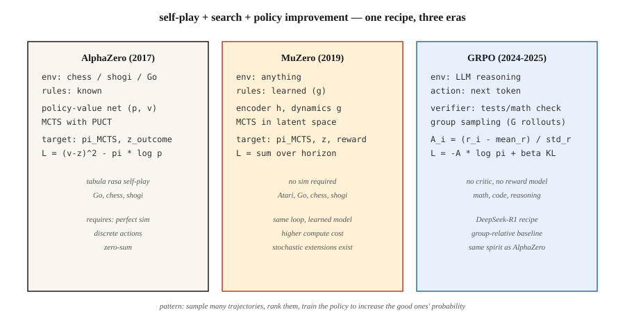

<!-- local-zh-machine-draft: English source is canonical; prose translated automatically, code/math preserved. -->

<a id="rl-for-games--alphazero-muzero-and-the-llm-reasoning-era"></a>

# 游戏强化学习——AlphaZero、MuZero 和 LLM 推理时代

> 1992 年：TD-Gammon 以纯 TD 击败了双陆棋人类冠军。 2016年：AlphaGo击败李世石。 2017 年：AlphaZero 从零开始统治国际象棋、将棋和围棋。 2024年：DeepSeek-R1证明了相同的配方，用GRPO替换PPO，适用于推理。游戏是推动这一阶段每一次突破的基准。

**类型：** 构建
**语言：** Python
**先决条件：** 第 9·05 期 (DQN)、第 9·08 期 (PPO)、第 9·09 期 (RLHF)、第 9·10 期（马尔）
**时间：** ~120分钟

<a id="the-problem"></a>

## 问题

游戏拥有 RL 想要的一切。干净的奖励（赢/输）。无限剧集（自行重置）。完美模拟（游戏*就是*模拟器）。离散或小的连续动作空间。多 agent 结构，增强对抗鲁棒性。

强化学习的每一项重大突破都通过游戏进行测试。 TD-Gammon（双陆棋，1992）。雅达利-DQN (2013)。阿尔法狗（2016）。阿尔法零（2017）。 OpenAI 五（Dota 2，2019）。 AlphaStar（星际争霸 II，2019）。 MuZero（学习模型，2019）。 AlphaTensor（矩阵乘法，2022）。 AlphaDev（排序算法，2023）。 DeepSeek-R1（数学推理，2025）——游戏强化学习技术在文本上发挥作用的最新演示。

本篇综合项目研究通过一个统一的镜头：** 自玩+搜索+策略改进**，调查了三个标志性架构——AlphaZero、MuZero 和 GRPO。每个都概括了前一个； GRPO 特别是 AlphaZero 的配方应用于 LLM 推理，以 tokens 作为动作，以数学验证作为获胜信号。

<a id="the-concept"></a>

## 概念



**统一循环。**

```
while True:
    trajectory = self_play(current_policy, search)     # play game against self
    policy_target = search.improved_policy(trajectory) # search improves raw policy
    policy_net.update(policy_target, value_target)     # supervised on search output
```

**AlphaZero (2017).** Silver 等人。给定一个已知规则的游戏（国际象棋、将棋、围棋）：

- 策略价值网：一塔`f_θ(s) → (p, v)`。 `p` 优先于合法移动。 `v` 是预期的游戏结果。
- Monte Carlo 树搜索（MCTS）：在每次移动时，展开可能的延续树。使用 `(p, v)` 作为先前+引导程序。通过UCB（PUCT）选择节点：`a* = argmax Q(s, a) + c · p(a|s) · √N(s) / (1 + N(s, a))`。
- 自玩：玩游戏agent-vs-agent。在移动`t`时，MCTS访问分布`π_t`成为策略训练目标。
- 损失：`L = (v - z)² - π · log p + c · ||θ||²`。 `z` 是游戏结果 (+1 / 0 / -1)。

人类知识为零。零手工启发法。经过数千万次自玩游戏后，掌握了国际象棋、将棋和围棋的单一秘诀。

**MuZero (2019).** Schrittwieser 等人。删除了已知规则的要求。

- 代替固定环境，学习 * 潜在动力学模型* `(h, g, f)`：
  - `h(s)`：将观察编码为潜在状态。
  - `g(s_latent, a)`：预测下一个潜在状态+奖励。
  - `f(s_latent)`：预测策略先验+值。
- MCTS运行在*中学习latent space*。相同的搜索，相同的训练循环。
- 适用于围棋、国际象棋、将棋 * 和 * Atari — 一种算法，无需规则知识。

**Stochastic MuZero (2022).** 添加随机动力学和机会节点；扩展到双陆棋类游戏。

**Muesli，Gumbel MuZero (2022-2024).** 样本效率和确定性搜索的改进。

**GRPO (2024-2025).** DeepSeek-R1 配方。相同的 AlphaZero 形循环，应用于语言模型推理：

- “游戏”：回答数学/编码/推理问题。 “Win” = 验证者（测试用例通过，数字答案匹配）返回 1。
- 策略：LLM。行动：tokens。状态：prompt + 到目前为止的响应。
- 无critic（PPO型V_φ）。相反，对于每个 prompt，从策略中采样 `G` 完成情况。计算每个人的奖励。使用 ** 群体相对优势 ** `A_i = (r_i - mean_r) / std_r` 作为 REINFORCE 式更新的信号。
- KL惩罚参考防止漂移的策略（如RLHF）。
- 全损：

  `L_GRPO(θ) = -E_{q, {o_i}} [ (1/G) Σ_i A_i · log π_θ(o_i | q) ] + β · KL(π_θ || π_ref)`

没有 reward model，没有 critic，没有 MCTS。组相对基线取代了所有三个基线。以一小部分计算量在推理基准上匹配或超过 PPO-RLHF 质量。

**R1配方完整。** DeepSeek-R1（DeepSeek 2025）是一篇论文中的两个模型：

- **R1-Zero.** 从 DeepSeek-V3 基础模型开始。没有 SFT。直接将 GRPO 与两个奖励组件一起应用：*accuracy奖励*（基于规则 - 最终答案是否解析到正确的数字/代码是否通过单元测试）和*格式奖励*（是否完成包装）其 `<think>…</think>` 标签中的 chain-of-thought ）。经过数千步，平均响应长度从 ~100 增长到 ~10,000 tokens，数学基准分数攀升至接近 o1 预览水平。该模型从头开始学习推理。缺点是：它的思想链往往难以阅读、混合语言、缺乏文体修饰。
- **R1.** 修复 R1-Zero 四级管道的可读性问题：
  1. **冷启动 SFT.** 收集数千个格式干净的长 CoT 演示。在它们的基础上进行监督微调基础模型。这提供了一个可读的起点。
  2. ** 推理导向 GRPO.** 应用 GRPO 并获得准确性+格式奖励以及 * 语言一致性 * 奖励以防止语码转换。
  3. **拒绝 sampling + SFT 第 2 轮。** 来自 RL checkpoint 的约 600K 推理轨迹样本，仅保留那些具有正确的最终答案和可读 CoT 的轨迹，并与约 20 万个非推理 SFT 示例（写作、QA、自我认知）。再次微调底座。
  4. **全谱 GRPO.** 又一轮强化学习，涵盖推理（基于规则的奖励）和一般 alignment（基于帮助/无害偏好的奖励）。

结果与 AIME 和 MATH-500 上开放的 weights 上的 o1 匹配，并且足够小以进行蒸馏。同一篇论文还发布了 SFT 基于 R1 推理 traces 的六个蒸馏密集模型（Qwen-1.5B 到 Llama-70B）——学生没有 RL。从学生的角度来看，一位强大的强化学习教师的精炼始终胜过从头开始的强化学习。

**为什么用GRPO而不是PPO进行推理。** DeepSeekMath论文（2024年2月）中的三个原因：（1）没有价值网络可训练，内存减半； （2）组基线自然地处理推理任务产生的稀疏轨迹末端奖励； （3）每个prompt normalization在难度截然不同的问题上具有可比较的优势，而PPO的单个critic则不能。

** 无搜索与基于搜索。** 游戏已经分支：

- *具有长远视野的完美信息游戏*（围棋、国际象棋）：仍然基于搜索。 AlphaZero / MuZero 占主导地位。
- *LLM推理*：尚未生产MCTS；完整 rollouts 上的 GRPO，inference 计算的 N 最佳结果。进程 reward models (PRM) 提示已添加回步骤级搜索。

```figure
f3-selfplay-ladder
```

<a id="build-it"></a>

## 动手实现

`code/main.py`中的代码实现了**GRPO的缩影**——一个具有多组样本的老虎机。该算法与 LLM 上的算法相同；只是策略和环境更简单。它教授*loss*和*群体相对优势*，这是2025年的创新。

<a id="step-1-a-tiny-verifier-environment"></a>

### 第 1 步：微型验证器环境

```python
QUESTIONS = [
    {"prompt": "q1", "correct": 3},
    {"prompt": "q2", "correct": 1},
]

def verify(prompt_idx, answer_token):
    return 1.0 if answer_token == QUESTIONS[prompt_idx]["correct"] else 0.0
```

在真实的 GRPO 中，验证者运行单元测试或检查数学相等性。

<a id="step-2-policy-softmax-over-k-answer-tokens-per-prompt"></a>

### 第2步：策略：softmax超过K答案tokens每prompt

```python
def policy_probs(theta, p_idx):
    return softmax(theta[p_idx])
```

相当于以 prompt 为条件的 LLM 的最后层输出。

<a id="step-3-group-sampling-and-group-relative-advantage"></a>

### 步骤3：群组sampling和群组相对优势

```python
def grpo_step(theta, p_idx, G=8, beta=0.01, lr=0.1, rng=None):
    probs = policy_probs(theta, p_idx)
    samples = [sample(probs, rng) for _ in range(G)]
    rewards = [verify(p_idx, s) for s in samples]
    mean_r = sum(rewards) / G
    std_r = stddev(rewards) + 1e-8
    advs = [(r - mean_r) / std_r for r in rewards]

    for a, A in zip(samples, advs):
        grad = onehot(a) - probs
        for i in range(len(probs)):
            theta[p_idx][i] += lr * A * grad[i]
    # KL penalty: pull theta toward reference
    for i in range(len(probs)):
        theta[p_idx][i] -= beta * (theta[p_idx][i] - reference[p_idx][i])
```

团体相对优势是 2024 DeepSeek 技巧。不需要 critic。 “基线”是组平均值，normalization 使用组标准差。

<a id="step-4-compare-to-reinforce-baseline-value-free"></a>

### 步骤4：与REINFORCE基线比较（无值）

相同的设置，相同的计算，简单的 REINFORCE。 GRPO 收敛速度更快、更稳定。

<a id="step-5-observe-entropy-and-kl"></a>

### 第5步：观察熵和KL

与 RLHF 的诊断相同：参考的平均 KL、策略熵、随时间的奖励。一旦这些稳定下来，训练就完成了。

<a id="pitfalls"></a>

## 陷阱

- **通过验证器游戏奖励黑客攻击。** GRPO继承了RLHF的风险：如果验证器错误或可利用，LLM将发现漏洞。强大的验证器（多个测试用例、形式证明）很重要。
- ** 组大小太小。** 组基线的方差类似于 `1/√G`。 `G = 4`以下，优势信号有噪声；标准选择是 `G = 8` 至 `64`。
- **Length 偏差。** LLM 不同长度的完成具有不同的对数概率。通过 token 计数进行归一化，或使用序列级 log-prob，或截断至最大长度。
- **纯粹的自我对弈循环。** AlphaZero 式的训练可能会陷入一般和游戏的优势循环中。通过不同的对手池来缓解（联赛，第 10 课）。
- **搜索策略不匹配。** AlphaZero 训练策略来模拟搜索输出。如果策略网太小而无法代表搜索的分布，训练就会停止。
- **计算层。** MuZero / AlphaZero需要大量计算。一次消融通常需要数百 GPU 小时。存在用于学习的微型演示（例如 Connect Four 上的 AlphaZero）。
- **Verifier 覆盖范围。** 通过 bug 解决方案的单元测试 reinforce bug。捕获边缘情况的设计验证器。

<a id="use-it"></a>

## 实际应用

2026 年游戏强化学习格局（按领域划分）：

| 域名 | 主导方法 |
|--------|-----------------|
| 两人零和棋盘游戏（围棋、国际象棋、将棋） | AlphaZero / MuZero / KataGo |
| 不完美信息纸牌游戏（扑克） | CFR + 深度学习（DeepStack、Libratus、Pluribus） |
| 雅达利/像素游戏 | 麦片 / MuZero / IMPALA-PPO |
| 大型多人策略游戏（Dota、星际争霸） | PPO + 自玩 + 联赛（OpenAI 五、AlphaStar） |
| LLM 数学/代码推理 | GRPO（DeepSeek-R1、Qwen-RL，开放复制） |
| LLM alignment | DPO / RLHF-PPO（不是 GRPO；验证者偏好不可验证） |
| 机器人技术 | PPO + DR（不是游戏-RL，但使用相同的策略-gradient工具） |
| 组合问题 | AlphaZero 变体（AlphaTensor、AlphaDev） |

*recipe*——自我游戏、搜索增强改进、策略蒸馏——涵盖文本、像素和物理控制。 GRPO 是最年轻的实例；更多的人即将到来。

<a id="ship-it"></a>

## 交付成果

另存为 `outputs/skill-game-rl-designer.md`：

```markdown
---
name: game-rl-designer
description: Design a game-RL or reasoning-RL training pipeline (AlphaZero / MuZero / GRPO) for a given domain.
version: 1.0.0
phase: 9
lesson: 12
tags: [rl, alphazero, muzero, grpo, self-play]
---

Given a target (perfect-info game / imperfect-info / Atari / LLM reasoning / combinatorial), output:

1. Environment fit. Known rules? Markov? Stochastic? Multi-agent? Informs AlphaZero vs MuZero vs GRPO.
2. Search strategy. MCTS (PUCT with learned prior), Gumbel-sampled, best-of-N, or none.
3. Self-play plan. Symmetric self-play / league / offline data / verifier-generated.
4. Target signal. Game outcome / verifier reward / preference / learned model. Include robustness plan.
5. Diagnostics. Win rate vs baseline, ELO curve, verifier pass rate, KL to reference.

Refuse AlphaZero on imperfect-info games (route to CFR). Refuse GRPO without a trusted verifier. Refuse any game-RL pipeline without a fixed baseline opponent set (self-play ELO is uncalibrated otherwise).
```

<a id="exercises"></a>

## 练习

1. **Easy.** 在`code/main.py`中实现GRPO bandit。在 2 个 prompts × 4 上进行训练，每个答案为 tokens。使用 `G=8` 进行不到 1,000 次更新。
2. **Medium.** 插入 PPO（剪辑）和普通 REINFORCE。将样本效率和奖励方差与同一老虎机上的 GRPO 进行比较。
3. **Hard.** 扩展到长度为2的“推理链”：agent发出两个tokens，验证者奖励该对。衡量 GRPO 如何跨两步序列处理信用分配。 （提示：根据 * 完整序列 * 计算组优势，传播到两个 token 位置。）

<a id="key-terms"></a>

## 关键术语

| 术语 | 人们怎么说 | 它实际上意味着什么 |
|------|-----------------|-----------------------|
| MCTS | “利用学习网络进行树搜索” | Monte Carlo 树搜索；使用学习到的 `(p, v)` 先验进行 UCB1/PUCT 选择。 |
| 阿尔法零 | “自玩+MCTS” | 经过训练的策略价值网可匹配 MCTS 访问和游戏结果。 |
| 穆泽罗 | “学习模型 AlphaZero” | 相同的循环，但通过学习动态在 latent space 中。 |
| GRPO | “Critic-无PPO” | 集团相关策略优化； REINFORCE 具有组平均基线 + KL。 |
| 聚氯乙烯CT | “AlphaZero 的 UCB” | `Q + c · p · √N / (1 + N_a)` — 与之前的平衡值估计。 |
| 自玩 | 《Agent VS 过去的自己》 | 零和标准；对称训练信号。 |
| 联赛比赛 | “基于人群的自我博弈” | 过去+现在+剥削者被采样为对手。 |
| 验证者奖励 | “可验证的强化学习” | 奖励来自确定性检查器（测试通过，答案匹配）。 |
| 过程奖励 | “PRM” | 对每个推理步骤进行评分，而不仅仅是最终答案。 |

<a id="further-reading"></a>

## 进一步阅读

- [Silver 等人。 （2017）。在没有人类知识的情况下掌握围棋游戏（AlphaGo Zero）](https://www.nature.com/articles/nature24270)。
- [Silver 等人。 （2018）。通用 reinforcement learning 算法，通过自对弈掌握国际象棋、将棋和围棋 (AlphaZero)](https://www.science.org/doi/10.1126/science.aar6404)。
- [Schrittwieser 等人。 （2020）。通过 planning 使用学习模型 (MuZero)](https://www.nature.com/articles/s41586-020-03051-4) 掌握 Atari、围棋、国际象棋和将棋。
- [Vinyals 等人。 （2019）。星际争霸 II (AlphaStar)](https://www.nature.com/articles/s41586-019-1724-z) 中的宗师级别。
- [DeepSeek-AI (2024)。 DeepSeekMath: Pushing the Limits of Mathematical Reasoning in Open Language Models (GRPO)](https://arxiv.org/abs/2402.03300) — 介绍 GRPO 和组相关基线的论文。
- [DeepSeek-AI (2025)。 DeepSeek-R1：通过 Reinforcement Learning](https://arxiv.org/abs/2501.12948) 激励 LLMs 中的推理能力 — 完整的四阶段 R1 配方加上 R1-零消融。
- [Brown 等人。 （2019）。用于多人扑克的超人人工智能 (Pluribus)](https://www.science.org/doi/10.1126/science.aay2400) — CFR + 大规模深度学习。
- [Tesauro (1995)。时间差异学习和 TD-Gammon](https://dl.acm.org/doi/10.1145/203330.203343) — 这篇论文开始了这一切。
- [Hugging Face TRL — GRPOTrainer](https://huggingface.co/docs/trl/main/en/grpo_trainer) — 应用 GRPO 与自定义奖励功能的生产参考。
- [Qwen 团队（2024）。 Qwen2.5-Math — GRPO 复制](https://github.com/QwenLM/Qwen2.5-Math) — 在多个规模上开放 R1 配方的复制。
- [萨顿和巴托 (2018)。章。 17 — Reinforcement Learning](http://incompleteideas.net/book/RLbook2020.pdf) 的前沿 — R1 以 LLM 规模实例化的自我游戏、搜索和“设计奖励”的教科书框架。
