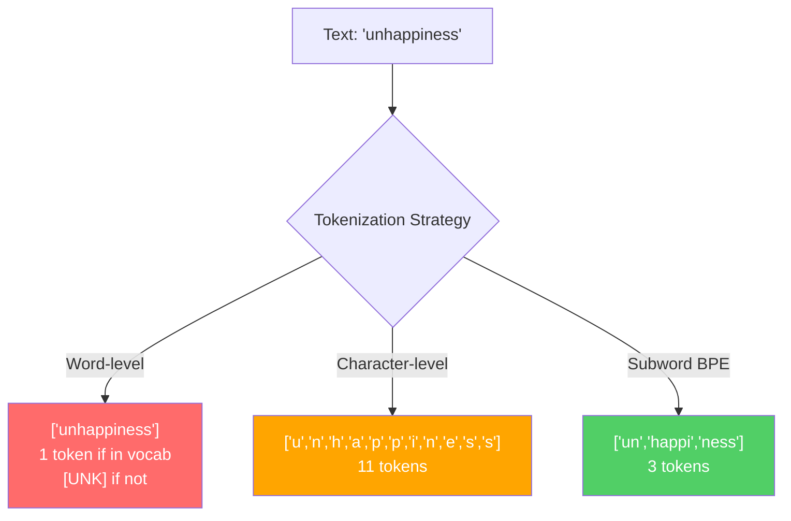
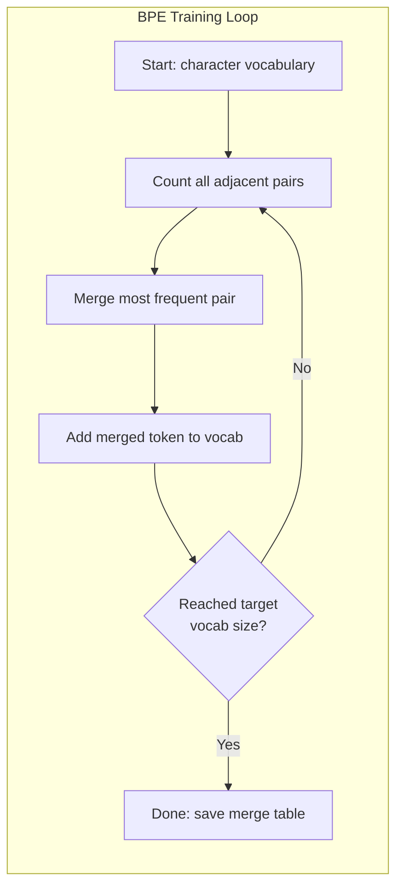
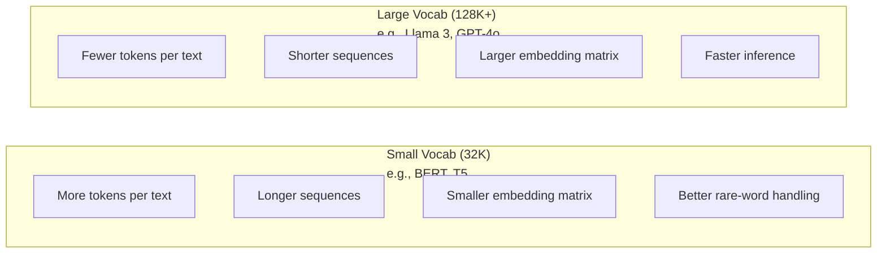

<!-- local-zh-machine-draft: English source is canonical; prose translated automatically, code/math preserved. -->

<a id="tokenizers-bpe-wordpiece-sentencepiece"></a>

# Tokenizers: BPE, WordPiece, SentencePiece

> 您的 LLM 无法读取英文。它读取整数。 tokenizer 决定这些整数是有意义还是浪费。

**类型：** 构建
**语言：** Python
**先决条件：** 第05阶段（NLP基础）
**时间：** ~90 分钟

<a id="learning-objectives"></a>

## 学习目标

- 从头开始实现 BPE、WordPiece 和 Unigram tokenization 算法并比较它们的合并策略
- 解释 vocabulary 大小如何影响模型效率：太小会产生长序列，太大会浪费 embedding parameters
- 跨语言和代码分析 tokenization 工件，识别特定 tokenizers 发生故障的位置
- 使用 tiktoken 和 sentencepiece 库对文本进行标记并检查生成的 token ID

<a id="the-problem"></a>

## 问题

您的 LLM 无法读取英文。它不读取任何语言。它读取数字。

“你好，世界！”之间的差距[15496, 11, 995, 0] 是 tokenizer。每个单词、每个空格、每个标点符号都必须先转换为整数，然后模型才能对其进行处理。这种转换不是中性的。它将假设融入到模型中，以后无法撤销。

如果出错，您的模型就会浪费用多个 tokens 编码常见单词的容量。 “不幸的是”变成了四个 tokens 而不是一个。对于多音节单词的文本，您的 128K context window 刚刚缩小了 75%。如果正确的话，同样的 context window 的意义会增加两倍。 “这个模型可以很好地处理代码”和“这个模型在 Python 上窒息”之间的区别通常取决于 tokenizer 的训练方式。

您对 GPT-4 或 Claude 进行的每个 API 调用均按 token 定价。您的模型的每个 token 都会生成成本计算。表示输出所需的 tokens 越少，端到端 inference 的速度越快。 Tokenization 未进行预处理。这是建筑。

<a id="the-concept"></a>

## 概念

<a id="three-approaches-that-failed-and-one-that-won"></a>

### 三种失败的方法（以及一种成功的方法）

将文本转换为数字有三种明显的方法。其中两个无法大规模发挥作用。

**字级 tokenization** 按空格和标点符号拆分。 “猫坐”变成 [“The”、“猫”、“sat”]。简单的。但是“tokenization”呢？或者“GPT-4o”？或者像“Geschwindigkeitsbegrenzung”这样的德语复合词？单词级别需要大量的 vocabulary 来覆盖每种语言的每个单词。漏掉一个单词，你就会得到可怕的 `[UNK]` token——模型表达“我不知道这是什么”的方式。仅英语就有超过一百万个单词形式。添加代码、URL、科学记数法和 100 种其他语言，您需要一个无限的 vocabulary。

** 字符级 tokenization** 走向另一个方向。 “你好”变成 [“h”，“e”，“l”，“l”，“o”]。 Vocabulary 很小（几百个字符）。从来没有未知的 tokens。但序列变得非常长。 10 个单词级 tokens 的句子变为 50 个字符级 tokens。该模型必须学习“t”、“h”、“e”一起表示“the”——在人类三岁时学习的东西上燃烧 attention 能力。

**Subword tokenization** 找到了最佳点。常用词保持完整：“the”是一个token。生僻词分解为有意义的片段：“unhappiness”变为 [“un”、“happi”、“ness”]。 Vocabulary 保持可管理性（30K 至 128K tokens）。序列保持较短。未知的 tokens 基本上消失了，因为任何单词都可以从子词片段构建。

每个现代 LLM 都使用子字 tokenization。 GPT-2、GPT-4、BERT、Llama 3、Claude——全部。问题是哪种算法。



<a id="bpe-byte-pair-encoding"></a>

### BPE: Byte Pair Encoding

BPE 是一种贪婪压缩算法，为 tokenization 重新设计。这个想法很简单，可以放在索引卡上。

从单个字符开始。计算训练语料库中每个相邻对的数量。将最频繁的对合并到新的 token 中。重复此操作，直到达到目标 vocabulary 大小。

```figure
tokenizer-bpe
```

这是在一个小语料库上运行的 BPE，其中包含“lower”、“lowest”和“newest”等词：

```
Corpus (with word frequencies):
  "lower"  x5
  "lowest" x2
  "newest" x6

Step 0 -- Start with characters:
  l o w e r       (x5)
  l o w e s t     (x2)
  n e w e s t     (x6)

Step 1 -- Count adjacent pairs:
  (e,s): 8    (s,t): 8    (l,o): 7    (o,w): 7
  (w,e): 13   (e,r): 5    (n,e): 6    ...

Step 2 -- Merge most frequent pair (w,e) -> "we":
  l o we r        (x5)
  l o we s t      (x2)
  n e we s t      (x6)

Step 3 -- Recount and merge (e,s) -> "es":
  l o we r        (x5)
  l o we s t      (x2)    <- 'es' only forms from 'e'+'s', not 'we'+'s'
  n e we s t      (x6)    <- wait, the 'e' before 'we' and 's' after 'we'

Actually tracking this precisely:
  After "we" merge, remaining pairs:
  (l,o): 7   (o,we): 7   (we,r): 5   (we,s): 8
  (s,t): 8   (n,e): 6    (e,we): 6

Step 3 -- Merge (we,s) -> "wes" or (s,t) -> "st" (tied at 8, pick first):
  Merge (we,s) -> "wes":
  l o we r        (x5)
  l o wes t       (x2)
  n e wes t       (x6)

Step 4 -- Merge (wes,t) -> "west":
  l o we r        (x5)
  l o west        (x2)
  n e west        (x6)

...continue until target vocab size reached.
```

合并表是tokenizer。要对新文本进行编码，请按照学习的顺序应用合并。训练语料库决定存在哪些合并，并且该选择永久地塑造模型所看到的内容。



<a id="byte-level-bpe-gpt-2-gpt-3-gpt-4"></a>

### 字节级 BPE (GPT-2、GPT-3、GPT-4)

标准 BPE 在 Unicode 字符上运行。字节级 BPE 对原始字节 (0-255) 进行操作。这为您提供了恰好为 256 的基础 vocabulary，可以处理任何语言或编码，并且永远不会产生未知的 token。

GPT-2介绍了这种方法。基础 vocabulary 涵盖了每个可能的字节。 BPE 在此基础上合并构建。 OpenAI 的 tiktoken 库使用以下 vocabulary 大小实现字节级 BPE：

- GPT-2: 50,257 tokens
- GPT-3.5/GPT-4: ~100,256 tokens (cl100k_base 编码)
- GPT-4o：200,019 tokens（o200k_base编码）

<a id="wordpiece-bert"></a>

### WordPiece (BERT)

WordPiece 看起来与 BPE 类似，但选择合并的方式不同。它不是原始频率，而是最大化训练数据的可能性：

```
BPE merge criterion:      count(A, B)
WordPiece merge criterion: count(AB) / (count(A) * count(B))
```

BPE 问：“哪一对出现最频繁？” WordPiece 问：“哪一对出现在一起的次数比你预期的偶然次数多？”这种细微的差别产生了不同的vocabularies。 WordPiece 倾向于同时出现令人惊讶而不仅仅是频繁的合并。

WordPiece 还使用“##”前缀作为连续子词：

```
"unhappiness" -> ["un", "##happi", "##ness"]
"embedding"   -> ["em", "##bed", "##ding"]
```

“##”前缀告诉您此作品延续了之前的 token。 BERT 使用 WordPiece，其中 vocabulary 为 30,522 tokens。每个BERT变体——DistilBERT，RoBERTa的tokenizer实际上是BPE，但BERT本身是WordPiece。

<a id="sentencepiece-llama-t5"></a>

### SentencePiece (Llama, T5)

SentencePiece 将输入视为 Unicode 字符的原始流，包括空格。无预 tokenization 步骤。没有关于单词边界的特定于语言的规则。这使得它真正与语言无关——它适用于中文、日语、泰语和其他不使用空格分隔单词的语言。

SentencePiece 支持两种算法：
- **BPE模式**：与标准BPE相同的合并逻辑，应用于原始字符序列
- **一元模式**：从一个大的vocabulary开始，迭代地删除对整体可能性影响最小的tokens。 BPE 的反向操作——修剪而不是合并。

Llama 2 使用 SentencePiece BPE，vocabulary 为 32,000 tokens。 T5使用SentencePiece Unigram，有32,000个tokens。注：Llama 3 切换为基于 tiktoken 的字节级 BPE tokenizer，拥有 128,256 个 tokens。

<a id="vocabulary-size-tradeoffs"></a>

### Vocabulary 尺寸权衡

这是一个真正的工程决策，具有可衡量的后果。



具体数字。对于具有 4,096 维 embeddings 的 128K vocabulary，仅 embedding 矩阵就是 128,000 x 4,096 = 5.24 亿个 parameters。对于32K的vocabulary来说，就是1.31亿个parameters。这与单独选择 tokenizer 相比，有 400M parameter 的差异。

但较大的 vocabularies 会更积极地压缩文本。同一个英文段落，如果使用 32K vocabulary 占用 100 tokens，则使用 128K vocabulary 可能需要 70 tokens。这意味着生成过程中 forward passes 的数量减少了 30%。对于 model serving 数百万个请求，这直接降低了计算成本。

趋势很明显：vocabulary 尺寸正在增长。 GPT-2 已使用 50,257。 GPT-4 使用 ~100K。 Llama 3 使用 128K。 GPT-4o 使用 200K。

| 模型 | 词汇量 | Tokenizer型 | 每个英文单词的平均 Tokens |
|-------|-----------|----------------|---------------------------|
| BERT | 30,522 | WordPiece | ~1.4 |
| GPT-2 | 50,257 | 字节级 BPE | ~1.3 |
| Llama 2 | 32,000 | SentencePiece BPE | ~1.4 |
| GPT-4 | ~100,256 | 字节级 BPE | ~1.2 |
| Llama 3 | 128,256 | 字节级 BPE (tiktoken) | ~1.1 |
| GPT-4o | 200,019 | 字节级 BPE | ~1.0 |

<a id="the-multilingual-tax"></a>

### 多语言税

Tokenizers 主要接受英语训练，对其他语言来说是残酷的。 GPT-2 的 tokenizer 中的韩文文本平均每个单词有 2-3 个 tokens。中国人可能更糟。这意味着韩国用户实际上拥有的 context window 大小是英国用户的一半——支付相同的价格但信息密度较低。

这就是为什么 Llama 3 将 vocabulary 从 32K 增加到 128K 的四倍。更多专用于非英语脚本的 tokens 意味着跨语言的压缩更加公平。

```figure
tokenizer-tradeoff
```

<a id="build-it"></a>

## 动手实现

<a id="step-1-character-level-tokenizer"></a>

### 步骤1：字符级Tokenizer

从基础开始。字符级 tokenizer 将每个字符映射到其 Unicode 代码点。无需培训。没有未知的tokens。只是直接映射。

```python
class CharTokenizer:
    def encode(self, text):
        return [ord(c) for c in text]

    def decode(self, tokens):
        return "".join(chr(t) for t in tokens)
```

“你好”变成 [104, 101, 108, 108, 111]。每个角色都有自己的token。这是我们改进的基线。

<a id="step-2-bpe-tokenizer-from-scratch"></a>

### 步骤 2：从头开始 BPE Tokenizer

真正的执行。我们对原始字节进行训练（例如 GPT-2），对对进行计数，合并最频繁的字节，并按顺序记录每次合并。合并表是tokenizer。

```python
from collections import Counter

class BPETokenizer:
    def __init__(self):
        self.merges = {}
        self.vocab = {}

    def _get_pairs(self, tokens):
        pairs = Counter()
        for i in range(len(tokens) - 1):
            pairs[(tokens[i], tokens[i + 1])] += 1
        return pairs

    def _merge_pair(self, tokens, pair, new_token):
        merged = []
        i = 0
        while i < len(tokens):
            if i < len(tokens) - 1 and tokens[i] == pair[0] and tokens[i + 1] == pair[1]:
                merged.append(new_token)
                i += 2
            else:
                merged.append(tokens[i])
                i += 1
        return merged

    def train(self, text, num_merges):
        tokens = list(text.encode("utf-8"))
        self.vocab = {i: bytes([i]) for i in range(256)}

        for i in range(num_merges):
            pairs = self._get_pairs(tokens)
            if not pairs:
                break
            best_pair = max(pairs, key=pairs.get)
            new_token = 256 + i
            tokens = self._merge_pair(tokens, best_pair, new_token)
            self.merges[best_pair] = new_token
            self.vocab[new_token] = self.vocab[best_pair[0]] + self.vocab[best_pair[1]]

        return self

    def encode(self, text):
        tokens = list(text.encode("utf-8"))
        for pair, new_token in self.merges.items():
            tokens = self._merge_pair(tokens, pair, new_token)
        return tokens

    def decode(self, tokens):
        byte_sequence = b"".join(self.vocab[t] for t in tokens)
        return byte_sequence.decode("utf-8", errors="replace")
```

训练循环是BPE的核心：计数对，合并获胜者，重复。每次合并都会减少 token 总数。 `num_merges` 轮后，vocabulary 从 256（基本字节）增长到 256 + num_ 合并。

编码按照学习的确切顺序应用合并。这很重要。如果合并 1 创建了“th”并且合并 5 创建了“the”，则编码必须首先应用合并 1，以便“the”可以在合并 5 中由“th”+“e”形成。

解码则相反：在vocabulary中查找每个token ID，连接字节，解码为UTF-8。

<a id="step-3-encode-and-decode-roundtrip"></a>

### 第 3 步：编码和解码往返

```python
corpus = (
    "The cat sat on the mat. The cat ate the rat. "
    "The dog sat on the log. The dog ate the frog. "
    "Natural language processing is the study of how computers "
    "understand and generate human language. "
    "Tokenization is the first step in any NLP pipeline."
)

tokenizer = BPETokenizer()
tokenizer.train(corpus, num_merges=40)

test_sentences = [
    "The cat sat on the mat.",
    "Natural language processing",
    "tokenization pipeline",
    "unhappiness",
]

for sentence in test_sentences:
    encoded = tokenizer.encode(sentence)
    decoded = tokenizer.decode(encoded)
    raw_bytes = len(sentence.encode("utf-8"))
    ratio = len(encoded) / raw_bytes
    print(f"'{sentence}'")
    print(f"  Tokens: {len(encoded)} (from {raw_bytes} bytes) -- ratio: {ratio:.2f}")
    print(f"  Roundtrip: {'PASS' if decoded == sentence else 'FAIL'}")
```

压缩比告诉您 tokenizer 的效果如何。比率为 0.50 意味着 tokenizer 将文本压缩为原始字节的一半 tokens。越低越好。在训练语料上，这个比例会很好。对于像“unhappiness”（未出现在语料库中）这样的分布外文本，该比率会更糟 - tokenizer 会回退到未见过的模式的字符级编码。

<a id="step-4-compare-with-tiktoken"></a>

### 第四步：与抖音对比

```python
import tiktoken

enc = tiktoken.get_encoding("cl100k_base")

texts = [
    "The cat sat on the mat.",
    "unhappiness",
    "Hello, world!",
    "def fibonacci(n): return n if n < 2 else fibonacci(n-1) + fibonacci(n-2)",
    "Geschwindigkeitsbegrenzung",
]

for text in texts:
    our_tokens = tokenizer.encode(text)
    tiktoken_tokens = enc.encode(text)
    tiktoken_pieces = [enc.decode([t]) for t in tiktoken_tokens]
    print(f"'{text}'")
    print(f"  Our BPE:   {len(our_tokens)} tokens")
    print(f"  tiktoken:  {len(tiktoken_tokens)} tokens -> {tiktoken_pieces}")
```

tiktoken 使用完全相同的算法，但对数百 GB 的文本进行了 100,000 次合并训练。算法是相同的。区别在于训练数据和合并次数。你的tokenizer在一个有40个合并的段落上训练无法与tiktoken在海量语料库上的10万个合并竞争。但机制是一样的。

<a id="step-5-vocabulary-analysis"></a>

### 步骤5：Vocabulary分析

```python
def analyze_vocabulary(tokenizer, test_texts):
    total_tokens = 0
    total_chars = 0
    token_usage = Counter()

    for text in test_texts:
        encoded = tokenizer.encode(text)
        total_tokens += len(encoded)
        total_chars += len(text)
        for t in encoded:
            token_usage[t] += 1

    print(f"Vocabulary size: {len(tokenizer.vocab)}")
    print(f"Total tokens across all texts: {total_tokens}")
    print(f"Total characters: {total_chars}")
    print(f"Avg tokens per character: {total_tokens / total_chars:.2f}")

    print(f"\nMost used tokens:")
    for token_id, count in token_usage.most_common(10):
        token_bytes = tokenizer.vocab[token_id]
        display = token_bytes.decode("utf-8", errors="replace")
        print(f"  Token {token_id:4d}: '{display}' (used {count} times)")

    unused = [t for t in tokenizer.vocab if t not in token_usage]
    print(f"\nUnused tokens: {len(unused)} out of {len(tokenizer.vocab)}")
```

这会显示 vocabulary 中的 Zipf 发行版。少数 tokens 占主导地位（空格、“the”、“e”）。大多数tokens很少使用。生产 tokenizers 对此分布进行优化——常见模式获得较短的 token ID，罕见模式获得更长的表示。

<a id="use-it"></a>

## 实际应用

您的刮擦 BPE 有效。现在看看生产工具是什么样子的。

<a id="tiktoken-openai"></a>

### 抖音 (OpenAI)

```python
import tiktoken

enc = tiktoken.get_encoding("cl100k_base")

text = "Tokenizers convert text to integers"
tokens = enc.encode(text)
print(f"Tokens: {tokens}")
print(f"Pieces: {[enc.decode([t]) for t in tokens]}")
print(f"Roundtrip: {enc.decode(tokens)}")
```

tiktoken 采用 Rust 编写，绑定为 Python。它编码了数百万个tokens per second。相同的 BPE 算法，工业级实现。

<a id="hugging-face-tokenizers"></a>

### 抱脸 tokenizers

```python
from tokenizers import Tokenizer
from tokenizers.models import BPE
from tokenizers.trainers import BpeTrainer
from tokenizers.pre_tokenizers import ByteLevel

tokenizer = Tokenizer(BPE())
tokenizer.pre_tokenizer = ByteLevel()

trainer = BpeTrainer(vocab_size=1000, special_tokens=["<pad>", "<eos>", "<unk>"])
tokenizer.train(["corpus.txt"], trainer)

output = tokenizer.encode("The cat sat on the mat.")
print(f"Tokens: {output.tokens}")
print(f"IDs: {output.ids}")
```

Hugging Face tokenizers 库的底层也是 Rust。它可以在几秒钟内在千兆字节规模的语料库上训练 BPE。这是您在训练自己的模型时使用的。

<a id="loading-llamas-tokenizer"></a>

### 正在加载 Llama 的 Tokenizer

```python
from transformers import AutoTokenizer

tokenizer = AutoTokenizer.from_pretrained("meta-llama/Llama-3.1-8B")

text = "Tokenizers are the unsung heroes of LLMs"
tokens = tokenizer.encode(text)
print(f"Token IDs: {tokens}")
print(f"Tokens: {tokenizer.convert_ids_to_tokens(tokens)}")
print(f"Vocab size: {tokenizer.vocab_size}")

multilingual = ["Hello world", "Hola mundo", "Bonjour le monde"]
for text in multilingual:
    ids = tokenizer.encode(text)
    print(f"'{text}' -> {len(ids)} tokens")
```

Llama 3 的 128K vocabulary 压缩非英语文本的效果明显优于 GPT-2 的 50K vocabulary。您可以自己验证这一点——用多种语言对同一个句子进行编码并计算 tokens。

<a id="ship-it"></a>

## 交付成果

本课程生成 `outputs/prompt-tokenizer-analyzer.md`——一个可重复使用的 prompt，用于分析任何文本和模型组合的 tokenization 效率。向其提供文本示例，它会告诉您哪个模型的 tokenizer 处理得最好。

<a id="exercises"></a>

## 练习

1. 修改 BPE tokenizer 以在每个合并步骤打印 vocabulary。观察“t”+“h”如何变成“th”，然后“th”+“e”变成“the”。跟踪常见英语单词是如何逐个组装的。

2. 将特殊的tokens（`<pad>`、`<eos>`、`<unk>`）添加到BPE tokenizer。为它们分配 ID 0、1、2，并相应地移动所有其他 tokens。实施 tokenization 之前的步骤，在运行 BPE 之前按空格进行分割。

3. 实施 WordPiece 合并标准（似然比而不是频率）。在同一语料库上以相同的合并次数训练 BPE 和 WordPiece。比较生成的 vocabularies——哪一个产生更多具有语言意义的子词？

4. 构建多语言 tokenizer 效率基准。用英语、西班牙语、汉语、韩语和阿拉伯语写 10 个句子。用 tiktoken (cl100k_base) 对每个字符进行标记，并测量每个字符的平均值 tokens。量化每种语言的“多语言税”。

5. 在更大的语料库上训练您的 BPE tokenizer（下载维基百科文章）。调整合并次数，以实现同一文本上 tiktoken 10% 以内的压缩率。这迫使您了解语料库大小、合并计数和压缩质量之间的关系。

<a id="key-terms"></a>

## 关键术语

| 术语 | 人们怎么说 | 它实际上意味着什么 |
|------|----------------|----------------------|
| Token | “一句话” | 模型 vocabulary 中的一个单元——可以是字符、子字、单词或多字块 |
| BPE | “一些压缩的东西” | Byte Pair Encoding -- 迭代合并 tokens 中最频繁的相邻对，直到达到目标 vocabulary 大小 |
| WordPiece | “BERT的tokenizer” | 与 BPE 类似，但合并最大化似然比 count(AB)/(count(A)*count(B)) 而不是原始频率 |
| SentencePiece | “tokenizer 库” | 与语言无关的 tokenizer，在原始 Unicode 上运行，无需预 tokenization，支持 BPE 和 Unigram 算法 |
| Vocabulary尺寸 | “它认识多少个单词” | 唯一tokens的总数：GPT-2有50,257个，BERT有30,522个，Llama 3有128,256个 |
| 生育能力 | “不是 tokenizer 术语” | 每个单词的 tokens 的平均数量——衡量 tokenizer 跨语言的效率（1.0 是完美的，3.0 意味着模型工作三倍） |
| 字节级 BPE | “GPT的tokenizer” | BPE 对原始字节（0-255）而不是 Unicode 字符进行操作，保证任何输入都没有未知的 tokens |
| 合并表 | “tokenizer 文件” | 训练期间学到的对合并的有序列表——这是 tokenizer，顺序很重要 |
| 预售 tokenization | “分割空间” | 在子字 tokenization 之前应用的规则：空格分割、数字分隔、标点符号处理 |
| 压缩比 | “tokenizer 的效率如何” | Tokens 除以输入字节生成 - 较低意味着更好的压缩和更快的 inference |

<a id="further-reading"></a>

## 进一步阅读

- [Sennrich et al., 2016 - “Neural Machine Translation of Rare Words with Subword Units”](https://arxiv.org/abs/1508.07909) - 这篇论文介绍了 BPE 用于 NLP，将 1994 年的压缩算法变成了现代压缩算法的基础tokenization
- [Kudo & Richardson，2018 --“SentencePiece：一个简单且与语言无关的子字 tokenizer”](https://arxiv.org/abs/1808.06226) --与语言无关tokenization 使多语言模型变得实用
- [OpenAI抖音存储库](https://github.com/openai/tiktoken)-  生产BPE实施于Rust和Python绑定，使用者GPT-3.5/4/4o
- [Hugging Face Tokenizers 文档](https://huggingface.co/docs/tokenizers) -- 生产级 tokenizer 培训，具有 Rust 性能
