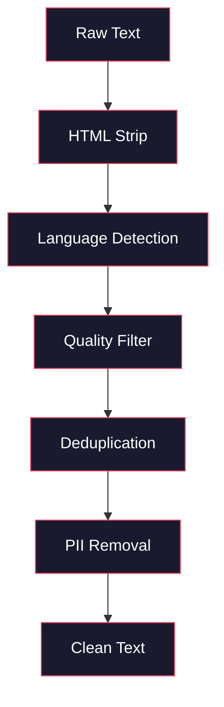
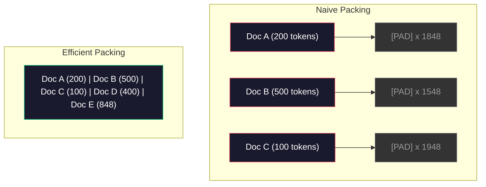

<!-- local-zh-machine-draft: English source is canonical; prose translated automatically, code/math preserved. -->

<a id="data-pipelines-for-pre-training"></a>

# 用于预训练的数据管道

> 模型是一面镜子。它反映了您提供给它的任何数据。给它喂垃圾，它以完美流畅的方式反映垃圾。

**类型：** 构建
**语言：** Python
**先决条件：** 第 10 阶段，第 01-02 课（Tokenizers，构建 Tokenizer）
**时间：** ~90 分钟

<a id="learning-objectives"></a>

## 学习目标

- 构建 streaming 数据管道，对 TB 文本进行标记、分块、洗牌和批量处理，而无需将其全部加载到内存中
- 实施实际预训练管道中使用的数据质量过滤器（重复数据删除、语言检测、内容过滤）
- 使用适当的 attention 掩码和文档边界处理创建固定长度的训练序列
- 配置文件管道吞吐量，以确保数据加载器跟上 GPU 训练速度

<a id="the-problem"></a>

## 问题

您有一个 tokenizer。现在您需要数据。

不是数据集。不是 CSV 文件。 TB 级文本 — 已清理、重复数据删除、质量过滤、标记为固定长度序列，并以足够快的速度以随机批次提供服务，使您的 8-GPU 集群永远不会等待下一批。

大多数人认为训练 LLM 与模型架构有关。它不是。 Llama 3使用了15.6万亿个tokens。 GPT-3使用了3000亿。 DeepSeek-V2使用了8.1万亿。三者的架构大致相同：堆叠 transformer 块与 attention 和前馈层。输出质量的差异主要来自数据。

DeepMind 的 Chinchilla 论文明确说明了这一点。对于给定的计算预算，模型 parameters 与训练 tokens 存在最佳比率。 Chinchilla 表明，2022 年的大多数模型都严重缺乏训练——相对于他们看到的数据量，他们有太多的 parameters。在 1.4 万亿个 tokens（Chinchilla 最优）上训练的 70B parameter 模型优于在 3000 亿个 tokens（Gopher）上训练的 280B 模型。

您的数据管道决定您的模型是学习语言还是学习噪声。

<a id="the-concept"></a>

## 概念

<a id="where-the-data-comes-from"></a>

### 数据来自哪里

每个大型语言模型都经过混合源的训练。对于大多数实验室来说，确切的成分是严格保守的秘密，但我们已经足够了解其类别。

| 来源 | 尺寸 | 品质 | 使用者 |
|--------|------|---------|---------|
| 普通爬行 | 约 250 TB 原始数据 | 低（需要重度过滤） | GPT-3、Llama、最开放型号 |
| 维基百科 | 〜20GB | 高 | 各大LLM |
| GitHub码 | 〜1TB+ | 中等（大量重复、死代码） | StarCoder、CodeLlama、DeepSeek-Coder |
| 书籍（BookCorpus、Pile） | 〜100GB | 高 | GPT-2、GPT-3、早期型号 |
| 学术论文（arXiv、S2ORC） | 〜100GB | 适合 STEM | Llama，卡拉狄加 |
| 堆栈溢出、Reddit | 〜100GB | 中等 | Llama，猎鹰 |
| 策划网络（C4、RefinedWeb） | 〜5TB | 中高（预过滤） | T5、猎鹰 |

Llama 3披露了其数据组合：大约50%的网络数据、25%的代码、13%的书籍和学术论文、8%的数学数据和4%的多语言网络数据。来自超过 5 TB 原始文本的来源的 tokens 总量为 15.6 万亿。

该比率与总大小一样重要。网络数据太多，模型就变成了 Reddit 鹦鹉。代码太少，无法编程。数学太少，推理失败。正确地进行这种混合是训练 LLM 中最困难的部分之一，并且没有公式——它需要实验和 evaluation。

<a id="data-cleaning"></a>

### 数据清理

原始网络数据是肮脏的。典型的 Common Crawl 转储包含：

- HTML 标签和 JavaScript
- 样板页眉、页脚、导航菜单
- 重复的页面（完全重复和近似重复）
- 机器生成的垃圾邮件
- 个人身份信息 (PII)
- 低质量文本（关键字列表、SEO 垃圾邮件）
- 非文本内容编码为文本

清洁它不是可选的。这是生成连贯段落的模型和输出与产品列表混合的 HTML 标签的模型之间的区别。



每一步都会消除一类噪声：

**HTML 剥离：** 删除所有标记。仅保留可见的文本内容。像 `trafilatura` 或 `readability` 这样的库提取文章内容，同时丢弃导航、广告和样板文件。

**语言检测：** 使用fastText的语言识别模型（lid.176.bin）对每个文档进行分类。过滤到您的目标语言。置信度低于 0.8 的被归类为英语的文档可能不是干净的英语。

**质量过滤：** 这就是它变得有趣的地方。 RefinedWeb（Falcon 背后的数据集）使用基于 perplexity 的过滤器：在维基百科上训练一个小型语言模型，然后对每个文档进行评分。高 perplexity 意味着该文档与维基百科不同——可能是垃圾邮件、关键字列表或机器生成的内容。 perplexity 高于阈值的文档将被删除。

**重复数据删除：** 最具影响力的单一清理步骤。 Common Crawl 包含大量重复页面——法律免责声明、cookie 通知、服务条款。对重复内容的训练会浪费计算量，并可能导致模型逐字记忆和反省特定的段落。

**PII 删除：** 姓名、电子邮件地址、电话号码、社会安全号码。基于正则表达式的结构化 PII 检测，上下文中名称的 NER 模型。

<a id="deduplication-with-minhash"></a>

### 使用 MinHash 进行重复数据删除

精确的重复数据删除很简单：散列每个文档，删除重复项。但接近重复才是真正的问题。同一篇新闻文章的两份副本，周围的广告略有不同，几乎是重复的。内容 95% 相同，但逐字节不同。

MinHash + 局部敏感哈希 (LSH) 有效地解决了这个问题。


想法：

1. **Shingling:** 将每个文档转换为一组 n 元语法（例如，5 元语法的单词或字符）。带有 3 个词带状疱疹的“the Quick Brown Fox”变为 {“the Quick Brown”，“Quick Brown Fox”}。

2. **MinHash:** 对于每个文档的木瓦集，计算 k 个哈希值。每个哈希值是不同哈希函数下所有带状疱疹的最小哈希值。这将创建一个固定大小的“签名”，该“签名”近似于任意两个文档之间的 Jaccard 相似度。

3. **LSH:** 根据 MinHash 签名的带将文档分组到存储桶中。同一存储桶中的文档是候选的近似重复项。这避免了比较每一对——您只比较候选者。

4. **Verify:** 对于每个候选对，计算精确的 Jaccard 相似度。如果相似度超过阈值（通常为 0.8），则删除一个副本。

Llama 团队报告通过重复数据删除删除了大约 38% 的 Web 数据。这可不是一个小数目。超过三分之一的 Common Crawl 是重复或接近重复的内容。

<a id="sequence-packing"></a>

### 顺序打包

您的模型需要固定长度的输入序列。您的文档是可变长度的。有些是50 tokens。有的是5万个tokens。

简单的方法：将每个文档填充到最大序列长度。这会浪费大量的计算来填充 tokens，而对学习没有任何贡献。

更好的方法：将多个文档打包到一个序列中，并用序列末尾 tokens 分隔。 2048-token 序列可能包含三个短文档，它们之间用 [EOS] tokens 连接。



必须正确设置 attention 掩码。来自文档 A 的 Tokens 不应在同一打包序列中关注来自文档 B 的 tokens。这需要块对角 attention 掩码。

长文档在序列边界处被截断或分割成块。分割点很重要：在句子中间分割会迫使模型看到不完整的想法。有些管道会尽可能将分割与段落或句子边界对齐。

<a id="the-chinchilla-scaling-law"></a>

### 龙猫缩放法则

对于固定的计算预算 C（以 FLOP 为单位），最佳模型大小 N 和数据集大小 D 如下：

```
N_opt ~ C^0.5
D_opt ~ C^0.5
```

实际上，这意味着您应该大致相等地缩放模型大小和数据集大小。具有 10 倍 parameters 的模型需要大约 10 倍的训练 tokens 才能达到相同的损失。

| 模型 | Parameters | 培训 Tokens | 龙猫-最优？ |
|-------|-----------|----------------|-------------------|
| GPT-3 | 175B | 300B | 否（训练不足 3-4x） |
| 龙猫 | 70B | 1.4T | 是（设计使然） |
| Llama 2 | 70B | 2T | 训练过度（故意） |
| Llama 3 | 70B | 15吨 | 严重过度训练 |

Llama 3 故意违反龙猫法。 Meta 发现，对更多数据进行过度训练（远远超出计算最佳比率）可以为 inference 生成更好的模型。额外的培训费用只需支付一次，但较小的模型可以更便宜地永久服务。这有时称为“inference 最佳”扩展方法，自 2024 年以来已成为行业标准。

```figure
l5-data-pipeline
```

<a id="build-it"></a>

## 动手实现

<a id="step-1-text-cleaning"></a>

### 第1步：文本清理

剥离HTML，标准化空白，删除非文本内容。我们将使用公共领域文本（古腾堡计划）作为我们的小型语料库。

```python
import re

def clean_text(text):
    text = re.sub(r"<[^>]+>", "", text)
    text = re.sub(r"http\S+", "", text)
    text = re.sub(r"[^\x20-\x7E\n]", "", text)
    text = re.sub(r"\n{3,}", "\n\n", text)
    text = re.sub(r" {2,}", " ", text)
    return text.strip()

def quality_filter(text, min_words=50, max_ratio_caps=0.3, max_ratio_special=0.1):
    words = text.split()
    if len(words) < min_words:
        return False
    caps_ratio = sum(1 for w in words if w.isupper()) / len(words)
    if caps_ratio > max_ratio_caps:
        return False
    special_chars = sum(1 for c in text if not c.isalnum() and not c.isspace())
    if special_chars / max(len(text), 1) > max_ratio_special:
        return False
    return True
```

质量过滤器可捕获 SEO 垃圾邮件（全部大写）、机器生成的噪音（特殊字符比例高）和存根页面（太短）。仅这三项检查就可以从网络爬行中删除大量垃圾。

<a id="step-2-minhash-deduplication"></a>

### 第2步：MinHash去重

从头开始实现 MinHash。不需要外部库——只需 `hashlib`。

```python
import hashlib
from collections import defaultdict

def get_shingles(text, k=5):
    words = text.lower().split()
    if len(words) < k:
        return set()
    return {" ".join(words[i:i+k]) for i in range(len(words) - k + 1)}

def minhash_signature(shingles, num_hashes=128):
    signature = []
    for i in range(num_hashes):
        min_hash = float("inf")
        for shingle in shingles:
            h = int(hashlib.sha256(f"{i}:{shingle}".encode()).hexdigest(), 16)
            min_hash = min(min_hash, h)
        signature.append(min_hash)
    return signature

def lsh_buckets(signature, bands=16):
    rows_per_band = len(signature) // bands
    buckets = []
    for b in range(bands):
        start = b * rows_per_band
        band_data = tuple(signature[start:start + rows_per_band])
        bucket_hash = hashlib.md5(str(band_data).encode()).hexdigest()
        buckets.append((b, bucket_hash))
    return buckets

def deduplicate(documents, threshold=0.8, num_hashes=128, bands=16):
    signatures = []
    shingle_sets = []
    for doc in documents:
        shingles = get_shingles(doc)
        shingle_sets.append(shingles)
        signatures.append(minhash_signature(shingles, num_hashes))

    bucket_map = defaultdict(list)
    for doc_idx, sig in enumerate(signatures):
        for band_id, bucket_hash in lsh_buckets(sig, bands):
            bucket_map[(band_id, bucket_hash)].append(doc_idx)

    duplicate_pairs = set()
    for bucket_docs in bucket_map.values():
        if len(bucket_docs) < 2:
            continue
        for i in range(len(bucket_docs)):
            for j in range(i + 1, len(bucket_docs)):
                duplicate_pairs.add((bucket_docs[i], bucket_docs[j]))

    removed = set()
    for i, j in duplicate_pairs:
        if i in removed or j in removed:
            continue
        s1, s2 = shingle_sets[i], shingle_sets[j]
        if not s1 or not s2:
            continue
        jaccard = len(s1 & s2) / len(s1 | s2)
        if jaccard >= threshold:
            removed.add(j)

    return [doc for idx, doc in enumerate(documents) if idx not in removed], len(removed)
```

`num_hashes=128` 和 `bands=16` parameters 控制精确率与召回率的权衡。更多哈希可以提供更准确的相似性估计。更多条带可以提高召回率（捕获更多重复项），但代价是产生更多误报。这些值适用于典型的网络文本。

<a id="step-3-tokenize-and-pack-sequences"></a>

### 第 3 步：标记和打包序列

获取干净、去重的文本，对其进行标记，然后打包成固定长度的序列以进行训练。

```python
def tokenize_corpus(documents, tokenizer):
    all_tokens = []
    for doc in documents:
        tokens = tokenizer.encode(doc)
        all_tokens.extend(tokens)
        all_tokens.append(tokenizer.eos_id)
    return all_tokens

def pack_sequences(token_ids, seq_length, pad_id=0):
    sequences = []
    attention_masks = []
    for i in range(0, len(token_ids), seq_length):
        seq = token_ids[i:i + seq_length]
        mask = [1] * len(seq)
        if len(seq) < seq_length:
            pad_count = seq_length - len(seq)
            seq = seq + [pad_id] * pad_count
            mask = mask + [0] * pad_count
        sequences.append(seq)
        attention_masks.append(mask)
    return sequences, attention_masks
```

<a id="step-4-dataloader-for-training"></a>

### 第 4 步：用于训练的 DataLoader

产生随机批次的打包序列。这就是训练循环消耗的内容。

```python
import random

class PreTrainingDataLoader:
    def __init__(self, sequences, attention_masks, batch_size, shuffle=True):
        self.sequences = sequences
        self.attention_masks = attention_masks
        self.batch_size = batch_size
        self.shuffle = shuffle

    def __len__(self):
        return (len(self.sequences) + self.batch_size - 1) // self.batch_size

    def __iter__(self):
        indices = list(range(len(self.sequences)))
        if self.shuffle:
            random.shuffle(indices)
        for start in range(0, len(indices), self.batch_size):
            batch_idx = indices[start:start + self.batch_size]
            batch_seqs = [self.sequences[i] for i in batch_idx]
            batch_masks = [self.attention_masks[i] for i in batch_idx]
            yield batch_seqs, batch_masks
```

<a id="step-5-dataset-statistics"></a>

### 第5步：数据集统计

计算重要的数字：总计 tokens、唯一 tokens、压缩率、文档长度分布。

```python
from collections import Counter

def compute_statistics(documents, token_ids, sequences, tokenizer_vocab_size):
    total_chars = sum(len(d) for d in documents)
    total_tokens = len(token_ids)
    unique_tokens = len(set(token_ids))
    compression_ratio = total_chars / total_tokens

    doc_lengths = [len(d.split()) for d in documents]
    avg_doc_length = sum(doc_lengths) / max(len(doc_lengths), 1)
    max_doc_length = max(doc_lengths) if doc_lengths else 0
    min_doc_length = min(doc_lengths) if doc_lengths else 0

    token_counts = Counter(token_ids)
    top_tokens = token_counts.most_common(10)

    non_pad_tokens = sum(sum(1 for t in seq if t != 0) for seq in sequences)
    total_positions = sum(len(seq) for seq in sequences)
    utilization = non_pad_tokens / max(total_positions, 1)

    stats = {
        "total_documents": len(documents),
        "total_characters": total_chars,
        "total_tokens": total_tokens,
        "unique_tokens": unique_tokens,
        "vocab_utilization": unique_tokens / tokenizer_vocab_size,
        "compression_ratio": compression_ratio,
        "avg_doc_length_words": avg_doc_length,
        "max_doc_length_words": max_doc_length,
        "min_doc_length_words": min_doc_length,
        "num_sequences": len(sequences),
        "sequence_utilization": utilization,
        "top_10_tokens": top_tokens,
    }
    return stats
```

压缩比告诉您效率如何tokenizer在此语料库中。 英文文本通常会压缩至每节约 3-4 个字符token。 如果您看到每个字符 1.5 个token， 你的tokenizer分裂得太激进了。 如果你看到 8+，它已经学会了非常特定领域的合并。

序列利用率告诉您打包序列中有多少是真实数据与填充数据。低于 90% 意味着您的打包效率低下——您在填充 tokens 上浪费了计算。

<a id="use-it"></a>

## 实际应用

<a id="compare-with-huggingface-datasets"></a>

### 与 HuggingFace 数据集比较

通过 HuggingFace 的数据集库加载相同的语料库并比较管道速度。

```python
from datasets import load_dataset
from transformers import AutoTokenizer

ds = load_dataset("wikitext", "wikitext-2-raw-v1", split="train")
tokenizer = AutoTokenizer.from_pretrained("meta-llama/Meta-Llama-3-8B")

import time

start = time.time()
tokenized = ds.map(
    lambda x: tokenizer(x["text"], truncation=True, max_length=2048),
    batched=True,
    num_proc=4,
)
hf_time = time.time() - start
total_tokens = sum(len(t) for t in tokenized["input_ids"])
print(f"HuggingFace: {total_tokens:,} tokens in {hf_time:.2f}s ({total_tokens/hf_time:,.0f} tokens/sec)")
```

HuggingFace 管道在底层使用 Rust tokenizers 并跨 4 个内核进行并行处理。您的纯 Python 管道将慢 10-50 倍。这个差距就是制作团队使用编译后的 tokenizers 的原因。算法是一样的。区别在于实现语言。

<a id="ship-it"></a>

## 交付成果

本课程生成一个 prompt，用于验证和调试 LLM 训练管道中的数据质量。参见 `outputs/prompt-data-quality-checker.md`。

<a id="exercises"></a>

## 练习

1. **Easy:** 使用简单的启发式（字符集分析）将语言检测添加到清理管道。仅过滤英文文档并测量有多少文档被删除。
2. **Medium：** 使用 SHA-256 哈希以及 MinHash 近重复数据删除来实现精确重复数据删除。比较网络抓取语料库中每种方法捕获的重复项数量。
3. **Hard:** 构建基于 perplexity 的质量过滤器。在维基百科文本上训练一个小型二元语言模型，通过 perplexity 对每个文档进行评分，并删除底部的 20%。比较使用已过滤数据与未过滤数据进行训练时的模型输出质量。

<a id="key-terms"></a>

## 关键术语

| 术语 | 人们怎么说 | 它实际上意味着什么 |
|------|----------------|----------------------|
| 普通爬行 | “互联网” | 每月抓取网络的非营利组织 -- ~250TB 原始数据，大多数 LLM 训练数据的起点 |
| 最小哈希值 | “一些哈希技巧” | 一种使用固定大小签名估计集合之间的 Jaccard 相似度的技术 - 实现大规模的近乎重复检测 |
| LSH | “局部敏感哈希” | 一种将相似项目分组到同一桶中的方法——将成对比较从 O(n^2) 减少到近线性 |
| 顺序包装 | “连接文档” | 使用适当的 attention 掩码将多个文档放入固定长度的序列中——消除填充浪费 |
| 龙猫鳞片 | “使用更多数据进行训练” | 对于固定的计算预算，最佳性能需要大致同等地缩放模型大小和训练 tokens |
| 生育能力 | “每个字Tokens” | 每个单词 tokens 的平均数量 -- GPT-4 中的英语为 1.3，非拉丁字母的数量更高 |
| 数据混合 | “选择训练数据” | 代码与文本、数学与多语言数据的比率——没有公式，需要实验 |
| Perplexity过滤器 | 《质量评分》 | 使用小型语言模型对文档进行评分 - 高 perplexity 意味着文本与干净的参考数据不同 |
| 重复数据删除 | “删除副本” | 消除完全相同和近似重复的文档——通常会删除 30-40% 的原始 Web 数据 |
| Attention 面罩 | “看哪个tokens” | 一种二进制掩码，可防止 attention 跨越打包序列中的文档边界 |

<a id="further-reading"></a>

## 进一步阅读

- [Hoffmann 等人，2022 年——训练计算最优大型语言模型 (Chinchilla)](https://arxiv.org/abs/2203.15556)——这篇论文改变了我们对数据规模的看法
- [Penedo 等人，2023 -- Falcon 的 RefinedWeb 数据集 LLM](https://arxiv.org/abs/2306.01116) -- 如何过滤 Common Crawl 以获得高质量
- [Touvron 等人，2023 -- Llama 2：开放基础和微调聊天模型](https://arxiv.org/abs/2307.09288) -- Llama 2 的数据管道详细信息
- [Lee 等人，2022 — 训练数据去重使语言模型变得更好](https://arxiv.org/abs/2107.06499) — 为什么去重比您想象的更重要
- [Broder, 1997 -- 关于文档的相似性和包含性](https://ieeexplore.ieee.org/document/666900) -- 原始的 MinHash 论文
- [Meta, 2024 -- Llama 3 技术报告](https://arxiv.org/abs/2407.21783) -- 15.6T tokens，数据混合比例，过滤管道
