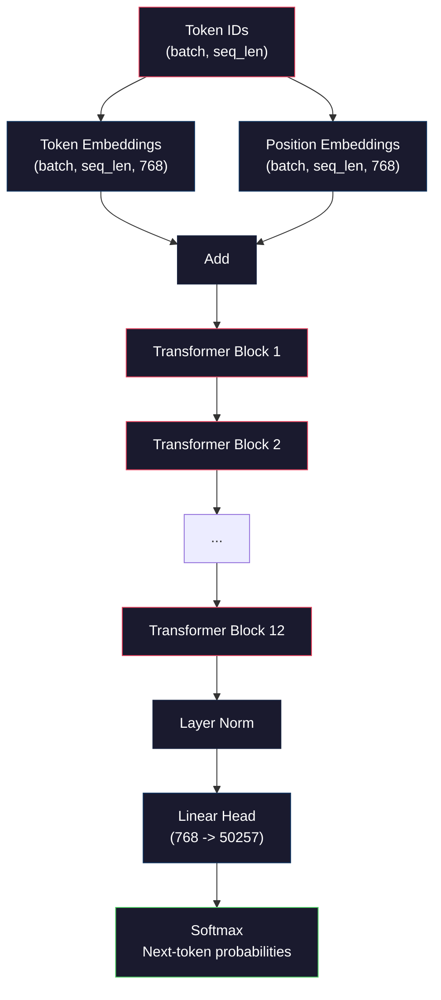
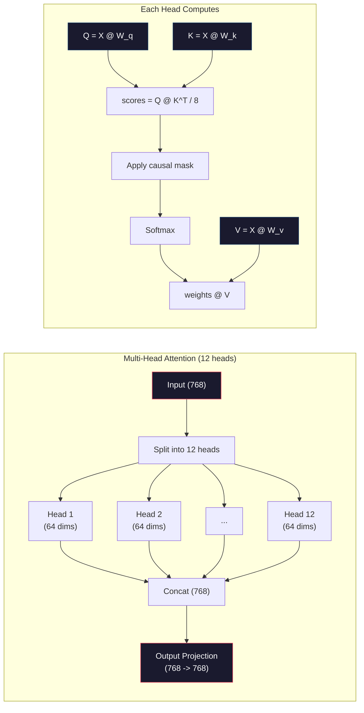
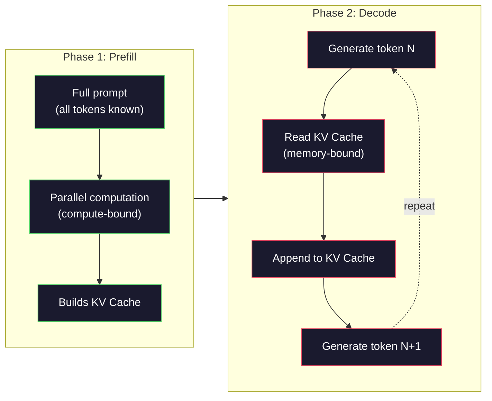

<!-- local-zh-machine-draft: English source is canonical; prose translated automatically, code/math preserved. -->

<a id="pre-training-a-mini-gpt-124m-parameters"></a>

# 预训练Mini GPT (124M Parameters)

> GPT-2小型拥有1.24亿个parameters。即 12 个 transformer 层、12 个 attention 头和 768 维 embeddings。您可以在几个小时内在单个 GPU 上从头开始训练它。大多数人从来不这样做。他们使用预先训练的 checkpoints。但是，如果您自己不训练模型，您实际上就无法了解您正在构建产品的模型内部发生了什么。

**类型：** 构建
**语言：** Python（与numpy）
**先决条件：** 第 10 阶段，第 01-03 课（Tokenizers，构建 Tokenizer，数据管道）
**时间：** ~120 分钟

<a id="learning-objectives"></a>

## 学习目标

- 从头开始实现完整的GPT-2架构（124M parameters）：token embeddings、位置embeddings、transformer块和语言模型头
- 使用带有 cross-entropy 损失的 next-token 预测在文本语料库上训练 GPT 模型
- 使用 temperature sampling 和 top-k/top-p 过滤实现 autoregressive 文本生成
- 监控训练损失曲线并验证模型是否学习连贯的语言模式

<a id="the-problem"></a>

## 问题

您知道 transformer 是什么。您已经阅读了图表。您可以背诵“attention is all you need”并在白板上画出标有“Multi-Head Attention”的方框。

这些都不意味着您了解模型生成文本时会发生什么。

GPT-2 Small 中有 124,438,272 个 parameters（与 weight 捆绑）。其中每一个都是通过运行训练循环来设置的：forward pass，计算损失，backward pass，更新weights。十二个 transformer 块。每块有十二个 attention 头。 768维embedding空间。 50,257 个 tokens 的 vocabulary。每次模型生成 token 时，所有 1.24 亿个 parameters 都会参与单个矩阵乘法链，该链采用一系列 token ID 并生成下一个 token 的概率分布。

如果您从未自己构建过这个，那么您正在使用黑匣子。您可以使用API。你可以微调一下。但是，当出现问题时——当模型产生幻觉时、当它重复自身时、当它拒绝遵循指令时——你就没有 *why* 的心理模型。

本课程从头开始构建 GPT-2 Small。不在 PyTorch 中。在numpy。每个矩阵乘法都是可见的。每个 gradient 都是由您的代码计算的。您将准确地看到 1.24 亿个数字如何共同预测下一个单词。

<a id="the-concept"></a>

## 概念

<a id="the-gpt-architecture"></a>

### GPT架构

GPT 是 autoregressive 语言模型。 “Autoregressive”表示它一次生成一个token，每个都以所有之前的tokens为条件。该架构是 transformer decoder 块的堆栈。

以下是从 token ID 到下一个 token 概率的完整计算图：

1. Token ID 进来。形状：（batch_size，seq_len）。
2. Token embedding 查找。每个 ID 映射到一个 768 维向量。形状：（b​​atch_size，seq_len，768）。
3. 定位 embedding 查找。每个位置 (0, 1, 2, ...) 映射到一个 768 维向量。形状相同。
4. 添加 token embeddings + 持仓 embeddings。
5. 通过12个transformer块。
6. 最后一层 normalization。
7. 线性投影到 vocabulary 尺寸。形状：（b​​atch_size，seq_len，vocab_size）。
8. Softmax 获取概率。

这就是整个模型。 没有卷积。 没有复发。 只是embeddings,attention、前馈网络和层规范堆叠 12 次。



<a id="the-transformer-block"></a>

### Transformer 块

12 个区块均遵循相同的模式。 Pre-norm架构（GPT-2使用pre-norm，而不是像原始transformer那样使用post-norm）：

1. LayerNorm
2. 多头 Self-Attention
3. 剩余连接（添加回输入）
4. LayerNorm
5. 前馈网络 (MLP)
6. 剩余连接（添加回输入）

剩余连接至关重要。如果没有它们，gradients 在 backpropagation 期间到达区块 1 时就会消失。有了它们，gradients 可以通过“跳过”路径直接从损失流到任何层。这就是为什么你可以堆叠 12 个、32 个甚至 96 个块（据传 GPT-4 使用 120 个）。

<a id="attention-the-core-mechanism"></a>

### Attention：核心机制

Self-attention让每个token看看以前的每一个token并决定对每一项的关注程度。 这是数学。

对于每个 token 位置，根据输入计算三个向量：
- **Query (Q)**：“我在寻找什么？”
- **Key (K)**：“我包含什么？”
- **Value (V)**：“我携带什么信息？”

```
Q = input @ W_q    (768 -> 768)
K = input @ W_k    (768 -> 768)
V = input @ W_v    (768 -> 768)

attention_scores = Q @ K^T / sqrt(d_k)
attention_scores = mask(attention_scores)   # causal mask: -inf for future positions
attention_weights = softmax(attention_scores)
output = attention_weights @ V
```

因果掩码是 GPT autoregressive 的组成部分。位置 5 可以处理位置 0-5，但不能处理位置 6、7、8 等。这可以防止模型在训练期间通过查看未来的 tokens 来“作弊”。

**多头 attention** 将 768 维空间分割成 12 个头，每个头有 64 维。每个头学习不同的 attention 模式。一个头脑可能会跟踪句法关系（主谓一致）。另一个可能会跟踪语义相似性（同义词）。另一个可能会跟踪位置接近度（附近的单词）。所有 12 个头的输出被连接并投影回 768 个维度。



除以 sqrt(d_k) -- sqrt(64) = 8 -- 就是缩放。如果没有它，高维向量的点积会变得很大，将 softmax 推入 gradients 几乎为零的区域。这是原始“Attention Is All You Need”论文中的关键见解之一。

<a id="kv-cache-why-inference-is-fast"></a>

### KV Cache：为什么Inference很快

在训练期间，您可以立即处理整个序列。在inference期间，您一次生成一个token。如果不进行优化，生成 token N 需要为所有 N-1 个先前的 tokens 重新计算 attention。也就是说，每个生成的 token 的时间复杂度为 O(N^2)，或者长度为 N 的序列的总时间复杂度为 O(N^3)。

KV Cache 解决了这个问题。计算每个token的K和V后，存储它们。当生成token N+1时，只需计算新的token的Q，并从所有先前的tokens中查找缓存的K和V。这将 K 和 V 计算的每 token 成本从 O(N) 降低到 O(1)。 attention 分数计算仍然是 O(N)，因为您关注所有先前的位置，但避免了输入上的冗余矩阵乘法。

对于具有 12 层和 12 个头的 GPT-2，KV cache 每个 token 存储 2 (K + V) x 12 层 x 12 头 x 64 个暗淡 = 18,432 个值。对于 1024-token 序列，在 FP32 中大约为 75MB。对于128层的Llama 3 405B，单个序列的KV cache可以超过10GB。这就是长上下文 inference 受内存限制的原因。

<a id="prefill-vs-decode-two-phases-of-inference"></a>

### Prefill 与解码：Inference 的两个阶段

当您将 prompt 发送到 LLM 时，inference 会发生在两个不同的阶段。

**Prefill** 并行处理整个 prompt。所有 tokens 都是已知的，因此模型可以同时计算所有位置的 attention。此阶段受计算限制 - GPU 正在以全吞吐量进行矩阵乘法。对于 A100 上的 1000-token prompt，prefill 大约需要 20-50ms。

**Decode** 一次生成一个 tokens。每个新的 token 都依赖于所有之前的 tokens。此阶段受内存限制 - 瓶颈是从 GPU 内存中读取模型 weights 和 KV cache，而不是矩阵数学本身。 GPU 的计算核心大部分时间处于空闲状态，等待内存读取。对于 GPT-2，无论 matmul 需要多少 FLOP，每个解码步骤都需要大约相同的时间，因为内存带宽是约束。

这种区别对于生产系统很重要。 Prefill 吞吐量随 GPU 计算而扩展（更多 FLOPS = 更快的 prefill）。解码吞吐量随内存带宽变化（更快的内存 = 更快的解码）。这就是为什么 NVIDIA 的 H100 专注于对 A100 的内存带宽改进——它直接加速了 token 的生成。



<a id="the-training-loop"></a>

### 训练循环

训练 LLM 是下一个 token 预测。给定 tokens [0, 1, 2, ..., N-1]，预测 tokens [1, 2, 3, ..., N]。 loss function 是模型预测概率分布与实际下一个 token 之间的 cross-entropy。

一步训练：

1. **Forward pass**：通过所有 12 个块运行批处理。获取每个位置的 logits（softmax 之前的分数）。
2. **计算损失**：logits和目标tokens之间的Cross-entropy（输入移动一位）。
3. **Backward pass**：使用backpropagation计算所有124M parameters的gradients。
4. **Optimizer 步骤**：更新weights。 GPT-2 使用 Adam 和 learning rate warmup 和余弦衰减。

learning rate schedule 的重要性超出您的想象。 GPT-2 在前 2,000 个步骤中从 0 升温到峰值 learning rate，然后按照余弦曲线衰减。从较高的 learning rate 开始会导致模型发散。保持恒定的高速率会导致后期训练中的振荡。每个主要的 LLM 都使用 warmup-then-decay 模式。

<a id="gpt-2-small-the-numbers"></a>

### GPT-2 小号：数字

| 组件 | 形状 | Parameters |
|-----------|-------|------------|
| Token embeddings | (50257, 768) | 38,597,376 |
| 位置 embeddings | (1024, 768) | 786,432 |
| 每块 attention (W_q、W_k、W_v、W_out) | 4×（768、768） | 2,359,296 |
| 每块 FFN（向上 + 向下） | (768, 3072) + (3072, 768) | 4,718,592 |
| 每块 LayerNorms (2x) | 2×768×2 | 3,072 |
| 最终LayerNorm | 768×2 | 1,536 |
| **每块总计** | | **7,080,960** |
| **共（12块）** | | **85,054,464 + 39,383,808 = 124,438,272** |

输出投影（logits 头）与 token embedding 矩阵共享 weights。这称为 weight 捆绑 - 它将 parameter 计数减少 38M 并提高性能，因为它强制模型对输入和输出使用相同的表示空间。

<a id="build-it"></a>

## 动手实现

<a id="step-1-embedding-layer"></a>

### 步骤1：Embedding层

Token embeddings 将 50,257 个可能的 tokens 中的每一个映射到 768 维向量。位置 embeddings 添加有关每个 token 在序列中的位置的信息。两者相加。

```python
import numpy as np

class Embedding:
    def __init__(self, vocab_size, embed_dim, max_seq_len):
        self.token_embed = np.random.randn(vocab_size, embed_dim) * 0.02
        self.pos_embed = np.random.randn(max_seq_len, embed_dim) * 0.02

    def forward(self, token_ids):
        seq_len = token_ids.shape[-1]
        tok_emb = self.token_embed[token_ids]
        pos_emb = self.pos_embed[:seq_len]
        return tok_emb + pos_emb
```

初始化的 0.02 标准差来自 GPT-2 论文。太大，初始 forward passes 会产生破坏训练稳定性的极端值。太小并且所有输入的初始输出几乎相同，使得早期的 gradient 信号毫无用处。

<a id="step-2-self-attention-with-causal-mask"></a>

### 步骤 2：带有因果掩码的 Self-Attention

单头attention第一。因果掩码将 softmax 之前的未来位置设置为负无穷大，确保每个位置只能处理其自身和之前的位置。

```python
def attention(Q, K, V, mask=None):
    d_k = Q.shape[-1]
    scores = Q @ K.transpose(0, -1, -2 if Q.ndim == 4 else 1) / np.sqrt(d_k)
    if mask is not None:
        scores = scores + mask
    weights = np.exp(scores - scores.max(axis=-1, keepdims=True))
    weights = weights / weights.sum(axis=-1, keepdims=True)
    return weights @ V
```

softmax 实现在求幂之前减去最大值。如果没有这个，exp(large_number)就会溢出到无穷大。这是一个数值稳定性技巧，不会改变输出，因为对于任何常数 c，softmax(x - c) = softmax(x)。

<a id="step-3-multi-head-attention"></a>

### 步骤3：多头Attention

将 768 维输入拆分为 12 个头，每个头有 64 维。每个头独立计算attention。连接结果并投影回 768 维。

```python
class MultiHeadAttention:
    def __init__(self, embed_dim, num_heads):
        self.num_heads = num_heads
        self.head_dim = embed_dim // num_heads
        self.W_q = np.random.randn(embed_dim, embed_dim) * 0.02
        self.W_k = np.random.randn(embed_dim, embed_dim) * 0.02
        self.W_v = np.random.randn(embed_dim, embed_dim) * 0.02
        self.W_out = np.random.randn(embed_dim, embed_dim) * 0.02

    def forward(self, x, mask=None):
        batch, seq_len, d = x.shape
        Q = (x @ self.W_q).reshape(batch, seq_len, self.num_heads, self.head_dim).transpose(0, 2, 1, 3)
        K = (x @ self.W_k).reshape(batch, seq_len, self.num_heads, self.head_dim).transpose(0, 2, 1, 3)
        V = (x @ self.W_v).reshape(batch, seq_len, self.num_heads, self.head_dim).transpose(0, 2, 1, 3)

        scores = Q @ K.transpose(0, 1, 3, 2) / np.sqrt(self.head_dim)
        if mask is not None:
            scores = scores + mask
        weights = np.exp(scores - scores.max(axis=-1, keepdims=True))
        weights = weights / weights.sum(axis=-1, keepdims=True)
        attn_out = weights @ V

        attn_out = attn_out.transpose(0, 2, 1, 3).reshape(batch, seq_len, d)
        return attn_out @ self.W_out
```

重塑-转置-重塑舞蹈是多头attention中最令人困惑的部分。发生的情况如下： (batch, seq_len, 768) tensor 变为 (batch, seq_len, 12, 64)，然后 (batch, 12, seq_len, 64）。现在，12 个头中的每一个都有自己的 (seq_len, 64) 矩阵来运行 attention。 attention 之后，我们反转该过程： (batch, 12, seq_len, 64) 变为 (batch, seq_len, 12, 64) 变为 (batch, seq_len, 768）。

<a id="step-4-transformer-block"></a>

### 步骤4：Transformer区块

一个完整的 transformer 块：LayerNorm，带残差的多头 attention，LayerNorm，带残差的前馈。

```python
class LayerNorm:
    def __init__(self, dim, eps=1e-5):
        self.gamma = np.ones(dim)
        self.beta = np.zeros(dim)
        self.eps = eps

    def forward(self, x):
        mean = x.mean(axis=-1, keepdims=True)
        var = x.var(axis=-1, keepdims=True)
        return self.gamma * (x - mean) / np.sqrt(var + self.eps) + self.beta


class FeedForward:
    def __init__(self, embed_dim, ff_dim):
        self.W1 = np.random.randn(embed_dim, ff_dim) * 0.02
        self.b1 = np.zeros(ff_dim)
        self.W2 = np.random.randn(ff_dim, embed_dim) * 0.02
        self.b2 = np.zeros(embed_dim)

    def forward(self, x):
        h = x @ self.W1 + self.b1
        h = np.maximum(0, h)  # GELU approximation: ReLU for simplicity
        return h @ self.W2 + self.b2


class TransformerBlock:
    def __init__(self, embed_dim, num_heads, ff_dim):
        self.ln1 = LayerNorm(embed_dim)
        self.attn = MultiHeadAttention(embed_dim, num_heads)
        self.ln2 = LayerNorm(embed_dim)
        self.ffn = FeedForward(embed_dim, ff_dim)

    def forward(self, x, mask=None):
        x = x + self.attn.forward(self.ln1.forward(x), mask)
        x = x + self.ffn.forward(self.ln2.forward(x))
        return x
```

前馈网络将 768 维输入扩展到 3,072 维 (4x)，应用非线性，然后投影回 768。这种扩展-收缩模式为模型提供了“更广泛”的内部表示，可以在每个位置使用。 GPT-2 使用 GELU 激活，但为了简单起见，我们在这里使用 ReLU ——对于理解架构来说，差异很小。

<a id="step-5-full-gpt-model"></a>

### 第5步：完整的GPT模型

堆栈 12 个 transformer 块。在前面添加 embedding 层，在后面添加输出投影。

```python
class MiniGPT:
    def __init__(self, vocab_size=50257, embed_dim=768, num_heads=12,
                 num_layers=12, max_seq_len=1024, ff_dim=3072):
        self.embedding = Embedding(vocab_size, embed_dim, max_seq_len)
        self.blocks = [
            TransformerBlock(embed_dim, num_heads, ff_dim)
            for _ in range(num_layers)
        ]
        self.ln_f = LayerNorm(embed_dim)
        self.vocab_size = vocab_size
        self.embed_dim = embed_dim

    def forward(self, token_ids):
        seq_len = token_ids.shape[-1]
        mask = np.triu(np.full((seq_len, seq_len), -1e9), k=1)

        x = self.embedding.forward(token_ids)
        for block in self.blocks:
            x = block.forward(x, mask)
        x = self.ln_f.forward(x)

        logits = x @ self.embedding.token_embed.T
        return logits

    def count_parameters(self):
        total = 0
        total += self.embedding.token_embed.size
        total += self.embedding.pos_embed.size
        for block in self.blocks:
            total += block.attn.W_q.size + block.attn.W_k.size
            total += block.attn.W_v.size + block.attn.W_out.size
            total += block.ffn.W1.size + block.ffn.b1.size
            total += block.ffn.W2.size + block.ffn.b2.size
            total += block.ln1.gamma.size + block.ln1.beta.size
            total += block.ln2.gamma.size + block.ln2.beta.size
        total += self.ln_f.gamma.size + self.ln_f.beta.size
        return total
```

请注意 weight 绑定：`logits = x @ self.embedding.token_embed.T`。输出投影重用 token embedding 矩阵（转置）。这不仅仅是 parameter 的保存技巧。这意味着模型使用相同的向量空间来理解 tokens (embeddings) 并预测它们（输出）。

<a id="step-6-training-loop"></a>

### 第 6 步：训练循环

要在 124M parameters 上进行真正的训练，您需要 GPU 和 PyTorch。此训练循环演示了在纯 numpy 中运行的小型模型的机制。我们使用一个微型模型（4 层、4 个头、128 个暗淡）来使其易于处理。

```python
def cross_entropy_loss(logits, targets):
    batch, seq_len, vocab_size = logits.shape
    logits_flat = logits.reshape(-1, vocab_size)
    targets_flat = targets.reshape(-1)

    max_logits = logits_flat.max(axis=-1, keepdims=True)
    log_softmax = logits_flat - max_logits - np.log(
        np.exp(logits_flat - max_logits).sum(axis=-1, keepdims=True)
    )

    loss = -log_softmax[np.arange(len(targets_flat)), targets_flat].mean()
    return loss


def train_mini_gpt(text, vocab_size=256, embed_dim=128, num_heads=4,
                   num_layers=4, seq_len=64, num_steps=200, lr=3e-4):
    tokens = np.array(list(text.encode("utf-8")[:2048]))
    model = MiniGPT(
        vocab_size=vocab_size, embed_dim=embed_dim, num_heads=num_heads,
        num_layers=num_layers, max_seq_len=seq_len, ff_dim=embed_dim * 4
    )

    print(f"Model parameters: {model.count_parameters():,}")
    print(f"Training tokens: {len(tokens):,}")
    print(f"Config: {num_layers} layers, {num_heads} heads, {embed_dim} dims")
    print()

    for step in range(num_steps):
        start_idx = np.random.randint(0, max(1, len(tokens) - seq_len - 1))
        batch_tokens = tokens[start_idx:start_idx + seq_len + 1]

        input_ids = batch_tokens[:-1].reshape(1, -1)
        target_ids = batch_tokens[1:].reshape(1, -1)

        logits = model.forward(input_ids)
        loss = cross_entropy_loss(logits, target_ids)

        if step % 20 == 0:
            print(f"Step {step:4d} | Loss: {loss:.4f}")

    return model
```

损失从 ln(vocab_size) 附近开始——对于 256-token 字节级 vocabulary，即 ln(256) = 5.55。随机模型为每个 token 分配相同的概率。随着训练的进行，损失会下降，因为模型学会了预测常见模式：“t”后面的“th”、句号后面的空格等等。

在生产中，您可以将 Adam optimizer 与 gradient accumulation、learning rate、warmup 和 gradient clipping 一起使用。前向传递-损失-后向更新循环是相同的。 optimizer 更为复杂。

<a id="step-7-text-generation"></a>

### 第7步：文本生成

Generation 使用经过训练的模型一次预测一个 token。每个预测都是从输出分布中采样的（或贪婪地作为 argmax）。

```python
def generate(model, prompt_tokens, max_new_tokens=100, temperature=0.8):
    tokens = list(prompt_tokens)
    seq_len = model.embedding.pos_embed.shape[0]

    for _ in range(max_new_tokens):
        context = np.array(tokens[-seq_len:]).reshape(1, -1)
        logits = model.forward(context)
        next_logits = logits[0, -1, :]

        next_logits = next_logits / temperature
        probs = np.exp(next_logits - next_logits.max())
        probs = probs / probs.sum()

        next_token = np.random.choice(len(probs), p=probs)
        tokens.append(next_token)

    return tokens
```

Temperature 控制随机性。 Temperature 1.0 使用原始发行版。 Temperature 0.5 使其更加清晰（更具确定性——模型更频繁地选择其最佳选择）。 Temperature 1.5 将其压平（更加随机——低概率的 tokens 获得更大的机会）。 Temperature 0.0 是贪婪解码（始终选择最高概率的 token）。

`tokens[-seq_len:]` 窗口是必需的，因为模型具有最大上下文长度（GPT-2 为 1024）。一旦超过，则必须删除最旧的 tokens。这就是大家谈论的“context window”。

```figure
sampling-decoder
```

<a id="use-it"></a>

## 实际应用

<a id="full-training-and-generation-demo"></a>

### 完整的训练和生成演示

```python
corpus = """The transformer architecture has revolutionized natural language processing.
Attention mechanisms allow the model to focus on relevant parts of the input.
Self-attention computes relationships between all pairs of positions in a sequence.
Multi-head attention splits the representation into multiple subspaces.
Each attention head can learn different types of relationships.
The feedforward network provides nonlinear transformations at each position.
Residual connections enable gradient flow through deep networks.
Layer normalization stabilizes training by normalizing activations.
Position embeddings give the model information about token ordering.
The causal mask ensures autoregressive generation during training.
Pre-training on large text corpora teaches the model general language understanding.
Fine-tuning adapts the pre-trained model to specific downstream tasks."""

model = train_mini_gpt(corpus, num_steps=200)

prompt = list("The transformer".encode("utf-8"))
output_tokens = generate(model, prompt, max_new_tokens=100, temperature=0.8)
generated_text = bytes(output_tokens).decode("utf-8", errors="replace")
print(f"\nGenerated: {generated_text}")
```

在具有小模型的小语料库上，生成的文本最多是半连贯的。它将从训练文本中学习一些字节级模式，但无法概括 GPT-2 使用 40GB 训练数据和完整 124M parameter 架构的方式。重点不是输出质量。重点是，您可以 trace 每一步：embedding 查找、attention 计算、前馈变换、logit 投影、softmax 和 sampling。每个操作都是可见的。

<a id="ship-it"></a>

## 交付成果

本课程生成 `outputs/prompt-gpt-architecture-analyzer.md`——一个 prompt，它分析任何 GPT 样式模型中的架构选择。向其提供 model card 或技术报告，它会分解 parameter 分配、attention 设计和扩展决策。

<a id="exercises"></a>

## 练习

1. 修改模型以使用 24 层和 16 个头，而不是 12/12。数parameters。深度加倍与宽度加倍（embedding 尺寸）相比如何？

2. 实现 GELU activation function (GELU(x) = x * 0.5 * (1 + erf(x / sqrt(2)))) 并替换前馈网络中的 ReLU。每次激活运行 500 步的训练并比较最终损失。

3. 将 KV cache 添加到生成函数中。在第一个 forward pass 之后的每一层存储 K 和 V tensors，并在后续的 tokens 中重复使用它们。测量加速比：在有和没有缓存的情况下生成 200 tokens 并比较挂钟时间。

4. 实现top-k sampling（仅考虑k个最高概率tokens）和top-p sampling（nucleus sampling：考虑累积概率超过p的tokens的最小集合）。比较 temperature 0.8 时 top-k=50 与 top-p=0.95 的输出质量。

5. 构建训练损失曲线绘图仪。训练模型 1000 步并绘制损失与步数的关系图。确定三个阶段：快速初始下降（学习常见字节）、较慢的中间阶段（学习字节模式）和平稳阶段（小语料库上的 overfitting）。无论您训练的是 128 维模型还是 GPT-4，这条曲线的形状都是相同的。

<a id="key-terms"></a>

## 关键术语

| 术语 | 人们怎么说 | 它实际上意味着什么 |
|------|----------------|----------------------|
| Autoregressive | “它一次生成一个单词” | 每个输出 token 都以所有之前的 tokens 为条件——模型预测 P(token_n \| token_0, ...,代币_{n-1}) |
| 因果面具 | “它看不到未来” | 无穷大值的上三角矩阵，可防止 attention 在训练期间到达未来位置 |
| 多头 attention | “多个 attention 模式” | 将 Q、K、V 拆分为平行头（例如，GPT-2 的 12 个头，每个头 64 个维度），以便每个头可以学习不同的关系类型 |
| KV Cache | “缓存以提高速度” | 存储先前 tokens 计算出的键和值 tensors 以避免 autoregressive 生成期间的冗余计算 |
| Prefill | “处理 prompt” | 第一个 inference 阶段，所有 prompt tokens 并行处理——在 GPU FLOPS 上进行计算限制 |
| 解码 | “正在生成tokens” | 第二个 inference 阶段，一次生成一个 tokens——GPU 带宽上的内存限制 |
| Weight 捆绑 | “分享embeddings” | 对输入 token embeddings 和输出投影头使用相同的矩阵——在 GPT-2 中保存 38M 参数 |
| 剩余连接 | “跳过连接” | 将输入直接添加到子层的输出 (x + sublayer(x)) - 启用深度网络中的 gradient 流 |
| 层 normalization | “激活正常化” | 将 feature 维度标准化为均值 0 和方差 1，具有可学习的尺度和偏差 parameters |
| Cross-entropy 损失 | “预测有多么错误” | -log（分配给正确的下一个 token 的概率），对所有位置进行平均——标准 LLM 训练目标 |

<a id="further-reading"></a>

## 进一步阅读

- [Radford et al., 2019 -- “语言模型是无监督多任务学习者” (GPT-2)](https://cdn.openai.com/better-language-models/language_models_are_unsupervised_multitask_learners.pdf) -- GPT-2 论文介绍了124M 转 1.5B parameter 系列
- [Vaswani 等人，2017 --“Attention Is All You Need”](https://arxiv.org/abs/1706.03762) --带有缩放点积的原始 transformer 论文attention 和多头 attention
- [Llama 3 技术报告](https://arxiv.org/abs/2407.21783) -- Meta 如何将 GPT 架构扩展到 405B parameters 16K GPUs
- [Pope 等人，2022 年——“高效扩展 Transformer Inference”](https://arxiv.org/abs/2211.05102)——正式化 prefill 的论文vs 解码和 KV cache 分析
