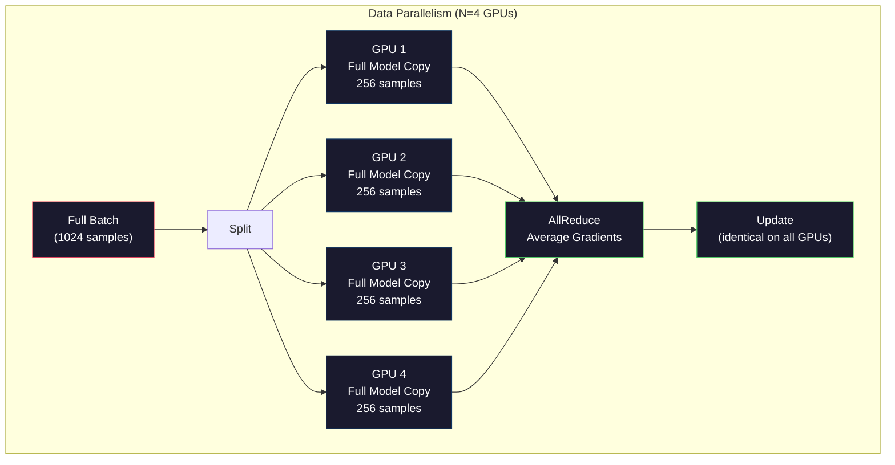
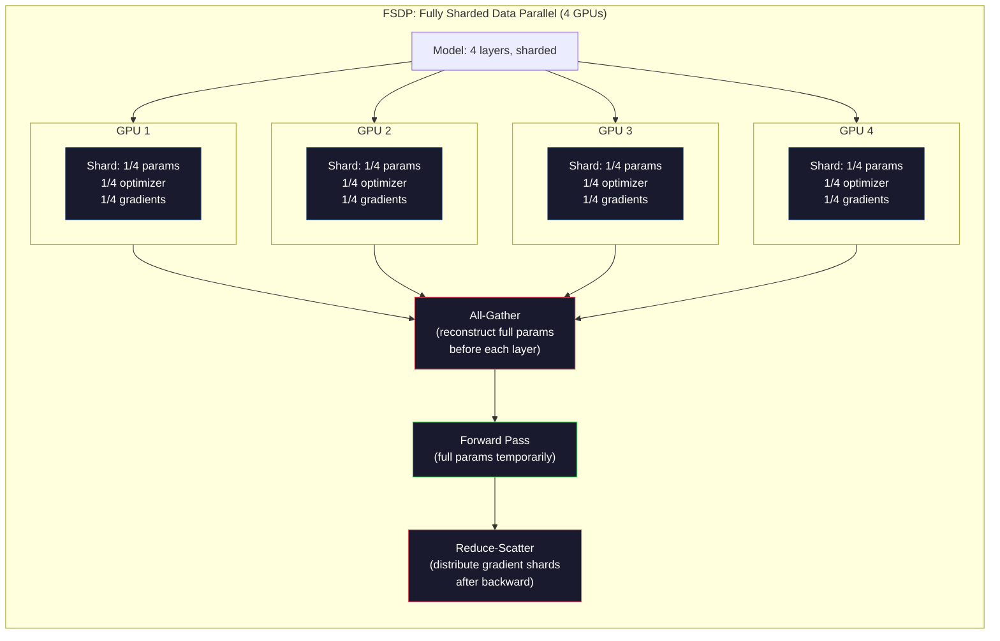
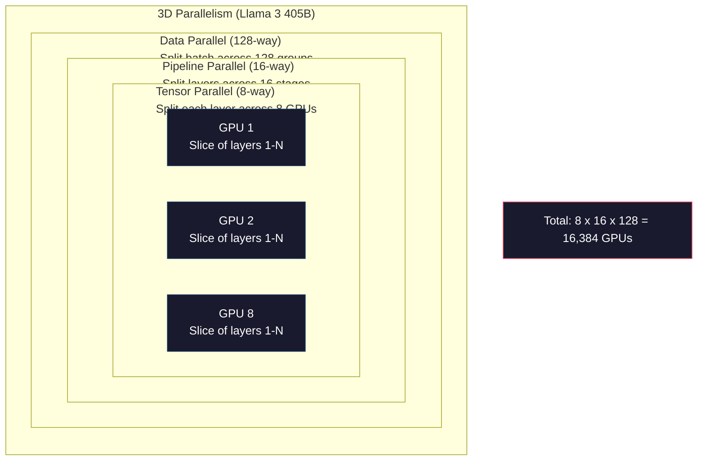

<!-- local-zh-machine-draft: English source is canonical; prose translated automatically, code/math preserved. -->

<a id="scaling-distributed-training-fsdp-deepspeed"></a>

# 扩展：分布式训练、FSDP、DeepSpeed

> 您的 124M 模型在一台 GPU 上进行训练。现在尝试70亿parameters。该模型不适合内存。这些数据在一台机器上需要几周的时间。大规模分布式训练不是可选的。这是唯一的前进道路。

**类型：** 构建
**语言：** Python
**先决条件：** 第 10 阶段，第 04 课（预训练迷你 GPT）
**时间：** ~120分钟

<a id="learning-objectives"></a>

## 学习目标

- 根据模型和集群大小解释三种类型的并行性（数据、tensor、管道）以及何时需要每种并行性
- 使用 PyTorch DDP 和 gradient 跨多个 GPUs 同步实现数据并行训练
- 计算给定模型大小的内存预算（weights + optimizer 状态 + gradients + 激活）以确定最小硬件
- 配置 FSDP 或 DeepSpeed ZeRO 阶段以跨 GPUs 分片模型状态并适合超过单 GPU 内存的模型

<a id="the-problem"></a>

## 问题

FP16 中的 7B parameter 模型需要 14GB 仅用于 weights。 Adam optimizer 存储每个 parameter 的两个附加副本（第一和第二矩估计）。那是另外 28GB。 Gradients 在 backpropagation 期间增加了 14GB。在存储单个激活之前，您的空间为 56GB。

NVIDIA A100 具有 80GB 内存。

已消耗 80GB 中的 56GB。这留下了 24GB 用于激活——在 forward pass 期间计算的中间值，必须为 backpropagation 保持活动状态。对于具有 4096 维模型的 2048-token 序列，单个层的激活使用大约 64MB。对于 32 层，每个样本需要 2GB。 8 的 batch size 需要 16GB。你有24GB。 12个batch size炸毁。

现在尝试 70B parameters。 Weights 单独：FP16 中 140GB。不适用于一台 GPU。您至少需要 2 个 A100 (2 x 80GB = 160GB) 才能容纳 weights。添加 optimizer 状态和 gradients，您需要更多：最少 3+ GPUs，实际上 8-16 个，具体取决于分片策略。

Llama 3 405B 在 16,384 个 NVIDIA H100 GPUs 上进行训练。训练运行的计算成本估计为 1 亿美元。 DeepSeek V3 通过巧妙地利用架构（专家混合意味着每个 token 只激活 parameters 的一小部分）和训练效率，花费大约 560 万美元训练了一个类似的模型。

本课程涵盖了使大规模训练成为可能的四种策略：数据并行、tensor parallelism、pipeline parallelism 和完全分片数据并行。在接触分布式训练框架之前，您将在纯 Python 中模拟每一个，以了解其机制。

<a id="the-concept"></a>

## 概念

<a id="why-distribution-is-required"></a>

### 为什么需要分发

这是真实模型的内存数学。每个数字都是计算出来的，而不是估计的。

| 模型 | 参数 | Weights (FP16) | Adam 状态 | Gradients (FP16) | 总计（无激活） |
|-------|--------|----------------|-------------|------------------|----------------------|
| GPT-2 小号 | 124M | 248MB | 992MB | 248MB | 1.5GB |
| Llama 3 8B | 8B | 16GB | 64GB | 16GB | 96GB |
| Llama 3 70B | 70B | 140GB | 560GB | 140GB | 840GB |
| Llama 3 405B | 405B | 810GB | 3,240 GB | 810GB | 4,860 GB |

“Adam States”栏是杀手。 Adam 存储每个 parameter 的运行平均值 (m) 和运行方差 (v)，两者都在 FP32 中。对于 70B 型号，即 70B x 4 字节 x 2 = 560GB。仅 optimizer 就需要七台 A100。

单个H100有80GB。 Llama 3 405B 需要至少 61 个 H100 来保存 weights、optimizer 和 gradients。添加激活，数量会进一步增长。 Meta 使用 16,384 GPUs 不是因为他们想这样做，而是因为他们不得不这样做。

<a id="data-parallelism"></a>

### 数据并行性

最简单的分布式策略。将整个模型复制到 N GPUs。将每个训练批次分成 N 个相等的部分。每个 GPU 在其数据分片上运行转发和 backward pass。在 backward pass 之后，对所有 GPUs 中的 gradients 进行平均。每个 GPU 都使用相同的平均值 gradients 更新其 weights 的副本，从而保持所有副本同步。

** 好的：** 线性吞吐量缩放。 N GPUs 每步处理 N 倍的数据。通信仅限于 gradient 平均，与计算重叠。

** 坏处：** 每个 GPU 都持有模型的完整副本，optimizer 声明，以及 gradients。对于 70B 型号，每个 GPU 需要 840GB。数据并行性不会减少每 GPU 内存。它只会减少训练时间。

**数学：** 有效 batch size = per_gpu_batch_size x N。对于 N=64 GPUs 每 GPU 批次为 16 个，有效批次为 1,024 个。 Llama 3 每步使用了 1600 万个 tokens 的有效 batch size。



<a id="tensor-parallelism"></a>

### Tensor Parallelism

在 GPUs 上分割各个层。单个矩阵乘法被划分为GPUs，每个计算部分的结果。

考虑前馈层中形状为 (8192, 8192) 的 weight 矩阵。对于4路tensor parallelism，每个GPU持有一个（8192, 2048）分片。每个 GPU 将输入与其分片相乘，产生部分结果。部分结果被组合（通过 all-reduce 或 all-gather）以产生完整的输出。

**好的：** 减少模型 weights 的每个 GPU 内存。 70B 模型分为 8 个 GPUs，意味着每个 GPU 持有约 8.75B parameters 价值的 weights。

** 坏处：** 每一层之后都需要快速的内部 GPU 通信。每个 matmul 之后的 all-reduce 会增加延迟。这适用于 NVLink（同一节点上的 GPUs 之间为 900 GB/s），但在 InfiniBand 连接的节点之间效果不佳（400 Gb/s，约 50 GB/s）。 Tensor parallelism 几乎总是限制在单个节点内 (8 GPUs)。

**真实用法：**威震天-LM首创tensor parallelism。 Llama 3 405B 在每个节点内使用 8 路 tensor parallelism。

<a id="pipeline-parallelism"></a>

### Pipeline Parallelism

按层分割模型。 GPU1 运行第 1-8 层。 GPU2 次运行第 9-16 层。 GPU3 次运行第 17-24 层。 GPU4 次运行第 25-32 层。 数据流经管道：GPU1 计算其层并将激活发送到GPU2，计算其层并发送到GPU3、等等。

**好的：** GPUs之间的最小通信——只是层边界处的激活，与gradients或weights相比很小。由于带宽要求较低，因此可以跨节点工作。

** 不良：** 管道有气泡。当 GPU 4 在微批次 1 上计算 forward pass 时，GPUs 1、2 和 3 空闲（它们已经转发了自己的部分）。在 backward pass 期间，模式相反。对于简单的流水线，GPU 对于 N 个流水线阶段的利用率仅为 1/N。

**GPipe 和管道梦想** 将批量分成小巴 解决泡沫问题 GPU 1个在微型插头2号上开始,一旦它完成传输微型插头1号,就会在管道各个阶段进行重叠计算。用M微型插头和N级来计算,泡沫碎片会下降到(N-1)/M级。使用M=16型带有N=4级的微型插头,而泡沫是3/16 = 18.75%闲置时间。

<a id="fsdp-fully-sharded-data-parallel"></a>

### FSDP: 完全碎片数据平行

FSDP 将数据平行的可缩放性与断裂的内存效率结合起来。 GPU 每个都持有模型的完整副本 GPU 仅持有 parameters, gradients, 和 optimizer 州级。

在一层楼之前 forward passFSDP 运行 **all-gather** 收集全部数据 parameters 全部来自 GPUs 进入每个 GPU记忆 之后 forward pass, 每个 GPU 丢弃非本地 parameters。在后向,全采集者再次运行以重建 parameters 用于 gradient 计算。 backward pass, 一个 **reduce-scatter** distributes gradient 碎片,所以每个 GPU 仅存储 gradients.

**70B模型8号的数学 GPUs:**

| 组件 | 没有FSDP | 与FSDP合作 |
|-----------|-------------|-----------|
| Weights (FP16) 国家 | 140 GB 每 GPU | 17.5英镑/ GPU |
| Adam 州(FP32) | 560英镑/ GPU | 70 GB 每 GPU |
| Gradients (FP16) 国家 | 140 GB 每 GPU | 17.5英镑/ GPU |
| **Total** | **840 GB/每 GPU** | **105英镑/ GPU** |

没有FSDP, 你无法在一个 80GB 上安装 70B 模型 GPU与FSDP对8 GPUs, 每个 GPU 使用 105GB - 等等, 仍然不合适。 您至少需要 16 GPUs 低于80GB/每 GPU,或者你把FSDP和 activation checkpointing (在后向期间对激活进行计算,而不是储存)

通信成本比香草数据平行性高,因为每个层之前都是全采集的。 但记忆节约使得以前不可能进行的训练成为可能。



<a id="deepspeed-zero"></a>

### 深波ZeRO

零冗余 Optimizer)在概念上与FSDP相同,但由微软独立开发。

| 舞台 | Shards | 内存节余 | Communication |
|-------|--------|---------------|---------------|
| ZeRO-1 | Optimizer 仅显示状态 | ~4x 减少 | 与数据平行相同 |
| ZeRO-2 | + Gradients | ~8x 减少 | 稍微长一点 |
| ZeRO-3 | + Parameters | ~ Nx 减少 (N) GPUs) | 每层全部采集 |

ZeRO-3相当于FSDP。命名不同，机制是一样的。在 DeepSpeed 证明这一概念后，PyTorch 添加了 FSDP 作为本机实现。

DeepSpeed 还推出了 ZeRO-Offload（将 optimizer 状态卸载到 CPU RAM，后者更便宜、更大）和 ZeRO-Infinity（卸载到 NVMe SSD）。这些以计算速度换取内存容量——卸载操作速度较慢，但​​可以释放 GPU 内存。

<a id="mixed-precision-training"></a>

### Mixed Precision 培训

现代训练同时使用多种浮点格式：

- **Forward pass**：FP16 或 BF16（16 位）。内存是 FP32 的一半。 Matmuls 在 tensor 内核上的运行速度提高了 2 倍。
- **Master weights**：FP32（32位）。由 optimizer 在 weight 更新期间维护数值精度。
- **损耗缩放**：在backward pass之前将损耗乘以一个大常数，以防止FP16 gradients下溢为零。在 optimizer 步骤之前除以相同的常数。

BF16（Brain Float 16）具有与 FP32 相同的指数范围（8 个指数位），但精度降低（7 个尾数位，而 FP32 为 23 个）。它很少需要损失缩放，因为它可以表示相同范围的值。 FP16 有 5 个指数位和 10 个尾数位——它可以表示细粒度的值，但会在极端情况下出现上溢/下溢。

Google 的 TPU 本身使用 BF16。 NVIDIA 的 A100 和 H100 同时支持 FP16 和 BF16。该行业很大程度上已转向 BF16，因为它消除了损失扩展的难题。

**7B型号的内存比较：**

| 精度 | Weights | Optimizer | Gradients | 总计 |
|-----------|---------|-----------|-----------|-------|
| FP32 无处不在 | 28GB | 56GB | 28GB | 112GB |
| 混合（BF16 + FP32 主控） | 14GB | 56GB | 14GB | 84GB |

Mixed precision 在此型号上节省了 28GB。不管怎样，optimizer 状态都保留在 FP32 中——这是大部分内存所在的位置。

<a id="megatron-lm-and-3d-parallelism"></a>

### Megatron-LM 和 3D 并行性

真正的大规模训练结合了所有三个并行性：

- ** 跨节点组的数据并行性**（规模batch size）
- 节点内的 **Tensor parallelism**（跨 8 个 GPUs 的分层）
- **Pipeline parallelism** 跨节点（跨机器分层组）

Llama 3 405B 在 16,384 H100 上：
- 每个节点内8路tensor parallelism（每个节点8个GPUs）
- 跨节点16路pipeline parallelism（16个管道阶段）
- 剩余维度上的 128 路数据并行性 (16,384 / 8 / 16 = 128)

这种 3D 分解 (8 x 16 x 128 = 16,384) 是您扩展到数千个 GPUs 的方法。每个 GPU 看到不同的数据分片（数据并行），保存每层的一个切片（tensor 并行），并计算一组不同的层（管道并行）。

DeepSeek V3采取了不同的方法。他们的专家混合架构仅激活每个 token 671B parameters 中的 37B。这意味着每个 GPU 仅需要计算（并存储激活）活动的 parameters。他们在 2,048 个 H800 GPUs 上进行了训练，不到 Meta 的 GPU 数量的 1/8，花费了 560 万美元，而 Meta 的估计为 1 亿美元。



```figure
paged-kv-cache
```

<a id="build-it"></a>

## 动手实现

<a id="step-1-simulate-data-parallelism"></a>

### 第 1 步：模拟数据并行性

跨模拟 GPUs 拆分批次。每个 GPU 在其分片上计算一个 forward pass。平均“gradients”（我们将它们模拟为损失值）。

```python
import numpy as np

def simulate_data_parallelism(data, num_gpus, model_fn):
    batch_size = len(data)
    shard_size = batch_size // num_gpus
    remainder = batch_size % num_gpus

    gpu_losses = []
    gpu_gradients = []

    offset = 0
    for gpu_id in range(num_gpus):
        extra = 1 if gpu_id < remainder else 0
        shard = data[offset:offset + shard_size + extra]
        offset += shard_size + extra

        loss, grad = model_fn(shard)
        gpu_losses.append(loss)
        gpu_gradients.append(grad)

    avg_loss = np.mean(gpu_losses)
    avg_gradient = np.mean(gpu_gradients, axis=0)

    return avg_loss, avg_gradient
```

全归约操作（平均gradients）是数据并行中唯一的通信。实际上，这使用 NVIDIA GPUs 上的 NCCL 库，该库实现环全归约：每个 GPU 将其 gradients 的 1/N 发送到其邻居，从另一个邻居接收 1/N，并且在 N-1 步后，每个 GPU 具有完整的平均值。总通信量：2 x 梯度 _ 大小 x (N-1)/N，接近大 N 的 gradient 大小的 2 倍。

<a id="step-2-simulate-tensor-parallelism"></a>

### 步骤2：模拟Tensor Parallelism

将 weight 矩阵拆分为 GPUs。每个 GPU 计算部分矩阵乘法。合并结果。

```python
def simulate_tensor_parallelism(input_data, weight_matrix, num_gpus):
    d_in, d_out = weight_matrix.shape
    assert d_out % num_gpus == 0, f"d_out {d_out} not divisible by num_gpus {num_gpus}"
    shard_size = d_out // num_gpus

    partial_results = []
    for gpu_id in range(num_gpus):
        start = gpu_id * shard_size
        end = start + shard_size
        weight_shard = weight_matrix[:, start:end]

        partial = input_data @ weight_shard
        partial_results.append(partial)

    full_output = np.concatenate(partial_results, axis=-1)

    direct_output = input_data @ weight_matrix
    error = np.abs(full_output - direct_output).max()

    return full_output, error
```

误差应该恰好为零（或机器 epsilon）。 Tensor parallelism 在数学上是精确的——它产生的结果与在一个 GPU 上计算完整的 matmul 相同。分割是沿着输出维度进行的，因此每个 GPU 都会生成不同的列块，并且串联会重建完整的结果。

对于列平行线性层（分割输出维度），您可以连接。对于行并行（分割输入维度），您需要求和。在 transformer FFN 中，第一个线性（扩展）使用列并行，第二个线性（收缩）使用行并行。这避免了两层之间的全归约。

<a id="step-3-simulate-pipeline-parallelism"></a>

### 第三步：模拟Pipeline Parallelism

跨虚拟 GPUs 拆分模型层。显示早期阶段闲置而后期阶段计算的泡沫问题。

```python
def simulate_pipeline_parallelism(num_layers, num_stages, num_microbatches):
    layers_per_stage = num_layers // num_stages

    timeline = {}
    clock = 0

    for mb in range(num_microbatches):
        for stage in range(num_stages):
            start_time = max(
                timeline.get((stage, mb - 1, "fwd"), (0, 0))[1] if mb > 0 else 0,
                timeline.get((stage - 1, mb, "fwd"), (0, 0))[1] if stage > 0 else 0,
            )
            end_time = start_time + layers_per_stage
            timeline[(stage, mb, "fwd")] = (start_time, end_time)

    last_fwd_end = max(v[1] for v in timeline.values())

    for mb in range(num_microbatches - 1, -1, -1):
        for stage in range(num_stages - 1, -1, -1):
            deps = [last_fwd_end]
            if mb < num_microbatches - 1 and (stage, mb + 1, "bwd") in timeline:
                deps.append(timeline[(stage, mb + 1, "bwd")][1])
            if stage < num_stages - 1 and (stage + 1, mb, "bwd") in timeline:
                deps.append(timeline[(stage + 1, mb, "bwd")][1])
            start_time = max(deps)
            end_time = start_time + layers_per_stage
            timeline[(stage, mb, "bwd")] = (start_time, end_time)

    total_time = max(v[1] for v in timeline.values())
    compute_time = num_microbatches * num_stages * layers_per_stage * 2
    bubble_fraction = 1.0 - compute_time / (total_time * num_stages)

    return timeline, total_time, bubble_fraction
```

采用 4 个阶段和 1 个微批次，气泡分数为 75%——四分之三的 GPUs 随时闲置。如果有 16 个微批次，则下降至 19% 左右。消除气泡的成本是内存：您必须同时存储所有正在进行的微批次的激活。

<a id="step-4-memory-calculator"></a>

### 第四步：内存计算器

计算训练任何模型大小的确切内存需求。

```python
def memory_calculator(
    params_billions,
    precision_bytes=2,
    optimizer="adam",
    num_gpus=1,
    sharding="none",
    sequence_length=2048,
    batch_size_per_gpu=1,
    hidden_dim=None,
    num_layers=None,
):
    params = params_billions * 1e9

    weight_memory = params * precision_bytes

    if optimizer == "adam":
        optimizer_memory = params * 4 * 2
    elif optimizer == "sgd":
        optimizer_memory = params * 4
    else:
        optimizer_memory = 0

    gradient_memory = params * precision_bytes

    total_no_activation = weight_memory + optimizer_memory + gradient_memory

    if hidden_dim and num_layers:
        activation_per_layer = (
            sequence_length * batch_size_per_gpu * hidden_dim * precision_bytes * 4
        )
        activation_memory = activation_per_layer * num_layers
    else:
        activation_memory = params * precision_bytes * 0.5

    if sharding == "fsdp" or sharding == "zero3":
        weight_memory /= num_gpus
        optimizer_memory /= num_gpus
        gradient_memory /= num_gpus
    elif sharding == "zero2":
        optimizer_memory /= num_gpus
        gradient_memory /= num_gpus
    elif sharding == "zero1":
        optimizer_memory /= num_gpus

    per_gpu_total = weight_memory + optimizer_memory + gradient_memory + activation_memory

    return {
        "params_billions": params_billions,
        "weights_gb": weight_memory / 1e9,
        "optimizer_gb": optimizer_memory / 1e9,
        "gradients_gb": gradient_memory / 1e9,
        "activations_gb": activation_memory / 1e9,
        "per_gpu_total_gb": per_gpu_total / 1e9,
        "total_across_gpus_gb": per_gpu_total * num_gpus / 1e9,
        "fits_on_80gb": per_gpu_total / 1e9 <= 80,
        "num_gpus": num_gpus,
        "sharding": sharding,
    }
```

该计算器回答了每个 ML 工程师都会问的问题：“我需要多少个 GPUs？”输入模型尺寸并查看是否合适。调整分片策略，直到每个 GPU 的总大小降至 80GB 以下。

<a id="step-5-mixed-precision-simulation"></a>

### 步骤5：Mixed Precision模拟

比较 FP32、FP16 和 mixed precision 训练之间的内存使用情况。

```python
def mixed_precision_comparison(params_billions):
    params = params_billions * 1e9

    fp32_weights = params * 4
    fp32_optimizer = params * 4 * 2
    fp32_gradients = params * 4
    fp32_total = fp32_weights + fp32_optimizer + fp32_gradients

    fp16_weights = params * 2
    fp16_master = params * 4
    fp16_optimizer = params * 4 * 2
    fp16_gradients = params * 2
    fp16_total = fp16_weights + fp16_master + fp16_optimizer + fp16_gradients

    mixed_weights = params * 2
    mixed_optimizer = params * 4 * 2
    mixed_gradients = params * 2
    mixed_total = mixed_weights + mixed_optimizer + mixed_gradients

    return {
        "fp32_total_gb": fp32_total / 1e9,
        "fp16_with_master_gb": fp16_total / 1e9,
        "mixed_bf16_gb": mixed_total / 1e9,
        "savings_vs_fp32": 1 - mixed_total / fp32_total,
    }
```

对于大多数人来说最大的惊喜是：mixed precision 并没有将内存减半。 optimizer 状态（Adam 的 m 和 v）无论精度如何，都保持在 FP32 中。对于 7B 模型，FP32 训练使用 112GB。 Mixed precision 使用 84GB。这是减少了 25%，而不是 50%。 optimizer 占主导地位。

<a id="use-it"></a>

## 实际应用

<a id="run-all-simulations"></a>

### 运行所有模拟

```python
def run_all_demos():
    print("=" * 70)
    print("DATA PARALLELISM SIMULATION")
    print("=" * 70)

    np.random.seed(42)
    data = np.random.randn(64, 32)
    weight = np.random.randn(32, 16)

    def model_fn(batch):
        output = batch @ weight
        loss = np.mean(output ** 2)
        grad = 2 * batch.T @ (batch @ weight) / len(batch)
        return loss, grad

    for n_gpus in [1, 2, 4, 8]:
        loss, grad = simulate_data_parallelism(data, n_gpus, model_fn)
        print(f"  {n_gpus} GPUs: loss={loss:.4f}, grad_norm={np.linalg.norm(grad):.4f}")

    print()
    print("=" * 70)
    print("TENSOR PARALLELISM SIMULATION")
    print("=" * 70)

    x = np.random.randn(4, 8192)
    W = np.random.randn(8192, 8192)

    for n_gpus in [1, 2, 4, 8]:
        output, error = simulate_tensor_parallelism(x, W, n_gpus)
        print(f"  {n_gpus} GPUs: output_shape={output.shape}, max_error={error:.2e}")

    print()
    print("=" * 70)
    print("PIPELINE PARALLELISM SIMULATION")
    print("=" * 70)

    for n_mb in [1, 4, 8, 16, 32]:
        _, total_t, bubble = simulate_pipeline_parallelism(32, 4, n_mb)
        print(f"  {n_mb:2d} micro-batches: total_time={total_t:4d}, bubble={bubble:.1%}")

    print()
    print("=" * 70)
    print("MEMORY CALCULATOR")
    print("=" * 70)

    configs = [
        (7, "none", 1),
        (7, "fsdp", 8),
        (70, "none", 1),
        (70, "fsdp", 8),
        (70, "fsdp", 16),
        (405, "fsdp", 64),
        (405, "fsdp", 128),
    ]

    print(f"  {'Model':>8} {'Sharding':>8} {'GPUs':>5} {'Per-GPU':>10} {'Fits 80GB':>10}")
    print("  " + "-" * 50)
    for params, shard, gpus in configs:
        result = memory_calculator(params, num_gpus=gpus, sharding=shard)
        fits = "Yes" if result["fits_on_80gb"] else "No"
        print(f"  {params:>6}B {shard:>8} {gpus:>5} {result['per_gpu_total_gb']:>8.1f}GB {fits:>10}")

    print()
    print("=" * 70)
    print("MIXED PRECISION COMPARISON")
    print("=" * 70)

    for params_b in [7, 13, 70, 405]:
        result = mixed_precision_comparison(params_b)
        print(f"  {params_b}B: FP32={result['fp32_total_gb']:.0f}GB, "
              f"Mixed BF16={result['mixed_bf16_gb']:.0f}GB, "
              f"Savings={result['savings_vs_fp32']:.0%}")
```

<a id="ship-it"></a>

## 交付成果

本课程生成 `outputs/prompt-distributed-training-planner.md`——一个 prompt，它采用模型大小和可用硬件，然后生成完整的分布式训练计划：并行策略、内存预算、通信开销和预期吞吐量。

<a id="exercises"></a>

## 练习

1. 修改内存计算器以包含 activation checkpointing。通过检查点，仅存储每个第 K 层的激活（典型 K=1，意味着重新计算所有层）。显示内存-计算权衡：检查点节省了多少内存，以及它会减慢训练多少（完整检查点的计算量增加大约 33%）？

2. 扩展 pipeline parallelism 模拟以实现 PipeDream 使用的 1F1B（一向前，一向后）调度。将气泡分数与 4 个阶段和 8 个微批次的原始时间表进行比较。 1F1B 调度应该具有较小的峰值内存，因为它较早启动 backward passes。

3. 实现 gradient accumulation 模拟器。不要在每个微批次后进行全部归约，而是在本地累积 gradients K 个步骤，然后进行全部归约。展示这如何将通信减少 K 倍，但产生相同的最终 gradients（从而产生相同的训练）。

4. 构建成本估算器。给定模型大小、目标 token 计数、GPU 类型（A100 为 2 美元/小时，H100 为 3.50 美元/小时）和并行策略，估算总训练成本（以美元为单位）。根据已知成本进行验证：据报道，Llama 3 405B 的成本约为 1 亿美元，DeepSeek V3 的成本约为 560 万美元。

5. 将 ZeRO-Offload 添加到内存计算器。假设 CPU RAM 为每个节点 512GB，NVMe 为 2TB。展示如何将 optimizer 状态卸载到 CPU 允许 70B 模型在 4 个 GPUs（而不是 16 个）上进行训练，但代价是 optimizer 步慢 30-50%。

<a id="key-terms"></a>

## 关键术语

| 术语 | 人们怎么说 | 它实际上意味着什么 |
|------|----------------|----------------------|
| 数据并行性 | “将模型复制到每个GPU” | 每个GPU处理不同的数据分片； gradients 在每一步后通过 all-reduce 进行平均 |
| Tensor parallelism | “在 GPUs 上分割一层” | 对 weight 矩阵进行分区，以便每个 GPU 计算 matmul 的一部分；需要快速 NVLink 互连 |
| Pipeline parallelism | “跨 GPUs 的分层” | 每个GPU运行不同的层组；数据以微批次的方式流经管道，以减少气泡 |
| FSDP | “粉碎一切” | 完全分片数据并行——每个GPU持有weights、gradients和optimizer状态的1/N；计算前全部收集 |
| 零度 | “DeepSpeed 版本的 FSDP” | 零冗余 Optimizer，具有 3 个阶段：分片 optimizer（第 1 阶段）、+ gradients（第 2 阶段）、+ parameters（第 3 阶段） |
| 全部归约 | “GPUs 的平均值” | 集体操作，其中每个 GPU 以所有 GPUs 输入的总和（或平均值）结束 - 通常实现为环全归约 |
| 全员聚集 | “从所有GPUs收集” | 集体操作，其中每个 GPU 以所有 GPUs 数据的串联结束 - 在 FSDP 中用于重建完整的 parameters |
| 减少分散 | “求和与分配” | 减少（求和）数据并将不同块分散到不同 GPUs 的集体操作——用于 gradient 分片的 FSDP |
| Mixed precision | “半精度训练” | 使用 FP16/BF16 进行前向/后向，使用 FP32 进行 optimizer 状态——节省约 25% 内存，而不是 50%，因为 optimizer 占主导地位 |
| 管道气泡 | “管道中的空闲时间” | GPUs 闲置等待前一阶段数据的时间比例 - 通过使用更多微批次来减少 |

<a id="further-reading"></a>

## 进一步阅读

- [Rajbhandari 等人，2020 年——“ZeRO：面向训练万亿 Parameter 模型的内存优化”](https://arxiv.org/abs/1910.02054)——定义三个分片阶段的 DeepSpeed ZeRO 论文
- [Shoeybi 等人，2020 --“Megatron-LM：使用模型并行性训练数十亿 Parameter 语言模型”](https://arxiv.org/abs/1909.08053) -- NVIDIA 的 tensor parallelism适用于transformers
- [Narayanan 等人，2021 - “使用 Megatron-LM 在 GPU 集群上进行高效大规模语言模型训练”](https://arxiv.org/abs/2104.04473) - 结合数据的 3D 并行性， tensor，以及管道
- [Zhao 等人，2023 --“PyTorch FSDP：扩展完全分片数据并行的经验”](https://arxiv.org/abs/2304.11277) -- PyTorch 的原生 FSDP 实现
- [Llama 3 技术报告](https://arxiv.org/abs/2407.21783) -- 16,384 GPU 3D并行细节训练
- [DeepSeek-V3技术报告](https://arxiv.org/abs/2412.19437) -- MoE架构如何将训练成本降低一个数量级
