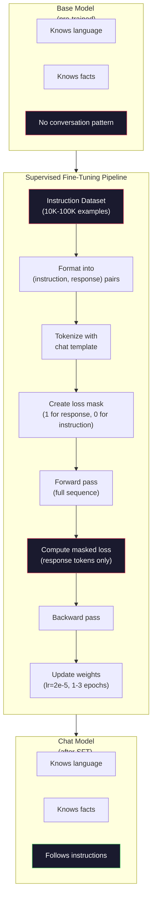

<!-- local-zh-machine-draft: English source is canonical; prose translated automatically, code/math preserved. -->

<a id="instruction-tuning-sft"></a>

# 指令微调（SFT）

> 基本模型预测下一个 token。就是这样。它不遵循指示、回答问题或拒绝有害请求。 SFT 是 token 预测器和有用助手之间的桥梁。您曾经交谈过的每个模型 - Claude、GPT、Llama 聊天 - 都经历过此步骤。

**类型：** 构建
**语言：** Python（与numpy）
**先决条件：** 第 10 阶段，第 04 课（预训练迷你 GPT）
**时间：** ~90 分钟

<a id="learning-objectives"></a>

## 学习目标

- 实现有监督的 fine-tuning (SFT)，将基本语言模型转换为指令跟踪助手
- 使用具有系统、用户和助理角色的聊天模板格式化训练数据，并在非助理上屏蔽丢失 tokens
- 解释为什么 SFT 是必要的：基础模型继续文本而不是回答问题
- 通过比较基础模型与微调模型对保留指令集的响应来评估 SFT 质量

<a id="the-problem"></a>

## 问题

您在第 04 课中训练了一个模型。它可以根据给定的序列预测下一个 token。输入“transformer 架构”，它可能会继续“彻底改变了自然语言处理”。对于下一个 token 预测器来说，这令人印象深刻。

现在试试这个：喂它“法国的首都是哪里？”基本模型不会回答“巴黎”。它延续了这种模式。它可能会产生“德国的首都是什么？西班牙的首都是什么？”因为它从包含问题列表的文档中学习。或者它可能会产生“这是很多人问的问题”，因为这是一个合理的 next-token 延续。该模型没有 *answering* 的概念。它只知道*继续*。

这是 GPT-3（基础模型，2020 年 6 月发布）和 ChatGPT（指令调整，2022 年 11 月发布）之间的差距。相同的架构。同样的预训练。区别在于 20,000 到 100,000 个精心设计的（指令、响应）对教会模型遵循对话模式。

斯坦福羊驼证明你不需要数百万个例子。 2023 年 3 月，他们在 GPT-3.5 生成的 52,000 个指令响应对上对 Llama 7B 进行了微调。总成本：600 美元。结果是一个可以遵循指令、回答问题和进行对话的聊天机器人。不如 ChatGPT，但令人震惊的是，只需 600 美元和几个小时的培训。

Meta 的 Llama 2 Chat 在其初始 SFT 阶段仅使用了约 27,000 个高质量示例。关键见解：质量比数量更重要。由熟练注释者编写的 27,000 个示例击败了从互联网上抓取的 100 万个噪音示例。

<a id="the-concept"></a>

## 概念

<a id="what-sft-actually-does"></a>

### SFT 实际上做了什么

受监督的 Fine-Tuning 继续与预训练相同的训练循环 - forward pass，计算损失，backward pass，更新 weights - 但使用不同类型的数据。您可以训练结构化对话，而不是原始文本：

```json
{
  "system": "You are a helpful assistant.",
  "user": "What is the capital of France?",
  "assistant": "The capital of France is Paris."
}
```

该模型已经知道巴黎是法国的首都。它是在维基百科、教科书和网页上的预训练中了解到这一点的。 SFT 不会向模型传授新的事实。它教导模型一个新的 *behavior*：当你看到一个问题时，给出一个答案。当您看到指令时，请完成。当您看到有害的请求时，请拒绝。

这样想吧。预训练提供模型知识。 SFT 给出模型礼仪。

<a id="data-formats"></a>

### 数据格式

三种业态主导行业。每个都使用不同的分隔符对相同的信息（谁说了什么）进行编码。

**羊驼格式**（斯坦福大学，2023 年 3 月）：

```json
{
  "instruction": "Summarize the following article in 3 sentences.",
  "input": "The European Central Bank raised interest rates...",
  "output": "The ECB increased rates by 25 basis points..."
}
```

简单且应用广泛。 `input` 字段是可选的——许多指令不需要额外的上下文。斯坦福大学以这种格式发布了 52,000 个示例，由 GPT-3.5 生成，价格为 600 美元。这拉开了开源指令调整运动的序幕。

**ShareGPT 格式**（社区，2023）：

```json
{
  "conversations": [
    {"from": "system", "value": "You are a helpful assistant."},
    {"from": "human", "value": "What causes tides?"},
    {"from": "gpt", "value": "Tides are caused by the gravitational pull of the Moon..."},
    {"from": "human", "value": "How often do they occur?"},
    {"from": "gpt", "value": "Most coastal areas experience two high tides and two low tides per day..."}
  ]
}
```

支持多轮对话。 “来自”字段按照惯例使用“人类”和“gpt”，无论实际模型如何。 Vicuna 接受了从用户共享的 ChatGPT 记录中抓取的 70,000 个 ShareGPT 对话的训练。

**ChatML格式**（OpenAI，许多开源模型使用）：

```
<|im_start|>system
You are a helpful assistant.<|im_end|>
<|im_start|>user
What is the capital of France?<|im_end|>
<|im_start|>assistant
The capital of France is Paris.<|im_end|>
```

使用特殊的tokens（`<|im_start|>`、`<|im_end|>`）来界定角色。这些tokens在fine-tuning期间被添加到tokenizer的vocabulary中。 Qwen、Yi 和许多其他模型使用 ChatML。

所有三种格式都完成相同的任务：它们告诉模型“这是指令，这是响应，学习这种模式。”

<a id="why-it-works"></a>

### 为什么它有效

该模型已经通过预训练了解了语言。它已经看到了数十亿个问题、答案、指令、完成以及人与人之间对话的例子。这些模式已编码在 weights 中。

SFT集中了这种潜在能力。 SFT 明确地训练对话模式，而不是模型需要根据上下文确定是否应该回答问题或继续文档。经过几千个示例后，模型学会了：当您看到助理角色标记时，产生有用的响应。

这就是为什么 27,000 个示例就足够了。你教的不是标准英语。你没有教它关​​于世界的事实。你正在教它一种简单的行为：响应指令。知识已经在那里了。

<a id="the-masked-loss"></a>

### 蒙面损失

这是SFT中最重要的技术细节，大多数教程都会跳过它。

在预训练期间，您计算每个 token 的损失。该模型学习预测序列中的每个下一个 token。在 SFT 期间，您仅计算 *response* tokens 上的损失。指令 tokens 用于上下文，但模型不会因为错误地“预测”它们而受到惩罚。

为什么？因为你不希望模型学习 *generate* 指令。您希望它学习 * 响应 * 指令。如果您计算指令 tokens 的损失，您正在训练模型来预测“法国的首都是哪里？”就好像是这个人在问问题一样。这浪费了 gradient 信号，并且可能会使模型对其角色感到困惑。

实际上，您创建一个丢失掩码：1 表示响应 tokens，0 表示指令 tokens。在求平均值之前，将每个 token 损失乘以该掩码。

```
Tokens:    [SYS] You are helpful [USER] What is the capital? [ASST] Paris is the capital [EOS]
Loss mask:   0    0    0     0      0     0   0  0     0       1     1    1   1     1      1
```

只有 `[ASST]` 之后的 tokens 才会造成损失。该模型在 forward pass 期间看到完整的对话（它需要指令来产生正确的响应），但仅根据其预测响应的程度更新其 weights。

<a id="training-hyperparameters"></a>

### 培训 Hyperparameters

SFT 使用与预训练截然不同的 hyperparameters。你不是从头开始训练。您正在调整一个已经有效的模型。

| Parameter | 预训练（Llama 2 7B） | SFT (Llama 2 聊天) |
|-----------|---------------------------|---------------------|
| Learning rate | 3e-4（峰值） | 2e-5 |
| epoch | 1（单次传递数据） | 2 |
| Batch size | 4M tokens | 64个例子 |
| Warmup 步骤 | 2,000 | 0-100 |
| Weight decay | 0.1 | 0.0-0.1 |
| 数据大小 | 2T tokens | 27,000 个示例 |

learning rate 比 SFT 低 15 倍。这很关键。 fine-tuning 期间的高 learning rate 会破坏预先训练的知识。该模型“忘记”了它所学到的内容，并且与小型 fine-tuning 数据集过度拟合。这是灾难性的遗忘。

两个epoch意味着模型会看到每个训练示例两次。小数据集上超过 3 个 epoch 会导致记忆——模型开始逐字再现训练示例，而不是泛化。

<a id="catastrophic-forgetting"></a>

### 灾难性遗忘

Fine-tuning 可以破坏一般能力。在指令跟踪数据上训练时间过长，模型就会失去编写代码、做数学或生成创意文本的能力。它变得非常擅长训练数据的特定格式，而在其他方面都很糟糕。

三种缓解措施：

1. **低 learning rate.** 1e-5 至 5e-5。较小的更新意味着对预训练 features 的破坏较少。

2. **短期训练。** 1-3个epoch。在模型过度拟合之前停止。

3. **混合预训练数据。** Llama 2 Chat 将一小部分（2-5%）原始预训练数据混合到 SFT 数据集中。这会“提醒”模型其一般功能，同时学习新的指令遵循行为。

<a id="real-numbers"></a>

### 实数

Fine-tuning 10,000 个高质量指令对的 7B 模型在单个 NVIDIA A100 80GB GPU 上大约需要 1 小时。这是数学：

- 10,000 个示例 x 512 tokens 平均值 = 5.12M tokens
- 2 epoch = 总计 10.24M tokens
- 7B 型号 fine-tuning 的 A100 吞吐量：~3,000 tokens/秒
- 10.24M / 3,000 = ~3,400 秒 = ~57 分钟

对于我们的迷你 GPT（4 层，128 个亮度），训练几乎是即时的。重点是理解机制，而不是规模。



```figure
loss-masking
```

<a id="build-it"></a>

## 动手实现

<a id="step-1-instruction-dataset"></a>

### 第 1 步：指令数据集

创建合成指令数据集。 在生产中,像 缩放 AI 和 Anthropic 使用人类标记器来写这些。我们将用程序来制作它们来演示格式。

```python
import numpy as np

INSTRUCTION_DATA = [
    {
        "instruction": "What is the capital of France?",
        "response": "The capital of France is Paris."
    },
    {
        "instruction": "Explain gravity in one sentence.",
        "response": "Gravity is the force that attracts objects with mass toward each other."
    },
    {
        "instruction": "Write a haiku about the ocean.",
        "response": "Waves crash on the shore, salt and foam beneath the sun, endless blue expanse."
    },
    {
        "instruction": "What is 15 multiplied by 7?",
        "response": "15 multiplied by 7 is 105."
    },
    {
        "instruction": "Name three programming languages.",
        "response": "Three programming languages are Python, Rust, and TypeScript."
    },
    {
        "instruction": "Summarize photosynthesis.",
        "response": "Photosynthesis converts sunlight, water, and carbon dioxide into glucose and oxygen."
    },
    {
        "instruction": "What year did World War II end?",
        "response": "World War II ended in 1945."
    },
    {
        "instruction": "Define machine learning.",
        "response": "Machine learning is a field where algorithms learn patterns from data to make predictions."
    },
]
```

8个例子很小。斯坦福·阿尔帕卡用了52,000。但是,无论你有多少8或52,000个,机械都是一样的:象征性化、掩码、仅计算反应的损失。

<a id="step-2-tokenize-with-chat-template"></a>

### 步骤2: 使用聊天模板

转换指令- 响应对 token 带有特殊角色标记的序列。标记可以告诉模型指令的结束和反应的开始。

```python
SPECIAL_TOKENS = {
    "INST_START": 253,
    "INST_END": 254,
    "RESP_START": 255,
}


def tokenize_instruction_pair(instruction, response, vocab_size=256):
    inst_tokens = list(instruction.encode("utf-8"))
    resp_tokens = list(response.encode("utf-8"))

    inst_tokens = [min(t, vocab_size - 4) for t in inst_tokens]
    resp_tokens = [min(t, vocab_size - 4) for t in resp_tokens]

    tokens = (
        [SPECIAL_TOKENS["INST_START"]]
        + inst_tokens
        + [SPECIAL_TOKENS["INST_END"]]
        + [SPECIAL_TOKENS["RESP_START"]]
        + resp_tokens
    )

    return tokens


def create_loss_mask(tokens):
    mask = np.zeros(len(tokens), dtype=np.float32)
    in_response = False

    for i, token in enumerate(tokens):
        if token == SPECIAL_TOKENS["RESP_START"]:
            in_response = True
            continue
        if in_response:
            mask[i] = 1.0

    return mask
```

丢失面具是全部零的指令 tokens 和所有反应 tokens. 该 `RESP_START` token 因为它是一个分隔符,不是回应内容的一部分。

<a id="step-3-masked-cross-entropy-loss"></a>

### 步骤3:遮蔽 Cross-Entropy Loss

Standard cross-entropy,但乘以损失掩码。只有响应 tokens 捐款 gradient.

```python
def masked_cross_entropy_loss(logits, targets, loss_mask):
    batch, seq_len, vocab_size = logits.shape
    logits_flat = logits.reshape(-1, vocab_size)
    targets_flat = targets.reshape(-1)
    mask_flat = loss_mask.reshape(-1)

    max_logits = logits_flat.max(axis=-1, keepdims=True)
    log_softmax = logits_flat - max_logits - np.log(
        np.exp(logits_flat - max_logits).sum(axis=-1, keepdims=True)
    )

    per_token_loss = -log_softmax[np.arange(len(targets_flat)), targets_flat]

    masked_loss = per_token_loss * mask_flat
    num_response_tokens = mask_flat.sum()
    if num_response_tokens == 0:
        return 0.0
    loss = masked_loss.sum() / num_response_tokens

    return loss
```

分母是 `num_response_tokens`, 不 `seq_len`。如果以总序列长度分隔,较长的指令会冲淡 gradient 信号,通过反应分辨 token 计数确保相等 weight 每份答复 token 不论指令长度如何。

<a id="step-4-sft-training-loop"></a>

### 步骤4: SFT 训练循环

重新使用从 04 课中读取的迷你GPT。 训练循环看起来几乎与训练前相同, 但带有教学格式和掩码丢失 。

```python
import sys
import os
sys.path.insert(0, os.path.join(os.path.dirname(__file__), "..", "..", "04-pre-training-mini-gpt", "code"))
from main import MiniGPT, LayerNorm, FeedForward, MultiHeadAttention, TransformerBlock, Embedding


def sft_train(model, dataset, num_epochs=2, lr=2e-5, seq_len=64):
    formatted_data = []
    for example in dataset:
        tokens = tokenize_instruction_pair(example["instruction"], example["response"])
        mask = create_loss_mask(tokens)
        formatted_data.append((tokens, mask))

    print(f"SFT Training: {len(formatted_data)} examples, {num_epochs} epochs, lr={lr}")
    print(f"Total tokens: {sum(len(t) for t, _ in formatted_data):,}")
    print()

    losses = []

    for epoch in range(num_epochs):
        epoch_loss = 0.0
        num_batches = 0

        indices = np.random.permutation(len(formatted_data))

        for idx in indices:
            tokens, mask = formatted_data[idx]

            if len(tokens) < 3:
                continue
            if len(tokens) > seq_len:
                tokens = tokens[:seq_len]
                mask = mask[:seq_len]

            input_ids = np.array(tokens[:-1]).reshape(1, -1)
            target_ids = np.array(tokens[1:]).reshape(1, -1)
            loss_mask = np.array(mask[1:]).reshape(1, -1)

            logits = model.forward(input_ids)
            loss = masked_cross_entropy_loss(logits, target_ids, loss_mask)

            batch_size, s_len, v_size = logits.shape
            probs = np.exp(logits - logits.max(axis=-1, keepdims=True))
            probs = probs / probs.sum(axis=-1, keepdims=True)
            dlogits = probs.copy()
            dlogits[np.arange(batch_size)[:, None], np.arange(s_len), target_ids] -= 1.0

            mask_expanded = loss_mask[:, :, np.newaxis]
            num_resp = loss_mask.sum()
            if num_resp > 0:
                dlogits = dlogits * mask_expanded / num_resp

            for block in model.blocks:
                block.ffn.W1 -= lr * np.random.randn(*block.ffn.W1.shape) * 0.01
                block.ffn.W2 -= lr * np.random.randn(*block.ffn.W2.shape) * 0.01
                block.ffn.b1 -= lr * np.random.randn(*block.ffn.b1.shape) * 0.01
                block.ffn.b2 -= lr * np.random.randn(*block.ffn.b2.shape) * 0.01

            epoch_loss += loss
            num_batches += 1
            losses.append(loss)

        avg_loss = epoch_loss / max(num_batches, 1)
        print(f"Epoch {epoch + 1}/{num_epochs} | Avg Loss: {avg_loss:.4f}")

    return model, losses
```

该 learning rate 是 2e-5, 匹配 Llama 2 聊天。与培训前使用的3e-4相比,小15倍。 gradient 隐藏: 指令 tokens 生产为零 gradient。只有响应 tokens 推开 weights.

<a id="step-5-compare-base-vs-sft-model"></a>

### 第5步:比较基准与标准 SFT 模型

整个问题 SFT 是行为上的改变。让我们通过检查模型如何响应以指令格式输入的输入和原始文本的延续来测量它。

```python
def generate_response(model, prompt_tokens, max_new_tokens=50, temperature=0.8):
    tokens = list(prompt_tokens)
    seq_len = model.embedding.pos_embed.shape[0]

    for _ in range(max_new_tokens):
        context = np.array(tokens[-seq_len:]).reshape(1, -1)
        logits = model.forward(context)
        next_logits = logits[0, -1, :]

        next_logits = next_logits / max(temperature, 1e-8)
        probs = np.exp(next_logits - next_logits.max())
        probs = probs / probs.sum()
        probs = np.clip(probs, 1e-10, 1.0)
        probs = probs / probs.sum()

        next_token = np.random.choice(len(probs), p=probs)
        tokens.append(int(next_token))

    return tokens


def evaluate_instruction_following(model, instructions):
    print("Evaluating instruction following:")
    print("-" * 50)

    for instruction in instructions:
        tokens = (
            [SPECIAL_TOKENS["INST_START"]]
            + [min(t, 252) for t in list(instruction.encode("utf-8"))]
            + [SPECIAL_TOKENS["INST_END"]]
            + [SPECIAL_TOKENS["RESP_START"]]
        )

        output = generate_response(model, tokens, max_new_tokens=30, temperature=0.6)
        response_start = len(tokens)
        response_tokens = output[response_start:]
        response_bytes = bytes([t for t in response_tokens if t < 128])
        response_text = response_bytes.decode("utf-8", errors="replace")

        print(f"  Q: {instruction}")
        print(f"  A: {response_text[:80]}")
        print()
```

在一个有8个例子的微小模型上, 反应不会有意义。这是预期的。重要的是 *structure*:模型学会在响应标记之后产生产出,而不是继续生成更多的指示。

<a id="step-6-measure-catastrophic-forgetting"></a>

### 步骤6:衡量灾难性的遗忘

比较模型的下一个...token 前后的预测能力 SFT. 如果 SFT 原案文的损失将增加。

```python
def measure_forgetting(model, test_text, seq_len=64):
    tokens = np.array(list(test_text.encode("utf-8")[:512]))

    total_loss = 0.0
    num_windows = 0

    for start in range(0, len(tokens) - seq_len - 1, seq_len):
        input_ids = tokens[start:start + seq_len].reshape(1, -1)
        target_ids = tokens[start + 1:start + seq_len + 1].reshape(1, -1)

        logits = model.forward(input_ids)

        batch, s_len, vocab_size = logits.shape
        logits_flat = logits.reshape(-1, vocab_size)
        targets_flat = target_ids.reshape(-1)

        max_logits = logits_flat.max(axis=-1, keepdims=True)
        log_softmax = logits_flat - max_logits - np.log(
            np.exp(logits_flat - max_logits).sum(axis=-1, keepdims=True)
        )

        loss = -log_softmax[np.arange(len(targets_flat)), targets_flat].mean()
        total_loss += loss
        num_windows += 1

    return total_loss / max(num_windows, 1)
```

真实的 fine-tuning,您将在整个培训过程中跟踪这一指标。如果原始文本损失增加10-15%以上,您 SFT 太过侵略性了 低一点 learning rate 或减少epoch的数目。

<a id="use-it"></a>

## 实际应用

<a id="full-sft-pipeline-demo"></a>

### Full SFT 管道演示

```python
if __name__ == "__main__":
    np.random.seed(42)

    test_text = """The transformer architecture processes sequences through self-attention.
Each layer applies multi-head attention followed by a feedforward network.
Residual connections and layer normalization stabilize deep networks.
The model learns to predict the next token given all previous tokens."""

    print("=" * 70)
    print("INSTRUCTION TUNING (SFT) DEMO")
    print("=" * 70)
    print()

    model = MiniGPT(
        vocab_size=256, embed_dim=128, num_heads=4,
        num_layers=4, max_seq_len=128, ff_dim=512
    )
    print(f"Model: {model.count_parameters():,} parameters")
    print(f"Config: 4 layers, 4 heads, 128 dims (mini GPT from Lesson 04)")
    print()

    print("PRE-SFT: Measuring base model loss on raw text")
    base_loss = measure_forgetting(model, test_text)
    print(f"  Base model loss: {base_loss:.4f}")
    print()

    print("=" * 70)
    print("SFT TRAINING")
    print("=" * 70)

    model, losses = sft_train(
        model, INSTRUCTION_DATA, num_epochs=3, lr=2e-5, seq_len=128
    )

    print()
    print("POST-SFT: Measuring fine-tuned model loss on raw text")
    sft_loss = measure_forgetting(model, test_text)
    print(f"  SFT model loss: {sft_loss:.4f}")
    print(f"  Change: {((sft_loss - base_loss) / base_loss * 100):+.1f}%")
    if abs(sft_loss - base_loss) / base_loss < 0.15:
        print("  Minimal forgetting (< 15% change)")
    else:
        print("  Significant forgetting detected")
    print()

    print("=" * 70)
    print("INSTRUCTION FOLLOWING EVALUATION")
    print("=" * 70)
    print()

    test_instructions = [
        "What is the capital of France?",
        "Name a programming language.",
        "Define gravity.",
    ]
    evaluate_instruction_following(model, test_instructions)

    print("=" * 70)
    print("DATA FORMAT EXAMPLES")
    print("=" * 70)
    print()

    for i, example in enumerate(INSTRUCTION_DATA[:3]):
        tokens = tokenize_instruction_pair(example["instruction"], example["response"])
        mask = create_loss_mask(tokens)
        resp_count = int(mask.sum())
        total_count = len(tokens)
        print(f"  Example {i + 1}: {total_count} tokens, {resp_count} response tokens ({resp_count/total_count:.0%} of sequence)")
        print(f"    Instruction: {example['instruction']}")
        print(f"    Response: {example['response']}")
        print()

    print("=" * 70)
    print("TRAINING LOSS CURVE")
    print("=" * 70)
    print()

    if losses:
        window = max(1, len(losses) // 5)
        for i in range(0, len(losses), window):
            chunk = losses[i:i + window]
            avg = sum(chunk) / len(chunk)
            print(f"  Steps {i:3d}-{i + len(chunk) - 1:3d}: avg loss = {avg:.4f}")
```

<a id="ship-it"></a>

## 交付成果

这个课程产生 `outputs/prompt-sft-data-curator.md` -- 一个 prompt 帮助您设计和翻译用于 SFT鉴于目标能力(代码生成、数学、对话),它编制有格式规格、质量标准和多样性要求的数据收集计划。

<a id="exercises"></a>

## 练习

1. 添加 system prompt 支持。修改 `tokenize_instruction_pair` 以接受 system message 并将其添加到指令之前。创建 5 个具有不同 system prompts（“你是诗人”、“你是数学导师”）的示例，并验证模型在训练期间看到不同的 system prompts。

2. 实施数据混合。创建一个函数，该函数采用 SFT 数据集和原始文本语料库，然后生成训练批次，其中 5% 的示例是原始文本（无屏蔽），95% 是指令对（屏蔽）。运行 3 个 epoch，并将遗忘指标与纯 SFT 训练进行比较。

3. 构建数据质量评分器。对于每个指令-响应对，计算：(a) tokens 中的响应长度，(b) 指令响应比，(c) vocabulary 多样性（唯一的 tokens / 总 tokens）。过滤掉响应长度 < 10 tokens 或多样性 < 0.3 的示例。显示过滤如何影响最终损失。

4. 实施多轮对话训练。扩展tokenization以处理3轮对话（用户-助理-用户-助理-用户-助理）。损失掩码应覆盖所有三个辅助回合。例如，通过打印 token-mask alignment 来验证掩码是否正确。

5. 比较 learning rates。使用 lr=1e-4、lr=2e-5 和 lr=1e-6 训练同一模型 3 次。绘制损失曲线。 1e-4 运行应显示快速的初始下降但较高的最终损失 (overfitting)。 1e-6 运行应该几乎不会移动。 2e-5 跑应该是最佳点。

<a id="key-terms"></a>

## 关键术语

| 术语 | 人们怎么说 | 它实际上意味着什么 |
|------|----------------|----------------------|
| SFT | “Fine-tuning 对话” | 受监督的 Fine-Tuning：继续对（指令、响应）对进行训练，仅根据响应 tokens 计算损失 |
| 指令调优 | “教导模型遵循指令” | 对显式指令-响应对进行训练，以便基础模型学习对话模式，而不是新知识 |
| 损失掩蔽 | “忽略 prompt” | 将指令 tokens 的损失设置为零，以便 gradients 仅来自响应 token 预测 |
| 聊天机器学习 | 《聊天标记语言》 | 使用 `<\|im_start\|>` 和 `<\|im_end\|>` 分隔符的 token 格式来标记对话数据中的发言者角色 |
| 羊驼毛格式 | “斯坦福的模式” | 带有指令/输入/输出字段的 JSON 格式，用于 52K GPT-3.5 生成的示例，成本为 600 美元 |
| 灾难性遗忘 | “模型变得更加愚蠢” | Fine-tuning 破坏了预先训练的功能，因为 gradient 更新用特定于任务的模式覆盖一般知识 |
| Weight 捆绑 | “共享embeddings” | 输入 token embeddings 和输出预测头使用相同的矩阵，节省 parameters 并提高一致性 |
| 聊天模板 | “如何格式化 prompt” | 为模型构建对话的特定 token 序列（角色标记、分隔符） |

<a id="further-reading"></a>

## 进一步阅读

- [Ouyang et al., 2022 - “Training language models to follow instructions with human Feedback” (InstructGPT)](https://arxiv.org/abs/2203.02155) - 介绍指令调优的论文 + RLHF at OpenAI
- [Taori 等人，2023 - “Stanford Alpaca：遵循指令的 LLaMA 模型”](https://github.com/tatsu-lab/stanford_alpaca) - 52K 指令示例，价格为 600 美元，证明SFT 适用于小型数据集
- [Touvron 等人，2023 年——“Llama 2：开放基础和微调聊天模型”](https://arxiv.org/abs/2307.09288)——Meta 的 SFT + RLHF 管道，包含 27K 个高质量示例
- [Chiang 等人，2023 年——“Vicuna：令人印象深刻的开源聊天机器人 GPT-4”](https://lmsys.org/blog/2023-03-30-vicuna/)——70K ShareGPT 对话的训练
- [Zhou 等人，2023 年——“LIMA：Alignment 的少即是多”](https://arxiv.org/abs/2305.11206)——证明 1,000 个精心策划的示例可以在更大的数据集上匹配 SFT
