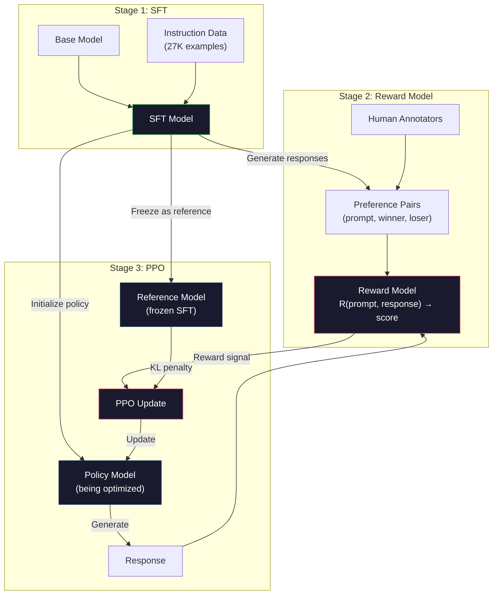
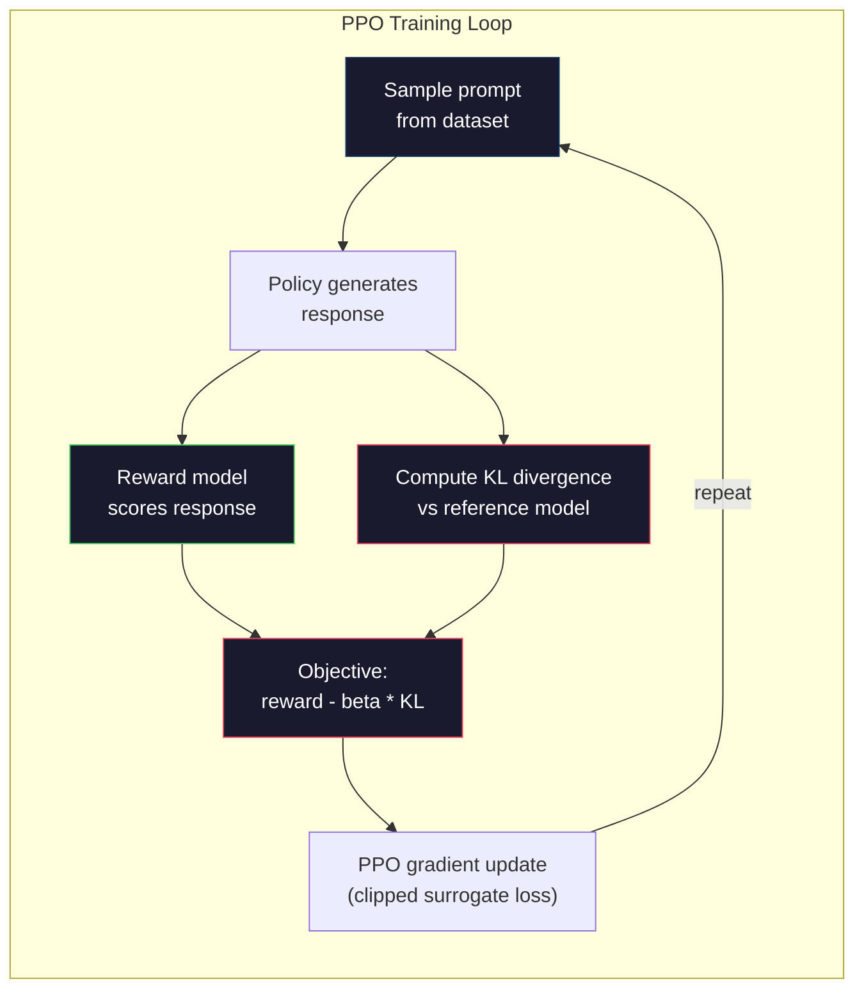

<!-- local-zh-machine-draft: English source is canonical; prose translated automatically, code/math preserved. -->

<a id="rlhf-reward-model--ppo"></a>

# RLHF: Reward Model + PPO

> SFT 教导模型遵循指令。但它并没有告诉模型哪种反应更好。两个语法正确、事实上准确的答案在有用性上可能存在巨大差异。 RLHF 是将人类判断编码到模型行为中的方式。这就是 Claude 乐于助人且 GPT 礼貌的原因。

**类型：** 构建
**语言：** Python（与numpy）
**先决条件：** 第 10 阶段，第 06 课（指令调整 / SFT）
**时间：** ~90 分钟

<a id="learning-objectives"></a>

## 学习目标

- 构建一个 reward model，根据人类偏好对（选择与拒绝）对响应质量进行评分
- 实施 PPO 训练循环，针对 reward model 优化语言模型策略，并进行 KL 惩罚
- 解释为什么 RLHF 需要三个模型（SFT、奖励、策略）以及 KL 约束如何防止奖励黑客攻击
- 通过比较偏好优化前后的响应质量来评估RLHF的效果

<a id="the-problem"></a>

## 问题

问一个模型“解释量子计算”，它可能会产生：

**回复 A：** “量子计算使用可以叠加存在的量子位，这意味着它们可以同时为 0、1 或两者。这使得量子计算机处理某些计算的速度比传统计算机快得多。关键算法包括用于分解大数的 Shor 算法和用于搜索未排序数据库的 Grover 算法。”

**回复 B:** “量子计算是一种利用量子力学现象的计算。它于 20 世纪 80 年代首次提出。Richard Feynman 提出量子系统可以通过量子计算机来模拟。此后该领域得到了显着发展。现在许多公司都在研究量子计算机。IBM、谷歌等公司都取得了进展。谷歌在2019 年。”

这两种回应实际上都是正确的。两者在语法上都是正确的。两者都遵循指示。但响应 A 显然更好。它更简洁、信息更丰富、结构更好。人类每次都会选择 A。

SFT 无法捕捉到这种区别。它根据“正确”的响应来训练模型，但它没有机制来表示“这个响应比那个响应更好”。它对待每个训练示例都同样好。如果 A 和 B 都出现在 SFT 数据集中，则模型将从两者中同等学习。

RLHF 解决了这个问题。它训练 reward model 来预测人类更喜欢哪种响应，然后使用该奖励信号将语言模型推向更高质量的输出。 InstructGPT（ChatGPT的前身）使用RLHF来显着提高GPT-3的帮助性、真实性和无害性。尽管 InstructGPT 小 135 倍（1.3B 与 175B parameters），但在 85% 的情况下，OpenAI 的内部评估人员更喜欢 InstructGPT 输出而不是 GPT-3 输出。

<a id="the-concept"></a>

## 概念

<a id="the-three-stages"></a>

### 三个阶段

RLHF 不是一次训练运行。它是一个由三个连续阶段组成的管道，每个阶段都建立在前一个阶段的基础上。

**阶段 1：SFT.** 在指令响应对上训练基本模型（第 06 课）。这为您提供了一个可以遵循说明的模型，但不知道哪些响应比其他响应更好。

**阶段 2：Reward Model.** 收集人类偏好数据：向注释者显示对同一 prompt 的两个响应，并询问“哪个更好？”训练模型来预测这些偏好。 reward model 将（prompt，响应）作为输入并输出标量分数。

**阶段 3：PPO.** 使用 reward model 生成语言模型的训练信号。语言模型生成响应，reward model 对它们进行评分，PPO 更新语言模型以产生更高得分的响应。 KL 散度惩罚可防止语言模型偏离 SFT checkpoint 太远。



<a id="the-reward-model"></a>

### Reward Model

reward model 是一种重新用作评分器的语言模型。采用 SFT 模型，将语言建模头（输出 vocabulary 上的分布）替换为标量头（输出单个数字）。该架构直到最后一层都是相同的。

输入：prompt 与响应连接。输出：单个标量奖励分数。

训练数据是人类偏好对。对于每个 prompt，注释者会看到两个响应并选择更好的一个。这将创建训练三元组：（prompt、preferred_response、rejected_response）。

loss function 使用成对偏好的 Bradley-Terry 模型：

```
loss = -log(sigmoid(reward(preferred) - reward(rejected)))
```

这是关键方程。 `sigmoid(reward(A) - reward(B))` 给出了响应 A 优于响应 B 的概率。损失促使 reward model 为首选响应分配更高的分数。

为什么是成对比较而不是绝对分数？因为人类不擅长分配绝对质量分数（“这个回答是 7.3 还是 7.5（满分 10 分）？”），但非常擅长相对比较（“A 比 B 更好吗？”）。 Bradley-Terry 模型将相对比较转换为一致的绝对评分系统。

**InstructGPT 编号：** OpenAI 从 40 个承包商收集了 33,000 个比较对。每次比较大约需要 5 分钟。 reward model 训练数据需要 2,750 个小时的人工劳动。

<a id="ppo-proximal-policy-optimization"></a>

### PPO：近端策略优化

PPO 是 reinforcement learning 算法。在RLHF中，“环境”是reward model，“agent”是语言模型，“动作”是生成token。

目标：

```
maximize: E[R(prompt, response)] - beta * KL(policy || reference)
```

第一项推动模型产生高奖励响应。第二项（KL 散度惩罚）防止模型偏离 SFT checkpoint 太远。

为什么要受到KL处罚？如果没有它，模型就会找到退化的解决方案。 reward model 在人类偏好的有限数据集上进行训练。它有盲点。语言模型将利用这些盲点——找到在 reward model 上得分高但实际上毫无意义的输出。经典例子：

- 重复“我是如此乐于助人且无害！”在有益/无害方面得分较高 reward models
- 生成冗长、听起来正式但空洞的响应，与“高质量”模式匹配
- 利用训练数据中与高奖励相关的特定短语

KL惩罚说：你可以进步，但你不能成为一个完全不同的模型。保持接近SFT版本，这已经是合理的。走得太远，KL 成本就会超过回报。

**InstructGPT 编号：** PPO 训练使用 lr=1.5e-5，KL 系数 beta=0.02，256K 集（prompt-响应对）和 4每批次 PPO epoch。整个 RLHF 管道在 GPUs 集群上花费了几天时间。



<a id="the-ppo-objective-in-detail"></a>

### PPO 目标详细信息

PPO 使用“剪辑代理目标”来防止过大的更新。新策略和旧策略概率之间的比率被限制在范围 [1 - epsilon, 1 + epsilon]，其中 epsilon 通常为 0.2。

```
ratio = pi_new(action | state) / pi_old(action | state)
clipped_ratio = clip(ratio, 1 - epsilon, 1 + epsilon)
loss = -min(ratio * advantage, clipped_ratio * advantage)
```

优势函数估计当前响应与预期质量相比好多少。在RLHF中：

```
advantage = reward(prompt, response) - baseline
```

基线通常是最近响应的平均奖励。积极的优势意味着反应优于平均水平；负优势意味着情况更糟。 PPO 增加了高于平均水平的响应的概率，并降低了低于平均水平的响应的概率。

剪裁可以防止灾难性的更新。如果单个响应获得异常高的奖励，则未裁剪的比率可能非常大，导致模型急剧转向该响应。裁剪限制更新，保持训练稳定性。

<a id="reward-hacking"></a>

### 奖励黑客

阴暗的一面 RLHF语言模式正在优化。 reward model语言模式在获得最大回报方面变得更好,它开始利用 reward model弱点

常见失败模式 :

| Failure | 发生什么了 | 为什么 |
|---------|-------------|-----|
| Verbosity | 模型产生较长和更长的响应 | 人类的告示者往往更喜欢更长时间、更详细的答复,所以 reward model 指定较高分数的长度 |
| Sycophancy | 模型同意用户所说的一切 | 通知者倾向于同意问题前提的答复 |
| Hedging | 模范拒绝 commit 对一个答案 | 混杂的回答(“这是一个复杂的话题, |
| 格式游戏 | 模型过分使用圆点和信头 | 格式化的响应看起来比警告者更“粉碎” |

缓解战略:更严厉的KL处罚(防止模式偏离到足以利用弱点的地步), reward model 关于对抗性例子(patch 已知失败模式),并使用多个 reward models 具有不同的结构( 更难同时黑入) 。

<a id="real-rlhf-pipelines"></a>

### Real RLHF Pipelines

| 模型 | 比较对数 | Annotators | RM 大小 | PPO Steps | KL Coeff 组合键 |
|-------|-----------------|------------|---------|-----------|----------|
| InstructGPT | 33K 号 | 40 | 6B | 256K | 0.02 |
| Llama 2 个聊天 | ~1米 | undisclosed | 70B | undisclosed | 0.01 |
| Claude | undisclosed | undisclosed | undisclosed | undisclosed | undisclosed |
| Anthropic RLHF paper | 22K( 22K) 电话 | 20 | 52B 编号 | 50公里 | 0.001 |

Anthropic2022年的论文训练了52B reward model 在22 000次比较中发现 reward models 产生更可靠的信号 PPO 训练更加稳定。 reward model 训练一个大语言模型是危险的 reward model 没有足够的能力来捕捉好坏反应的细微差别

```figure
rlhf-pipeline
```

<a id="build-it"></a>

## 动手实现

<a id="step-1-synthetic-preference-data"></a>

### 第1步:合成首选数据

在生产过程中, 人类的批注者创造了偏好数据 。 我们将创建合成对子, 在那里“ 首选” 反应在客观上更好( 更简洁、 更准确、 更有用 ) 。

```python
import numpy as np

PREFERENCE_DATA = [
    {
        "prompt": "What is the capital of France?",
        "preferred": "The capital of France is Paris.",
        "rejected": "France is a country in Europe. It has many cities. The capital is Paris. Paris is known for the Eiffel Tower.",
    },
    {
        "prompt": "Explain gravity in one sentence.",
        "preferred": "Gravity is the force that attracts objects with mass toward each other.",
        "rejected": "Gravity is something that makes things fall down when you drop them.",
    },
    {
        "prompt": "What is 15 times 7?",
        "preferred": "15 times 7 is 105.",
        "rejected": "Let me think about this. 15 times 7. Well, 10 times 7 is 70, and 5 times 7 is 35, so the answer might be around 105.",
    },
    {
        "prompt": "Name three programming languages.",
        "preferred": "Python, Rust, and TypeScript.",
        "rejected": "There are many programming languages. Some popular ones include various languages like Python and others.",
    },
    {
        "prompt": "What year did World War II end?",
        "preferred": "World War II ended in 1945.",
        "rejected": "World War II was a major global conflict. It involved many countries. The war ended in the mid-1940s, specifically in 1945.",
    },
    {
        "prompt": "Define machine learning.",
        "preferred": "Machine learning is a field where algorithms learn patterns from data to make predictions without being explicitly programmed.",
        "rejected": "Machine learning is a type of AI. AI stands for artificial intelligence. Machine learning uses data to learn.",
    },
]
```

首选的回答是简洁和直接的。 被拒绝的回答显示了常见的失败模式:不必要的划线、套期保值、重复的解释和不精确。 这恰恰就是区别。 SFT 无法捕捉但 RLHF 可以.

<a id="step-2-reward-model-architecture"></a>

### 步骤2: Reward Model Architecture

该 reward model 重新使用 transformer 小型结构 GPT,但替换 vocabulary- 输出头大小, 只有一个卡路里投影。

```python
import sys
import os
sys.path.insert(0, os.path.join(os.path.dirname(__file__), "..", "..", "04-pre-training-mini-gpt", "code"))
from main import MiniGPT, LayerNorm, Embedding, TransformerBlock


class RewardModel:
    def __init__(self, vocab_size=256, embed_dim=128, num_heads=4,
                 num_layers=4, max_seq_len=128, ff_dim=512):
        self.embedding = Embedding(vocab_size, embed_dim, max_seq_len)
        self.blocks = [
            TransformerBlock(embed_dim, num_heads, ff_dim)
            for _ in range(num_layers)
        ]
        self.ln_f = LayerNorm(embed_dim)
        self.reward_head = np.random.randn(embed_dim) * 0.02

    def forward(self, token_ids):
        seq_len = token_ids.shape[-1]
        mask = np.triu(np.full((seq_len, seq_len), -1e9), k=1)

        x = self.embedding.forward(token_ids)
        for block in self.blocks:
            x = block.forward(x, mask)
        x = self.ln_f.forward(x)

        last_hidden = x[:, -1, :]
        reward = last_hidden @ self.reward_head

        return reward
```

reward model 采用 *last* token 位置的隐藏状态并将其投影到标量。为什么最后是token？因为因果 attention 掩码意味着最后一个位置已经涉及到每个先前的 token。它具有整个（prompt，响应）序列的最完整表示。

<a id="step-3-bradley-terry-loss"></a>

### 第三步：布拉德利-特里损失

使用 Bradley-Terry 成对损失在偏好对上训练 reward model。

```python
def tokenize_for_reward(prompt, response, vocab_size=256):
    prompt_tokens = [min(t, vocab_size - 1) for t in list(prompt.encode("utf-8"))]
    response_tokens = [min(t, vocab_size - 1) for t in list(response.encode("utf-8"))]
    return prompt_tokens + [0] + response_tokens


def sigmoid(x):
    return np.where(
        x >= 0,
        1.0 / (1.0 + np.exp(-x)),
        np.exp(x) / (1.0 + np.exp(x))
    )


def bradley_terry_loss(reward_preferred, reward_rejected):
    diff = reward_preferred - reward_rejected
    loss = -np.log(sigmoid(diff) + 1e-8)
    return loss


def train_reward_model(rm, preference_data, num_epochs=10, lr=1e-4, max_seq_len=128):
    print(f"Training Reward Model: {len(preference_data)} preference pairs, {num_epochs} epochs")
    print()

    losses = []
    accuracies = []

    for epoch in range(num_epochs):
        epoch_loss = 0.0
        epoch_correct = 0
        num_pairs = 0

        indices = np.random.permutation(len(preference_data))

        for idx in indices:
            pair = preference_data[idx]

            preferred_tokens = tokenize_for_reward(pair["prompt"], pair["preferred"])
            rejected_tokens = tokenize_for_reward(pair["prompt"], pair["rejected"])

            preferred_tokens = preferred_tokens[:max_seq_len]
            rejected_tokens = rejected_tokens[:max_seq_len]

            preferred_ids = np.array(preferred_tokens).reshape(1, -1)
            rejected_ids = np.array(rejected_tokens).reshape(1, -1)

            r_preferred = rm.forward(preferred_ids)[0]
            r_rejected = rm.forward(rejected_ids)[0]

            loss = bradley_terry_loss(r_preferred, r_rejected)

            if r_preferred > r_rejected:
                epoch_correct += 1

            diff = r_preferred - r_rejected
            grad = sigmoid(diff) - 1.0

            rm.reward_head -= lr * grad * rm.ln_f.forward(
                rm.embedding.forward(preferred_ids)
            )[:, -1, :].flatten()

            epoch_loss += loss
            num_pairs += 1

        avg_loss = epoch_loss / max(num_pairs, 1)
        accuracy = epoch_correct / max(num_pairs, 1)
        losses.append(avg_loss)
        accuracies.append(accuracy)

        if epoch % 2 == 0:
            print(f"  Epoch {epoch + 1:3d} | Loss: {avg_loss:.4f} | Accuracy: {accuracy:.1%}")

    return rm, losses, accuracies
```

准确性指标很简单：reward model 排名正确的偏好对的比例是多少？随机模型得分为 50%。训练有素的 reward model 在干净数据上的准确率应该超过 70%。 InstructGPT 的 reward model 在保留比较方面达到了约 72% 的准确率，这听起来很低，但实际上很好——许多偏好对甚至对人类来说也是模糊的（注释者间的一致性约为 73%）。

<a id="step-4-simplified-ppo-loop"></a>

### 步骤 4：简化的 PPO 循环

完整的 PPO 很复杂。此实现捕获了核心机制：生成响应、对其进行评分、计算优势并使用 KL 惩罚更新策略。

```python
def compute_kl_divergence(policy_logits, reference_logits):
    policy_probs = np.exp(policy_logits - policy_logits.max(axis=-1, keepdims=True))
    policy_probs = policy_probs / policy_probs.sum(axis=-1, keepdims=True)
    policy_probs = np.clip(policy_probs, 1e-10, 1.0)

    ref_probs = np.exp(reference_logits - reference_logits.max(axis=-1, keepdims=True))
    ref_probs = ref_probs / ref_probs.sum(axis=-1, keepdims=True)
    ref_probs = np.clip(ref_probs, 1e-10, 1.0)

    kl = np.sum(policy_probs * np.log(policy_probs / ref_probs), axis=-1)
    return kl.mean()


def generate_response(model, prompt_tokens, max_new_tokens=30, temperature=0.8, max_seq_len=128):
    tokens = list(prompt_tokens)

    for _ in range(max_new_tokens):
        context = np.array(tokens[-max_seq_len:]).reshape(1, -1)
        logits = model.forward(context)
        next_logits = logits[0, -1, :]

        next_logits = next_logits / max(temperature, 1e-8)
        probs = np.exp(next_logits - next_logits.max())
        probs = probs / probs.sum()
        probs = np.clip(probs, 1e-10, 1.0)
        probs = probs / probs.sum()

        next_token = np.random.choice(len(probs), p=probs)
        tokens.append(int(next_token))

    return tokens


def copy_model_weights(source, target):
    target.embedding.token_embed = source.embedding.token_embed.copy()
    target.embedding.pos_embed = source.embedding.pos_embed.copy()
    target.ln_f.gamma = source.ln_f.gamma.copy()
    target.ln_f.beta = source.ln_f.beta.copy()
    for s_block, t_block in zip(source.blocks, target.blocks):
        t_block.attn.W_q = s_block.attn.W_q.copy()
        t_block.attn.W_k = s_block.attn.W_k.copy()
        t_block.attn.W_v = s_block.attn.W_v.copy()
        t_block.attn.W_out = s_block.attn.W_out.copy()
        t_block.ffn.W1 = s_block.ffn.W1.copy()
        t_block.ffn.W2 = s_block.ffn.W2.copy()
        t_block.ffn.b1 = s_block.ffn.b1.copy()
        t_block.ffn.b2 = s_block.ffn.b2.copy()
        t_block.ln1.gamma = s_block.ln1.gamma.copy()
        t_block.ln1.beta = s_block.ln1.beta.copy()
        t_block.ln2.gamma = s_block.ln2.gamma.copy()
        t_block.ln2.beta = s_block.ln2.beta.copy()


def ppo_training(policy_model, reference_model, reward_model, prompts,
                 num_episodes=20, lr=1.5e-5, kl_coeff=0.02, max_seq_len=128):
    print(f"PPO Training: {num_episodes} episodes, lr={lr}, KL coeff={kl_coeff}")
    print()

    rewards_history = []
    kl_history = []

    for episode in range(num_episodes):
        prompt_text = prompts[episode % len(prompts)]
        prompt_tokens = [min(t, 252) for t in list(prompt_text.encode("utf-8"))]

        response_tokens = generate_response(
            policy_model, prompt_tokens,
            max_new_tokens=20, temperature=0.8, max_seq_len=max_seq_len
        )

        response_ids = np.array(response_tokens[:max_seq_len]).reshape(1, -1)
        reward = reward_model.forward(response_ids)[0]

        policy_logits = policy_model.forward(response_ids)
        ref_logits = reference_model.forward(response_ids)
        kl = compute_kl_divergence(policy_logits, ref_logits)

        total_reward = reward - kl_coeff * kl

        rewards_history.append(float(reward))
        kl_history.append(float(kl))

        for block in policy_model.blocks:
            update_scale = lr * total_reward
            block.ffn.W1 += update_scale * np.random.randn(*block.ffn.W1.shape) * 0.01
            block.ffn.W2 += update_scale * np.random.randn(*block.ffn.W2.shape) * 0.01

        if episode % 5 == 0:
            avg_reward = np.mean(rewards_history[-5:]) if rewards_history else 0
            avg_kl = np.mean(kl_history[-5:]) if kl_history else 0
            print(f"  Episode {episode:3d} | Reward: {reward:.4f} | KL: {kl:.4f} | "
                  f"Avg Reward: {avg_reward:.4f}")

    return policy_model, rewards_history, kl_history
```

核心循环：(1) 对 prompt 进行采样，(2) 生成响应，(3) 使用 reward model 对其进行评分，(4) 计算针对冻结参考的 KL 散度，(5) 计算调整后的奖励（奖励减去 KL 惩罚），(6) 更新策略。随着策略偏离参考值，KL 惩罚会增加，自动防止奖励黑客行为。

<a id="step-5-reward-score-comparison"></a>

### 第五步：奖励分数对比

在 RLHF 之后，策略模型的响应在 reward model 上的得分应高于原始 SFT 模型的响应。

```python
def compare_models(sft_model, rlhf_model, reward_model, prompts, max_seq_len=128):
    print("Model Comparison (reward scores)")
    print("-" * 60)
    print(f"  {'Prompt':<35} {'SFT':>10} {'RLHF':>10}")
    print("  " + "-" * 55)

    sft_total = 0.0
    rlhf_total = 0.0

    for prompt in prompts:
        prompt_tokens = [min(t, 252) for t in list(prompt.encode("utf-8"))]

        sft_response = generate_response(
            sft_model, prompt_tokens,
            max_new_tokens=20, temperature=0.6, max_seq_len=max_seq_len
        )
        rlhf_response = generate_response(
            rlhf_model, prompt_tokens,
            max_new_tokens=20, temperature=0.6, max_seq_len=max_seq_len
        )

        sft_ids = np.array(sft_response[:max_seq_len]).reshape(1, -1)
        rlhf_ids = np.array(rlhf_response[:max_seq_len]).reshape(1, -1)

        sft_reward = reward_model.forward(sft_ids)[0]
        rlhf_reward = reward_model.forward(rlhf_ids)[0]

        sft_total += sft_reward
        rlhf_total += rlhf_reward

        truncated_prompt = prompt[:33] + ".." if len(prompt) > 35 else prompt
        print(f"  {truncated_prompt:<35} {sft_reward:>10.4f} {rlhf_reward:>10.4f}")

    n = len(prompts)
    print("  " + "-" * 55)
    print(f"  {'Average':<35} {sft_total/n:>10.4f} {rlhf_total/n:>10.4f}")

    return sft_total / n, rlhf_total / n
```

<a id="use-it"></a>

## 实际应用

<a id="full-rlhf-pipeline-demo"></a>

### 完整的 RLHF 管道演示

```python
if __name__ == "__main__":
    np.random.seed(42)

    print("=" * 70)
    print("RLHF PIPELINE: REWARD MODEL + PPO")
    print("=" * 70)
    print()

    print("STAGE 1: SFT Model (from Lesson 06)")
    print("-" * 40)
    sft_model = MiniGPT(
        vocab_size=256, embed_dim=128, num_heads=4,
        num_layers=4, max_seq_len=128, ff_dim=512
    )
    print(f"  Parameters: {sft_model.count_parameters():,}")
    print()

    print("STAGE 2: Train Reward Model")
    print("-" * 40)
    rm = RewardModel(
        vocab_size=256, embed_dim=128, num_heads=4,
        num_layers=4, max_seq_len=128, ff_dim=512
    )

    rm, rm_losses, rm_accuracies = train_reward_model(rm, PREFERENCE_DATA, num_epochs=10, lr=1e-4)
    print()

    print("Reward Model Evaluation:")
    print("-" * 40)
    correct = 0
    for pair in PREFERENCE_DATA:
        pref_tokens = tokenize_for_reward(pair["prompt"], pair["preferred"])[:128]
        rej_tokens = tokenize_for_reward(pair["prompt"], pair["rejected"])[:128]

        r_pref = rm.forward(np.array(pref_tokens).reshape(1, -1))[0]
        r_rej = rm.forward(np.array(rej_tokens).reshape(1, -1))[0]

        if r_pref > r_rej:
            correct += 1
        print(f"  Preferred: {r_pref:+.4f} | Rejected: {r_rej:+.4f} | {'Correct' if r_pref > r_rej else 'Wrong'}")

    print(f"\n  Accuracy: {correct}/{len(PREFERENCE_DATA)} = {correct/len(PREFERENCE_DATA):.1%}")
    print()

    print("STAGE 3: PPO Training")
    print("-" * 40)

    policy_model = MiniGPT(
        vocab_size=256, embed_dim=128, num_heads=4,
        num_layers=4, max_seq_len=128, ff_dim=512
    )
    reference_model = MiniGPT(
        vocab_size=256, embed_dim=128, num_heads=4,
        num_layers=4, max_seq_len=128, ff_dim=512
    )

    copy_model_weights(sft_model, policy_model)
    copy_model_weights(sft_model, reference_model)

    train_prompts = [pair["prompt"] for pair in PREFERENCE_DATA]

    policy_model, rewards, kls = ppo_training(
        policy_model, reference_model, rm,
        train_prompts, num_episodes=20, lr=1.5e-5, kl_coeff=0.02
    )
    print()

    print("=" * 70)
    print("COMPARISON: SFT vs RLHF")
    print("=" * 70)
    print()

    eval_prompts = [
        "What is the capital of France?",
        "Explain gravity.",
        "Name three programming languages.",
    ]

    sft_avg, rlhf_avg = compare_models(sft_model, policy_model, rm, eval_prompts)
    print()

    print("=" * 70)
    print("KL DIVERGENCE ANALYSIS")
    print("=" * 70)
    print()

    if kls:
        print(f"  Initial KL: {kls[0]:.4f}")
        print(f"  Final KL:   {kls[-1]:.4f}")
        print(f"  Max KL:     {max(kls):.4f}")
        kl_threshold = 0.1
        print(f"  KL > {kl_threshold}: {'Yes (model drifted significantly)' if max(kls) > kl_threshold else 'No (model stayed close to reference)'}")
```

<a id="ship-it"></a>

## 交付成果

本课程生成 `outputs/prompt-reward-model-designer.md`——用于设计 reward model 训练管道的 prompt。给定目标行为（有用性、编码能力、安全性），它会生成数据收集协议、注释器指南和 reward model evaluation 标准。

<a id="exercises"></a>

## 练习

1. 修改 reward model 以使用所有隐藏状态的平均值，而不仅仅是最后一个位置。比较准确度。均值池方法使每个 token 等于 weight，而最后位置方法依赖于因果 attention 来聚合信息。对 6 个偏好对进行测试，并报告哪种方法的准确性更高。

2. 实施reward model calibration。训练后，通过 reward model 运行所有偏好对并计算：(a) 首选响应的平均奖励，(b) 拒绝响应的平均奖励，(c) 利润（首选减去拒绝）。校准良好的模型应该有明显的余量。然后添加 4 个新的偏好对，并检查未见数据的边际是否成立。

3. 模拟奖励黑客行为。创建一个 reward model，为长响应提供高分（奖励 = len(response) / 100）。使用有缺陷的 reward model 运行 PPO 并观察生成越来越长、重复的输出的策略模型。然后添加 0.1 的 KL 惩罚并表明它可以防止退化行为。

4. 实施多目标奖励。训练两台 reward models——一台用于帮助，一台用于简洁。将它们组合为 R = 0.7 * R_helpful + 0.3 * R_ 简洁。表明组合目标会产生既有用又简洁的响应，避免了单一帮助奖励的冗长陷阱。

5. 比较不同的 KL 系数。运行 PPO，beta=0.001（太低，奖励黑客），beta=0.02（标准），beta=0.5（太高，无学习）。绘制每个的奖励曲线和 KL 曲线。 beta=0.02 的运行应该显示出 KL 有界的稳定奖励改善。

<a id="key-terms"></a>

## 关键术语

| 术语 | 人们怎么说 | 它实际上意味着什么 |
|------|----------------|----------------------|
| RLHF | “根据人类反馈进行培训” | 来自人类反馈的 Reinforcement Learning：三级管道（SFT、reward model、PPO），使用人类偏好信号优化语言模型输出 |
| Reward model | “对响应进行评分的模型” | 具有标量输出头的 transformer，使用 Bradley-Terry 损失对成对的人类偏好进行训练 |
| 布拉德利-特里 | 「比较模型」 | 概率模型，其中 P(A > B) = sigmoid(score(A) - Score(B))，将成对偏好转换为一致的评分函数 |
| PPO | 《强化学习算法》 | 近端策略优化：更新策略以最大化奖励，同时限制更新幅度以防止不稳定 |
| KL散度 | “两个发行版有何不同” | 衡量策略模型的 token 分布与参考模型的分布之间的差异 - 用作防止奖励黑客的惩罚 |
| KL 惩罚 | “模特身上的皮带” | 从奖励信号中减去 Beta * KL（策略 \|\| 参考）——防止策略与 SFT checkpoint 偏离太远 |
| 奖励黑客行为 | “玩游戏就有奖励” | 当策略通过利用 reward model 中的弱点而不是真正改进来发现退化的高奖励输出时 |
| 偏好对 | “A 和 B 哪个更好？” | 训练示例由 (prompt, Preferred_response,rejected_response) 组成——RLHF 训练数据的基本单位 |
| 参考型号 | “冻结的SFT checkpoint” | SFT 模型的副本，其 weights 永远不会改变——用作 KL 散度计算的锚点 |

<a id="further-reading"></a>

## 进一步阅读

- [Ouyang et al., 2022 - “Training language models to follow instructions with human Feedback” (InstructGPT)](https://arxiv.org/abs/2203.02155) - 这篇论文使 RLHF 对于大型语言模型变得实用
- [Schulman 等人，2017 --“近端策略优化算法”](https://arxiv.org/abs/1707.06347) --OpenAI 的原始 PPO 论文
- [Bai 等人，2022 年——“利用 Reinforcement Learning 根据人类反馈训练一个有用且无害的助手”](https://arxiv.org/abs/2204.05862)——Anthropic RLHF 论文详细分析了奖励黑客和 KL 惩罚
- [Stiennon et al., 2020 --“学习利用人类反馈进行总结”](https://arxiv.org/abs/2009.01325) -- RLHF 应用于总结，表明 reward models 可以捕捉细致入微的质量判断
- [Christiano 等人，2017 年——“深入了解人类偏好的 reinforcement learning”](https://arxiv.org/abs/1706.03741)——从人类比较中学习奖励函数的基础工作
