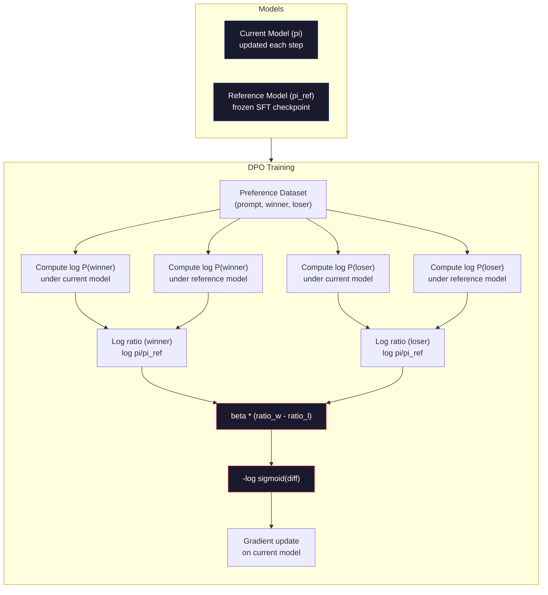

<!-- local-zh-machine-draft: English source is canonical; prose translated automatically, code/math preserved. -->

<a id="dpo-direct-preference-optimization"></a>

# DPO：直接偏好优化

> RLHF 有效。它还需要训练三个模型（SFT，reward model，策略），管理PPO的不稳定性，并调整KL惩罚。 DPO 询问：如果你可以跳过所有这些怎么办？ DPO 直接优化偏好对上的语言模型。没有 reward model。没有 PPO。一个训练循环。结果相同。

**类型：** 构建
**语言：** Python（与numpy）
**先决条件：** 第 10 阶段，第 07 课 (RLHF)
**时间：** ~90 分钟

<a id="learning-objectives"></a>

## 学习目标

- 实施 DPO 训练，直接优化偏好对上的语言模型，无需单独的 reward model
- 推导 DPO loss function 并解释它如何通过策略的对数概率隐式表示 reward model
- 在训练稳定性、计算成本和所需模型数量方面比较 DPO 与 RLHF
- 调整 beta parameter 以控制经过训练的策略与参考模型的偏离程度

<a id="the-problem"></a>

## 问题

您在第 07 课中构建了 RLHF 管道。三个阶段。三个型号。 SFT模型、reward model以及用PPO优化的策略模型。仅 reward model 就需要数千个人类偏好对和一个单独的训练循环。 PPO 需要仔细调整 KL 系数、learning rate、剪辑比率和历元数。

在实践中，PPO 训练是出了名的不稳定。小的 hyperparameter 变化会导致训练发散。 reward model 是人类偏好的不完美代表，该策略找到了利用其弱点的方法。 KL 惩罚有帮助，但需要自己调整——太低，你会得到奖励黑客，太高，模型几乎无法学习。

这种复杂性就是为什么大多数开源模型在 InstructGPT 发布后多年都在 RLHF 上苦苦挣扎。三级管道很脆弱。每个阶段都有自己的故障模式，并且错误会复合。

2023 年 5 月，斯坦福大学的 Rafael Rafailov、Archit Sharma 及其同事发表了“直接偏好优化：你的语言模型秘密是 Reward Model”。关键见解：您不需要单独的 reward model。最优奖励函数由语言模型自身的 token 概率在数学上确定。您可以完全跳过 reward model 并直接在偏好对上优化语言模型。

DPO 将 RLHF 简化为单个监督学习步骤。一种型号。一个loss function。一个训练循环。没有 reinforcement learning。 Zephyr-7B 是首批大规模使用 DPO 的模型之一，在多个基准测试中匹配或击败了使用完整 RLHF 训练的模型。 Meta 使用 DPO 作为 Llama 3 的 alignment 管道的一部分。 Anthropic 在其 alignment 研究中引用了 DPO 风格的方法。

<a id="the-concept"></a>

## 概念

<a id="the-key-insight"></a>

### 关键见解

RLHF 优化了这个目标：

```
maximize: E[R(x, y)] - beta * KL(pi || pi_ref)
```

R在那个地方 reward model,pi是政策,pi_参考是参考模型,Beta是KL系数。

该 DPO 文件显示,这一目标有一个封闭式的最佳解决办法。

```
pi*(y | x) = pi_ref(y | x) * exp(R(x, y) / beta) / Z(x)
```

Z( x) 是正常化常数。 重新排列 :

```
R(x, y) = beta * log(pi*(y | x) / pi_ref(y | x)) + beta * log Z(x)
```

这是突破,奖励完全以策略模式的概率和参考模式的概率来表示。 reward model。奖励是 *implicit* 在概率比率中。

换成布拉德利-泰瑞优惠模式:

```
P(y_w > y_l | x) = sigmoid(R(x, y_w) - R(x, y_l))
                  = sigmoid(beta * (log pi(y_w|x)/pi_ref(y_w|x) - log pi(y_l|x)/pi_ref(y_l|x)))
```

Z(x) 术语取消, 因为两个回复都以相同条件为条件 prompt 十. 剩下的只是政策模型的日志概率和参考模型对首选和被拒绝答复的日志概率的函数。

<a id="the-dpo-loss"></a>

### 该 DPO Loss

```
L_DPO = -log(sigmoid(beta * (log pi(y_w|x)/pi_ref(y_w|x) - log pi(y_l|x)/pi_ref(y_l|x))))
```

让我们拆开每一块:

- **y_w** =首选(获奖)回应
- **y_l** = 拒绝(失去)答复
- **x** = prompt
- **pi** = 现有模式(正在接受培训)
- **pi_ref** = 参考模型(冻结) SFT checkpoint)
- **beta** = temperature parameter 控制参考偏差(通常为0.1至0.5)

比例 `log pi(y|x) / pi_ref(y|x)` 是日志概率比。当此比率为正时,当前模式会给响应的概率高于引用。负时,则当前模式会给其较低的概率。

该 DPO 损失促使模型增加优先响应的日志概率比,并降低被拒绝响应的数值。 parameter 控制模型如何能积极地偏离引用 -- 小贝塔意味着允许大偏差, 大贝塔让模型接近引用。



<a id="why-dpo-is-simpler"></a>

### Why DPO 更简单

| 方面 | RLHF (PPO) | DPO |
|--------|-----------|-----|
| 培训模式 | 3 (SFT + 奖励+策略) | 1(仅限政策) |
| 训练循环 | 3 (SFT(b) 管理培训, PPO) | 2 (SFT, DPO) |
| Hyperparameters | lr, KL coeff, 剪贴率, RM lr, epoch x3 | 陆、海、陆、空 |
| Reward model | 所需(单独培训) | 模型概率隐含 |
| RL 算法 | PPO (复杂、不稳定) | 监督学习(稳定) |
| GPU memory | 3-4个模型在 PPO | 2个模型(当前+参考) |
| 培训稳定性 | 敏感到 hyperparameters | 坚硬, 类似 SFT |

DPO 在训练过程中需要内存中的两个模型——当前模型和冻结参考。 RLHF 需要三个或四个：策略、参考、reward model 以及可选的 value function 基线。对于 70B 型号，每个副本在 FP16 中占用 140GB。消除 reward model 可以节省大量内存。

<a id="when-dpo-beats-rlhf"></a>

### 当 DPO 击败 RLHF 时

**小数据集。** 具有 5,000-20,000 个偏好对，DPO 通常匹配或超过 RLHF。 RLHF 中的 reward model 需要足够的数据来进行泛化——在数据有限的情况下，它会过度拟合并产生不可靠的奖励信号。 DPO 通过根本不需要 reward model 来绕过这个问题。

**有限计算。** DPO 大约需要完整 RLHF 的三分之一的计算（一个训练循环而不是三个）。对于没有大型 GPU 集群的团队来说，这是实用的选择。

**快速迭代。** 想要尝试 10 个不同的偏好数据集，看看哪个产生最好的模型？ DPO 让您可以在数小时内运行每个实验。 RLHF 需要为每个数据集重新训练 reward model。

<a id="when-rlhf-beats-dpo"></a>

### 当 RLHF 击败 DPO 时

**大规模训练。** 在GPT-4或Claude的规模上，RLHF的单独reward model可以捕获更细致的偏好信号。 reward model 充当学习型 loss function，适应复杂的质量标准。

**复杂的奖励信号。** 当“更好”涉及多个维度（乐于助人、无害、诚实）时，reward model可以学习这种多目标权衡。 DPO 将每个偏好对视为二进制信号 - 一个更好，一个更差 - 没有建模原因。

**Iterative alignment.** RLHF 管道可以使用当前策略生成新响应，让人类对其进行评分，并在在线循环中重新训练 reward model。 DPO 适用于偏好对的固定数据集。宪法AI（Anthropic的方法）广泛使用了RLHF的这种迭代特性。

<a id="beyond-dpo-kto-orpo-simpo"></a>

### 超越 DPO：KTO、ORPO、SimPO

DPO 启发了一系列简化的 alignment 方法。

**KTO（Kahneman-Tversky Optimization，2024）：** 你甚至不需要对。 KTO 使用不成对的反馈——只需将每个响应标记为“好”或“坏”，而不将其与替代方案进行比较。这极大地简化了数据收集。您不必向注释者显示两个响应并询问“哪个更好？”，而是显示一个响应并询问“这好吗？” loss function 应用前景理论中的损失厌恶：不良反应受到的惩罚多于良好反应得到的奖励。

**ORPO（优势比偏好优化，2024）：** 在单个训练步骤中结合 SFT 和 alignment。 ORPO 不是先执行 SFT，然后执行 DPO，而是修改 SFT 损失以包含偏好信号。损失有两项：首选响应的标准 next-token 预测损失，以及增加首选响应概率和拒绝响应概率之间差距的优势比项。一个训练循环而不是两个。

**SimPO（简单偏好优化，2024）：** 完全消除参考模型。 SimPO 不是根据冻结参考计算对数概率比，而是使用响应的平均对数概率（按长度标准化）作为隐式奖励。这可以节省内存（不需要参考模型）并简化培训。长度 normalization 会阻止模型偏向较短的响应。

| 方法 | 年份 | 内存中的模型 | 需要成对吗？ | 需要参考吗？ | 训练循环 |
|--------|------|-----------------|-------------|-----------------|----------------|
| RLHF | 2022 | 3-4 | 是（RM） | 是的 | 3 |
| DPO | 2023 | 2 | 是的 | 是的 | 2 |
| 韩国贸易组织 | 2024 | 2 | 否（未配对） | 是的 | 2 |
| 奥尔普 | 2024 | 1 | 是的 | 否 | 1 |
| 模拟PO | 2024 | 1 | 是的 | 否 | 1 |

趋势很明显：每种方法都消除了更多的复杂性。 RLHF 需要 reward model 和 PPO。 DPO 消除了两者。 KTO 消除了配对数据。 ORPO 取消了单独的 SFT 阶段。 SimPO 消除了参考模型。 alignment 税（从基本模型到对齐模型的计算和复杂性成本）不断下降。

<a id="real-dpo-deployments"></a>

### 真实 DPO 部署

**Zephyr-7B（HuggingFace，2023 年 10 月）：** Mistral 7B 基础，UltraChat 上的 SFT（20 万个示例），然后是 DPO UltraFeedback（60K 首选项对）。 MT-Bench 得分为 6.47——当时最高的 7B 型号。作为比较，Llama 2 Chat 70B 得分为 6.86，这意味着 Zephyr 仅使用 DPO alignment 就可以将 10 倍大小的模型的误差控制在 6% 以内。

**Llama 3（元，2024 年 4 月）：** 在初始 RLHF 阶段后使用了 DPO。这种组合表明DPO和RLHF可以互补——RLHF用于广泛的alignment，DPO用于有针对性的细化。

**Neural Magic / nm-chat (2024)：** 将 DPO 应用于多个开源模型，与仅使用 SFT 的基准相比，alignment 基准始终显示出 5-15% 的改进。

```figure
dpo-loss
```

<a id="build-it"></a>

## 动手实现

<a id="step-1-preference-dataset"></a>

### 第 1 步：偏好数据集

与 RLHF 格式相同——（prompt，首选，拒绝）三元组。 DPO 直接使用此数据，无需中间 reward model。

```python
import numpy as np
import sys
import os
sys.path.insert(0, os.path.join(os.path.dirname(__file__), "..", "..", "04-pre-training-mini-gpt", "code"))
from main import MiniGPT, LayerNorm, Embedding, TransformerBlock

PREFERENCE_DATA = [
    {
        "prompt": "What is the capital of France?",
        "preferred": "The capital of France is Paris.",
        "rejected": "France is a country in Europe. It has many cities. The capital is Paris. Paris is known for the Eiffel Tower.",
    },
    {
        "prompt": "Explain gravity in one sentence.",
        "preferred": "Gravity is the force that attracts objects with mass toward each other.",
        "rejected": "Gravity is something that makes things fall down when you drop them.",
    },
    {
        "prompt": "What is 15 times 7?",
        "preferred": "15 times 7 is 105.",
        "rejected": "Let me think about this. 15 times 7. Well, 10 times 7 is 70, and 5 times 7 is 35, so the answer might be around 105.",
    },
    {
        "prompt": "Name three programming languages.",
        "preferred": "Python, Rust, and TypeScript.",
        "rejected": "There are many programming languages. Some popular ones include various languages like Python and others.",
    },
    {
        "prompt": "What year did World War II end?",
        "preferred": "World War II ended in 1945.",
        "rejected": "World War II was a major global conflict. It involved many countries. The war ended in the mid-1940s, specifically in 1945.",
    },
    {
        "prompt": "Define machine learning.",
        "preferred": "Machine learning is a field where algorithms learn patterns from data to make predictions without being explicitly programmed.",
        "rejected": "Machine learning is a type of AI. AI stands for artificial intelligence. Machine learning uses data to learn.",
    },
]
```

<a id="step-2-sequence-log-probability"></a>

### 步骤 2：序列对数概率

DPO 损失需要计算给定 prompt 的响应的总对数概率。这意味着在完整的（prompt + 响应）序列上运行模型并对每个响应 token 的对数概率求和。

```python
def tokenize_sequence(text, vocab_size=256):
    return [min(t, vocab_size - 1) for t in list(text.encode("utf-8"))]


def compute_sequence_log_prob(model, prompt_tokens, response_tokens, max_seq_len=128):
    full_sequence = prompt_tokens + response_tokens
    if len(full_sequence) > max_seq_len:
        full_sequence = full_sequence[:max_seq_len]

    if len(full_sequence) < 2:
        return 0.0

    input_ids = np.array(full_sequence[:-1]).reshape(1, -1)
    target_ids = np.array(full_sequence[1:])

    logits = model.forward(input_ids)
    logits = logits[0]

    max_logits = logits.max(axis=-1, keepdims=True)
    log_probs = logits - max_logits - np.log(
        np.exp(logits - max_logits).sum(axis=-1, keepdims=True)
    )

    prompt_len = len(prompt_tokens)
    response_start = max(0, prompt_len - 1)
    response_end = len(target_ids)

    if response_start >= response_end:
        return 0.0

    response_log_probs = log_probs[response_start:response_end, :]
    response_targets = target_ids[response_start:response_end]

    total_log_prob = 0.0
    for i, target in enumerate(response_targets):
        total_log_prob += response_log_probs[i, target]

    return total_log_prob
```

该函数是DPO的主力。对于每个偏好对，它运行四次：首选响应模型、拒绝响应模型、首选响应参考、拒绝响应参考。每个训练示例有 4 个 forward passes ，而 RLHF 的生成 + 奖励评分 + 价值估计 + PPO 更新。更简单、更快、更稳定。

<a id="step-3-the-dpo-loss"></a>

### 第三步：DPO 损失

论文的核心在代码中。一种功能。一失。没有 reward model。

```python
def sigmoid(x):
    return np.where(
        x >= 0,
        1.0 / (1.0 + np.exp(-x)),
        np.exp(x) / (1.0 + np.exp(x))
    )


def dpo_loss(policy_logprob_preferred, policy_logprob_rejected,
             ref_logprob_preferred, ref_logprob_rejected, beta=0.1):
    preferred_ratio = policy_logprob_preferred - ref_logprob_preferred
    rejected_ratio = policy_logprob_rejected - ref_logprob_rejected

    logit = beta * (preferred_ratio - rejected_ratio)

    loss = -np.log(sigmoid(logit) + 1e-8)

    preferred_reward = beta * preferred_ratio
    rejected_reward = beta * rejected_ratio

    return loss, {
        "preferred_ratio": float(preferred_ratio),
        "rejected_ratio": float(rejected_ratio),
        "logit": float(logit),
        "implicit_preferred_reward": float(preferred_reward),
        "implicit_rejected_reward": float(rejected_reward),
        "reward_margin": float(preferred_reward - rejected_reward),
    }
```

`preferred_ratio` 和 `rejected_ratio` 是来自 DPO 推导的对数概率比。当当前模型将较高概率分配给首选响应（相对于参考）并将较低概率分配给拒绝响应时，logit 为正且损失较低。训练信号将模型推向这个方向。

`implicit_preferred_reward` 和 `implicit_rejected_reward` 是 DPO 损失隐式分配的奖励。您可以提取它们来验证培训是否有效——首选奖励和拒绝奖励之间的差距应该随着培训而增加。

<a id="step-4-dpo-training-loop"></a>

### 步骤 4：DPO 训练循环

标准的监督训练循环。没有 PPO。没有 reward model。只是 forward passes 和 gradient 更新。

```python
def copy_model_weights(source, target):
    target.embedding.token_embed = source.embedding.token_embed.copy()
    target.embedding.pos_embed = source.embedding.pos_embed.copy()
    target.ln_f.gamma = source.ln_f.gamma.copy()
    target.ln_f.beta = source.ln_f.beta.copy()
    for s_block, t_block in zip(source.blocks, target.blocks):
        t_block.attn.W_q = s_block.attn.W_q.copy()
        t_block.attn.W_k = s_block.attn.W_k.copy()
        t_block.attn.W_v = s_block.attn.W_v.copy()
        t_block.attn.W_out = s_block.attn.W_out.copy()
        t_block.ffn.W1 = s_block.ffn.W1.copy()
        t_block.ffn.W2 = s_block.ffn.W2.copy()
        t_block.ffn.b1 = s_block.ffn.b1.copy()
        t_block.ffn.b2 = s_block.ffn.b2.copy()
        t_block.ln1.gamma = s_block.ln1.gamma.copy()
        t_block.ln1.beta = s_block.ln1.beta.copy()
        t_block.ln2.gamma = s_block.ln2.gamma.copy()
        t_block.ln2.beta = s_block.ln2.beta.copy()


def dpo_train(policy_model, reference_model, preference_data,
              num_epochs=5, lr=5e-6, beta=0.1, max_seq_len=128):
    print(f"DPO Training: {len(preference_data)} pairs, {num_epochs} epochs, "
          f"lr={lr}, beta={beta}")
    print()

    losses = []
    margins = []

    for epoch in range(num_epochs):
        epoch_loss = 0.0
        epoch_margin = 0.0
        num_examples = 0

        indices = np.random.permutation(len(preference_data))

        for idx in indices:
            pair = preference_data[idx]

            prompt_tokens = tokenize_sequence(pair["prompt"])
            preferred_tokens = tokenize_sequence(pair["preferred"])
            rejected_tokens = tokenize_sequence(pair["rejected"])

            pi_logprob_w = compute_sequence_log_prob(
                policy_model, prompt_tokens, preferred_tokens, max_seq_len
            )
            pi_logprob_l = compute_sequence_log_prob(
                policy_model, prompt_tokens, rejected_tokens, max_seq_len
            )
            ref_logprob_w = compute_sequence_log_prob(
                reference_model, prompt_tokens, preferred_tokens, max_seq_len
            )
            ref_logprob_l = compute_sequence_log_prob(
                reference_model, prompt_tokens, rejected_tokens, max_seq_len
            )

            loss, metrics = dpo_loss(
                pi_logprob_w, pi_logprob_l,
                ref_logprob_w, ref_logprob_l, beta
            )

            update_direction = 1.0 if metrics["logit"] < 0 else -0.1
            for block in policy_model.blocks:
                block.ffn.W1 += lr * update_direction * np.random.randn(*block.ffn.W1.shape) * 0.01
                block.ffn.W2 += lr * update_direction * np.random.randn(*block.ffn.W2.shape) * 0.01

            epoch_loss += loss
            epoch_margin += metrics["reward_margin"]
            num_examples += 1
            losses.append(float(loss))
            margins.append(metrics["reward_margin"])

        avg_loss = epoch_loss / max(num_examples, 1)
        avg_margin = epoch_margin / max(num_examples, 1)

        print(f"  Epoch {epoch + 1}/{num_epochs} | Loss: {avg_loss:.4f} | "
              f"Avg Margin: {avg_margin:.4f}")

    return policy_model, losses, margins
```

与 RLHF 相比，训练循环非常简单。对于每个偏好对：计算四个对数概率（两个模型，两个响应），将它们插入 DPO 损失，计算 gradient，更新策略。无生成步骤。没有 reward model inference。没有优势估计。没有剪辑。

<a id="step-5-compare-dpo-vs-rlhf"></a>

### 第5步：比较DPO与RLHF

测量隐式奖励幅度和对数概率变化，将 DPO 与第 07 课中的 RLHF 模型进行比较。

```python
def evaluate_preference_accuracy(model, reference_model, preference_data, beta=0.1, max_seq_len=128):
    correct = 0
    total = 0

    for pair in preference_data:
        prompt_tokens = tokenize_sequence(pair["prompt"])
        preferred_tokens = tokenize_sequence(pair["preferred"])
        rejected_tokens = tokenize_sequence(pair["rejected"])

        pi_w = compute_sequence_log_prob(model, prompt_tokens, preferred_tokens, max_seq_len)
        pi_l = compute_sequence_log_prob(model, prompt_tokens, rejected_tokens, max_seq_len)
        ref_w = compute_sequence_log_prob(reference_model, prompt_tokens, preferred_tokens, max_seq_len)
        ref_l = compute_sequence_log_prob(reference_model, prompt_tokens, rejected_tokens, max_seq_len)

        preferred_reward = beta * (pi_w - ref_w)
        rejected_reward = beta * (pi_l - ref_l)

        if preferred_reward > rejected_reward:
            correct += 1
        total += 1

    return correct / max(total, 1)


def analyze_implicit_rewards(model, reference_model, preference_data, beta=0.1, max_seq_len=128):
    print("Implicit Reward Analysis:")
    print("-" * 65)
    print(f"  {'Prompt':<30} {'Pref Reward':>12} {'Rej Reward':>12} {'Margin':>10}")
    print("  " + "-" * 60)

    for pair in preference_data:
        prompt_tokens = tokenize_sequence(pair["prompt"])
        preferred_tokens = tokenize_sequence(pair["preferred"])
        rejected_tokens = tokenize_sequence(pair["rejected"])

        pi_w = compute_sequence_log_prob(model, prompt_tokens, preferred_tokens, max_seq_len)
        pi_l = compute_sequence_log_prob(model, prompt_tokens, rejected_tokens, max_seq_len)
        ref_w = compute_sequence_log_prob(reference_model, prompt_tokens, preferred_tokens, max_seq_len)
        ref_l = compute_sequence_log_prob(reference_model, prompt_tokens, rejected_tokens, max_seq_len)

        pref_reward = beta * (pi_w - ref_w)
        rej_reward = beta * (pi_l - ref_l)
        margin = pref_reward - rej_reward

        truncated = pair["prompt"][:28] + ".." if len(pair["prompt"]) > 30 else pair["prompt"]
        print(f"  {truncated:<30} {pref_reward:>12.4f} {rej_reward:>12.4f} {margin:>10.4f}")

    print()
```

<a id="step-6-beta-sensitivity-analysis"></a>

### 第 6 步：β 敏感性分析

beta parameter 是 DPO 相当于 RLHF 中的 KL 系数。它控制模型可以偏离参考的程度。这个实验就显示了它的效果。

```python
def beta_sensitivity_analysis(sft_model, preference_data, betas, max_seq_len=128):
    print("Beta Sensitivity Analysis")
    print("-" * 60)
    print(f"  {'Beta':>8} {'Final Loss':>12} {'Final Margin':>14} {'Accuracy':>10}")
    print("  " + "-" * 55)

    results = []

    for beta in betas:
        policy = MiniGPT(
            vocab_size=256, embed_dim=128, num_heads=4,
            num_layers=4, max_seq_len=max_seq_len, ff_dim=512
        )
        reference = MiniGPT(
            vocab_size=256, embed_dim=128, num_heads=4,
            num_layers=4, max_seq_len=max_seq_len, ff_dim=512
        )
        copy_model_weights(sft_model, policy)
        copy_model_weights(sft_model, reference)

        policy, losses, margins_list = dpo_train(
            policy, reference, preference_data,
            num_epochs=3, lr=5e-6, beta=beta, max_seq_len=max_seq_len
        )

        accuracy = evaluate_preference_accuracy(
            policy, reference, preference_data, beta, max_seq_len
        )

        final_loss = losses[-1] if losses else 0
        final_margin = margins_list[-1] if margins_list else 0

        print(f"  {beta:>8.3f} {final_loss:>12.4f} {final_margin:>14.4f} {accuracy:>10.1%}")
        results.append({
            "beta": beta,
            "final_loss": final_loss,
            "final_margin": final_margin,
            "accuracy": accuracy,
        })

        print()

    return results
```

小 beta (0.01) 让模型自由偏离参考——快速学习，但存在退化解决方案的风险。大 beta (1.0) 使模型接近参考——稳定但学习缓慢。大多数应用的最佳点是 0.1 到 0.3。

<a id="use-it"></a>

## 实际应用

<a id="full-dpo-pipeline-demo"></a>

### 完整的 DPO 管道演示

```python
if __name__ == "__main__":
    np.random.seed(42)

    print("=" * 70)
    print("DPO: DIRECT PREFERENCE OPTIMIZATION")
    print("=" * 70)
    print()

    print("STEP 1: Initialize SFT Model (from Lesson 06)")
    print("-" * 50)
    sft_model = MiniGPT(
        vocab_size=256, embed_dim=128, num_heads=4,
        num_layers=4, max_seq_len=128, ff_dim=512
    )
    print(f"  Parameters: {sft_model.count_parameters():,}")
    print()

    print("STEP 2: DPO Training")
    print("-" * 50)

    policy_model = MiniGPT(
        vocab_size=256, embed_dim=128, num_heads=4,
        num_layers=4, max_seq_len=128, ff_dim=512
    )
    reference_model = MiniGPT(
        vocab_size=256, embed_dim=128, num_heads=4,
        num_layers=4, max_seq_len=128, ff_dim=512
    )
    copy_model_weights(sft_model, policy_model)
    copy_model_weights(sft_model, reference_model)

    policy_model, losses, margins = dpo_train(
        policy_model, reference_model, PREFERENCE_DATA,
        num_epochs=5, lr=5e-6, beta=0.1
    )
    print()

    print("=" * 70)
    print("STEP 3: Evaluate")
    print("=" * 70)
    print()

    pre_accuracy = evaluate_preference_accuracy(
        sft_model, reference_model, PREFERENCE_DATA, beta=0.1
    )
    post_accuracy = evaluate_preference_accuracy(
        policy_model, reference_model, PREFERENCE_DATA, beta=0.1
    )

    print(f"  Preference accuracy (pre-DPO):  {pre_accuracy:.1%}")
    print(f"  Preference accuracy (post-DPO): {post_accuracy:.1%}")
    print()

    analyze_implicit_rewards(policy_model, reference_model, PREFERENCE_DATA, beta=0.1)

    print("=" * 70)
    print("STEP 4: Training Dynamics")
    print("=" * 70)
    print()

    if losses:
        print("  Loss curve:")
        window = max(1, len(losses) // 5)
        for i in range(0, len(losses), window):
            chunk = losses[i:i + window]
            avg = sum(chunk) / len(chunk)
            print(f"    Steps {i:3d}-{i + len(chunk) - 1:3d}: loss = {avg:.4f}")
        print()

    if margins:
        print("  Reward margin curve:")
        window = max(1, len(margins) // 5)
        for i in range(0, len(margins), window):
            chunk = margins[i:i + window]
            avg = sum(chunk) / len(chunk)
            print(f"    Steps {i:3d}-{i + len(chunk) - 1:3d}: margin = {avg:.4f}")
        print()

    print("=" * 70)
    print("STEP 5: Beta Sensitivity")
    print("=" * 70)
    print()

    beta_results = beta_sensitivity_analysis(
        sft_model, PREFERENCE_DATA, betas=[0.01, 0.1, 0.3, 1.0]
    )

    print("=" * 70)
    print("DPO vs RLHF COMPARISON")
    print("=" * 70)
    print()
    print("  DPO advantages:")
    print("    - 1 training loop (vs 3 for RLHF)")
    print("    - 2 models in memory (vs 3-4 for RLHF)")
    print("    - Supervised learning (vs RL, more stable)")
    print("    - No reward model to train or maintain")
    print()
    print("  RLHF advantages:")
    print("    - Separate reward model captures complex preferences")
    print("    - Online learning: generate, rate, retrain")
    print("    - Better for multi-objective alignment")
    print("    - Proven at largest scales (GPT-4, Claude)")
    print()
    print("  Practical guidance:")
    print("    - Start with DPO. It's simpler and often sufficient.")
    print("    - Switch to RLHF if DPO plateaus on your eval metrics.")
    print("    - Many production systems use both: RLHF first, DPO to refine.")
```

<a id="ship-it"></a>

## 交付成果

本课程将生成 `outputs/prompt-alignment-method-selector.md`——prompt，帮助您为您选择正确的 alignment 方法（SFT、RLHF、DPO、KTO、ORPO、SimPO）用例。给定您的数据 availability、计算预算和 alignment 目标，它会推荐一种方法和培训计划。

<a id="exercises"></a>

## 练习

1. 实施 KTO（卡尼曼-特沃斯基优化）。 KTO 不需要配对——只需将每个响应标记为“好”或“坏”。良好响应的损失为 `-log(sigmoid(beta * log_ratio))`，不良响应的损失为 `-log(1 - sigmoid(beta * log_ratio))`，不良响应损失有损失厌恶乘数（通常为 1.5 倍）。使用相同的数据进行训练（独立地将首选视为“好”，将拒绝视为“坏”）并将准确性与 DPO 进行比较。

2. 实现长度归一化 DPO。除以响应数量 tokens：`normalized_logprob = total_logprob / num_tokens`，而不是原始对数概率。这可以防止模型倾向于较短的响应（具有较高的总对数概率）。比较有和没有 normalization 的隐性奖励利润。

3. 建立 ORPO 式的组合损失。在 DPO 损失的首选响应上添加标准的 next-token 预测损失：`L = L_sft(preferred) + alpha * L_dpo`。尝试使用 0.1、0.5 和 1.0 的 alpha 值。组合损失应该产生一个模型，该模型既遵循指令（来自 SFT 术语），又倾向于更好的响应（来自 DPO 术语），从而无需单独的 SFT 阶段。

4. 实施迭代DPO。运行 DPO 3 个 epoch，然后从训练模型生成新响应，将它们与原始首选响应配对作为新的偏好对，然后再次运行 DPO。这个“自我对战”过程分为两轮。比较第一轮和第二轮之后的偏好准确性，看看迭代细化是否有帮助。

5. 将 DPO 与不同参考模型进行比较。不要使用 SFT checkpoint 作为参考，而是尝试：(a) 基本模型（SFT 之前），(b) 来自 epoch 1 的 checkpoint DPO，(c) 政策模型的指数移动平均线。报告哪个参考产生最高的偏好准确度和最稳定的训练曲线。

<a id="key-terms"></a>

## 关键术语

| 术语 | 人们怎么说 | 它实际上意味着什么 |
|------|----------------|----------------------|
| DPO | “RLHF 无 RL” | 直接偏好优化：一种监督学习算法，直接在偏好对上优化语言模型，绕过 reward model 和 PPO |
| 隐性奖励 | “奖励就在模型中” | 奖励函数由策略和参考模型之间的对数概率比确定——不需要单独的 reward model |
| 测试版（DPO） | “temperature” | 控制策略可以偏离参考模型多远——小贝塔允许大偏差，大贝塔保持模型接近 |
| 对数概率比 | “模型改变了多少” | log pi(y\|x) - log pi_ref(y\|x) -- 正值表示当前模型分配的概率高于参考模型 |
| 参考型号 | “冻结的checkpoint” | SFT 模型的副本，其 weights 永远不会改变——作为计算概率比的锚点 |
| 韩国贸易组织 | “DPO 无对” | Kahneman-Tversky 优化：使用不成对的“好”或“坏”标签，而不需要偏好对 |
| 奥尔普 | “一步alignment” | 优势比偏好优化：通过向 SFT 损失添加偏好项，将 SFT 和 alignment 组合到单个训练循环中 |
| 模拟PO | “无需参考” | 简单偏好优化：通过使用长度归一化平均对数概率作为隐式奖励来消除参考模型 |
| Alignment 税 | “确保模型安全的成本” | 从基本模型转变为对齐模型所需的额外计算、数据和复杂性 - DPO 显着减少了这一点 |

<a id="further-reading"></a>

## 进一步阅读

- [Rafailov 等人，2023 年——“直接偏好优化：你的语言模型秘密是 Reward Model”](https://arxiv.org/abs/2305.18290)——简化了 DPO 的论文alignment 从 RLHF 到监督学习
- [Tunstall 等人，2023 年——“Zephyr：LM Alignment 的直接蒸馏”](https://arxiv.org/abs/2310.16944)——Zephyr-7B，在 UltraFeedback 上显示 DPO在基准测试中匹配 RLHF
- [Ethayarajh 等人，2024 - “KTO：模型 Alignment 作为前景理论优化”](https://arxiv.org/abs/2402.01306) - 消除配对偏好的需要
- [hong 等人，2024 --“ORPO：无参考模型的整体偏好优化”](https://arxiv.org/abs/2403.07691) --一步结合 SFT 和 alignment
- [Meng et al., 2024 --“SimPO: Simple Preference Optimization with a Reference-Free Reward”](https://arxiv.org/abs/2405.14734) --完全消除参考模型
- [Llama 3 技术报告](https://arxiv.org/abs/2407.21783) -- Meta 的 alignment 管道结合了 RLHF 和 DPO
