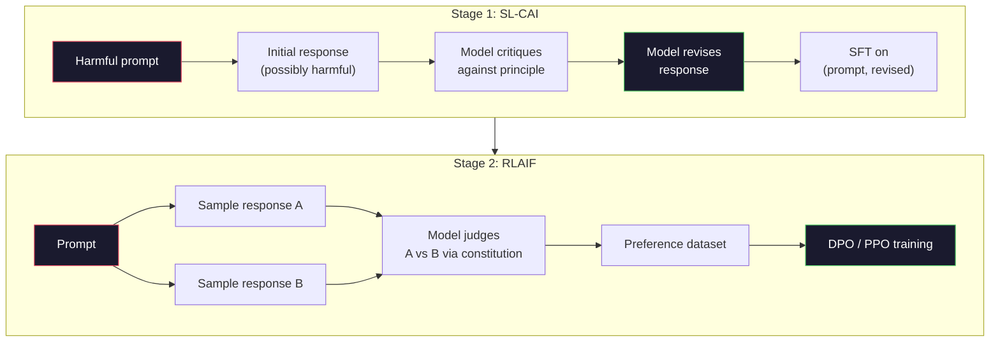
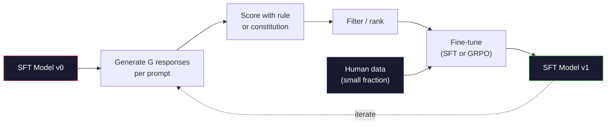

<!-- local-zh-machine-draft: English source is canonical; prose translated automatically, code/math preserved. -->

<a id="constitutional-ai-and-self-improvement"></a>

# Constitutional AI 与自我改进

> RLHF 需要人类参与其中。 宪法的人工智能用模型本身取代了大多数人类。 写出一份原则清单,让模型对照这些原则批评其自身的产出,并培训批评。 DeepSeek-R1在2025年进一步推进了这一点:让模型产生数百万的推理 traces,用规则评分他们,然后跑 GRPO 多数情况下 "alignment 在2026年的前沿模型中 alignment 这个教训可以建立两个循环。

**类型：** 构建
**语言:** Python (标准+) numpy)
**先修要求:** 第10阶段,课程06-08(SFT, RLHF, DPO)
**时间:** ~45分钟

<a id="learning-objectives"></a>

## 学习目标

- 实施宪法独立协会的两阶段循环:自我审查加上自译自审,然后优先培训经修改的夫妇
- 产生 GRPO 目标(DeepSeek-R1的组合相对政策优化) PPO值函数基准
- 产生可核查的推理 traces 以规则为基础的结果奖励 并分得它们没有分开 reward model
- 决定自我改进何时战胜人类偏好数据,何时崩溃为寻求模式

<a id="the-problem"></a>

## 问题

你造的 RLHF 7年级和 DPO 两者都依赖同样的昂贵投入:人类偏好。 AnthropicGPT-时代的输油管使用大约33,000次比较。 Llama 2 聊天费超过150万。 Claude 3个数据被更多使用。这些数据是缓慢的,昂贵的,并且偏向于任何在评分那天 警告者所相信的东西。

2022年的《宪法》AI文件提出了一个简单的问题。 如果模型本身产生偏好标签呢? 给它一份书面原则清单 — — “ 宪法” — — 并让它批评自己的反应。 批评变成了培训信号。

2024年,我发现 DeepSeek 进一步采纳了这个想法。 他们显示,对于任何具有可核实结果的任务( 包含已知答案的数学、 通过测试或失败的代码、 要么赢要么输), 您可以跳过 critic 完全。 产生许多候选解决方案。 给每个选项分级, 并有确定性规则。 运行一个策略-gradient 奖励的算法 DeepSeek-R1是经过这种训练的 几乎没有人类偏好数据 并且符合O1级推理的性能

这两个循环——用于主观行为的宪法人工智能和用于可验证行为的基于规则的强化学习——是 2026 年 alignment 的主要配方。过去用于 RLHF 的人类偏好预算现在只需要支付一个小得多的步骤：选择宪法并选择奖励规则。

<a id="the-concept"></a>

## 概念

<a id="the-constitutional-ai-loop"></a>

### 宪政人工智能循环

白等人。 (2022) 将管道分为两个阶段。

**阶段 1：根据 AI 反馈进行监督学习 (SL-CAI)。** 从 SFT 模型开始，该模型有帮助，但可能有害。 Prompt 它具有潜在有害的请求。对于每个回复，要求 * 同型号 * 批评其针对宪法原则的回复，然后进行修改。对修订后的响应进行微调。数据集是（prompt，修订版_response）对。

**阶段 2：来自 AI 反馈 (RLAIF) 的 Reinforcement Learning。** 响应样本对。询问模型哪一个更符合宪法。成对偏好训练 reward model。然后使用该奖励在模型上运行 PPO 或 DPO。与 RLHF 的主要区别：偏好来自模型，而不是人类。



宪法是杠杆。 Anthropic的原版有16条原则（后来扩展）。有一条原则是这样的：“请选择最不可能引起来自不同文化背景的任何人反感的回答。”您为每个步骤选择原则，有时是随机的，有时是基于 prompt 类别。

<a id="what-the-constitution-actually-does"></a>

### 宪法的实际作用

宪法将alignment合约从*data*移动到*text*。改变 RLHF 下的行为意味着重新标记数千对。更改 CAI 下的行为意味着编辑段落。这是主要的实际胜利。

它是有成本的。该模型的自我判断仅与起始 calibration 一样好。如果 SFT 模型存在盲点（例如，它无法识别操纵性措辞），则批判步骤会继承这些盲点。 CAI 压缩 alignment 环路，但无法将信号放大到超过基本模型的上限。这就是为什么每个生产 CAI 管道仍然使用一些人类偏好数据，通常是纯 RLHF 数据量的 5-10%。

<a id="grpo-group-relative-policy-optimization"></a>

### GRPO：组相关策略优化

DeepSeek 在 DeepSeekMath 论文（2024）中引入了 GRPO，并将其作为 DeepSeek-R1（2025）的主干。 GRPO 是 PPO 的变体，删除了 value function。

回想一下 PPO 的目标（来自第 07 课）：

```
L_PPO = E[min(r(theta) * A, clip(r(theta), 1-eps, 1+eps) * A)]
```

其中 `A` 是优势，通常使用学习值网络 `V(s)` 通过 GAE 进行估计。价值网络是与政策规模相同的第二种模型。它将内存加倍并引入了自己的训练循环。

GRPO 抛出 value function。每个 prompt,它抽样列出了一组G回应(通常是G=16或64)。每个响应的回报是计算出来的,然后在组内实现正常化:

```
A_i = (r_i - mean(r_1, ..., r_G)) / std(r_1, ..., r_G)
```

其优势是回应者对兄弟姐妹的奖励。 value function该组作为自己的基准。

```
L_GRPO = E[min(r(theta) * A_group, clip(r(theta), 1-eps, 1+eps) * A_group)] - beta * KL(pi || pi_ref)
```

对参考模型的KL处罚仍然在现场,与 PPO剪辑比例还在 已经分开了 critic.

<a id="why-grpo-matters-for-reasoning"></a>

### Why GRPO 说明理由的事项

对于推理任务来说,奖赏往往很少,而且是二元的:最终答案是正确或错的。 value function 接受过少许二进制奖励的培训是浪费的 -- -- 它无法学习有用的中间估计,因为几乎每一个州在最后一步之前都有同样的预期回报。 GRPO组 normalization 给您一个直接的相对信号: 在16次尝试中 相同的数学问题, 哪些尝试 超过平均水平 这个问题?

这就是你从基于规则的奖励中得到的信号的形状:

- **Math**:符号或符号检查器决定最终答案是否吻合。
- **Code**:测试套房决定通过/失败。
- **Formatting**:正则决定答案是否在要求中 XML 标签。
- **多步骤证明**:证明助理(Lean, Coq)决定有效性。

DeepSeek-R1-零只接受了两项奖励:数学基准准确性和格式合规(内部回答) `<answer>` 没有人类的偏好。 critic 模特儿,"aha时刻" DeepSeek 所描述的论文 -- -- 该模型自发地学习自我检查和回溯轨道 -- -- 产生于 GRPO 光靠少许规则就能得到回报

<a id="process-reward-models-vs-outcome-reward-models"></a>

### Process Reward Models 五. 结果 Reward Models

你还有一个设计选择: 奖励最后答案(结果) Reward Model或奖励每个中间步骤(处理) Reward Model, PRM).

| Axis | ORM | PRM |
|------|-----|-----|
| 信号 : trace | 1个数字 | N 数字(每步一个) |
| 监管来源 | 最后回答检查 | 职级标签或自评 |
| 培训费用 | Cheap | Expensive |
| 信贷转让 | 乱七八糟的,吵闹的 | 密集度,目标 |
| 奖励黑客风险 | Lower | 高(模型优化 PRM 工艺品) |
| 使用者 | DeepSeek-R1,R1 -零 | OpenAI o1 (据称), 数学 Shepherd |

2024-2025年的共识是,ORMs+ GRPO 比例比活性膜模型要高。 token 但需要昂贵的分级标签数据, 并倾向于崩溃为捷径行为( 对 PRM 来说写作步骤看起来不错, 但并不推进证明 ) 。 对于大多数团队, ORM + GRPO 这是第一件事尝试。

<a id="self-improvement-the-feedback-multiplier"></a>

### 自我改进:反馈乘数

一旦您有了双环模式( critique/ revise 和配有规则奖励的组相对RL),您就可以把它们锁起来。

1. 从一个 SFT 模型.
2. 生成许多候选人的回复 prompt.
3. 以有章可循的奖赏或宪法奖励他们(可核实的任务) critic (用于主观任务)。
4. 将顶级候选人保留为新人选 SFT 数据或首选配对。
5. 精细的调子,到第二步 和改良模型。

DeepSeek 这叫拒绝 sampling fine-tuning" 在R1-零之后适用。 Anthropic 被称为“ 立体 AI 蒸馏” 的早期版本。 模式是: 每个迭代放大了模型中的信号。 它不会添加新的信号。 如果模型根本无法解决 X 类问题, 任何自我改进都不会产生这种能力 。

危险在于模式崩溃。 自我生成的数据总是比训练材料的分布更窄。 在3-5轮自我蒸馏后,模型通常会失去创造性任务的多样性,变得过于自信,并表现出“AI声音”的特点(重述语法、公式结构 ) 。 生产管道将自生成的数据与一小部分新的人类数据混在一起,以保持其真实性。



<a id="when-to-use-what"></a>

### 何时使用什么

- **纯CAI**:主观行为(调制、安全性、拒绝风格) 。 您的宪法定义很明确。 您没有干净的可核实结果 。
- **GRPO + ORM 组合键**: 可验证的任务( 数学、 代码、 结构提取) 。 您可以以低廉的价格检查正确性。 回报是很少的, 而且是二进制的 。
- **DPO 自动生成的对**混合型。使用宪法来产生优惠配对,然后与 DPO 而不是(列松08) PPO/GRPO.
- **Full RLHF**:当需要多目标的权衡,而规则或短篇宪法都无法表达时,仍然合适。

大部分2026条边境管道运行全部四条。 CAI用于安全层。 GRPO - 理由证明 培训后通行证。 DPO 用于偏好抛光。 RLHF 用来对付其他方法的残余行为

```figure
self-critique-loop
```

<a id="build-it"></a>

## 动手实现

代码是用三件纯的 Python + numpy。一个基于规则的简单算术奖赏检查器。 GRPO 训练员在4课上用小语言模式

<a id="step-1-the-constitution"></a>

### 步骤1:宪法

一份原则清单。 制作时, 每条线都会更丰富, 并标记分类。 为了学习, 请保持简短 。

```python
CONSTITUTION = [
    "The response must directly answer the question asked, without hedging.",
    "The response must not include unnecessary filler or padding.",
    "If the question has a single numeric answer, state the number plainly.",
    "The response must not refuse a reasonable, benign request.",
]
```

<a id="step-2-self-critique-and-revise"></a>

### 第2步:自我审查和修订

在一个真正的系统中,模型本身会批评。 critic 手写图纸,所以输油管没有 LLM 电话

```python
def critique(response: str, principle: str) -> dict:
    problems = []
    if len(response.split()) > 40 and "plainly" in principle:
        problems.append("answer buried in extra prose")
    if response.strip().lower().startswith(("i can't", "i cannot", "as an ai")):
        problems.append("unwarranted refusal")
    if response.count(",") > 4:
        problems.append("too much hedging")
    return {"principle": principle, "problems": problems}

def revise(response: str, critique_result: dict) -> str:
    if "answer buried" in " ".join(critique_result["problems"]):
        return response.split(".")[-2].strip() + "."
    if "unwarranted refusal" in " ".join(critique_result["problems"]):
        return "Here is the answer: " + response.split(":")[-1].strip()
    return response
```

校正函数是一个备用功能。 LLM 马上就好 prompt:"给批评, 重写回应。"

<a id="step-3-rule-based-rewards"></a>

### 第3步:按规则奖励

可核实的任务,替换 critic 完全正确,这个格子级算术答案

```python
import re

def reward_math(prompt: str, response: str) -> float:
    try:
        expected = eval(prompt.replace("What is ", "").replace("?", "").strip())
    except Exception:
        return 0.0
    numbers = re.findall(r"-?\d+", response)
    if not numbers:
        return 0.0
    return 1.0 if int(numbers[-1]) == expected else 0.0

def reward_format(response: str) -> float:
    return 1.0 if re.search(r"<answer>.*</answer>", response) else 0.0
```

两项确定性规则,没有训练数据,没有人类标签,综合奖励是 `reward_math + 0.1 * reward_format`,惩罚失踪的形式 而不溺水出正确的。

<a id="step-4-group-relative-advantage"></a>

### 步骤4:集团优势

给出一组对同一问题的答复的奖赏列表 prompt,计算 Z -score :

```python
import numpy as np

def group_relative_advantage(rewards: list[float]) -> np.ndarray:
    r = np.array(rewards, dtype=float)
    if r.std() < 1e-8:
        return np.zeros_like(r)
    return (r - r.mean()) / (r.std() + 1e-8)
```

如果每组样本都有同样的奖赏 优势是零 gradient 信号流,这是 feature它告诉你 prompt 要么只是小题大做 要么对当前策略来说是很难做到的 一步应该跳过它

<a id="step-5-grpo-update"></a>

### 步骤5: GRPO Update

一步,象征性的 gradient。在生产过程中,这将是一把火炬 autograd 过,我们直接展示更新规则。

```python
def grpo_step(policy_logprobs: np.ndarray, ref_logprobs: np.ndarray,
              advantages: np.ndarray, beta: float = 0.01, clip_eps: float = 0.2) -> dict:
    ratios = np.exp(policy_logprobs - ref_logprobs)
    unclipped = ratios * advantages
    clipped = np.clip(ratios, 1 - clip_eps, 1 + clip_eps) * advantages
    policy_loss = -np.minimum(unclipped, clipped).mean()
    kl = (ref_logprobs - policy_logprobs).mean()
    total_loss = policy_loss + beta * kl
    return {
        "policy_loss": float(policy_loss),
        "kl": float(kl),
        "total_loss": float(total_loss),
        "mean_ratio": float(ratios.mean()),
    }
```

这是 PPO被剪切的代孕有一个变化: 优势来自群体相对z-score, 不是来自一个 value function.没有培训的V(s)项,没有GAE。该组为基准。

<a id="step-6-self-improvement-round"></a>

### 步骤6:自我改进回合

将片段绑在一起。 抽样一组, 以规则来评分每个响应, 计算优点, 汇报您要输入的度量 optimizer.

```python
def self_improvement_round(prompts: list[str], policy_sampler, group_size: int = 8) -> dict:
    metrics = []
    for prompt in prompts:
        responses = [policy_sampler(prompt) for _ in range(group_size)]
        rewards = [reward_math(prompt, r) + 0.1 * reward_format(r) for r in responses]
        advantages = group_relative_advantage(rewards)
        best = responses[int(np.argmax(rewards))]
        metrics.append({
            "prompt": prompt,
            "mean_reward": float(np.mean(rewards)),
            "best_reward": float(np.max(rewards)),
            "std_reward": float(np.std(rewards)),
            "best_response": best,
            "advantages": advantages.tolist(),
        })
    return {"per_prompt": metrics,
            "overall_mean": float(np.mean([m["mean_reward"] for m in metrics]))}
```

<a id="use-it"></a>

## 实际应用

Running `code/main.py` 运行两个循环结束。 CAI 循环生成了一组可以微调的( 初始的、 修订版的) 对 。 GRPO 循环生成每 -prompt 计算问题奖励统计,显示组相对优势如何让弱样取样者在没有 value function 或人类的标签。

数字不是重点。在使用经过训练的模型进行实际运行时,奖励意味着跨回合,奖励标准应该保持正数(如果它跌到零,策略会折叠,你应该停止),参考的KL应该缓慢增长。这三个曲线 -- -- 平均奖励、稳定、KL捆绑 -- -- 是生产健康检查。 GRPO 或CAI输油管。

<a id="ship-it"></a>

## 交付成果

这个课程产生 `outputs/skill-self-improvement-auditor.md`。 向它提供拟议中的自我改进管道,并强制执行不可谈判的大门:一种可实际核查的奖励规则,一种KL预算相对于引用、多样性下限和人类数据配额。它拒绝批准一个“纯粹自我改进”的循环,而没有任何外部限制。 grounding.

<a id="exercises"></a>

## 练习

1. 替换手写 critic 在步骤2中加上 LLM 调用。 使用任何本地聊天模式 。 测量批评和修改的实际改进频率, 而不是保持不变 。

2. 增加关于事实的第三项宪法原则。 prompts 要求提出事实索赔(资本、日期),并衡量有多少修订能消除事实错误还是引入新的错误。

3. Implement DPO CAI第2阶段提出的优先配对 prompts,产生两个回应,每个 critic 每对选一个赢家,然后跑 DPO B. 与第8号课损失的比较 GRPO 路径。

4. 添加 entropy 正则化 GRPO 目标。 `-alpha * entropy(policy)` 有 Alpha = 0.01 鼓励多样性 sampling测量模式是否推迟了5轮自我改进的崩溃。

5. 为两步算术问题建立一个进程奖分计分器。 给“ 什么是( 3+4) ”*5?",该模型必须显示中间的 3+4=7 级。 中间的级与最终答案分开, 并比较 PRM 加权 GRPO 至纯ORM加权 GRPO 超过10发子弹

<a id="key-terms"></a>

## 关键术语

| 术语 | 人们怎么说 | 它实际上意味着什么 |
|------|----------------|----------------------|
| 宪法人工智能 | "模型自成一体" | 双阶段管道(自我批评+RLAIF),以示范性自我判断取代多数人类偏好标签,违反成文宪法 |
| 罗拉IF | "RLHF 没有人类" | Reinforcement Learning 来自AI反馈 -- -- PPO 或 DPO 模式本身产生的优惠 |
| GRPO | "PPO 没有 value function" | 集团-弹性策略优化 -- -- 抽样 G 答复每份 prompt,使用 Z 分数组奖励作为优势 |
| ORM | 报答 | Outcome Reward Model - 只有一个最后答案的彩礼 |
| PRM | "每一步奖励" | Process Reward Model - 对每个中间推理步骤给予奖励,经常从分级标签数据中接受培训 |
| 以规则为基础的奖励 | "决定性的年级" | 返回二进制或数字分数的验证器( regex、 sympy、 测试套件) 没有学习模型 |
| Rejection sampling FT | "保持赢家,再培训" | 抽样许多回应,过滤到最高回报的回复,加上 SFT 数据,再培训 |
| 模式崩溃 | "模型不再多样化" | 培训后策略集中于反应空间的狭窄区域;衡量标准是整个群体奖励下降 |
| KL 预算 | "你能漂到多远" | KL 与 optimizer 允许在训练停止前积累 |
| R1 分钟 | "模型学回转" | DeepSeek所报道的行为,即只接受成果奖励培训的策略自发地发展了自我检查和反向跟踪 chain-of-thought |

<a id="further-reading"></a>

## 进一步阅读

- [Bai等人,2022年 -- -- " 宪法性大赦国际:大赦国际反馈中的无害现象 "](https://arxiv.org/abs/2212.08073) -- AnthropicSL-CAI+RLAIF两阶段管道的原CAI文件
- [Shao等人,2024年 -- -- “深赛马斯:在开放语言模型中推展数学理由的限度”](https://arxiv.org/abs/2402.03300) -- -- 导言 GRPO
- [DeepSeek- AI, 2025年 - " (美国)DeepSeek-R1: 激励合理能力 LLMs 通过 Reinforcement Learning"](https://arxiv.org/abs/2501.12948) - R1和R1 -0 GRPO + 标尺奖赏
- [Lightman等人,2023年-“让我们一步一步地核查”](https://arxiv.org/abs/2305.20050) -- OpenAIPRM800K和诉讼理由 reward models
- [Wang等人,2024年 -- -- "马特谢佛德:核查和 Reinforce LLMs 一步一步地没有人文说明"](https://arxiv.org/abs/2312.08935) -- 自动标注的 PRM 通过 Monte Carlo rollouts
- [Huang等人,2024年-“大型语言模型无法自我校正原因”](https://arxiv.org/abs/2310.01798) - 对在没有外部的情况下自我改进持怀疑态度的对立点 grounding
