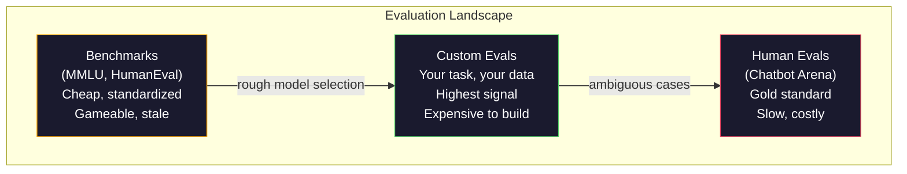
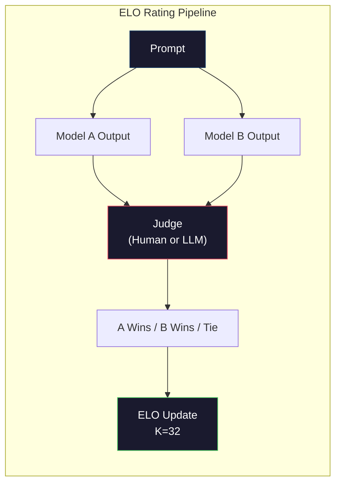

<!-- local-zh-machine-draft: English source is canonical; prose translated automatically, code/math preserved. -->

<a id="evaluation-benchmarks-evals-lm-harness"></a>

# Evaluation：基准、Evals 与 LM Harness

> Goodhart 的法则: 当一项措施成为目标时, 它不再是一个好的衡量标准。 每个边框实验游戏都以基准值为基准。 MMLU 得分上升, 而模型仍然无法可靠地计算 R 在“ 草莓” 中的数。 唯一重要的评价是您的任务中的评估, 以及您的数据 。

**类型:** Build
**语言:** Python
**先修要求:** 第10阶段,第01-05期(LLMs 发自Scratch)
**时间:** ~90分钟

<a id="learning-objectives"></a>

## 学习目标

- 构建一个自定义 evaluation harness 使用多种选择和不限人数的基准
- 解释为什么标准基准(MLU、HumanEval)饱和,而且没有区分前沿模式
- 采用适当的衡量标准,执行具体任务的评估: exact match, F1, BLEU, 和 LLM- 法官评分
- 设计自定义 evaluation 套件针对您的具体用途, 而不是只依赖公共头板

<a id="the-problem"></a>

## 问题

MMLU于2020年出版,共有15,908个问题,涉及57个主题,三年内,边界模型饱和了它。 GPT-4分86.4% Claude 3 Opus得86.8%。 Llama 3 405B 得分为88.6%。领先板压缩成三点范围,其中差异是统计噪音,而不是实际能力差距。

同时,同样的模型在10岁的人不考虑的情况下处理的任务中失败。 Claude 3.5 Sonnet在MMLU上得88.7%的分数,最初无法在“草莓”中计数字母。这个任务需要零世界知识和零推理,只是字符层迭代。人类Eval测试代码生成时遇到164个问题。模型在它上得90分,同时仍然产生代码,让任何初级开发者都能抓住边际案件。

基准业绩与现实世界可靠性之间的差距是 LLM evaluation。基准可以告诉您模型如何在基准上运行。它们几乎没有告诉你该模型将如何在具体任务中,用特定的数据,在特定的失败模式下运行。如果您正在构建客户支持机器人, MMLU就无关紧要了。如果您正在构建代码助理, HumanEval只覆盖函数级的生成, 它没有提及调试、 重新设定或解释文件之间的代码。

您需要自定义的评估。 不是因为基准是没用的, 它们对于粗略的模型选择有用, 而是因为最终的 evaluation 必须完全符合你的部署条件。

<a id="the-concept"></a>

## 概念

<a id="the-eval-landscape"></a>

### Eval 景观

共有三类 evaluation,每个有不同的成本和信号质量。

**Benchmarks** MMLU、HumanEval、SWE-bench、MATH、ARC、HellaSwag。您对基准运行一个模型,并获得分数。 优点是:每个人都使用相同的测试, 这样你就可以比较模型。 缺点是: 模型和训练数据越来越污染这些基准。 实验室训练包含基准问题的数据。 分数会上升。 能力可能不会提高 。

**自定义 evvals** 是您为特定使用大小写构建的测试套件。您定义了输入、预期输出和评分功能。法律文档摘要器在法律文档中被评估。 A SQL 生成器会在您的数据库图案上被评估。 这些是昂贵的, 但却是唯一的 evaluation 预测生产业绩

**人类评估** 使用付费的注解器来根据帮助、正确性、流利和安全等标准来判断模型输出。 在自动评分失败的情况下, 开放式任务的金质标准。 查波特竞技场在100+模型中收集了超过200万张人类偏好票。 负差: 成本( 每判决0. 10- 2. 00美元)和速度( 小时到 天 ) 。



<a id="why-benchmarks-break"></a>

### 为何打破基准

三种机制导致基准分数停止反映实际能力。

**数据污染。** 培训公司在网上浏览。基准问题在互联网上直播。模型在培训中看到答案。这不是传统意义上的欺骗,实验室并不故意包括基准数据。但网络规模的筛选几乎不可能排除。

**教人测试** 实验室优化培训混合物以适应基准性能。 如果培训组合的5%是 MMLU 式的多重选择, 模型可以学习格式和答案分布。 MMLU 具有四向多重选择。 模型可以发现答案分布在 A/ B/ C/ D 之间大致一致, 即使模型不知道答案, 也有所帮助 。

**Saturation.** 当每个前沿模型在基准上得85-90%分时,基准就不再有区别。 剩下的10-15%的问题可能含混不清、标签错误或需要模糊的域知识。 MMLU从87%提高到89%可能意味着模型会记住两个更模糊的问题,而不是它变得更聪明了。

<a id="perplexity-a-quick-health-check"></a>

### Perplexity:快速健康检查

Perplexity 测量一个模型有多惊讶 tokens。形式上,它是表列的平均负日志类型 :

```
PPL = exp(-1/N * sum(log P(token_i | context)))
```

一个 perplexity 10岁是指平均而言,该模型与每个模型在10个选项中统一选择一样不确定 token 位置,低一点更好 GPT-2个 perplexity 维基文本103上30号 GPT- 3个得到~20。 Llama 3 8B得到~7。

Perplexity 可用于比较同一测试集上的模型,但有盲点。 perplexity 能够很好地预测共同模式 同时在罕见但重要的模式下 变得非常可怕 instruction following用它来检查是否正常 而不是最后判决

<a id="llm-as-judge"></a>

### LLM- 法官

使用强型模型来评估较弱型模型的输出。 这个想法很简单: 询问 GPT-4个或 Claude 索纳特将按1-5比额表对答复的正确性、有用性和安全性进行评级。 GPT-4微米 与人类的判断有惊人的关联 大约80%的人同意大部分任务

评分 prompt 比模型更重要 模糊不清 prompt 产生噪音的分数。 prompt 使用一个标语 (“分数 5 : 如果答案准确无误, 并引用了一个来源, 4 表示正确, 但没有来源, 3 表示部分正确 ”) 来产生一致的、 可复制的分数。

失败模式:法官模型显示位置偏差(在对等比较中优先采用第一个答复)、动词偏差(倾向于较长的答复)和自我偏好(GPT- 4个费率 GPT-4项产出高于等值 Claude 减轻:随机排列顺序,长度正常化,使用与所评价模型不同的法官。

<a id="elo-ratings-from-pairwise-comparisons"></a>

### 从对称比较中进行 ELO 评分

查波特竞技场的手法。 显示对同一方向的两个响应 prompt 人(或) LLM 选择更好的。从上千个比较中,计算每个模型的ELO等级 -- -- 象棋中使用的同一系统。

ELO的优势:相对排名比绝对评分更可靠,优雅地处理关系,并且与每个产出的评分相比,相互比较要少于独立评分。 截至2026年初,Chatbot Arena排名显示 GPT- 4号 Claude 3.5 索内特, Gemini 1.5 在顶部20个ELO点内。



<a id="eval-frameworks"></a>

### Eval 框架

**lm-evaluation-harness** (EletherAI): 标准开放源码 Eval 框架。 支持 200+ 基准。 运行任何使用 MMLU、 HellaSwag、 ARC 等命令的 Hugging Face 模型。 由 Open 用户使用 LLM 头板。

**RAGAS**: evaluation 框架,专用于 RAG 管道: 测量是否忠实( 答案是否与检索的上下文相符? ) , 相关性( 检索的上下文是否与问题相关? ) , 以及回答正确 。

**promptfoo**: 配置驱动的 Eval prompt engineering定义测试案例 YAML,对多个模型运行,获得一个通过/失败报告。用于回归测试 prompts - - 确定一个 prompt 更改不会打破现有的测试案例。

<a id="building-custom-evals"></a>

### 创建自定义 Evals

唯一对生产重要的评估。 这个过程:

1. **定义任务 。** 模型应该做什么?准确。 “ 答案问题” 过于模糊。 “ 给客户投诉邮件, 提取产品名称、 发行类别和情绪” 是您可以评估的任务 。

2. **创建测试案例 。** 原型反射器至少50个,生产200个以上。_对输出。包括边框:空输入、对立输入、模糊输入、其他语言的投入。

3. **定义得分。** Exact match 用于 structured outputs. BLEU/(低浓铀)ROUGE 用于文本相似性。 LLMF1 用于提取任务。 weights.

4. **自动。** 每一个 Eval 都有一个命令。 没有手动步骤 。 存储结果的格式可以让时间比较 。

5. **跟踪时间。** 独立计算后,得分是毫无意义的。 您需要趋势线。 上次得分后是否有所改善 。 prompt 更改吗? 它在转换模型后回归了吗 ? 将您的 eval 和您的 prompts.

| Eval 类型 | 每项判决的费用 | 与人类达成协议 | 最适合 |
|-----------|------------------|----------------------|----------|
| Exact match | ~$0 | 100%(适用时) | Structured output分类 |
| BLEU/ 双轨线ROUGE | ~$0 | ~60% | 翻译、总结 |
| LLM- 以判决方式 | ~$0.01 | ~80% | 不限成员名额的一代 |
| 人类评价 | $0.10-$2.00 | N/A(即事实真相) | 模糊不清的,高考的任务 |

```figure
perplexity-loss
```

<a id="build-it"></a>

## 动手实现

<a id="step-1-a-minimal-eval-framework"></a>

### 步骤1:最低限度的 Eval 框架

定义核心抽象。 逆数案例包含输入、 预期输出和可选元数据指令。 计分器进行预测, 引用并返回 0 到 1 之间的得分 。

```python
import json
from collections import Counter

class EvalCase:
    def __init__(self, input_text, expected, metadata=None):
        self.input_text = input_text
        self.expected = expected
        self.metadata = metadata or {}

class EvalSuite:
    def __init__(self, name, cases, scorers):
        self.name = name
        self.cases = cases
        self.scorers = scorers

    def run(self, model_fn):
        results = []
        for case in self.cases:
            prediction = model_fn(case.input_text)
            scores = {}
            for scorer_name, scorer_fn in self.scorers.items():
                scores[scorer_name] = scorer_fn(prediction, case.expected)
            results.append({
                "input": case.input_text,
                "expected": case.expected,
                "prediction": prediction,
                "scores": scores,
            })
        return results
```

<a id="step-2-scoring-functions"></a>

### 第2步:分级函数

Build exact match, token F1和模拟 LLM- 做为裁判的得分者

```python
def exact_match(prediction, expected):
    return 1.0 if prediction.strip().lower() == expected.strip().lower() else 0.0

def token_f1(prediction, expected):
    pred_tokens = set(prediction.lower().split())
    exp_tokens = set(expected.lower().split())
    if not pred_tokens or not exp_tokens:
        return 0.0
    common = pred_tokens & exp_tokens
    precision = len(common) / len(pred_tokens)
    recall = len(common) / len(exp_tokens)
    if precision + recall == 0:
        return 0.0
    return 2 * (precision * recall) / (precision + recall)

def llm_judge_simulated(prediction, expected):
    pred_words = set(prediction.lower().split())
    exp_words = set(expected.lower().split())
    if not exp_words:
        return 0.0
    overlap = len(pred_words & exp_words) / len(exp_words)
    length_penalty = min(1.0, len(prediction) / max(len(expected), 1))
    return round(overlap * 0.7 + length_penalty * 0.3, 3)
```

<a id="step-3-elo-rating-system"></a>

### 第3步:ELO评级系统

执行与 ELO 更新的对比。 这正是 Chatbot Arena 用于排序模型的系统 。

```python
class ELOTracker:
    def __init__(self, k=32, initial_rating=1500):
        self.ratings = {}
        self.k = k
        self.initial_rating = initial_rating
        self.history = []

    def _ensure_player(self, name):
        if name not in self.ratings:
            self.ratings[name] = self.initial_rating

    def expected_score(self, rating_a, rating_b):
        return 1 / (1 + 10 ** ((rating_b - rating_a) / 400))

    def record_match(self, player_a, player_b, outcome):
        self._ensure_player(player_a)
        self._ensure_player(player_b)

        ea = self.expected_score(self.ratings[player_a], self.ratings[player_b])
        eb = 1 - ea

        if outcome == "a":
            sa, sb = 1.0, 0.0
        elif outcome == "b":
            sa, sb = 0.0, 1.0
        else:
            sa, sb = 0.5, 0.5

        self.ratings[player_a] += self.k * (sa - ea)
        self.ratings[player_b] += self.k * (sb - eb)

        self.history.append({
            "a": player_a, "b": player_b,
            "outcome": outcome,
            "rating_a": round(self.ratings[player_a], 1),
            "rating_b": round(self.ratings[player_b], 1),
        })

    def leaderboard(self):
        return sorted(self.ratings.items(), key=lambda x: -x[1])
```

<a id="step-4-perplexity-calculation"></a>

### 步骤4: Perplexity Calculation

Compute perplexity 使用 token 实际上,你应该从模型那里得到这些 logits。在这里,我们模拟概率分布。

```python
import numpy as np

def perplexity(log_probs):
    if not log_probs:
        return float("inf")
    avg_neg_log_prob = -np.mean(log_probs)
    return float(np.exp(avg_neg_log_prob))

def token_log_probs_simulated(text, model_quality=0.8):
    np.random.seed(hash(text) % 2**31)
    tokens = text.split()
    log_probs = []
    for i, token in enumerate(tokens):
        base_prob = model_quality
        if len(token) > 8:
            base_prob *= 0.6
        if i == 0:
            base_prob *= 0.7
        prob = np.clip(base_prob + np.random.normal(0, 0.1), 0.01, 0.99)
        log_probs.append(float(np.log(prob)))
    return log_probs
```

<a id="step-5-aggregate-results"></a>

### 步骤5:综合结果

计算整个逆算过程的汇总统计数据:平均值、中位数、临界值及分数。

```python
def summarize_results(results, threshold=0.8):
    all_scores = {}
    for r in results:
        for metric, score in r["scores"].items():
            all_scores.setdefault(metric, []).append(score)

    summary = {}
    for metric, scores in all_scores.items():
        arr = np.array(scores)
        summary[metric] = {
            "mean": round(float(np.mean(arr)), 3),
            "median": round(float(np.median(arr)), 3),
            "std": round(float(np.std(arr)), 3),
            "min": round(float(np.min(arr)), 3),
            "max": round(float(np.max(arr)), 3),
            "pass_rate": round(float(np.mean(arr >= threshold)), 3),
            "n": len(scores),
        }
    return summary

def print_summary(summary, suite_name="Eval"):
    print(f"\n{'=' * 60}")
    print(f"  {suite_name} Summary")
    print(f"{'=' * 60}")
    for metric, stats in summary.items():
        print(f"\n  {metric}:")
        print(f"    Mean:      {stats['mean']:.3f}")
        print(f"    Median:    {stats['median']:.3f}")
        print(f"    Std:       {stats['std']:.3f}")
        print(f"    Range:     [{stats['min']:.3f}, {stats['max']:.3f}]")
        print(f"    Pass rate: {stats['pass_rate']:.1%} (threshold >= 0.8)")
        print(f"    N:         {stats['n']}")
```

<a id="step-6-run-the-full-pipeline"></a>

### 步骤6:运行完整管道

将所有内容连接在一起。 定义一项任务, 创建测试案例, 模拟两个模型, 运行 Evals, 从对比中计算 ELO, 并打印头版 。

```python
def demo_model_good(prompt):
    responses = {
        "What is the capital of France?": "Paris",
        "What is 2 + 2?": "4",
        "Who wrote Hamlet?": "William Shakespeare",
        "What language is PyTorch written in?": "Python and C++",
        "What is the boiling point of water?": "100 degrees Celsius",
    }
    return responses.get(prompt, "I don't know")

def demo_model_bad(prompt):
    responses = {
        "What is the capital of France?": "Paris is the capital city of France",
        "What is 2 + 2?": "The answer is four",
        "Who wrote Hamlet?": "Shakespeare",
        "What language is PyTorch written in?": "Python",
        "What is the boiling point of water?": "212 Fahrenheit",
    }
    return responses.get(prompt, "Unknown")

cases = [
    EvalCase("What is the capital of France?", "Paris"),
    EvalCase("What is 2 + 2?", "4"),
    EvalCase("Who wrote Hamlet?", "William Shakespeare"),
    EvalCase("What language is PyTorch written in?", "Python and C++"),
    EvalCase("What is the boiling point of water?", "100 degrees Celsius"),
]

suite = EvalSuite(
    name="General Knowledge",
    cases=cases,
    scorers={
        "exact_match": exact_match,
        "token_f1": token_f1,
        "llm_judge": llm_judge_simulated,
    },
)

results_good = suite.run(demo_model_good)
results_bad = suite.run(demo_model_bad)

print_summary(summarize_results(results_good), "Model A (concise)")
print_summary(summarize_results(results_bad), "Model B (verbose)")
```

"好"模式给出了准确的答案。“坏”模式给出了动词句。 Exact match 严厉惩罚动脉模型 Token F1和F1类 LLM这说明了衡量选择的重要性: 同一模型看似伟大或糟糕, 取决于你如何得分。

<a id="step-7-elo-tournament"></a>

### 步骤7:ELO竞赛

在多个回合的模型之间进行对比。

```python
elo = ELOTracker(k=32)

for case in cases:
    pred_a = demo_model_good(case.input_text)
    pred_b = demo_model_bad(case.input_text)

    score_a = token_f1(pred_a, case.expected)
    score_b = token_f1(pred_b, case.expected)

    if score_a > score_b:
        outcome = "a"
    elif score_b > score_a:
        outcome = "b"
    else:
        outcome = "tie"

    elo.record_match("model_a_concise", "model_b_verbose", outcome)

print("\nELO Leaderboard:")
for name, rating in elo.leaderboard():
    print(f"  {name}: {rating:.0f}")
```

<a id="step-8-perplexity-comparison"></a>

### 步骤8: Perplexity Comparison

Compare perplexity 跨越不同质量水平的“模型”。

```python
test_text = "The quick brown fox jumps over the lazy dog in the garden"

for quality, label in [(0.9, "Strong model"), (0.7, "Medium model"), (0.4, "Weak model")]:
    log_probs = token_log_probs_simulated(test_text, model_quality=quality)
    ppl = perplexity(log_probs)
    print(f"  {label} (quality={quality}): perplexity = {ppl:.2f}")
```

<a id="use-it"></a>

## 实际应用

<a id="lm-evaluation-harness-eleutherai"></a>

### lm-evaluation-harness (优绝国际)

运行任何模型基准的标准工具。

```python
# pip install lm-eval
# Command line:
# lm_eval --model hf --model_args pretrained=meta-llama/Llama-3.1-8B --tasks mmlu --batch_size 8

# Python API:
# import lm_eval
# results = lm_eval.simple_evaluate(
#     model="hf",
#     model_args="pretrained=meta-llama/Llama-3.1-8B",
#     tasks=["mmlu", "hellaswag", "arc_easy"],
#     batch_size=8,
# )
# print(results["results"])
```

<a id="promptfoo"></a>

### promptfoo

配置驱动的 Eval prompt engineering定义测试 YAML 并运行与多个提供者。

```yaml
# promptfoo.yaml
providers:
  - openai:gpt-4o-mini
  - anthropic:claude-3-haiku

prompts:
  - "Answer in one word: {{question}}"

tests:
  - vars:
      question: "What is the capital of France?"
    assert:
      - type: contains
        value: "Paris"
  - vars:
      question: "What is 2 + 2?"
    assert:
      - type: equals
        value: "4"
```

<a id="ragas-for-rag-evaluation"></a>

### 反种族主义组织 RAG evaluation

```python
# pip install ragas
# from ragas import evaluate
# from ragas.metrics import faithfulness, answer_relevancy, context_precision
#
# result = evaluate(
#     dataset,
#     metrics=[faithfulness, answer_relevancy, context_precision],
# )
# print(result)
```

RAGAS 测量通用评估缺失之处: 模型的回答是否基于检索的背景, 而不仅仅是答案是否“正确 ” 。

<a id="ship-it"></a>

## 交付成果

这个课程产生 `outputs/prompt-eval-designer.md` - 一个可重复使用 prompt 用于为任何任务设计自定义的 Eval 套件。 给它一个任务描述, 它生成测试大小写、 评分功能, 以及一个过错/ 失败的门槛建议 。

还能产生 `outputs/skill-llm-evaluation.md` - 选择权利的决定框架 evaluation 根据任务类型、预算和潜伏要求制定战略。

<a id="exercises"></a>

## 练习

1. 添加一个“ 一致性” 计分器, 该计分器通过模型运行相同的输入 5 次, 并测量输出的匹配频率 。 对决定性输入的不一致回答显示脆弱 。 prompts 或高 temperature 设置。

2. 扩大ELO跟踪器,以支持多个法官职能(exact match, F1, LLM- 法官)和 weight 比较头板在您 weight exact match 严重对F1。

3. 为特定任务构建一个 evval 套件: 电子邮件分类为 5 个类别。 创建 100 个测试案例, 包括边缘案例( 属于多个类别的电子邮件、 空邮件、 其它语言的电子邮件) 。 测量不同的“ 模型” (基于规则、 关键字匹配、 模拟) LLM执行。

4. 实施污染检测:根据一套评估问题和训练资料,检查训练数据中显示的评估问题(或近义词句)的百分比。这是研究人员审计基准的有效性。

5. 构建一个“ 模型 diff” 工具。 根据两个模型版本的 Eval 结果, 突出显示哪些具体的测试案例得到了改进, 哪些是倒退了, 哪些是保持不变的。 这是代码 diff 的eval 等值, 这对于理解改变是否有益或有害至关重要 。

<a id="key-terms"></a>

## 关键术语

| 术语 | 人们怎么说 | 它实际上意味着什么 |
|------|----------------|----------------------|
| MMLU | "基准" | 大规模多任务语言理解 -- -- 15 908个涉及57个科目的多重选择问题,到2025年饱和到88%以上 |
| HumanEval | "电算法" | 164 Python 功能完成问题 OpenAI,仅测试独立的函数生成 |
| SWE-bench | "真实编码电子算法" | 2,294 GitHub 12个问题 Python Repos, 测量端到端的错误修正, 包括测试生成 |
| Perplexity | “模型有多混乱” | exp (- avg( log P( token) )_(i 给定的上下文)))下限值:该模型给实际数值分配的概率较高 tokens |
| ELO 评级 | "模特儿的排名" | 相对技能评级,根据Chatbot Arena用于排行100+模型的双赢/损失记录计算 |
| LLM- 以判决方式 | 将AI升为AI级 | 强势模型的输出结果比标语差, 与人类法官的协议率是80% ~ 0.01/ 裁决率 |
| 数据污染 | "模型看到了测试" | 训练数据包括基准问题、超额计分而不提高实际能力 |
| Eval 套房 | "一堆测试" | 版本的收藏( 投入, 预期)_输出,计分器) |
| 及格率 | "什么比例它得到的权利" | 评分超过门槛值的反数值 -- -- 因其衡量可靠性而比平均得分更具可操作性 |
| 查波特竞技场 | "模式排名网站" | LMSYS 平台,2M+人偏好票,产生最受信任者 LLM 通过 ELO 评级的领先版 |

<a id="further-reading"></a>

## 进一步阅读

- [Hendrycks等人,2021年 -- -- " 衡量大规模多任务语言理解 "](https://arxiv.org/abs/2009.03300) - MMLU文件,仍然被引用最多 LLM 基准 saturation
- [Chen等人,2021年 -- -- “评价在代码方面受过训练的大语言模型”](https://arxiv.org/abs/2107.03374) - 人类生命年文件 OpenAI创建代码生成 evaluation methodology
- [Zheng等人,2023年 -- -- " Judging案 " LLM-as-a-Judge"](https://arxiv.org/abs/2306.05685) - 对使用进行系统分析 LLMs 用于评价 LLMs,包括立场偏见和动词偏见调查结果
- [竞技场(前称 " LMSYS " 查波特竞技场)](https://arena.ai/leaderboard) - 众源模型比较平台,2M+票,最信任的现实世界 LLM ranking
