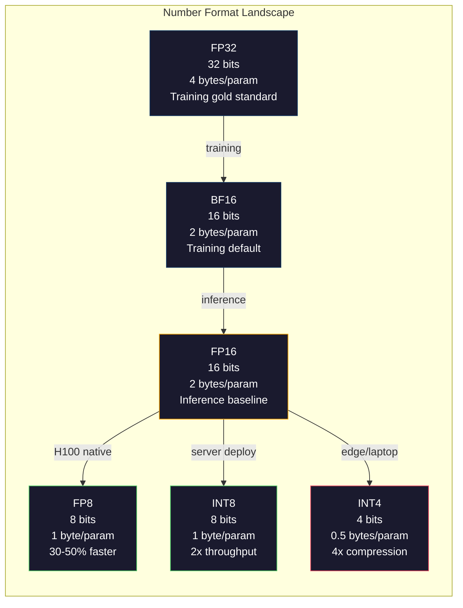
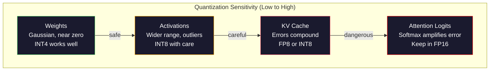
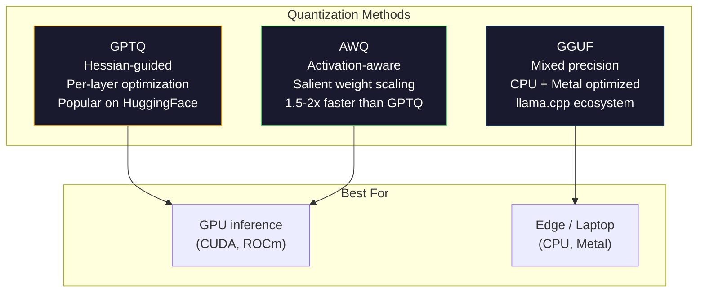

<!-- local-zh-machine-draft: English source is canonical; prose translated automatically, code/math preserved. -->

<a id="quantization-making-models-fit"></a>

# Quantization：让模型装得下

> FP16的70B模型需要140GB。 weights量化为 FP8: 1 80GB GPU.INT4: 麦克布克。

**类型:** Build
**语言:** Python (与 numpy)
**先修要求:** 第10阶段,课程01-10(LLMs 发自Scratch)
**时间:** ~120分钟

<a id="learning-objectives"></a>

## 学习目标

- 实施对称和不对称 quantization 从FP16到INT8和INT4,包括每-tensor 和每个频道的缩放
- 计算内存节余 quantization 确定哪个精确度适合给定的 GPU图像
- 解释培训后的差异 quantization (PTQ)和(PTQ) 国家 quantization- 意识培训
- 应用 GPTQ 或 AWQ 来量化一个真实的模型并测量基准的精确度- 模数权衡

<a id="the-problem"></a>

## 问题

Llama 370B有700亿 parameters. 每个 parameter 是一个 16 位浮点数。 共 140 亿 字节。 单 A100 含有 VRAM 的 80 GB 。 您甚至不能装入 weights,更不用说运行 inference,单 GPU。你需要两个A100,每小时2美元,只服务一个模型。

但每块16比特 parameter 浪费很多 weights 在接近零的神经网络组中。 FP16 的全部动态范围( 从 0.00000059 到 65 504) 几乎完全未使用。 如果您测量了实际分布 weights 在 Llama 3 70B, 其中95%在 - 0.1 和 + 0.1 之间。 您正在燃烧 16 位元以表示适合 4 的值 。

Quantization 将高精度数字替换为低精度数字。 FP16 至 FP8 将内存切成一半。 FP16 至 INT4 将内存切成四分之一。 140GB 模型变成 35GB 。 它适合单个消费者 。 GPU。按到 2 位 quantization 同一模型在16GB笔记本电脑上运行。

成本是准确的。 每次删除时都会破坏信息。 问题在于您损失了多少准确度和在哪里。 精确量化的INT4 模型在大多数基准中保留了95- 99%的原始质量。 一个天真的模式 。 quantization 对INT4可以完全摧毁模型。区别在于技术。

Community quantizations 的 Llama 3至INT4与 GPTQ 显示大约 1-2 perplexity 维基文本丢失的点数 。 Mistral 已释放 FP8 checkpoints MMLU的混凝土 8x22B 质量损失为零。 llama. cpp, 运行 70B 模型的MacBooks 与M系列芯片。 Quantization 并不是黑客,它是每个大于7B的模型的标准部署路径。

<a id="the-concept"></a>

## 概念

<a id="number-formats-what-each-bit-does"></a>

### 数字格式:每个位子做什么

每个浮点数有三个部分:标志、表率和曼蒂萨(也称为标志和标志)。符号是一位。提示决定范围(数字大小)。曼蒂萨决定精确度(小数位数)。

```
FP32:  [1 sign] [8 exponent] [23 mantissa]  = 32 bits
FP16:  [1 sign] [5 exponent] [10 mantissa]  = 16 bits
BF16:  [1 sign] [8 exponent] [7  mantissa]  = 16 bits
FP8:   [1 sign] [4 exponent] [3  mantissa]  = 8  bits (E4M3)
FP8:   [1 sign] [5 exponent] [2  mantissa]  = 8  bits (E5M2)
INT8:  [1 sign] [7 value]                   = 8  bits (uniform steps)
INT4:  [1 sign] [3 value]                   = 4  bits (16 levels total)
```

**FP32** 3⁄4 ̄ ̧漯B

**FP16** 将位数减半。 10 个曼蒂萨位数给出了大约3.3 位数的十进制数字。 指数缩小到 5 位数, 将范围大大缩小( 最大值~ 65 504) 。 这对您来说是罚款的 。 weights (它几乎为零)但对于活化和(或)对于活化是危险的。 gradients FP16培训需要损失规模,以防止资金外流。

**BF16** (Brain Float 16) 将8位指数从 FP32 保持到 7 位。 与 FP32 相同, 精确度低于 FP16 。 Google 专门为深层学习设计了它。 直觉: 范围比神经网络的精度更重要 。 A gradient 在FP16中,10 ^-20的下水量在BF16中存活下来。 weight 在 BF16 中, 0. 7342 到 0.0 334 的回合足够接近。 每次现代训练都使用 BF16 或 BF16/FP32 组合。

**FP8** E4M3 (4个指数, 3个曼蒂萨) weights 和在 inferenceE5M2 (5个指数,2个曼蒂萨) gradients 在训练期间,在范围比精度更重要的地方。 FP8 inference H100 轨道上 GPUs 与FP16相比加速30-50%,质量损失微不足道。

**INT8** 是一个整数格式。没有指数,没有曼蒂萨。只有 -128 到127 之间的256 个平均间距值。您需要一个比例系数来绘制浮动点。 weights 。 优点是: 整数计算比浮点更快、更具有功率。 A100 的INT8 矩阵乘法在624 TPS 运行, FP16 的 312 TFLOPS 中进行。

**INT4** 进一步推进。 只有 16 个可能的值。 缩放因子会使升重。 质量完全取决于您如何选择缩放和 weights 最先进的INT4方法(GPTQ, AWQ)保留了95%+原型质量。



<a id="how-quantization-works"></a>

### How Quantization Works

核心操作很简单, 取一个 tensor ,找到一个比例系数,乘以,圆到最近的整数,并存储整数加上比例系数。

**量化 :**
```
scale = max(abs(tensor)) / max_int_value
quantized = round(tensor / scale)
```

**量化 :**
```
reconstructed = quantized * scale
```

对于对称范围(-127至127)的INT8:
```
scale = max(abs(tensor)) / 127
quantized = clamp(round(tensor / scale), -128, 127)
```

错误是圆形错误。 每个值最多可以关闭 `scale / 2`。跨层的总错误取决于 weights 以及模型是多么的敏感 在那些干扰 weights.

**Per-tensor 对每个频道 quantization.** Per-tensor 使用整个比例系数 weight 矩阵。简单但丢失:如果一列有大值,而另一列有小值,则该小值失去大部分精确度。每个频道使用每个输出通道的尺度系数(每行或每一列) weight 更多的间接管理(您储存 N 比例系数而不是 1),但质量要高得多。 quantization 方法使用每个通道或细微颗粒。

**Asymmetric quantization** 增加零点偏差: `quantized = round(tensor / scale) + zero_point`。它处理的分布不以零为中心。 ReLU 例如,激活总是非负向的。 quantization 将负值的整数范围减半, 而不出现负值。 quantization 映射实际范围 [分钟, 最多] 至整数范围。

<a id="sensitivity-hierarchy"></a>

### 敏感性等级

模特儿不是什么都能忍受的 quantization 同样,有明确的等级。

**Weights (最强)** 模型 weights 训练期间变化缓慢,并跟随大约零点的高斯分布。它们量化良好。INT8 weights INT4需要更精密的方法,但能起作用。

**活动(中度敏感性)。** 激活是指在网络运行期间的中间值。 inference。它们的动态范围大于 weights 并装配外壳。 attention 头部可能会产生比平均值大100倍的激活值。 这些异常值对于模型质量至关重要。 量化它们会天真地摧毁信息 。 解决方案: 保持更精确的外部通道( )LLM.int8 (), 使用量 :token 或每个频道的启动比例尺。

**KV cache (高度敏感)。** 关键值缓存仓库 attention 以往所有状态 tokens。长的上下文 KV cache 控制内存。对于 70B 模式, 以 32K 上下文为单位, KV cache 单是FP16中的40GB。 KV cache 到 FP8 或 INT8 保存巨大的内存,但未来所有错误的化合物 attention 计算。质量撞击尺度与序列长度。

**Attention logits (最敏感的)。** 该 softmax 在 attention 对其投入的微小变化非常敏感。 quantization 之前的 0.01 错误softmax 登录可移动 attention 有意义的分布。 quantization 计划保留 attention 即使在所有其他数据都量化的情况下,也以更精确的方式计算(FP16或BF16)。



<a id="ptq-vs-qat"></a>

### PTQ 对 QAT

**Post-Training Quantization (PTQ) (PTQ) 国家** 测试一个已经受过训练的模型 weights,计算比例系数、圆形和部署。快速(分到小时)和廉价。对INT8和FP8效果良好。对于INT4来说,天真的PTQ往往由于四舍五入错误累积而严重失败。高级PTQ方法(GPTQ, AWQ)使用 calibration 数据以最小化 quantization 错误.

**Quantization- 知识训练(QAT)** 插入假的 quantization 业务进入 forward pass 在训练期间,该模型学会将其 weights 圆形错误很小。 Gradients 穿过假的 quantization 使用直线估计( STE) : 假称圆形操作 gradient 1. QAT生产比PTQ更好的INT4型和INT2型,但需要全面训练。 Gemini有效服务。 Meta 使用QAT 用于某些 Llama 部署目标。

| 方面 | PTQ | 质检总局 |
|--------|-----|-----|
| 成本 | 分钟至小时 | 全面训练 |
| INT8 质量 | 优秀( < 0.1%) | Excellent |
| INT4的质量 | GPTQ/AWQ(损失1-3%)良好 | 更好( < 1% 损失) |
| INT2 质量 | Poor | 可用于某些任务 |
| Calibration data | 128-1024个实例 | 全面训练数据集 |
| 何时使用 | 部署、迭代 | 低位宽的最大质量 |

<a id="gptq-awq-gguf"></a>

### GPTQ, AWQ, GGUF 通用计算机

**通用计算机计算器( GPTQ)GPT Quantization)** 是一个一发式 PTQ 方法。 它量化 weights 一次一层,使用一个小 calibration 数据集(典型的有128个实例) Hessian (关于输出对每个输出的敏感程度的第二顺序信息) weight). Weights 中文本不需修改。 Hessian GPTQ是第一种制造INT4的方法 quantization 实际用途 LLMs. 《拥抱脸上的闪光》通过发布数以百计的模型的量化版本而普及了GPTQ。

**AWQ( 启动软件) Weight Quantization)** 发现其中一小部分 weights (约1%) 具有过大的重要性, 因为它们会乘以巨大的激活值。 AWQ 确定了这些突出的值 。 weights 使用 calibration 数据, 并在之前对数据进行缩放 quantization (然后缩放相应的激活) 这样可以保留重要的 weights 在INT4的范围之内 quantization AWQ 通常匹配或略微超过 GPTQ 质量,而应用速度为1.5-2x。

**GGUF( 普通计算机)GPT- 创用统一格式)** 是文件格式 llama.cpp及其生态系统。 quantization:不同的层会获得不同的位宽。第一个和最后一个层(embedding GGUF文件是自成一体的: weights, tokenizer,元数据全部在一个文件中。 CPU inference 和苹果硅,将整个模型装入内存并运行矩阵乘法 CPU 金属 GPU 是标准路径。 Q4_K_M是最受欢迎的GGUF quantization 变体,平衡质量和大小。



<a id="quality-measurement"></a>

### 质量衡量

你怎么知道你的量化模型还不错?

**Perplexity.** 最常用的衡量标准。 低的比较好。 计算 perplexity 用于原始模型和量化模型的缓存数据集( WikiText-2 是标准)。 quantization 缩略图规则: 三角洲 < 0.5是极好的, 0. 5- 1. 0 是好的, 1.0- 2. 0 是大多数任务都能接受的, > 2. 0 表示出问题了。

**具体任务基准。** 运行 MMLU、 HumanEval、 GSM8K 或您的自定义 Eval 套件上的量化模型。 比较原始 。 Quantization 数学和代码任务对精确损失比一般知识更敏感。

**产出比较。** 从两个模型中生成相同的响应 prompts 并比较。 LLM- 法官( 课程 10) 在这里工作很顺利。 计算一个赢率: 多少分数 prompts 分数模型匹配还是比原始的要强?

**拖拉拉 和输液。** Quantization 能够让模型更快和便宜。 tokens per second, time to first token和记忆用法。一个比原型慢的量化模型比无用的要差。

| 模型 | 格式 | 尺寸 | Perplexity (维基文本-2) | MMLU | Tokens/秒(A100) |
|-------|--------|------|------------------------|------|-------------------|
| Llama 3 70B 电话: | FP16 | 140GB 140GB 140GB 140GB 140GB 140GB 140GB 140GB 140GB 140GB 140GB 140GB 140GB 140GB 140GB | 3.12 | 79.5% | 38 |
| Llama 3 70B 电话: | FP8 | 70英镑 | 3.14 | 79.3% | 55 |
| Llama 3 70B 电话: | GPTQ INT4 号卫星 | 35英镑 | 4.32 | 77.8% | 72 |
| Llama 3 70B 电话: | AWQ INT4号 | 35英镑 | 4.18 | 78.1% | 75 |
| Llama 3 70B 电话: | GGUF 问题4_K_M | 40英镑 | 4.25 | 77.9% | 28 (CPU) |

模式是: FP8 几乎是免费的。 INT4 成本为 1-2 MMLU 点, 但它使输送量和空间内存增加了一倍。 几乎每次部署都值得进行权衡。

<a id="real-numbers"></a>

### 实数

H100:30%-50% inference 加速, < 0.1% 质量损失。 这是无脑 quantization。每个H100部署都应使用它。

FP16至INT8 (单位:美元)LLM.int8 () : 2x 内存减少, < 0.5% 质量损失。 混合精度法保持了超值 features 在FP16中,同时量化 所有其他到INT8。

FP16至INT4(GPTQ/AWQ):根据模型和方法,减少4x内存,质量损失1-3%。在单 48GB上启用 70B 模型 GPU.

FP16至INT4(GGUF Q4)_K_M:3.5x内存减少,1-2%质量损失。 CPU inference问题4的70B型_K_M大约40GB,在10-15时运行 tokens/第二M3最大与64GB。

FP16 到INT2: 减少8x内存, 5- 15%的质量损失。 只有在可以容忍降解的特定狭窄任务中才可行 。 研究前沿, 不适于生产用于一般用途 。

```figure
quantization
```

<a id="build-it"></a>

## 动手实现

<a id="step-1-number-format-representations"></a>

### 第1步:数字格式

构建每种格式的位值代表, 以查看符号、 提示和 mantisa 究竟做了什么 。

```python
import numpy as np


def float_to_fp32_bits(value):
    bits = np.float32(value).view(np.uint32)
    sign = (bits >> 31) & 1
    exponent = (bits >> 23) & 0xFF
    mantissa = bits & 0x7FFFFF
    return {"sign": int(sign), "exponent": int(exponent), "mantissa": int(mantissa),
            "exponent_bits": format(int(exponent), '08b'),
            "mantissa_bits": format(int(mantissa), '023b'),
            "value": float(value),
            "actual_exponent": int(exponent) - 127}


def float_to_fp16_bits(value):
    fp16 = np.float16(value)
    bits = fp16.view(np.uint16)
    sign = (bits >> 15) & 1
    exponent = (bits >> 10) & 0x1F
    mantissa = bits & 0x3FF
    return {"sign": int(sign), "exponent": int(exponent), "mantissa": int(mantissa),
            "exponent_bits": format(int(exponent), '05b'),
            "mantissa_bits": format(int(mantissa), '010b'),
            "value": float(fp16),
            "actual_exponent": int(exponent) - 15}


def float_to_bf16_bits(value):
    fp32_bits = np.float32(value).view(np.uint32)
    bf16_bits = (fp32_bits >> 16).astype(np.uint16)
    sign = (bf16_bits >> 15) & 1
    exponent = (bf16_bits >> 7) & 0xFF
    mantissa = bf16_bits & 0x7F
    reconstructed = np.uint32(bf16_bits.astype(np.uint32) << 16).view(np.float32)
    return {"sign": int(sign), "exponent": int(exponent), "mantissa": int(mantissa),
            "exponent_bits": format(int(exponent), '08b'),
            "mantissa_bits": format(int(mantissa), '07b'),
            "value": float(reconstructed),
            "actual_exponent": int(exponent) - 127}


def simulate_fp8_e4m3(value):
    sign = 1 if value < 0 else 0
    abs_val = abs(value)
    max_val = 448.0
    abs_val = min(abs_val, max_val)
    if abs_val == 0:
        return {"sign": sign, "exponent": 0, "mantissa": 0, "value": 0.0,
                "exponent_bits": "0000", "mantissa_bits": "000"}
    exp = int(np.floor(np.log2(abs_val)))
    exp = max(-6, min(8, exp))
    mantissa_val = abs_val / (2.0 ** exp) - 1.0
    mantissa_quant = round(mantissa_val * 8) / 8
    mantissa_quant = max(0, min(0.875, mantissa_quant))
    reconstructed = (1.0 + mantissa_quant) * (2.0 ** exp)
    if sign:
        reconstructed = -reconstructed
    mantissa_int = int(round(mantissa_quant * 8))
    return {"sign": sign, "exponent": exp + 7, "mantissa": mantissa_int,
            "exponent_bits": format(exp + 7, '04b'),
            "mantissa_bits": format(mantissa_int, '03b'),
            "value": float(reconstructed),
            "actual_exponent": exp}


def display_format_comparison(value):
    fp32 = float_to_fp32_bits(value)
    fp16 = float_to_fp16_bits(value)
    bf16 = float_to_bf16_bits(value)
    fp8 = simulate_fp8_e4m3(value)

    print(f"\n  Value: {value}")
    print(f"  {'Format':<8} {'Stored Value':>14} {'Error':>12} {'Sign':>5} {'Exp Bits':>10} {'Man Bits':>25}")
    print(f"  {'-'*76}")
    print(f"  {'FP32':<8} {fp32['value']:>14.6f} {abs(fp32['value'] - value):>12.8f} {fp32['sign']:>5} {fp32['exponent_bits']:>10} {fp32['mantissa_bits']:>25}")
    print(f"  {'FP16':<8} {fp16['value']:>14.6f} {abs(fp16['value'] - value):>12.8f} {fp16['sign']:>5} {fp16['exponent_bits']:>10} {fp16['mantissa_bits']:>25}")
    print(f"  {'BF16':<8} {bf16['value']:>14.6f} {abs(bf16['value'] - value):>12.8f} {bf16['sign']:>5} {bf16['exponent_bits']:>10} {bf16['mantissa_bits']:>25}")
    print(f"  {'FP8e4m3':<8} {fp8['value']:>14.6f} {abs(fp8['value'] - value):>12.8f} {fp8['sign']:>5} {fp8['exponent_bits']:>10} {fp8['mantissa_bits']:>25}")
```

<a id="step-2-symmetric-quantization-per-tensor-and-per-channel"></a>

### 步骤2:对称 Quantization (每-Tensor 和每个通道)

根本问题 quantization 业务。tensor 整个矩阵使用一个比例尺。每个频道每行或每列使用一个比例尺。

```python
def quantize_symmetric(tensor, num_bits=8):
    qmin = -(2 ** (num_bits - 1))
    qmax = 2 ** (num_bits - 1) - 1
    abs_max = np.max(np.abs(tensor))
    if abs_max == 0:
        return np.zeros_like(tensor, dtype=np.int32), 1.0
    scale = abs_max / qmax
    quantized = np.clip(np.round(tensor / scale), qmin, qmax).astype(np.int32)
    return quantized, float(scale)


def dequantize_symmetric(quantized, scale):
    return quantized.astype(np.float64) * scale


def quantize_per_channel(tensor, num_bits=8, axis=0):
    qmin = -(2 ** (num_bits - 1))
    qmax = 2 ** (num_bits - 1) - 1

    if axis == 0:
        abs_max = np.max(np.abs(tensor), axis=1, keepdims=True)
    else:
        abs_max = np.max(np.abs(tensor), axis=0, keepdims=True)

    abs_max = np.where(abs_max == 0, 1.0, abs_max)
    scales = abs_max / qmax
    quantized = np.clip(np.round(tensor / scales), qmin, qmax).astype(np.int32)
    return quantized, scales.squeeze()


def dequantize_per_channel(quantized, scales, axis=0):
    if axis == 0:
        return quantized.astype(np.float64) * scales.reshape(-1, 1)
    else:
        return quantized.astype(np.float64) * scales.reshape(1, -1)


def quantize_asymmetric(tensor, num_bits=8):
    qmin = 0
    qmax = 2 ** num_bits - 1
    t_min = np.min(tensor)
    t_max = np.max(tensor)
    if t_max == t_min:
        return np.zeros_like(tensor, dtype=np.int32), 1.0, 0
    scale = (t_max - t_min) / (qmax - qmin)
    zero_point = int(np.round(qmin - t_min / scale))
    zero_point = max(qmin, min(qmax, zero_point))
    quantized = np.clip(np.round(tensor / scale + zero_point), qmin, qmax).astype(np.int32)
    return quantized, float(scale), int(zero_point)


def dequantize_asymmetric(quantized, scale, zero_point):
    return (quantized.astype(np.float64) - zero_point) * scale
```

<a id="step-3-quality-measurement"></a>

### 步骤3:质量衡量

测量信息数量 quantization 平均平方误差,信号对噪音比, cosine similarity 在原始和重整之间 tensors.

```python
def quantization_error(original, reconstructed):
    diff = original - reconstructed
    mse = float(np.mean(diff ** 2))
    rmse = float(np.sqrt(mse))
    max_error = float(np.max(np.abs(diff)))
    signal_power = float(np.mean(original ** 2))
    snr_db = 10 * np.log10(signal_power / max(mse, 1e-20))

    orig_flat = original.flatten()
    recon_flat = reconstructed.flatten()
    norm_orig = np.linalg.norm(orig_flat)
    norm_recon = np.linalg.norm(recon_flat)
    if norm_orig == 0 or norm_recon == 0:
        cosine_sim = 0.0
    else:
        cosine_sim = float(np.dot(orig_flat, recon_flat) / (norm_orig * norm_recon))

    return {"mse": mse, "rmse": rmse, "max_error": max_error,
            "snr_db": float(snr_db), "cosine_similarity": cosine_sim}


def compare_quantization_methods(tensor, num_bits=8):
    q_pt, s_pt = quantize_symmetric(tensor, num_bits)
    recon_pt = dequantize_symmetric(q_pt, s_pt)
    err_pt = quantization_error(tensor, recon_pt)

    q_pc, s_pc = quantize_per_channel(tensor, num_bits, axis=0)
    recon_pc = dequantize_per_channel(q_pc, s_pc, axis=0)
    err_pc = quantization_error(tensor, recon_pc)

    q_asym, s_asym, zp = quantize_asymmetric(tensor, num_bits)
    recon_asym = dequantize_asymmetric(q_asym, s_asym, zp)
    err_asym = quantization_error(tensor, recon_asym)

    print(f"\n  Quantization Comparison ({num_bits}-bit, tensor shape {tensor.shape}):")
    print(f"  {'Method':<20} {'MSE':>12} {'SNR (dB)':>10} {'Cosine Sim':>12} {'Max Error':>12}")
    print(f"  {'-'*68}")
    print(f"  {'Per-tensor sym':<20} {err_pt['mse']:>12.8f} {err_pt['snr_db']:>10.2f} {err_pt['cosine_similarity']:>12.8f} {err_pt['max_error']:>12.8f}")
    print(f"  {'Per-channel sym':<20} {err_pc['mse']:>12.8f} {err_pc['snr_db']:>10.2f} {err_pc['cosine_similarity']:>12.8f} {err_pc['max_error']:>12.8f}")
    print(f"  {'Asymmetric':<20} {err_asym['mse']:>12.8f} {err_asym['snr_db']:>10.2f} {err_asym['cosine_similarity']:>12.8f} {err_asym['max_error']:>12.8f}")

    return {"per_tensor": err_pt, "per_channel": err_pc, "asymmetric": err_asym}
```

<a id="step-4-bit-width-sweep"></a>

### 步骤 4: 比特边扫瞄

量化相同 tensor 以不同的位宽(2、3、4、8、16)测量,并测量每层的质量。 这显示了质量悬崖的确切位置 。

```python
def bit_width_sweep(tensor):
    print(f"\n  Bit-Width Sweep (tensor shape {tensor.shape}):")
    print(f"  {'Bits':>6} {'Levels':>8} {'MSE':>14} {'SNR (dB)':>10} {'Cosine Sim':>12} {'Compression':>12}")
    print(f"  {'-'*64}")

    results = []
    for bits in [2, 3, 4, 8, 16]:
        q, s = quantize_per_channel(tensor, bits, axis=0)
        recon = dequantize_per_channel(q, s, axis=0)
        err = quantization_error(tensor, recon)
        levels = 2 ** bits
        compression = 32.0 / bits

        print(f"  {bits:>6} {levels:>8} {err['mse']:>14.8f} {err['snr_db']:>10.2f} {err['cosine_similarity']:>12.8f} {compression:>11.1f}x")
        results.append({"bits": bits, "levels": levels, "error": err, "compression": compression})

    return results
```

<a id="step-5-sensitivity-experiment"></a>

### 步骤5:敏感性实验

模拟对 A 中不同部分的量化 transformer 并测量哪些组件最敏感。 这显示了敏感等级 : weights < 激活 < KV cache < attention.

```python
def simulate_transformer_layer(input_data, weights, kv_scale=1.0):
    hidden = input_data @ weights["qkv"]
    seq_len = hidden.shape[1]
    d_model = weights["qkv"].shape[1] // 3
    q, k, v = hidden[:, :, :d_model], hidden[:, :, d_model:2*d_model], hidden[:, :, 2*d_model:]

    attn_scores = (q @ k.transpose(0, 2, 1)) / np.sqrt(d_model) * kv_scale
    attn_max = np.max(attn_scores, axis=-1, keepdims=True)
    attn_exp = np.exp(attn_scores - attn_max)
    attn_weights = attn_exp / np.sum(attn_exp, axis=-1, keepdims=True)

    attn_output = attn_weights @ v
    output = attn_output @ weights["out"]
    return output, {"q": q, "k": k, "v": v, "attn_scores": attn_scores,
                    "attn_weights": attn_weights, "attn_output": attn_output}


def sensitivity_experiment(batch_size=2, seq_len=16, d_model=64, num_bits=8):
    np.random.seed(42)
    input_data = np.random.randn(batch_size, seq_len, d_model) * 0.1

    weights = {
        "qkv": np.random.randn(d_model, 3 * d_model) * (2.0 / d_model) ** 0.5,
        "out": np.random.randn(d_model, d_model) * (2.0 / d_model) ** 0.5,
    }

    baseline_output, baseline_internals = simulate_transformer_layer(input_data, weights)

    experiments = {}

    q_qkv, s_qkv = quantize_per_channel(weights["qkv"], num_bits, axis=0)
    q_out, s_out = quantize_per_channel(weights["out"], num_bits, axis=0)
    quantized_weights = {
        "qkv": dequantize_per_channel(q_qkv, s_qkv, axis=0),
        "out": dequantize_per_channel(q_out, s_out, axis=0),
    }
    weight_quant_output, _ = simulate_transformer_layer(input_data, quantized_weights)
    experiments["Weights only"] = quantization_error(baseline_output, weight_quant_output)

    _, fresh_internals = simulate_transformer_layer(input_data, weights)
    q_act, s_act = quantize_per_channel(
        fresh_internals["attn_output"].reshape(-1, d_model), num_bits, axis=0
    )
    quant_attn_out = dequantize_per_channel(q_act, s_act, axis=0).reshape(batch_size, seq_len, d_model)
    act_quant_output = quant_attn_out @ weights["out"]
    experiments["Activations only"] = quantization_error(baseline_output, act_quant_output)

    q_k, s_k = quantize_per_channel(fresh_internals["k"].reshape(-1, d_model), num_bits, axis=0)
    q_v, s_v = quantize_per_channel(fresh_internals["v"].reshape(-1, d_model), num_bits, axis=0)
    quant_k = dequantize_per_channel(q_k, s_k, axis=0).reshape(batch_size, seq_len, d_model)
    quant_v = dequantize_per_channel(q_v, s_v, axis=0).reshape(batch_size, seq_len, d_model)
    attn_scores_kv = (fresh_internals["q"] @ quant_k.transpose(0, 2, 1)) / np.sqrt(d_model)
    attn_max_kv = np.max(attn_scores_kv, axis=-1, keepdims=True)
    attn_exp_kv = np.exp(attn_scores_kv - attn_max_kv)
    attn_weights_kv = attn_exp_kv / np.sum(attn_exp_kv, axis=-1, keepdims=True)
    kv_quant_output = (attn_weights_kv @ quant_v) @ weights["out"]
    experiments["KV cache only"] = quantization_error(baseline_output, kv_quant_output)

    noise_scale = np.std(fresh_internals["attn_scores"]) * 0.05
    noisy_scores = fresh_internals["attn_scores"] + np.random.randn(*fresh_internals["attn_scores"].shape) * noise_scale
    noisy_max = np.max(noisy_scores, axis=-1, keepdims=True)
    noisy_exp = np.exp(noisy_scores - noisy_max)
    noisy_weights = noisy_exp / np.sum(noisy_exp, axis=-1, keepdims=True)
    attn_quant_output = (noisy_weights @ fresh_internals["v"]) @ weights["out"]
    experiments["Attention logits (5% noise)"] = quantization_error(baseline_output, attn_quant_output)

    print(f"\n  Sensitivity Experiment ({num_bits}-bit quantization):")
    print(f"  {'Component':<30} {'MSE':>14} {'SNR (dB)':>10} {'Cosine Sim':>12}")
    print(f"  {'-'*68}")
    for name, err in sorted(experiments.items(), key=lambda x: x[1]["mse"]):
        print(f"  {name:<30} {err['mse']:>14.8f} {err['snr_db']:>10.2f} {err['cosine_similarity']:>12.8f}")

    return experiments
```

<a id="step-6-simulated-gptq"></a>

### 步骤6:模拟通用计算机

GPTQ 使用 Hessian 来决定如何分配圆形错误。 这是一个包含核心概念的简化版本 : 使用 calibration 用于测量的数据 weight 重要性, 然后量化最小的 weights 更积极些

```python
def simulated_gptq(weight_matrix, calibration_inputs, num_bits=4):
    n_in, n_out = weight_matrix.shape
    qmin = -(2 ** (num_bits - 1))
    qmax = 2 ** (num_bits - 1) - 1

    H = np.zeros((n_in, n_in))
    for x in calibration_inputs:
        x = x.reshape(-1, 1) if x.ndim == 1 else x
        for row in range(x.shape[0]):
            xi = x[row].reshape(-1, 1)
            H += xi @ xi.T
    H /= len(calibration_inputs)
    H += np.eye(n_in) * 1e-4

    weight_importance = np.diag(H)

    quantized = np.zeros_like(weight_matrix, dtype=np.int32)
    scales = np.zeros(n_out)
    errors = np.zeros(n_out)

    W = weight_matrix.copy()

    for col in range(n_out):
        w_col = W[:, col]
        abs_max = np.max(np.abs(w_col))
        if abs_max == 0:
            scales[col] = 1.0
            continue
        scale = abs_max / qmax
        scales[col] = scale

        q_col = np.clip(np.round(w_col / scale), qmin, qmax).astype(np.int32)
        quantized[:, col] = q_col

        quant_error = w_col - q_col * scale
        errors[col] = np.sqrt(np.mean(quant_error ** 2))

        if col < n_out - 1:
            importance_weights = weight_importance / (np.max(weight_importance) + 1e-10)
            for next_col in range(col + 1, min(col + 4, n_out)):
                compensation = quant_error * importance_weights * 0.1
                W[:, next_col] += compensation

    return quantized, scales, {"column_errors": errors,
                               "mean_error": float(np.mean(errors)),
                               "max_error": float(np.max(errors))}


def dequantize_gptq(quantized, scales):
    result = np.zeros_like(quantized, dtype=np.float64)
    for col in range(quantized.shape[1]):
        result[:, col] = quantized[:, col] * scales[col]
    return result
```

<a id="step-7-awq-simulation"></a>

### 步骤7: AWQ 模拟

AWQ 识别突出 weights (与大活化相乘的) quantization.

```python
def simulated_awq(weight_matrix, calibration_inputs, num_bits=4, salient_fraction=0.01):
    n_in, n_out = weight_matrix.shape
    qmin = -(2 ** (num_bits - 1))
    qmax = 2 ** (num_bits - 1) - 1

    activation_magnitudes = np.zeros(n_in)
    for x in calibration_inputs:
        if x.ndim == 1:
            activation_magnitudes += np.abs(x)
        else:
            activation_magnitudes += np.mean(np.abs(x), axis=0)
    activation_magnitudes /= len(calibration_inputs)

    n_salient = max(1, int(n_in * salient_fraction))
    salient_indices = np.argsort(activation_magnitudes)[-n_salient:]

    scale_factors = np.ones(n_in)
    for idx in salient_indices:
        col_max = np.max(np.abs(weight_matrix[idx, :]))
        if col_max > 0:
            scale_factors[idx] = min(4.0, 1.0 / (col_max + 1e-8) * np.mean(np.abs(weight_matrix)))

    scaled_weights = weight_matrix * scale_factors.reshape(-1, 1)

    quantized, scales = quantize_per_channel(scaled_weights, num_bits, axis=0)
    dequantized = dequantize_per_channel(quantized, scales, axis=0)

    result = dequantized / scale_factors.reshape(-1, 1)

    err = quantization_error(weight_matrix, result)

    return result, {"salient_indices": salient_indices,
                    "scale_factors": scale_factors[salient_indices],
                    "error": err,
                    "n_salient": n_salient}
```

<a id="step-8-full-pipeline"></a>

### 步骤8:完整管道

把所有东西都连接起来 比较天真 quantization、每条通道、 GPTQ 和 AWQ 相同 weight 矩阵。

```python
def full_quantization_comparison(d_in=256, d_out=512, num_bits=4, n_calibration=32):
    np.random.seed(42)

    weight = np.random.randn(d_in, d_out) * 0.02
    outlier_rows = np.random.choice(d_in, size=5, replace=False)
    weight[outlier_rows] *= 10

    calibration = [np.random.randn(8, d_in) * 0.1 for _ in range(n_calibration)]

    q_naive, s_naive = quantize_symmetric(weight, num_bits)
    recon_naive = dequantize_symmetric(q_naive, s_naive)
    err_naive = quantization_error(weight, recon_naive)

    q_pc, s_pc = quantize_per_channel(weight, num_bits, axis=0)
    recon_pc = dequantize_per_channel(q_pc, s_pc, axis=0)
    err_pc = quantization_error(weight, recon_pc)

    q_gptq, s_gptq, gptq_info = simulated_gptq(weight, calibration, num_bits)
    recon_gptq = dequantize_gptq(q_gptq, s_gptq)
    err_gptq = quantization_error(weight, recon_gptq)

    recon_awq, awq_info = simulated_awq(weight, calibration, num_bits)
    err_awq = awq_info["error"]

    print(f"\n  Full Quantization Comparison ({num_bits}-bit, {d_in}x{d_out} matrix)")
    print(f"  Matrix has {len(outlier_rows)} outlier rows (10x scale)")
    print()
    print(f"  {'Method':<20} {'MSE':>14} {'SNR (dB)':>10} {'Cosine Sim':>12}")
    print(f"  {'-'*58}")
    print(f"  {'Naive per-tensor':<20} {err_naive['mse']:>14.8f} {err_naive['snr_db']:>10.2f} {err_naive['cosine_similarity']:>12.8f}")
    print(f"  {'Per-channel':<20} {err_pc['mse']:>14.8f} {err_pc['snr_db']:>10.2f} {err_pc['cosine_similarity']:>12.8f}")
    print(f"  {'Simulated GPTQ':<20} {err_gptq['mse']:>14.8f} {err_gptq['snr_db']:>10.2f} {err_gptq['cosine_similarity']:>12.8f}")
    print(f"  {'Simulated AWQ':<20} {err_awq['mse']:>14.8f} {err_awq['snr_db']:>10.2f} {err_awq['cosine_similarity']:>12.8f}")

    test_input = np.random.randn(4, d_in) * 0.1
    baseline = test_input @ weight
    output_naive = test_input @ recon_naive
    output_pc = test_input @ recon_pc
    output_gptq = test_input @ recon_gptq
    output_awq = test_input @ recon_awq

    print(f"\n  End-to-End Output Error (matmul with test input):")
    print(f"  {'Method':<20} {'Output MSE':>14} {'Output Cosine':>14}")
    print(f"  {'-'*50}")
    for name, output in [("Naive", output_naive), ("Per-channel", output_pc),
                          ("GPTQ", output_gptq), ("AWQ", output_awq)]:
        out_err = quantization_error(baseline, output)
        print(f"  {name:<20} {out_err['mse']:>14.8f} {out_err['cosine_similarity']:>14.8f}")

    return {"naive": err_naive, "per_channel": err_pc, "gptq": err_gptq, "awq": err_awq}


def memory_calculator(num_params_billions, bits_per_param):
    bytes_per_param = bits_per_param / 8
    total_bytes = num_params_billions * 1e9 * bytes_per_param
    total_gb = total_bytes / (1024 ** 3)
    return total_gb


def print_memory_table():
    print("\n  Memory Requirements by Model and Precision:")
    print(f"  {'Model':<15} {'FP32':>8} {'FP16':>8} {'FP8':>8} {'INT8':>8} {'INT4':>8} {'INT2':>8}")
    print(f"  {'-'*64}")
    for name, params in [("7B", 7), ("13B", 13), ("34B", 34), ("70B", 70), ("405B", 405)]:
        fp32 = memory_calculator(params, 32)
        fp16 = memory_calculator(params, 16)
        fp8 = memory_calculator(params, 8)
        int8 = memory_calculator(params, 8)
        int4 = memory_calculator(params, 4)
        int2 = memory_calculator(params, 2)
        print(f"  {name:<15} {fp32:>7.1f}G {fp16:>7.1f}G {fp8:>7.1f}G {int8:>7.1f}G {int4:>7.1f}G {int2:>7.1f}G")


if __name__ == "__main__":
    np.random.seed(42)

    print("=" * 70)
    print("QUANTIZATION: MAKING MODELS FIT")
    print("=" * 70)

    print("\nSTEP 1: Number Format Comparison")
    print("-" * 50)
    for val in [0.1, 3.14159, -0.00073, 42.5, 0.0000012]:
        display_format_comparison(val)

    print("\n\nSTEP 2: Memory Requirements")
    print("-" * 50)
    print_memory_table()

    print("\n\nSTEP 3: Quantization Methods Comparison")
    print("-" * 50)
    weight_matrix = np.random.randn(128, 256) * 0.02
    weight_matrix[0] *= 15
    weight_matrix[42] *= 8
    compare_quantization_methods(weight_matrix, num_bits=8)
    compare_quantization_methods(weight_matrix, num_bits=4)

    print("\n\nSTEP 4: Bit-Width Sweep")
    print("-" * 50)
    sweep_tensor = np.random.randn(64, 128) * 0.05
    bit_width_sweep(sweep_tensor)

    print("\n\nSTEP 5: Sensitivity Experiment")
    print("-" * 50)
    print("\n  INT8:")
    sensitivity_experiment(num_bits=8)
    print("\n  INT4:")
    sensitivity_experiment(num_bits=4)

    print("\n\nSTEP 6: GPTQ vs AWQ vs Naive (INT4)")
    print("-" * 50)
    full_quantization_comparison(d_in=256, d_out=512, num_bits=4)

    print("\n\nSTEP 7: Distribution Analysis")
    print("-" * 50)
    np.random.seed(0)
    simulated_weights = np.random.randn(1000) * 0.02
    abs_vals = np.abs(simulated_weights)
    pct_in_range = np.mean(abs_vals < 0.1) * 100
    print(f"\n  Simulated weight distribution (1000 params, std=0.02):")
    print(f"  Weights in [-0.1, 0.1]: {pct_in_range:.1f}%")
    print(f"  Weights in [-0.05, 0.05]: {np.mean(abs_vals < 0.05) * 100:.1f}%")
    print(f"  Weights in [-0.01, 0.01]: {np.mean(abs_vals < 0.01) * 100:.1f}%")
    print(f"  Max absolute value: {np.max(abs_vals):.6f}")
    print(f"  Mean absolute value: {np.mean(abs_vals):.6f}")

    histogram = np.histogram(simulated_weights, bins=20)
    print(f"\n  Weight histogram:")
    max_count = max(histogram[0])
    for i in range(len(histogram[0])):
        bar_len = int(histogram[0][i] / max_count * 40)
        lo = histogram[1][i]
        hi = histogram[1][i + 1]
        print(f"  [{lo:>7.4f}, {hi:>7.4f}] {'#' * bar_len} ({histogram[0][i]})")

    print("\n\n" + "=" * 70)
    print("DONE")
    print("=" * 70)
```

<a id="use-it"></a>

## 实际应用

<a id="quantizing-with-gptqmodel"></a>

### 使用 GPTQ 模式量化

```python
# pip install gptqmodel
# from gptqmodel import GPTQConfig, GPTQModel
#
# model_id = "meta-llama/Llama-3.1-8B"
# quant_config = GPTQConfig(bits=4, group_size=128)
#
# model = GPTQModel.load(model_id, quant_config)
# model.quantize(calibration_texts[:128], batch_size=1)
# model.save("llama-8b-gptq-int4")
```

<a id="quantizing-to-awq-with-llm-compressor"></a>

### 以 AWQ 量化 LLM Compressor

```python
# pip install llmcompressor
# from transformers import AutoModelForCausalLM, AutoTokenizer
# from llmcompressor import oneshot
# from llmcompressor.modifiers.quantization import QuantizationModifier
# from llmcompressor.modifiers.transform.awq import AWQModifier
#
# model_id = "meta-llama/Llama-3.1-8B"
# model = AutoModelForCausalLM.from_pretrained(model_id)
# tokenizer = AutoTokenizer.from_pretrained(model_id)
#
# recipe = [
#     AWQModifier(duo_scaling="both"),
#     QuantizationModifier(ignore=["lm_head"], scheme="W4A16_ASYM", targets=["Linear"]),
# ]
# oneshot(
#     model=model,
#     dataset="perfectblend",
#     splits="train[:512]",
#     recipe=recipe,
#     max_seq_length=512,
#     num_calibration_samples=256,
# )
# model.save_pretrained("llama-8b-awq-int4", save_compressed=True)
# tokenizer.save_pretrained("llama-8b-awq-int4")
```

AutoGPTQ 和 AutoAWQ 这两个方法的原始工具被存档。 LLM 压缩机是保持的接班人。

<a id="converting-to-gguf"></a>

### 转换为 GGUF

```bash
# git clone https://github.com/ggml-org/llama.cpp
# cmake -S llama.cpp -B llama.cpp/build && cmake --build llama.cpp/build --config Release
# pip install -r llama.cpp/requirements.txt
# hf download meta-llama/Llama-3.1-8B --local-dir Llama-3.1-8B
# python llama.cpp/convert_hf_to_gguf.py Llama-3.1-8B --outtype f16 --outfile llama-8b-f16.gguf
# llama.cpp/build/bin/llama-quantize llama-8b-f16.gguf llama-8b-q4km.gguf Q4_K_M
# llama.cpp/build/bin/llama-server -m llama-8b-q4km.gguf -c 4096 -ngl 99
```

转换器没有 K 等量输出 ()`--outtype` accepts `f32`, `f16`, `bf16`, `q8_0`, `tq1_0`, `tq2_0`, 或 `auto`(b) 与《公约》第4条(a)项有关的材料; `llama-quantize` 生成 Q4_K_M档案

<a id="serving-quantized-models"></a>

### 为量化模型服务

```python
# pip install vllm
# vllm serve llama-8b-awq-int4 --max-model-len 8192
```

vLLM 本地支持 AWQ 和 GPTQ 模型并读取 quantization 方法 checkpoint是配置,所以没有 `--quantization` 需要标记。 它会处理矩阵乘法中的分解和使用页码 attention 用于 KV cacheH100上的FP8,增加 `--quantization fp8_per_tensor` 来量化16位数 checkpoint的 weights 装货时。

<a id="ship-it"></a>

## 交付成果

这个课程产生 `outputs/skill-quantization.md`,选择权利的决定框架 quantization 战略。根据您的模型大小、目标硬件和质量要求,它可以告诉你使用的格式、方法和验证步骤。它包括存储预算计算、每个组件的精确建议以及部署配方。 vLLM, llama...cpp,和TensorRT - - - - - - - - - - -LLM.

<a id="exercises"></a>

## 练习

1. 执行小组 quantization。不是每个频道一个比例尺,而是每组128个比例尺 weights 这是 GPTQ 和 AWQ 实际使用的。 比较组大小为 32、 64、 128 和 256 相同 weight 矩阵。 较小的群体质量更高,但规模因素的存储管理费用更多。

2. 建立一个混合精度量化器。 在 INT8 对多层网络的第一层和最后一层进行量化, 同时对 INT4 的中间层进行量化。 将端到端输出质量与统一的INT4 和 统一的INT8. 相比, 测量内存节省量 。

3. 执行直线估算器(STE) quantization- 认识训练。在操作中加入假量化/量化操作 forward pass 。 将通常受过训练的模型( 即PTQ 至 INT4 ) 与从一开始就接受QAT 训练的模型之间的最后损失比较。

4. 创建出一个能引起更多关注的量化器 LLM.int8 () 。 检测启动量超过平均值 6x 的频道。 将这些频道保留在 FP16 中, 并将其他所有频道量化为INT8 。 测量端对端质量 transformer 5级,有不同的超值阈值(3x、6x、10x)。

5. 执行a quantization 质量仪表板。 weight 矩阵,计算和显示: weight 分布直方图, quantization 错误分布、每个频道比例系数、最差量的频道(最大重建错误)以及 cosine similarity 在100个随机输入的原始和量化输出之间。确定哪些渠道应该保持更高的精确度。

<a id="key-terms"></a>

## 关键术语

| 术语 | 人们怎么说 | 它实际上意味着什么 |
|------|----------------|----------------------|
| FP16 | “半精度” | 16比特浮点,5比特和10曼提萨比特,最高值65 504,标准 inference format |
| BF16 | "脑浮" | 16比特的浮点,8比特(与FP32相同)和7曼蒂萨比特,由Google设计用于培训 |
| FP8 | "八位浮点" | 两种变式:E4M3 (inference,更精确)和E5M2(培训,更多范围),原生于H100 |
| INT8 | "八位整数" | 256个统一空格值,从 - 128 到 127, 从浮点绘制时需要比例系数 |
| INT4 | "四位数整数" | 总共16个等级,需要复杂的方法(GPTQ、AWQ)来保持质量 |
| Per-channel quantization | "每行一个尺度" | 每个输出频道使用单独的比例系数,而不是整个输出频道 tensor,大幅降低错误 |
| GPTQ | "该 Hessian 方法" | Post-training quantization 使用二阶信息以最小化输出错误, 一次一层 |
| AWQ | "行动意识" | 明显缩放 weights (乘以大活化) quantization 保护他们 |
| GGUF | "该 llama. cpp 格式" | 具有混合精度层的自成一体模型文件,为 CPU 和苹果硅 inference |
| PTQ | (训练后量化) | 转换经过训练的模型 weights 无需再培训,精度降低, 速度快,但限制在极端压缩 |
| 质检总局 | "训练时量化" | 插入假的 quantization 进入 forward pass 所以模型学会了容忍四舍五入 最好在INT4/INT2 |
| Calibration data | "128个例子" | 一个通过模型运行的小数据集,用于计算用于设定比例系数的激活统计数据 |
| 缩放因数 | "乘数" | 浮动点范围与整数范围的转换: `float_val = int_val * scale` |
| Perplexity delta | "多么糟糕" | 差异 perplexity 在原始模型和量化模型之间, < 0.5是优异的, > 2. 0是一个问题 |

<a id="further-reading"></a>

## 进一步阅读

- [Frantar等人,2022年 -- -- " GPTQ:准确的培训后 " Quantization 预科班 Transformers"](https://arxiv.org/abs/2210.17323) - 制造INT4的报纸 quantization 实际用途 LLMs 使用 Hessian- 制导 weight rounding
- [Lin等人,2023年 -- -- " AWQ:行动意识 " Weight Quantization 用于 LLM 压缩和加速"](https://arxiv.org/abs/2306.00978) - 保护显要 weights 之前缩放 quantization、匹配或击败 GPTQ
- [Dettmers等人,2022年。 "LLM.int8 (): 8 位矩阵乘法 Transformers 缩放](https://arxiv.org/abs/2208.07339) - 混合精度INT8,保持超值 features 启用INT8的FP16 inference 无质量损失
- [Xiao等人,2023年 -- -- " SmoothQuant:准确和有效的培训后 " Quantization 用于大语言模型的](https://arxiv.org/abs/2211.10438) - 移徙 quantization 激活到 weights 用于部署W8A8
- [Micikevicius等人,2022年 -- -- "FP8深造格式 "](https://arxiv.org/abs/2209.05433) - NVIDIA/ARM/Intel 纸张,其中定义了H100上原生的E4M3和E5M2格式
