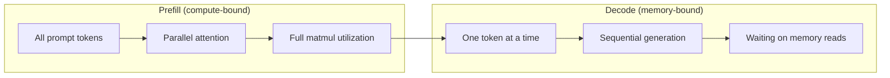
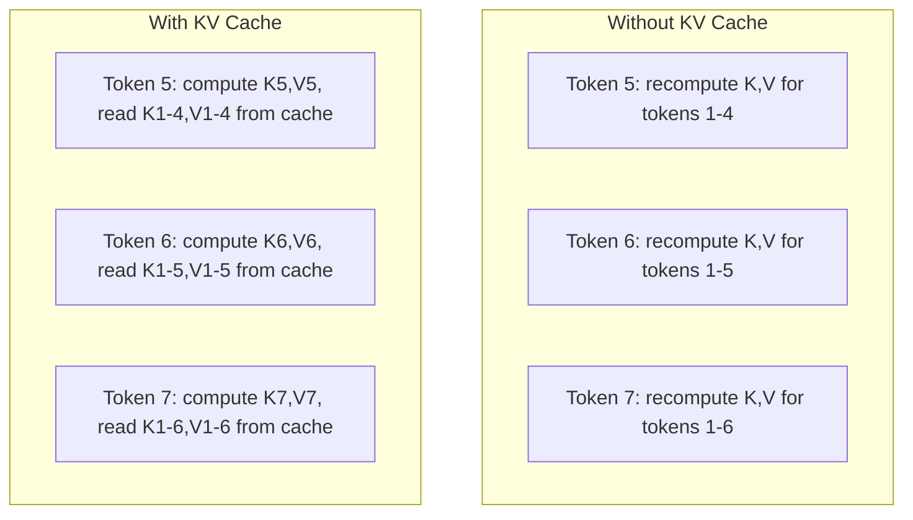
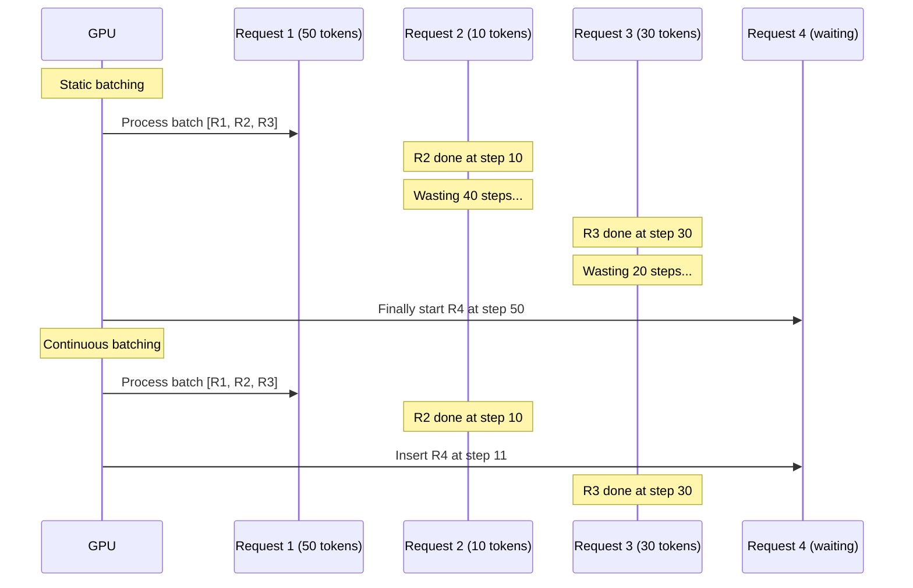
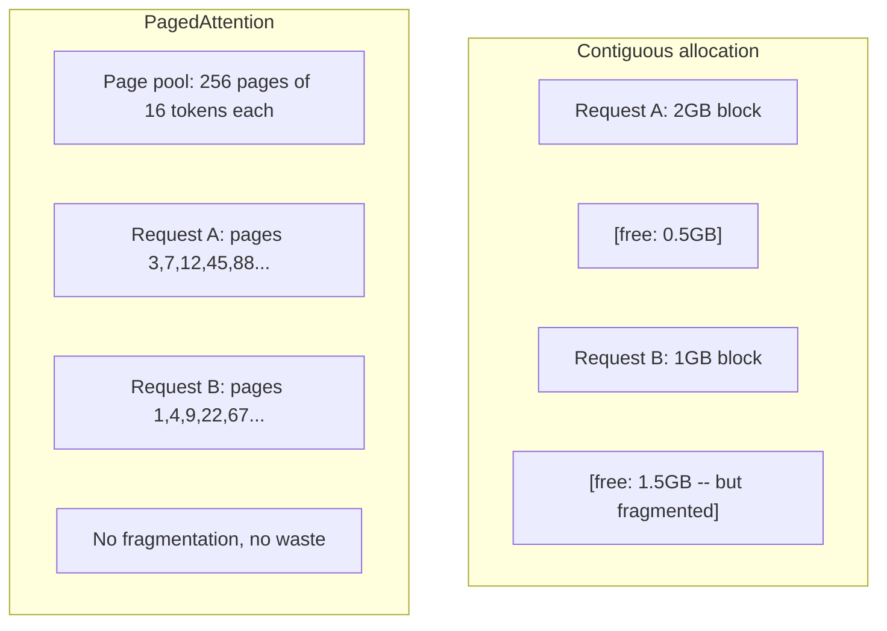
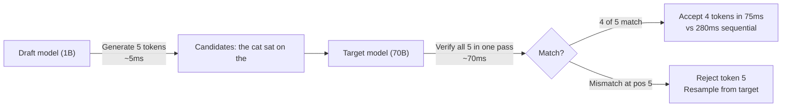

<!-- local-zh-machine-draft: English source is canonical; prose translated automatically, code/math preserved. -->

<a id="inference-optimization"></a>

# Inference Optimization

> 确定两个阶段 LLM inference. Prefill 处理您的 prompt 平行 - 计算。 解码生成 tokens 一次一个,每个优化都针对一个或两个

**类型:** Build
**语言:** Python
**先修要求:** 第10阶段, 课程01-08(Transformer 结构, attention)
**时间:** ~120分钟

<a id="learning-objectives"></a>

## 学习目标

- 执行 KV 缓存, 以在 autoregressive token generation
- 解释 prefill 与 decode phases 的 LLM inference 以及为什么每个系统都有不同的瓶颈(计算受约束的和受记忆约束的)
- Implement continuous batching 和页码搜索概念以最大限度地 GPU 利用同时提出的请求
- Compare inference 优化技术(KV-cache, speculative decoding,闪光 attention及其吞吐量/利得取舍

<a id="the-problem"></a>

## 问题

你调用 Llama 3 70B, 4xA100 GPUs。一个用户获得~50 tokens per second。感觉快。然后100个用户同时到达终点。 tokens/第二/用户.你每月25 000美元 GPU 法案的响应速度比人类要慢

模型本身在1个用户和100个用户之间没有变化。 weights相同的建筑,同样的数学。什么变化是你如何安排工作。 inference 现有废物 GPU 计算。 用户正在等待 token 47 持有整个批量槽,而 GPU 记忆总线在马特穆尔之间闲置。 同时,新用户的2,000 -token prompt 可以用有用的计算来填充那些死的时间

这不是一个缩放问题。 这是一个排程问题。 此课中的技巧 -- KV 缓冲, continuous batching呼叫目标, speculative decoding, prefix caching - 是每月25美元分开的 inference 每月5千元的账单 在同一条路上

vLLM serving Llama 4xA100-80GB 370B 达到~50 tokens/以低通货率处理的第二/用户,并维持15-25个TPS/用户,同时提出100项请求 continuous batching 和 PagedAtention 。 没有这些优化, 同样的硬件也为5个TPS/ 用户服务 。 GPUs同样的模型,4x输送量。

<a id="the-concept"></a>

## 概念

<a id="prefill-vs-decode"></a>

### Prefill vs 解码

每个 LLM inference 请求分为两个不同阶段。

**Prefill** 处理整个输入 prompt. 所有 tokens 已经知道,所以 attention 可以在整个序列中平行计算。这是一个大的矩阵乘法 -- GPU 核心保持忙碌。 瓶颈正在计算: 您的硬件每秒能提供多少 FLOPS 。 A100 代表 312 TFLOPS (BF16) 。 Prefill 4,096个token prompt 在70B模型上, 使用~400米的单A100。

**Decode** 生成输出 tokens 一次一个,每个新人 token 全部上一个 tokens,但只有一个 token 生产量 forward pass. 该 weight 矩阵大小与当值相同 prefill,但您正在把它们乘以一个矢量而不是矩阵。 GPU 核心在微秒内完成, 然后等待下一批 weights 以从记忆中到达。瓶颈是记忆带宽:您可以多快流出模型 weights 从 HBM 到计算单位。 A100 有 2 TB/s 带宽。 FP16 中的70B 模型是 140GB。读全模型需要 70 ms -- 也就是您为单一个解码步骤而做的地板 。



该 **业务:字节比率** (也称为算术强度) 捕捉到这个取舍。 它测量您从内存中装入的每个字节执行多少操作 。

```
ops:byte ratio = FLOPs per token / bytes read from memory
```

During prefill 共4 096批 tokens中,您执行的是~4,096 乘积操作 weight 加载。 比率是高的, 您会被计算。 在解码时使用 batch size 1, 您执行~ 1 操作 weight 装入。 比率低, 您有内存 。

基本的见解是: *解码是内存,因为您读了整个模型来生成一个 token*。在以下的优化中,要么减少您读到的内容,要么增加批次 tokens 处理的每个读数,或避免读数完全。

<a id="kv-cache"></a>

### KV Cache

During attention, 每个 token查询覆盖于前一页 token关键和值矢量。不缓存,生成 token N 要求重新计算之前所有 N-1 的钥匙和价值预测 tokens. Token 生成时预测 1 token 再来一次 token 3号,再来一次 token 4. 由 token 1000,你已经预测 token 总共999次

该 KV cache 保存所有前一页的密钥和值预测 tokens生成时 token N,你只计算键和值 token N,然后把他们和从 tokens 1至N1 号



**内存公式 KV cache:**

```
KV cache size = 2 * num_layers * num_kv_heads * head_dim * seq_len * bytes_per_param
```

用于 Llama 3 70B(80层,8 KV头带有GQA,头)_低度=128, BF16:

```
per token: 2 * 80 * 8 * 128 * 2 bytes = 327,680 bytes = 320 KB
at 4,096 tokens: 320 KB * 4,096 = 1.28 GB
at 128K tokens: 320 KB * 131,072 = 40 GB
```

128K- 文本的单一对话 Llama 3 70B 消耗40GB KV cache - 半个A100的内存。有100个同时用户在 4K tokens 每个, KV cache 单是需要128GB。 KV cache 管理是主要挑战 inference 优化。

<a id="continuous-batching"></a>

### Continuous Batching

静态分批处理直到一批N要求到达, 一起处理, 并等待到 *所有* 接受新请求前完成。 如果需要500个请求 tokens 还有一个需要10, 短暂的请求在完成后闲置490个解码步骤。

Continuous batching 一旦任何请求完成后,立即将新的请求插入批次。每分步都对该批次进行重新评价。 tokens 立即由等待请求取代。



产出量的改进取决于产出长度的不同。 continuous batching 匹配静态分批。 有变量长度( 常见大小写) , continuous batching 能够交付2 -5x更高的输送量,因为 GPU 空位从不空着

<a id="pagedattention"></a>

### 分页注意力

该 KV cache 每个请求都是一个连接的内存块。 当请求到达和离开时, 内存碎片 -- 与操作系统中的内存碎裂完全一样。 A 4K-token 请求需要 1. 28GB连结。 即使您有 2GB 无 总计, 您也可能没有 1. 28GB *contiguous*。您要么浪费记忆,要么拒绝请求。

(从 vLLM) 应用 OS 式虚拟内存 KV cache。不按请求分配一个毗连区块,而是分配固定大小的“页面”(通常为16页) tokens 每一页的页数都可以在 GPU 内存。 页面表格将每个请求的逻辑序列位置映射为物理页面位置 。



页面搜索还启用 **copy-on-write** 共享前缀。如果 50 个请求共享相同 system prompt, 该 KV cache 该页面 system prompt 所有50项请求都存储一次并引用。 只有当请求出现分歧时( 不同) user messages) 它是否拥有自己的页面。 这大大削减了共享应用程序的内存用量 。 system prompts.

vLLM 通过 PagedAttention 报告了接近零的内存浪费(~ 4% 与 ~ 60- 80% 的天真的分配) 。

<a id="speculative-decoding"></a>

### Speculative Decoding

解码缓慢, 因为它是相继的 -- 你生成一个 token但是如果你能猜到接下来的5个 tokens 便宜一点,然后立刻确认?

Speculative decoding 使用一个小的,快的 **模式草案** 要生成 K 候选人 tokens. 大 号 **目标模式** 然后将所有 K 候选人合并处理 forward pass (看起来像 prefill 如果目标模型同意模型草案的预测,您会接受所有 K tokens 在一个目标时 forward pass。如果在j号立场上意见不一,你接受 tokens 1至j-1 丢弃 rest.



速度取决于 **接受率** - 模型草案预测与目标的频率有多高。 Llama 3 8B 起草工作 Llama 3 70B, 接受率70-85%是自然语言的典型。 这翻译为 2-3x 解码速度 。

三个办法 speculative decoding:

| 方法 | 来源草案 | 录取率 | Overhead |
|--------|-------------|-----------------|----------|
| 目标草案(Leviathan等人) | 独立的小模型 | 70-85% | 模型内存草稿 |
| EAGLE(李等人) | 轻量级头瞄准目标 | 75-90% | ~ 1% 额外 parameters |
| N克调查 | Token n克表格 | 40-60% | 可以忽略不计 |

**EAGLE** 训练一小段 autoregressive 目标模型隐藏状态的顶端头部。 它预测下一个状态 token的 embedding 使用目标模型的第二至最后一层 features。因为它以目标模型本身的表示方式(而不是一个单独的模型)运作,所以在最小的额外内存的情况下就实现了更高的接受率。 EAGLE-2 添加了一个动态草稿树,根据上下文调整候选人数。

**N-gram speculative decoding** 从当前上下文或预设的文体中保留一个 n-gm 延续表。 如果草稿符合同一对话中出现的内容( 重复模式、 代码 、 structured output平均接受率较低,但每次投机的费用基本上都是免费的。

Speculative decoding 是 *数学精确* - 输出分布与目标模型的分布相同。它不是一个近似值。核查步骤确保每个被接受的 token 目标模型的概率。

<a id="prefix-caching"></a>

### Prefix Caching

许多请求都使用相同的前缀。 system prompt. 一个 RAG 上下文块。 few-shot 示例集。 prefix caching,每个请求都重新计算 KV cache 用于这些共享的 tokens 从头开始

Prefix caching 存储 KV cache 用于常见的前缀, 并在请求中重新使用。 当新请求到达时带有已知的前缀, 系统复制( 或引用) 缓存 KV 条目, 并且只计算唯一后缀的 KV 。

对于一个2000 -token system prompt 在所有请求中共享, prefix caching 消除~400米 prefill 100次请求/第二次请求,可节省40秒时间。 GPU 每秒计算 -- -- 多于1 GPU值得一试

SGLang的 Radix 跟踪工具 prefix caching 使用一种射线树( trie) , 该树的索引前缀 token 内容。任何匹配存储的前缀的请求都会得到它 KV cache 免费。 树允许部分前缀匹配, 如果您共享 1500 / 2 000 前缀 tokens 加上一个缓存条目,你重复使用那1500元, 重新计算只有500元。

<a id="inference-engines"></a>

### Inference Engines

三个引擎主导生产 LLM 服务 :

| Engine | 主要创新 | 最适合 |
|--------|---------------|----------|
| vLLM | 呼唤 continuous batching | 普通用途服务,最高兼容性 |
| SGLang | 半偏移 (R)prefix caching结构化生成 | 多方向聊天机,有限制解码 |
| TensorRT-LLM | NVIDIA 核聚变, FP8 quantization | 最大单人GPU NVIDIA 硬件的传输 |

**vLLM** 是默认的起点。它支持最广泛的模型,运行于任何 GPU 销售商(NVIDIA、AMD、英特尔),通过PagedAtention+实现强大的输送量 continuous batching. 该 OpenAI- 兼容 API 意思是你可以把它作为任何 OpenAI API 电话

**SGLang** 建立在与 vLLM 添加了 Radix 的注意 prefix caching 和用于结构化的 LLM 程序。如果您的工作量涉及多方向对话、工具使用或限制解码(JSON 输出, 正则制导生成) SGLang 通常表现优于 vLLM 以 2 -5x 通过前缀再利用。

**TensorRT-LLM** 将模型编译为优化的 NVIDIA GPU 内核,它能启动操作attention +线性+在一个内核中激活,在 H100 上使用 FP8 GPUs,并与 NVIDIA 整合 Triton Inference 用于生产部署的服务器。 它达到最高单GPU NVIDIA 硬件的吞吐量,但需要更多设置,仅对 NVIDIA 有效 GPUs.

真实世界数字 Llama 3 70B(4xA100-80GB,BF16):

| 公制 | vLLM | SGLang | TensorRT-LLM |
|--------|------|--------|---------------|
| 产出(1个用户) | ~50 TPS | ~55 TPS | ~65 TPS |
| 输送量(100个用户) | 总共~2 500个 | 总计~3 200个 | 总共~3,000台 |
| Time to first token | ~400米 | ~ 300米( 前缀点击) | ~350米 |
| 最大上下文 | 128K | 128K | 128K |

<a id="the-opsbyte-framework"></a>

### 行动中心:网络框架

您无法优化您不测量的内容。 操作: 字节比可以显示您是计算受约束还是内存约束, 这决定了哪个优化重要 。

```
Compute roof: peak FLOPS of the GPU
Memory roof:  peak bandwidth * ops:byte ratio
```

当操作值低时: 字节( 解码, 小批量) , 您会击中内存带宽顶部 。 添加更多计算( 高时钟, 更多核心) 毫无帮助 。 您需要减少内存读取 。quantization, KV cache 压缩)或增加 batch size 来读取更有用的作品。

操作高度: 字节prefill,大批量),您会到达计算屋顶。内存带宽优化没有帮助。您需要更快的速度 GPUs,内核聚变,或降低精度以挤压更多的FLOPS。

| 场景 | 行动:字节 | Bound | 优化 |
|----------|----------|-------|---------------|
| Prefill,批量=1 | ~4,096 | 计算 | 核聚变, FP8 |
| 解码, 批量= 1 | ~1 | 内存 | Quantization压缩 KV |
| 解码,批量=32 | ~32 | 内存 | 更大批次, continuous batching |
| 解码,批量=256 | ~256 | Transitioning | 两者皆有 |
| 解码,批量=1024 | ~1,024 | 计算 | 核聚变 tensor parallelism |

A100 上的交叉点围绕操作: byte = 156 (312 TFLOPS / 2 TBs) 。 在 156 下, 您有内存限制 。 在 156 上, 您有计算约束 。 Continuous batching 通过多包装,将解码推进到交叉处 tokens 每一个迭代。

```figure
context-window-slide
```

<a id="build-it"></a>

## 动手实现

<a id="step-1-kv-cache-from-scratch"></a>

### 步骤1: KV Cache 从剪辑

我们建一个多头人 KV cache 以显示记忆增长模式。

```python
import numpy as np

class KVCache:
    def __init__(self, num_layers, num_heads, head_dim, max_seq_len, dtype=np.float16):
        self.num_layers = num_layers
        self.num_heads = num_heads
        self.head_dim = head_dim
        self.max_seq_len = max_seq_len
        self.dtype = dtype

        self.k_cache = np.zeros(
            (num_layers, num_heads, max_seq_len, head_dim), dtype=dtype
        )
        self.v_cache = np.zeros(
            (num_layers, num_heads, max_seq_len, head_dim), dtype=dtype
        )
        self.seq_len = 0

    def update(self, layer_idx, new_keys, new_values):
        num_new = new_keys.shape[1]
        end = self.seq_len + num_new
        self.k_cache[layer_idx, :, self.seq_len:end, :] = new_keys
        self.v_cache[layer_idx, :, self.seq_len:end, :] = new_values
        return (
            self.k_cache[layer_idx, :, :end, :],
            self.v_cache[layer_idx, :, :end, :]
        )

    def advance(self, num_tokens):
        self.seq_len += num_tokens

    def memory_bytes(self):
        return self.k_cache.nbytes + self.v_cache.nbytes

    def used_bytes(self):
        per_token = 2 * self.num_layers * self.num_heads * self.head_dim * np.dtype(self.dtype).itemsize
        return per_token * self.seq_len
```

<a id="step-2-attention-with-kv-cache"></a>

### 步骤2: Attention 与 KV Cache

简化的多头 attention 使用 KV cache 解码步骤。

```python
def scaled_dot_product_attention(query, keys, values):
    head_dim = query.shape[-1]
    scores = np.matmul(query, keys.transpose(0, 1, 3, 2)) / np.sqrt(head_dim)
    seq_len_q = scores.shape[-2]
    seq_len_k = scores.shape[-1]
    if seq_len_q > 1:
        mask = np.triu(np.ones((seq_len_q, seq_len_k), dtype=np.float32), k=seq_len_k - seq_len_q + 1)
        scores = scores + mask * (-1e9)
    max_scores = np.max(scores, axis=-1, keepdims=True)
    exp_scores = np.exp(scores - max_scores)
    attn_weights = exp_scores / np.sum(exp_scores, axis=-1, keepdims=True)
    return np.matmul(attn_weights, values)


class MultiHeadAttention:
    def __init__(self, d_model, num_heads):
        self.num_heads = num_heads
        self.head_dim = d_model // num_heads
        scale = np.sqrt(2.0 / d_model)
        self.W_q = np.random.randn(d_model, d_model).astype(np.float32) * scale
        self.W_k = np.random.randn(d_model, d_model).astype(np.float32) * scale
        self.W_v = np.random.randn(d_model, d_model).astype(np.float32) * scale
        self.W_o = np.random.randn(d_model, d_model).astype(np.float32) * scale

    def forward(self, x, kv_cache=None, layer_idx=0):
        batch, seq_len, d_model = x.shape
        Q = np.matmul(x, self.W_q).reshape(batch, seq_len, self.num_heads, self.head_dim).transpose(0, 2, 1, 3)
        K = np.matmul(x, self.W_k).reshape(batch, seq_len, self.num_heads, self.head_dim).transpose(0, 2, 1, 3)
        V = np.matmul(x, self.W_v).reshape(batch, seq_len, self.num_heads, self.head_dim).transpose(0, 2, 1, 3)

        if kv_cache is not None:
            K_full, V_full = kv_cache.update(layer_idx, K[0], V[0])
            K = K_full[np.newaxis, :, :, :]
            V = V_full[np.newaxis, :, :, :]
            if seq_len == 1:
                kv_cache.advance(1)

        attn_out = scaled_dot_product_attention(Q, K, V)
        attn_out = attn_out.transpose(0, 2, 1, 3).reshape(batch, -1, d_model)
        return np.matmul(attn_out, self.W_o)
```

<a id="step-3-continuous-batching-simulator"></a>

### 步骤3: Continuous Batching Simulator

这模拟静态和 continuous batching.

```python
import heapq

class Request:
    def __init__(self, request_id, prompt_tokens, output_tokens, arrival_step):
        self.request_id = request_id
        self.prompt_tokens = prompt_tokens
        self.output_tokens = output_tokens
        self.arrival_step = arrival_step
        self.tokens_generated = 0
        self.start_step = None
        self.end_step = None

    def is_done(self):
        return self.tokens_generated >= self.output_tokens


def simulate_static_batching(requests, batch_size):
    step = 0
    completed = []
    queue = list(requests)
    queue.sort(key=lambda r: r.arrival_step)

    while queue:
        batch = []
        while queue and len(batch) < batch_size:
            r = queue.pop(0)
            r.start_step = max(step, r.arrival_step)
            batch.append(r)

        if batch:
            step = max(step, max(r.start_step for r in batch))
            max_output = max(r.output_tokens for r in batch)
            for r in batch:
                r.tokens_generated = r.output_tokens
                r.end_step = step + max_output
            step += max_output
            completed.extend(batch)

    return completed


def simulate_continuous_batching(requests, batch_size):
    step = 0
    completed = []
    queue = sorted(requests, key=lambda r: r.arrival_step)
    queue_idx = 0
    active = []
    waiting = []

    while queue_idx < len(queue) or active or waiting:
        while queue_idx < len(queue) and queue[queue_idx].arrival_step <= step:
            waiting.append(queue[queue_idx])
            queue_idx += 1

        while waiting and len(active) < batch_size:
            r = waiting.pop(0)
            r.start_step = step
            active.append(r)

        if not active:
            if waiting:
                step += 1
                continue
            elif queue_idx < len(queue):
                step = queue[queue_idx].arrival_step
                continue
            else:
                break

        for r in active:
            r.tokens_generated += 1

        done = [r for r in active if r.is_done()]
        for r in done:
            r.end_step = step + 1
            completed.append(r)
        active = [r for r in active if not r.is_done()]

        step += 1

    return completed


def batching_stats(completed):
    latencies = [r.end_step - r.arrival_step for r in completed]
    total_time = max(r.end_step for r in completed) - min(r.arrival_step for r in completed)
    total_tokens = sum(r.output_tokens for r in completed)
    return {
        "avg_latency": np.mean(latencies),
        "p50_latency": np.median(latencies),
        "p99_latency": np.percentile(latencies, 99),
        "total_time": total_time,
        "throughput": total_tokens / total_time if total_time > 0 else 0,
    }
```

<a id="step-4-prefix-cache"></a>

### 步骤 4: 前缀缓存

用于存储共享前缀的 KV 条目的三重前缀缓存 。

```python
class TrieNode:
    def __init__(self):
        self.children = {}
        self.kv_data = None
        self.hit_count = 0


class PrefixCache:
    def __init__(self, max_entries=1000):
        self.root = TrieNode()
        self.max_entries = max_entries
        self.total_entries = 0
        self.hits = 0
        self.misses = 0

    def _walk(self, token_ids):
        node = self.root
        depth = 0
        for tid in token_ids:
            if tid not in node.children:
                break
            node = node.children[tid]
            depth += 1
        return node, depth

    def lookup(self, token_ids):
        node, depth = self._walk(token_ids)
        if depth > 0:
            self.hits += 1
            current = self.root
            for tid in token_ids[:depth]:
                current = current.children[tid]
                current.hit_count += 1
            kv_entries = []
            current = self.root
            for tid in token_ids[:depth]:
                current = current.children[tid]
                if current.kv_data is not None:
                    kv_entries.append(current.kv_data)
            return depth, kv_entries
        self.misses += 1
        return 0, []

    def insert(self, token_ids, kv_per_token):
        node = self.root
        for i, tid in enumerate(token_ids):
            if tid not in node.children:
                if self.total_entries >= self.max_entries:
                    return i
                node.children[tid] = TrieNode()
                self.total_entries += 1
            node = node.children[tid]
            if i < len(kv_per_token):
                node.kv_data = kv_per_token[i]
        return len(token_ids)

    def hit_rate(self):
        total = self.hits + self.misses
        return self.hits / total if total > 0 else 0.0
```

<a id="step-5-speculative-decoding-simulator"></a>

### 步骤5: Speculative Decoding Simulator

我们模拟预告目标 speculative decoding 具有可配置的接受率。

```python
class DraftModel:
    def __init__(self, vocab_size, acceptance_rate=0.8):
        self.vocab_size = vocab_size
        self.acceptance_rate = acceptance_rate

    def generate(self, context, num_tokens):
        tokens = np.random.randint(0, self.vocab_size, size=num_tokens)
        return tokens

    def get_probs(self, context, token):
        probs = np.random.dirichlet(np.ones(self.vocab_size))
        return probs


class TargetModel:
    def __init__(self, vocab_size):
        self.vocab_size = vocab_size

    def get_probs(self, context, tokens=None):
        if tokens is not None:
            return [np.random.dirichlet(np.ones(self.vocab_size)) for _ in tokens]
        return np.random.dirichlet(np.ones(self.vocab_size))


def speculative_decode(draft_model, target_model, context, num_speculative=5,
                       draft_cost=1.0, target_cost=10.0, verify_cost=12.0):
    total_tokens = 0
    total_cost = 0.0
    accepted_counts = []
    context = list(context)

    max_tokens = 100

    while total_tokens < max_tokens:
        draft_tokens = draft_model.generate(context, num_speculative)
        total_cost += draft_cost * num_speculative

        target_probs = target_model.get_probs(context, draft_tokens)
        total_cost += verify_cost

        accepted = 0
        for i, token in enumerate(draft_tokens):
            draft_p = draft_model.get_probs(context + list(draft_tokens[:i]), token)
            target_p = target_probs[i]

            r = np.random.random()
            acceptance_prob = min(1.0, target_p[token] / (draft_p[token] + 1e-10))

            if r < draft_model.acceptance_rate:
                accepted += 1
                context.append(token)
                total_tokens += 1
            else:
                new_token = np.random.choice(draft_model.vocab_size, p=target_p)
                context.append(new_token)
                total_tokens += 1
                break

        accepted_counts.append(accepted)

        if accepted == num_speculative:
            bonus_probs = target_model.get_probs(context)
            bonus_token = np.random.choice(draft_model.vocab_size, p=bonus_probs)
            context.append(bonus_token)
            total_tokens += 1

    sequential_cost = total_tokens * target_cost
    return {
        "total_tokens": total_tokens,
        "speculative_cost": total_cost,
        "sequential_cost": sequential_cost,
        "speedup": sequential_cost / total_cost if total_cost > 0 else 1.0,
        "avg_accepted": np.mean(accepted_counts),
        "acceptance_rate": np.mean(accepted_counts) / num_speculative,
    }


def compare_speculation_strategies(vocab_size=1000, num_trials=20):
    results = {}

    for name, acceptance_rate, spec_tokens in [
        ("Draft-target (8B->70B)", 0.78, 5),
        ("EAGLE", 0.85, 6),
        ("N-gram", 0.50, 4),
        ("No speculation", 0.0, 0),
    ]:
        if spec_tokens == 0:
            results[name] = {
                "speedup": 1.0,
                "acceptance_rate": 0.0,
                "avg_accepted": 0.0,
            }
            continue

        trial_results = []
        for _ in range(num_trials):
            draft = DraftModel(vocab_size, acceptance_rate=acceptance_rate)
            target = TargetModel(vocab_size)
            context = list(np.random.randint(0, vocab_size, size=10))
            result = speculative_decode(draft, target, context, num_speculative=spec_tokens)
            trial_results.append(result)

        results[name] = {
            "speedup": np.mean([r["speedup"] for r in trial_results]),
            "acceptance_rate": np.mean([r["acceptance_rate"] for r in trial_results]),
            "avg_accepted": np.mean([r["avg_accepted"] for r in trial_results]),
        }

    return results
```

<a id="step-6-kv-cache-memory-profiler"></a>

### 步骤6: KV Cache 内存配置程序

Compute KV cache 真实模型配置的内存要求。

```python
MODEL_CONFIGS = {
    "Llama-3-8B": {
        "num_layers": 32, "num_kv_heads": 8, "head_dim": 128,
        "model_params_b": 8, "gqa": True,
    },
    "Llama-3-70B": {
        "num_layers": 80, "num_kv_heads": 8, "head_dim": 128,
        "model_params_b": 70, "gqa": True,
    },
    "Llama-3-405B": {
        "num_layers": 126, "num_kv_heads": 8, "head_dim": 128,
        "model_params_b": 405, "gqa": True,
    },
    "Mistral-7B": {
        "num_layers": 32, "num_kv_heads": 8, "head_dim": 128,
        "model_params_b": 7, "gqa": True,
    },
    "GPT-4-est": {
        "num_layers": 120, "num_kv_heads": 96, "head_dim": 128,
        "model_params_b": 1800, "gqa": False,
    },
}


def kv_cache_memory(config, seq_len, dtype_bytes=2):
    per_token = 2 * config["num_layers"] * config["num_kv_heads"] * config["head_dim"] * dtype_bytes
    total = per_token * seq_len
    return {
        "per_token_bytes": per_token,
        "per_token_kb": per_token / 1024,
        "total_bytes": total,
        "total_mb": total / (1024 ** 2),
        "total_gb": total / (1024 ** 3),
    }


def memory_budget(config, gpu_memory_gb, model_dtype_bytes=2, kv_dtype_bytes=2):
    model_memory_gb = config["model_params_b"] * 1e9 * model_dtype_bytes / (1024 ** 3)
    overhead_gb = gpu_memory_gb * 0.1
    available_for_kv = gpu_memory_gb - model_memory_gb - overhead_gb

    if available_for_kv <= 0:
        return {"error": "Model does not fit in GPU memory", "model_memory_gb": model_memory_gb}

    per_token = 2 * config["num_layers"] * config["num_kv_heads"] * config["head_dim"] * kv_dtype_bytes
    max_tokens = int(available_for_kv * (1024 ** 3) / per_token)

    return {
        "gpu_memory_gb": gpu_memory_gb,
        "model_memory_gb": round(model_memory_gb, 1),
        "overhead_gb": round(overhead_gb, 1),
        "available_for_kv_gb": round(available_for_kv, 1),
        "max_total_tokens": max_tokens,
        "max_users_at_2k": max_tokens // 2048,
        "max_users_at_4k": max_tokens // 4096,
        "max_users_at_32k": max_tokens // 32768,
    }
```

<a id="use-it"></a>

## 实际应用

与 vLLM:

```python
from vllm import LLM, SamplingParams

llm = LLM(
    model="meta-llama/Meta-Llama-3-70B-Instruct",
    tensor_parallel_size=4,
    enable_prefix_caching=True,
    max_model_len=8192,
    gpu_memory_utilization=0.9,
)

params = SamplingParams(temperature=0.7, max_tokens=256)
outputs = llm.generate(["Explain inference optimization in one paragraph."], params)
```

与 SGLang 用于 prefix caching + structured output:

```python
import sglang as sgl

@sgl.function
def classify(s, text):
    s += sgl.system("You are a classifier. Output JSON only.")
    s += sgl.user(f"Classify this text: {text}")
    s += sgl.assistant(sgl.gen("result", regex=r'\{"label": "(positive|negative|neutral)"\}'))

runtime = sgl.Runtime(model_path="meta-llama/Meta-Llama-3-70B-Instruct", tp_size=4)
sgl.set_default_backend(runtime)

results = classify.run_batch([
    {"text": "This product is amazing!"},
    {"text": "Terrible experience."},
    {"text": "It was okay I guess."},
])
```

与天文台 -LLM:

```python
import tensorrt_llm
from tensorrt_llm.runtime import ModelRunner

runner = ModelRunner.from_dir("./llama-70b-trt-engine/", rank=0)

outputs = runner.generate(
    batch_input_ids=[tokenizer.encode("Explain KV caching.")],
    max_new_tokens=256,
    temperature=0.7,
)
```

<a id="ship-it"></a>

## 交付成果

本课产生：
- `outputs/skill-inference-optimization.md` - 诊断和优化的技能 LLM inference serving

<a id="exercises"></a>

## 练习

1. 修改 KV cache 比较 FP16 和 FP8 和 INT4 的配置文件 KV cache quantization. 用于 Llama 3 70B 4K 上下文,计算4xA100-80GB 每个最大同时用户 quantization 向INT4发送大约4x用户能力。

2. 延长 continuous batching 要跟踪的模拟器 GPU 使用率(每步分批填充的批量槽的违规情况) continuous batching 提出50项请求,其产出长度与Pareto的分布相仿(形状=1.5,比例=20)。 Continuous batching 应保持 > 80%的利用率。

3. 实施分组查询 attention (GQA)版本的 KV cache where `num_kv_heads < num_query_heads`. Llama 3 70B 使用 64 个查询头, 但只有 8 KV 头。 计算内存节余相对于全多头 attention (减少8倍) KV cache (单位:千美元)

4. 建立一个使用 LRU 驱逐的前缀缓存。 设置最大_输入到 500, 并生成 1 000 个请求, 其中60% 共享 5 个共同的前缀之一 。 测量点击率并与无限制缓存比较 。 如果驱逐成功, 点击率应该保持在 55% 以上 。

5. 延长 speculative decoding 执行树基投机的模拟器( EAGLE-2 风格) 。 而不是单条 K 草稿 tokens产生一棵候选人树(例如,2棵) branches 3级各=8名候选人。 tokens 接受每轮核查和线性猜测。

<a id="key-terms"></a>

## 关键术语

| 术语 | 人们怎么说 | 它实际上意味着什么 |
|------|----------------|----------------------|
| Prefill | "处理 prompt" | Computing attention 超过所有输入 tokens 平行 -- 计算绑定,因为全矩阵乘法保持 GPU 核心繁忙 |
| 解码 | "创世纪 tokens" | 生产一个 token 每 forward pass,阅读全模型 weights 每次 -- 内存限制, 因为计算在下次之前完成 weights arrive |
| KV cache | 追逐着 attention 状态" | 存储所有前一次的密钥和值预测 tokens 所以它们不会在每个解码步骤中被重新编号 -- 用内存来计算 |
| Continuous batching | "Dynamic batching" | 任何请求一完结就将新请求插入运行中的批次,在每次解码重复时对其进行评价,而不是等待整批次 |
| 分页注意力 | 虚拟记忆 KV cache" | Allocating KV cache 在固定大小的页面而非毗连区块中,消除内存碎裂,并允许共享的前缀复制 |
| Speculative decoding | "草案和核实" | 使用快速草稿模式来提出多个 tokens,然后用一个目标模型来验证它们 forward pass - 数学精确,2-3x加速 |
| 鹰 | "自 己" "自 己" "Of coursespeculative decoding" | 一个 speculative decoding 在目标模型的隐藏状态上训练轻量级头的变量, 实现比单独模型草案更高的接受率 |
| Prefix caching | 重新使用 system prompt KV(KV) 车牌 | 计算好的存储 KV cache 共同前缀条目( A)system prompts, few-shot 请求中重复使用,以跳过多余 prefill |
| 业务:字节比率 | "亚特麦提尼克的强烈度" | 计算操作与读取内存字节的比率 -- -- 确定工作量是计算受约束(高比率)还是计算受内存约束(低比率) |
| Time to first token | "TTFT" (TTFT) (TTFT) (TTFT) (TTFT) (TTFT) (TTFT) (TTFT) (TTTFT) (TTFT) (TTTFT) (TTTFT) (TTTFT) (TTTFT) | 从收到请求到产生第一个产出的间隔 token - 以 prefill 时间长 prompts |

<a id="further-reading"></a>

## 进一步阅读

- Kwon等人,“大型语言的高效内存管理” Model Serving (2023年)-- 和(或) vLLM 介绍的论文 paged KV cache 管理,现在的行业标准 inference serving
- Leviathan等人,“迅速” Inference 来自 Transformers 通过 Speculative Decoding" (2023年) -- -- 证明投机的草稿核实在达到2-3x速度的同时产生精确的目标模型分布的基础文件
- Li等人,“EAGLE:投机” Sampling 需要重新思考 Feature 不确定性"(2024年) -- 通过训练目标模型的负责人,达到更高的接受率 features 而不是使用单独的模式草案
- Zheng等人, " 。SGLang: 有效执行结构化语言模型程序”(2024年) -- -- 引入 RadixAttention for prefix caching 和多电话程序模式 LLM programs
- Williams等人,“Roofline:多核心结构的视觉表现模型”(2009年)——原始屋顶线纸,正式确定了计算内存瓶颈的理由框架。
