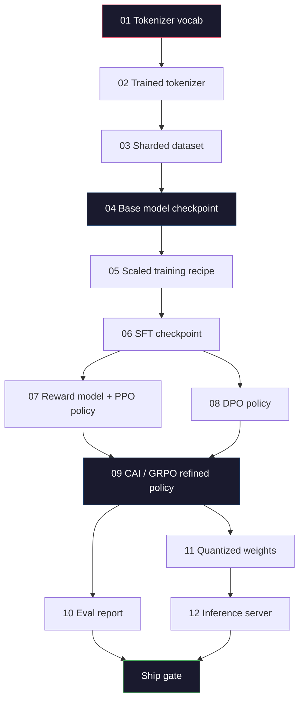
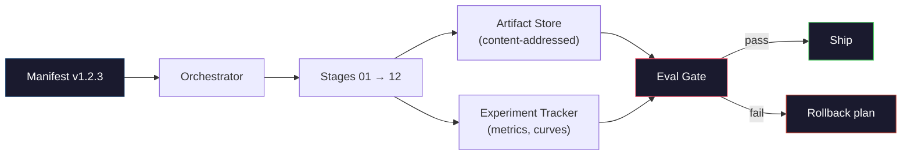

<!-- local-zh-machine-draft: English source is canonical; prose translated automatically, code/math preserved. -->

<a id="building-a-complete-llm-pipeline"></a>

# 构建一个完整的 LLM Pipeline

> 从第1课到第12课的每件事都是一个管道的阶段。这个课程是把这些阶段变成一个端到端的脚架:象征性化、预培训、规模化, SFT,对齐,评估,量化,服务。您不会在笔记本电脑上训练一个70B模型。您将制作 orchestration 层,舱单,反向门, rollback 计划由2026年边境小组 来决定运送什么

**类型：** 构建
**语言:** Python (斯迪利布)
**先修要求:** 所有第10阶段课程 01-12
**时间:** ~120分钟

<a id="learning-objectives"></a>

## 学习目标

- 撰写前十一堂课( T)tokenizer数据 训练前 升级 SFT, RLHF, DPOCAI, 评估, quantization, inference进入单一可复制的管道规格
- 界定两个阶段之间的文物合同:每个阶段的消耗量、生产量以及下一阶段如何核实输入量
- 建立一个跟踪实验的管弦乐团, 杂物, 和门船决定的反val阈值
- 设计 rollback 计划:哪些艺术品是廉价的,可以重新运行,哪些是昂贵的,什么是腐败的。 checkpoint costs

<a id="the-problem"></a>

## 问题

以往的教训都是有效的。 Tokenizer 受过训练。 GPT 训练前。 SFT 集成数据集。 Reward model 受过训练。 DPO 运行。 测量了 Evals。 量化 weights 导出。 Inference 服务器旋转。 每个都是笔记本。 每个都有自己的会话, 自己的输出路径, 自己的种子。

边境训练不是笔记本 Llama 3 405B在大约54天的时间里花了3 000万H100小时。 DeepSeek-V3用了大约280万H800小时。 checkpoint,一个数据污染,一个逆向回归 可能花费一个团队一周的墙上时间和一个月的时间 GPU 预算。团队生存的方式是通过管道卫生:每个阶段都有决定性的投入、确定性产出、显像、散列和大门。

这是综合项目 。 您不会在笔记本电脑上运行管道端到端。 您将写下坐标各个阶段的管弦乐队、 描述运行的显示器、 登船决定的验证器, 以及让第三方从一个文件重新运行您的作品的重播计划 。 代码是小的; 纪律是很大的 。

从100M到1T的图案比例 parameters 相同的四个组件 -- -- 显示器、管弦乐器、电子门、工艺品店 -- -- 运行 Llama 3号,还有你的爱好 GPT。区别在于每个阶段的配置内的数字大小,而不是管道的形状。

<a id="the-concept"></a>

## 概念

<a id="the-twelve-stages"></a>

### 十二个阶段

每一个阶段10课都是一个阶段。这是完整的依赖图。



07和08阶段可以平行运行,其他的都很难依赖。tokenizer第10阶段的改变只使船舶的决定无效。

<a id="the-manifest"></a>

### 宣言

显示器是指一个完全可以重播的单一文件。 管道生产的任何内容都不应取决于不在显示器中的状况。 字段是无聊和强制性的。

```
pipeline_version: 1.2.3
seed: 42
git_commit: a1b2c3d4
stages:
  01_tokenizer:
    recipe: bpe_32k
    input_hash: sha256:...
    output_hash: sha256:...
    wall_clock_sec: 3600
    cost_usd: 12
```

N阶段的输出散列是 N+1 级的输入散列, 任何偏差和管道停止。 这就是如何及早发现数据腐败。 另一大洲的队友如何验证他们的重播产生与您的相同工艺品 。

练习队用一个小 YAML 棋子加上一个比前一次成功运行更明显的检查器。 在预期字段外的任何三角形( 成本、 墙钟) 都是一个红旗 。

<a id="artifact-typing"></a>

### 人工打字

每个阶段的输出都是打印的人工制品。 不是目录布料, 不是泡菜, 而是有已知图案的名称类型 。

| 舞台 | 个体类型 | 密钥字段 |
|-------|--------------|-----------|
| 01-02 | Tokenizer | 伏尔加json,合并.txt,配置。json, hash 键盘 |
| 03 | 数据集 | shards[],行数, token 计数, 分层统计 |
| 04-05 | Checkpoint | weights安全器 配置json, optimizer 状态, 步数 |
| 06 | SFT 模型 | checkpoint + SFT 配方+数据组合 |
| 07 | Reward Model | RM checkpoint +偏好数据 hash |
| 08-09 | 政策 | checkpoint +参考大麻+贝塔+KL预算消耗量 |
| 10 | Eval 报告 | 基准分数 + 回归 diffs + 电子数据 hash |
| 11 | 量化模型 | quantized weights + calibration 数据 + 精确度 三角洲对 FP16 |
| 12 | 服务器spec | 终点+型号散列+配置+ observability hooks |

输入防止了最常见的失败模式: 使用第 08 级输出作为第 06 级输入, 发送 a/ DPO-经过训练的模型 SFT 路径。输入的工艺品和打印的阶段签名会使这些错误发生编译-时间失败,而不是第五天失败。

<a id="the-eval-gate"></a>

### 爱瓦尔门

运输不是“训练完成”。运输是“训练完成,反弹门通过”。在开始运行之前,该门就被定义了。

```
gates:
  mmlu:      >= baseline + 0.5   # no regression
  humaneval: >= baseline + 1.0
  truthfulqa: >= baseline         # no drop
  safety_refusal_rate: <= 0.05
  kl_from_reference: <= 25.0
  cost_total_usd: <= 50000
```

每个门都是个数字门槛。 没有“ 看上去不错” 的门。 没有主观的签名。 如果每个门都经过, 文物是可移动的标记 。 如果任何门都坏了, 运行将等待一个指定的审查员明确推翻, 且该审查员本身已被登录在列单中 。

两道门最能应付灾难 *regression* 大门(新模式必须至少与以前的核心基准相同)可捕捉训练虫。 *KL 预算* 门(对齐政策不得在参考线X之外进一步漂移) alignment 超熟了 每一生产管道都有

<a id="the-orchestrator"></a>

### 轮廓

读取单子的小代码, 发送阶梯, 跟踪工艺品, 并停止任何违反合同的行为。 这不是空流。 这不是Kubeflow。 对于管道卫生, 您想要您写的无聊的东西 。

指挥员的工作很狭窄

1. 从货单中解决货单问题
2. 对于每个阶段,检查预期产出是否已经存在于正确的散列( 如果存在, 则跳过) 。
3. 运行舞台,捕捉 stdout/strderr, 测量墙钟和成本。
4. 对照下游阶段的预期输入散列校验输出。
5. 失败时,写一个部分的显示 与准确的失败阶段 并退出非零。

这是200行 Python。它会看起来像文件 `code/main.py` 在头罩下 真正的输油管 `torchrun` 或 `ray` 来对组群执行单个阶段,但管弦琴本身却在单一的框中运行。

<a id="experiment-tracking-and-artifact-storage"></a>

### 实验跟踪和人工存储

两个外部系统固定管道。

**实验跟踪器( wandb, neptune, mlflow) 。** 日志丢失曲线、 电子量度、 系统遥测每个阶段。 跟踪器是三个星期后您需要比较 A 运行与 B 运行时的去处。 团队几乎总是使用主机追踪器来进行这个操作, 写出您自己应该去训练的时间。

**人工制品商店(S3、R2、GCS)。** 不可移动的物件存储 checkpoints,数据集, tokenizers, Eval 报告。人工智能由散列而不是文件名处理。 `latest.pt` 是一种手枪; `ckpt-7b-step-20000-sha256:abc123.safetensors` 是合约

管弦乐队写给两者。 追踪器是给人类看图表的。 工艺品商店是下一个阶段的搜索输入。

<a id="costing"></a>

### Costing

边检有1美元号码 预算纪律在两个地方发生

**预运行估计。** 从舱单中计算预期FLOPs(训练前:6x参数x) tokens),预计 GPU 如果估计超过预算门口,管道就拒绝启动。

**运行中的跟踪 。** 逐级挂钟和成本记录到列表中。 每个阶段后, 将检查剩余预算 。 如果一个阶段过错, 下一个阶段的大门会用新的剩余预算来评估 。 您不会发现您在 VC 呼叫时已经缺钱 。

Llama 3个报告的费用是6100万美元。 DeepSeek-V3报告的主要训练前运行费用为560万美元,该比率主要是硬件效率加上专家混合成本,但具体成本是显而易见的,因为两个小组每个阶段都跟踪而不是每个运行。

<a id="reproducibility-vs-determinism"></a>

### B. 可复制性与决定因素

这些不一样。 *Reproducible* 表示相同的舱单加上相同的代码加上相同的基础设施产生 checkpoint 具有相应的下游指标。 *Deterministic* 表示 Bit- same 输出。

Modern LLM 培训是可复制的,但不是决定性的。 GPU 内核非确定性( cuBLAS, 闪存) 和 mixed precision 圆形组合产生在运行的 1e-5 级别上不同的浮点。 对于最后的测量值来说, 这是罚款的, 它不会移动。 如果您试图用位数 diffs 调试, 则致命。 解析方法是记录每个阶段的输入散列、 输出散列和标题度量 - 如果匹配的话, 运行是“ 重新生成 ” 。 weights 并非一模一样。



<a id="rollback-plan"></a>

### Rollback Plan

在运行开始之前, 记录每个阶段失败时发生的情况。 有三个类别 。

- **要重新运行的便宜** (小时): tokenizer,评估, quantization, inference 服务器 重新运行
- **Medium** (天数): SFT, DPO, CAI。 保留基准模型; 只重新运行 alignment 阶段。
- **Expensive** (数周和数百万美元):培训前。 rollback 计划不是"重新运行" 而是"用最后的好 checkpoint 并重新运行 更便宜的下游阶段 与修订的数据。"

因为舞台依赖性被打入和散列, 管弦手可以计算 rollback 设置为自动: 无效的阶段加上每个子孙无效 。SFT)第06、07、08、09、10、11、12条. 第11阶段的故障(quantization仅宣布11和12无效。 将这个名称放在前面,可以避免在小组4点就精疲力尽时即兴表演。

<a id="production-recipes-observed-in-2026"></a>

### 2026年观察到的生产食谱

大部分边境部队都聚集在同一骨骼上。

- Tokenizer:128公里 BPE 以字节后退的方式 训练成一个小的,平衡的多语言片段
- 培训前:10-20T tokens,主要是网络加代码加上合成。 AdamW optimizerFSDP2 或深射ZeRO-3。 Gradient 检查站。 weightsFP32 大师
- SFT:500k-2M的混合人类和合成教学配对,并严格针对 eval set.
- Alignment: DPO 或 CAI + GRPO. RLHF 只有当偏好信号太多维时 DPO.
- Eval: MMLU-Pro、MATH、HumanEval+、GPQA、SWE-Bench Verized、LiveBench,加上一个公众从未见过的私密屏蔽装置。
- Quantization:4-位 GPTQ 或 AWQ 用于服务,8 位用于准确度三角洲值的安全评价。
- 服务 : vLLM特索瑞特, 特索瑞特... ...LLM或内部的 Continuous batching. Speculative decoding. KV cache 驱逐。

数字每六个月就会改变一次 骨骼不会改变

```figure
beam-search
```

<a id="build-it"></a>

## 动手实现

课程代码是一个管弦乐团和一个显示检查器, 不是十二个训练脚本。 每个舞台都模拟一个占位符, 以正确的形状和散列方式生成输出工艺品 。 运行管弦乐团的端到端运行证明管道在燃烧前是管子的工程 GPU 钱在真正的阶段。

See `code/main.py` 关键部分:

- `Manifest` 数据类别:管道版本,种子, git commit阶梯,门。
- `Stage` 数据类别:名称、类型、输入(shashes)、输出(hash)、壁钟、成本。
- `Orchestrator.run()`: 解决 DAG、发送阶段、核实hashes、更新列表。
- `EvalGate.check()`:读取阈值,与最新的评估报告相比,返回出入证/失效证。
- `ArtifactStore` 模拟S3,用大麻放/装配。
- `CostTracker`:每阶段和累积,上限超过时停止。

输油管进入 `main.py` 运行12个占位符级, 生成一个显示器, 并练习一个失败的逆向门以显示一个被拉动的场景。 从相应的课目中交换每个占位符真实的培训脚本, 您的骨架是一条真正的边疆管道用途 。

<a id="use-it"></a>

## 实际应用

弹道工作流程有三个命令。

```
python code/main.py plan    # validate manifest, compute cost estimate, print DAG
python code/main.py run     # execute stages, writing to manifest.out.yaml
python code/main.py gate    # read manifest.out.yaml, apply eval gates, ship-or-hold
```

Run `plan` 第一次。大多数管道错误在计划时间出现, 缺少门门槛, 杂乱无章, 预算超支。 `plan` 是免费的。 运行中 `run` 便宜,省点钱,在便宜的一边抓虫子

产出 `gate` 要么是 `SHIP` 或 `HOLD: <reason>`。一个被搁置的运行不是失败;它是一个决定点。一个被命名的审查者要么推翻(而覆盖被登录),要么他们批准 rollback.

<a id="ship-it"></a>

## 交付成果

这个课程产生 `outputs/skill-llm-pipeline-reviewer.md`输入一个拟议输油管清单,并检查所有合同:阶段打字、散列链、门、 rollback 它拒绝批准一份缺少的 Eval 门、无约束的 KL 预算或混合 Eval 和训练数据的运算单。

<a id="exercises"></a>

## 练习

1. 扩展管弦, 支持同步执行 07 和 08 阶段。 使用 stdlib `concurrent.futures` 模块. 确认两个阶段的最终清单记录输出,而第九阶段输入的散列是这两个阶段的决定性组合。

2. 添加一个“ 污染检查” 门。 根据 eval 数据集集和训练数据集碎片, 计算重叠( 精确的字符串匹配或13克匹配) 。 如果重度超过 0. 1 1%, 门会失效 。 请输入一个被污染的训练组, 并确认门能维持运行 。

3. 实施从头等原则算出的成本估计值。 对于第04阶段(训练前), FLOPs 估算为 6 x parms x tokens假设H100为40% MFU(FLOPs模型利用率),989 TFLOP BF16, 2.5美元。GPU报告2T训练的7B模型的估计值 tokens。与已出版的比较 Llama 2个数字

4. 构建一个部分 rollback。在 9 阶段模拟失败( CAI) , 然后在 09 - 12 阶段重新运行, 留下 01- 08 缓存 。 管弦乐队应该通过散列探测并跳过隐藏的文物。 测量时钟保存与全部重运行 。

5. Add observability。每个阶段的开关遥测范围,带有参数属性, tokens 显示、丢失和成本。 将范围拖到本地收藏家身上。 关键不是仪表板; 要点是每个阶段的健康都可以从一个 trace 身份证

<a id="key-terms"></a>

## 关键术语

| 术语 | 人们怎么说 | 它实际上意味着什么 |
|------|----------------|----------------------|
| Manifest | "食谱文件" | YAML 或 JSON 描述管道版本、种子、每个阶段的配置和大门阈值——足以重播运行 |
| Content-addressed | "用杂念不叫名字" | 由SHA-256存储的人工制品, 所以你永远不能将A版与B版混淆 |
| Eval 门 | "船的标准" | 标定标度和安全分数的数值阈值,必须在标出标注的文物之前通过 |
| KL 预算 | 有多远 alignment 漂浮着" | 累积 KL( 政策) 的上限 || 横 alignment 阶梯,作为大门执行 |
| 微量元素单位 | "有多少的,因为 GPU 你用过" | 模型FLOPs利用——实现的FLOPs除以理论高峰。 典型的70B级为40%,7B级为55% |
| Rollback plan | "当它打破时我们做什么" | 每阶段对失败采取一套预写行动:重新运行、退后、再培训,并修订投入 |
| Orchestrator | "指挥者" | 查阅清单、发送阶段、核实杂货、停止任何违反合同行为的程序 |
| 个体商店 | 变音S3为 weights" | 内容无法改变的物件存储处—— checkpoints、数据集、评估报告 |
| Reproducible | "重播时的同一度量" | 不同位数级别 weights (b) 下游指标——实际分布目标 LLM training |
| 费用门 | "你不能超过X" | 预运行费用估计数加上运行中的跟踪器——如果估计数超过预算,管道拒绝启动 |

<a id="further-reading"></a>

## 进一步阅读

- [Dubey等人,2024年,“ Llama 3 种模型”](https://arxiv.org/abs/2407.21783) - 关于边境管道的最详细的公开描述,包括数据、培训、 alignment, 评估
- [DeepSeek- AI, 2024年 - " (美国)DeepSeek-V3技术报告"](https://arxiv.org/abs/2412.19437) - 效率第一输油管,费用大约为 Llama 3次班级培训
- [Kaplan等人,2020年 -- -- “神经语言模型的扩展法”](https://arxiv.org/abs/2001.08361) - 原始计算数据参数缩放关系
- [霍夫曼等人,2022年 -- -- " 培训计算最佳大语言模型(钦奇利亚) "](https://arxiv.org/abs/2203.15556) - 对卡普兰的更正,调整了现代数据预算
- [PyTorch FSDP2 文档](https://pytorch.org/docs/stable/fsdp.html) - 原始培训,取代FSDP1 PyTorch 2.4+
- [Weights 分页( B) LLM Reports](https://wandb.ai/site/solutions/llms/) - 开源的实际清单和实验跟踪器输出 LLM 运行, 用作可插入的模板
