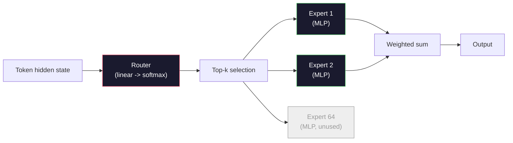

<!-- local-zh-machine-draft: English source is canonical; prose translated automatically, code/math preserved. -->

<a id="open-models-architecture-walkthroughs"></a>

# 开放模型：架构详解

> 你造了一个 GPT2026年的边界开放模型是同一家庭,有五六个具体变化。 RMSNorm 而非 LayerNorm. SwiGLU 而非 GELU. RoPE 而不是学习位置。 GQA 或 MLA 而不是完整的 MHA 。 规模化的混合专家。 您已经知道的数学涵盖了其中的95%。 此课读取 Llama 3, DeepSeek- V3,混血儿, Qwen,Gemma 并排,并列出每个建筑之间的确切线条。

**类型:** 学习
**语言:** Python (斯迪利布)
**先修要求:** 第10阶段,课程04、05、12(培训前,推广, Inference)
**时间:** ~45分钟

<a id="learning-objectives"></a>

## 学习目标

- 阅读配置 。json 的 Llama 3, Mistral混合体,Gemma 2号 Qwen 2.5, 和 DeepSeek-V3 并解释每个字段
- 列出每个模型相对于 GPT-2 从头等原则来看,规模小,理由合理
- Compute parameter 计数 KV cache 大小, 并激活光从配置中打开的模型的内存
- 根据延迟、记忆和能力限制为部署目标选择正确的开放模式

<a id="the-problem"></a>

## 问题

在04课上,你写了350行 numpy 并且有一个 GPT-2型型号 Llama 3 405B有一份200页的技术报告。你的直觉是,这些是不同的野兽。它们不是。200页用五、六种动机良好的修改来描述同一物体,加上一千个关于缩放的详情。骨架... embedding, transformer 区块, attention, MLP, 规范, 头 - 不变 。

这个课是一流的。 对于每个主要的开放型家庭, 我们列出与 GPT-2,为什么,它的成本。 model card 在精神上把它翻译回 GPT-2个基线

实际的回报是 当Meta释放 Llama 5个或 DeepSeek 释放 V4 时, 您不需要新的心理模型。 您可以查看配置, 查看哪个已知的 knobs 移动, 并知道下游的影响。 2026 年的架构是一个有限的工具框。 每个新模型都选择不同的子集 。

<a id="the-concept"></a>

## 概念

<a id="the-invariant-core"></a>

### 变化的核心

所有 autoregressive 共享的开户模式 :

- Token embedding 矩阵_大小 x 隐藏_(dim) 中文本不适用。
- N堆叠 decoder 区块: 规范, self-attention残留物 常规 残留物 残留物
- 最后规范和直线头投射到 vocab_大小( 通常) weight- 被绑了 embeddings).
- 下一个...token cross-entropy 损失。

这就是形状。 rest 是点。

<a id="the-six-knobs-that-actually-move"></a>

### 真正移动的六把手

在2024-2026年的边界开放模型中, 同样的六个设计选择被反复选择:

1. **Normalization.** LayerNorm -> RMSNorm.
2. **位置编码。** 绝对 - > RoPE (加上变体:YARN、NTK)。
3. **启动。** GELU -> SwiGLU (或GeGLU)。
4. **Attention 头部共享。** MAHA - > GQA - > MQA - > MLA。
5. **浓厚与稀少的MLP。** 密集度 - > 专家混合体。
6. **规范前安置。** 诺姆前就留下来 诺姆后就不见了

其它一切(请见E/CN.4/Sub.2/2000/L.10和Corr.1号文件)。learning rate schedule数据组合, batch size,上下文长度)在训练配置中的寿命,而不是建筑。六个把手。

<a id="knob-1-rmsnorm"></a>

### Knob 1 : 密码 RMSNorm

LayerNorm 减去平均值,除以 std, 比例尺和移动。 RMSNorm 只保留缩放 :

```
RMSNorm(x) = x / sqrt(mean(x^2) + eps) * gamma
```

不表示减法,没有偏差,每减一个 tokenZhang和Sennrich(2019年)认为这符合 LayerNorm 在机器翻译中, 速度更快10%。 每个现代的开放模型都运行它 。

成本:无。好处:小量投入赢,简单代码。

<a id="knob-2-rope"></a>

### 点 2 : RoPE

实得职位 embeddings 一张1024秒的搜索表 GPT- 2. 上下文1025不在表末,模型无法推断超过其培训时间。

旋转位置 Embedding (RoPE, Su等人 2021 输入位置,在输入前将每个 Q 和 K 矢量对齐旋转 attention 点产品。 旋转角度是位置的决定性功能, 所以没有学到什么,没有什么可以用完。 用缩放技巧( NTK- 觉察到的内插, YaRN) , 一个8k 上下文训练的模型可以延伸到 128k inference 准确度损失不大

```
q_rotated = rotate(q, angle(pos))
k_rotated = rotate(k, angle(pos))
score = q_rotated . k_rotated
```

每个 Llama, Mistral, Qwen, DeepSeek,Gemma使用 RoPEGemma 2 使用混合体(RoPE 在大多数层, 本地滑动窗口 attention (关于其他事项)。

<a id="knob-3-swiglu"></a>

### Knob 3 : 关键字 : SwiGLU

GPT-2号MLP是 `x -> gelu(xW1 + b1) -> (...)W2 + b2`. SwiGLU (Shazeer 2020) 将激活改为锁定产品:

```
SwiGLU(x) = (xW1) * sigmoid(xW1) * xV
```

有两个平行的投影 而不是一个 被斯维什号的启动锁定 perplexity 每 parameter. Llama 2个收养了它,每个人都跟着。 parameter 计数与原始密度的 MLP 匹配: 如果 GPT- 使用了2个 `ff_dim = 4 * hidden`, SwiGLU 使用 `ff_dim = (2/3) * 4 * hidden = 8/3 * hidden`.

<a id="knob-4-attention-head-sharing"></a>

### Knob 4: 键 Attention 头共享

GPT- 使用了2个 **Multi-Head Attention (马哈)**每个头都有自己的Q,K,V投影

**Multi-Query Attention (MQA,Shazeer 2019年)** 在所有头部共享一个K和一个V。 KV cache 在 num 之间_头部是典型模型的12x到32x的减幅。精确度略微低于硬基准值。

**Grouped-Query Attention (GQA、Ainslie等人,2023年)** 中间地带:G组的Q头同K组和V组。 Llama 3 8B 使用GQA,32个Q头和8个KV头(G=8),所以 KV cache 缩水4x对全MHA。

**多头顶 Attention (反洗钱法, DeepSeek 2024)** 将 K 和 V 压缩成一个共享的低级潜伏, 投射到每个头上。 进一步减少 KV cache 同时又能保持头部的直观性 DeepSeek- V2和V3的长文本性能依靠这个。

| Scheme | KV 头 | KV Cache | 准确度 |
|--------|----------|----------|----------|
| MHA    | num_heads | full | best |
| 质量保证局    | num_组 (G < num)_(头) | num_头部/G级减员 | near-MHA |
| 质量保证    | 1 | num_减少头部 | 受小打击 |
| MLA    | 潜伏,人均降压 | 小于 MQA | near-MHA |

用于~13B以上的任何模型 parameters、GQA或MLA是有效的强制性。 KV cache 灾难。

<a id="knob-5-mixture-of-experts"></a>

### Knob 5: 专家混合

密度大的 MLP 激活全部 parameters 每个 token. 一个 MoE MLP 每个区块都有K专家, 并有一个路由器来挑选顶级专家 token 只有那些专家 weights 见a forward pass 就为了这个 token.

```
router_logits = xW_r
indices, weights = top_k(router_logits, k=2)
output = sum_i weights[i] * expert[indices[i]](x)
```

上诉:您可以拥有64名大小为 7B 的专家, token (因此,token 计算符合密度为7B的模型。 Mixtral 8x7B 共有47B parameters 但只激活 13B / token. DeepSeek-V3共有671B parameters 仅激活37B/ token.



Pros: 相同的计算, 更多 parameters控制器:专家的记忆仍然必须留在某个地方(因此,服务需要的VRAM大于密度等量),路由器的负载平衡很困难,而且 fine-tuning 路由器 alignment 这是它自己的研究领域。

<a id="knob-6-pre-norm-stays"></a>

### Knob 6: 保持中度前

原件 transformer 每个子层之后应用的图层规范。 GPT-2 说 *之前* 每一个子层,在深度训练前, 完全容易。没什么好争论的。

<a id="model-by-model-diff"></a>

### 模型逐模式 Diff

这张桌子是所有混凝土的

| 模型 | 年份 | 参数共计 | 活动参数 | 规范 | 激活 | 职位 | Attention | MoE | 上下文 |
|-------|------|-------------|---------------|------|-----------|----------|-----------|-----|---------|
| GPT- 2个小 | 2019 | 124M | 124M | LayerNorm | GELU | 学到了 | MHA(12个头) | 不 | 1小时 |
| Llama 3 8B 目标 | 2024 | 8B | 8B | RMSNorm | SwiGLU | RoPE | GQA (32/8) | 不 | 128公里 |
| Llama 3 70B 电话: | 2024 | 70B | 70B | RMSNorm | SwiGLU | RoPE | GQA (64/8) | 不 | 128公里 |
| Llama 3 405B (3 405B) | 2024 | 405B | 405B | RMSNorm | SwiGLU | RoPE | GQA (128/16) | 不 | 128公里 |
| Mistral 7B 电话: | 2023 | 7.2B 国家 | 7.2B 国家 | RMSNorm | SwiGLU | RoPE | 质量保证局 | 不 | 32公里 |
| 混合 8x7B | 2023 | 47B 国家 | 13B | RMSNorm | SwiGLU | RoPE | 质量保证局 | 是(8名专家,顶层-2) | 32公里 |
| Gemma 2 9B 电话 | 2024 | 9B级 | 9B级 | RMSNorm (前置+员额) | 谷胱甘肽 | RoPE + 滑动 | 质量保证局 | 不 | 8公里 |
| Qwen 2.5 72B号 | 2024 | 72B | 72B | RMSNorm | SwiGLU | RoPE (雅鲁) | GQA (64/8) | 不 | 128公里 |
| DeepSeek V2 236B号 | 2024 | 236B号 | 21B 目标 | RMSNorm | SwiGLU | RoPE | MLA | 是(160名专家,顶级6人) | 128公里 |
| DeepSeek V3 | 2024 | 671B | 37B | RMSNorm | SwiGLU | RoPE | MLA | 是(256名专家,前8名) | 128公里 |

扫描柱子。 RMSNorm 是一个世界性的。 SwiGLU 或者GeGLU的表弟是普遍性的。 RoPE GQA的普遍性高于7B,除非被司法协助所取代。 MoE 是顶端的区别符。

<a id="reading-a-configjson"></a>

### 正在读取配置 。json

Llama 3 8B 配置 :

```
{
  "hidden_size": 4096,
  "intermediate_size": 14336,
  "num_hidden_layers": 32,
  "num_attention_heads": 32,
  "num_key_value_heads": 8,
  "max_position_embeddings": 131072,
  "rope_theta": 500000.0,
  "rms_norm_eps": 1e-5,
  "vocab_size": 128256
}
```

每个领域都与你已经执行的内容相对应。

- `hidden_size`: embedding 维度。
- `intermediate_size`: MLP 隐藏大小( 3.5x 隐藏 -) SwiGLU (数学)
- `num_hidden_layers`:堆放深度。
- `num_attention_heads`Q头。
- `num_key_value_heads`:KV头(GQA)。
- `max_position_embeddings`:培训时间长度。
- `rope_theta`: RoPE 元数据从默认的 10k 到500k 缩放成长文本外推法。
- `rms_norm_eps`:数字稳定。
- `vocab_size`: tokens.

单凭这些,你算出总计 parameters, KV cache,并峰值激活内存。 `code/main.py` 精确的公式。

<a id="activation-memory-budget"></a>

### 激活记忆预算

活动在培训记忆中占据主导地位,超过数十亿 parameters。 gradient 检查站:

```
activation_mem ~ batch_size * seq_len * hidden_size * num_layers * bytes_per_element
```

用于 Llama 3 8B 第1批第8192次,BF16,32层,隐藏在4096:大约8GB仅用于检查,40GB没有。这就是为什么闪光-attention 还有戒指...attention 重写 attention 计算如此激活。

<a id="kv-cache-budget"></a>

### KV Cache budget

用于 inference 最大上下文 :

```
kv_cache = 2 * num_layers * num_kv_heads * head_dim * max_seq_len * bytes_per_element
```

Llama 3 8B, 128k 上下文, BF16, 头_暗暗 = 隐藏 / num_头=128:
`2 * 32 * 8 * 128 * 131072 * 2 = 17.2 GB` 每一个序列。

8B号 weights 16GB在BF16。 KV cache 单128k 序列大于 weights。这是记忆压力驱动 GQA、MLA和 KV cache quantization 研究。

<a id="when-each-model-wins"></a>

### 当每个模特都赢了

- **单人 80GB GPU, 否 MoE**: Llama 3,8B, 3,8B, 3,8B, 3,8B, 3,8B, 3,8B, 3,8B, 3,8B, Mistral 7B, Gemma 2 9B. 易于使用, 宽度工具。
- **单节点( 8x80GB), 大容量**: Llama 3 70B, 3 70B, 3 70B, 3 70B, 7 70B, 3 70B, 3 70B, Qwen 2.5 72B. 最密集的露天能力。
- **最大开放能力, 接受 MoE complexity**: DeepSeek V3, Mixtral 8x22B. 每个活动FLOP的最佳能力。
- **A. 长期需要**: Llama 3(128公里与 RoPE 缩放) DeepSeek (《反洗钱法》优势)。
- **低延迟服务**: Gemma 2 9B(滑动窗口切除长字符计算) 。

```figure
rmsnorm-vs-layernorm
```

<a id="build-it"></a>

## 动手实现

课的代码是计算器 任何配置都行json的指纹 parameter 按组件计数, KV cache 以最大上下文, SwiGLU MLP比率和对结构的简短裁决(强烈/GQA/MLA/ MoE).

```python
config = {
    "hidden_size": 4096, "intermediate_size": 14336,
    "num_hidden_layers": 32, "num_attention_heads": 32,
    "num_key_value_heads": 8, "vocab_size": 128256,
    "max_position_embeddings": 131072,
}
```

脚本按字段行走,计算参数 embedding, attention (减少GQA),多功能项目(减少 SwiGLU 扩大), layernorms和头部。然后计算 KV cache 并打印摘要。

See `code/main.py` 用于执行。

<a id="use-it"></a>

## 实际应用

运行计算器 Llama 3,8B, 3,8B, 3,8B, 3,8B, 3,8B, 3,8B, 3,8B, 3,8B, Mistral 7B, Mixtral 8x7B, 和 DeepSeek 在脚本中捆绑的 V3 配置。 比较 parameter 注意 MoE 模型总参数计数比密度大的模型低,但活参数计数通常较小。 DeepSeek V3 号 KV cache 小于 Llama 3 405B 尽管有更多的总数 parameters - 即司法协助在行动。

然后插入本地任何模型的配置, 阅读摘要, 并决定它是否适合您 GPU.

<a id="ship-it"></a>

## 交付成果

这个课程产生 `outputs/skill-open-model-picker.md`. 确定部署目标(GPU 类型、 VRAM、 上下文长度、 延迟预算) 和任务配置( 聊天、 代码、 推理、 长文本) , 它推荐一个开放式模式, a quantization 来自课程11和 inference 12课的书架, 清晰的推理 关于6个建筑把手。

<a id="exercises"></a>

## 练习

1. 读 Qwen 2.5 72B 从 Hugging Face 配置。 计算总计 parameters 与高频报告值相比,并查明任何三角洲的来源(头部偏角、 KV 共享系数等)。

2. DeepSeek V3 使用256名具有8级以上路线的专家。 计算激活专家与专家总数的比例,并将Mixtral 8x7B 的前2比8比8比较, 从稀疏( 25%) 到密度( 3%) 的转变意味着每个FLOP的能力是什么?

3. 计算 KV cache 用于 Llama FP8和BF16中,在128k上下文时为3 405B。在FP8中,它是BF16数字的一半。您可以在一个8xH100节点上服务多少次平行序列(80GB各=640GB),减去 weight 记忆力?

4. Gemma 2号候补全员...attention 和滑动窗口 -attention 层。 写入数学 KV cache 当一半的层 使用4096 -token 滑动窗口而非完整上下文。 这能节省多少内存 ?

5. 找到一个在写完这门课后发布的最新边界开放模式。 确定它选择的六个把手中的哪一个以及是否引入了第七把手。 课程将感到当新的建筑船到来时, 目标是更新您的桌子而不重建你的心理模型 。

<a id="key-terms"></a>

## 关键术语

| 术语 | 人们怎么说 | 它实际上意味着什么 |
|------|----------------|----------------------|
| RMSNorm | "LayerNorm 没有刻薄的" | 仅按根平均平方实现正常化,其学习规模要低一些,而且可与 LayerNorm |
| RoPE | "扶轮员位置" | 将每个Q和K矢量以 2D 配对旋转到取决于位置的角度—— 用缩放技巧推断超过训练时间 |
| SwiGLU | 新的 MLP 激活 | 带有 Swish 的 Gated 线性单元 : `(xW1) * sigmoid(xW1) * xV` 标准值为每2024年+开放模式 |
| 质量保证局 | "中间地带" attention" | Grouped-Query Attention:G组的Q级头与K组和V组头共享——缩水组 KV cache 没有 MQA 的准确性被击中 |
| MLA | "DeepSeek的 attention" | 多头顶 Attention:将 K/V 压缩成一个共同的低级潜伏,降低头部压压——最小 KV cache 用于大型模型 |
| MoE | "种族隔离专家" | 专家混合器:每块N MLP,路由器每块取最高K token - 巨大的总参数,小型主动参数 |
| Top-k 路由 | "每个Pick k 专家 token" | 路由器计算每个专家的得分,并激活最高k-典型 k为 2 (混合) 到 8 ()DeepSeek) |
| 雅然 | 前进 RoPE" | 又一个 RoPE 扩展 - 内插旋转角度,将上下文从8k 延伸至 128k+ inference 时间 |
| Sliding-window attention | "别无所事事" | 每个 token 仅覆盖最后一个 W tokens - 上限 attention 按O(W)计算的费用 token,用于 Gemma 2 和早期 Mistral |
| 活动参数 | "什么运行每 token" | 用于 MoE 模型, parameter 计数时看到 forward pass 每 token (大大小于总参数)token FLOPs |

<a id="further-reading"></a>

## 进一步阅读

- [Dubey等人,2024年,“ Llama 3 种模型”](https://arxiv.org/abs/2407.21783) - 密度高者的建筑和培训参考资料 Llama 3个家庭
- [DeepSeek- AI, 2024年 - " (美国)DeepSeek-V3技术报告"](https://arxiv.org/abs/2412.19437) -- -- 司法协助加上无附带损失负载平衡加671B MoE
- [Jiang等人,2024年 -- -- "专家混合 "](https://arxiv.org/abs/2401.04088) - 银河系 MoE 开关模式纸
- [Su等人,2021年 -- -- "Roforemer:增强 Transformer 具有旋转位置 Embedding"](https://arxiv.org/abs/2104.09864) -- 该 RoPE paper
- [Shazeer,2020年 -- "GLU变体改进 Transformer"](https://arxiv.org/abs/2002.05202) -- SwiGLUGeGLU和朋友们
- [Ainslie等人,2023年 -- -- " GQA:培训通用多查询 " Transformer 模型"](https://arxiv.org/abs/2305.13245) - GQA文件
- [Gemma 2小组,2024年——“Gemma2:在实际规模上改进开放语言模型”](https://arxiv.org/abs/2408.00118) -- 混合整流+滑动 attention,前加后规范
- [Qwen 小组,2024年 -- "Qwen 2.5 技术报告”](https://arxiv.org/abs/2412.15115) - 雅马网背景扩展和长文本培训配方
