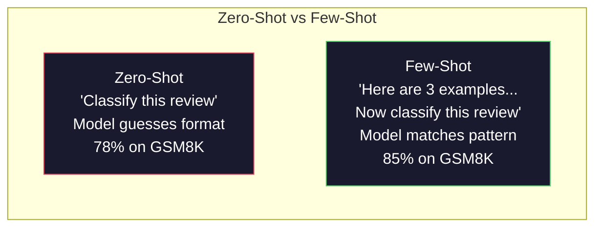
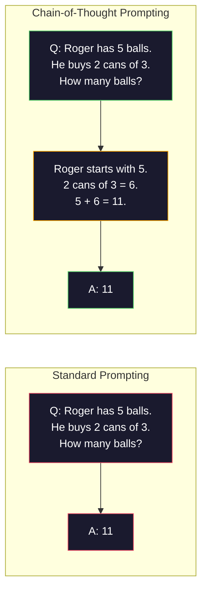
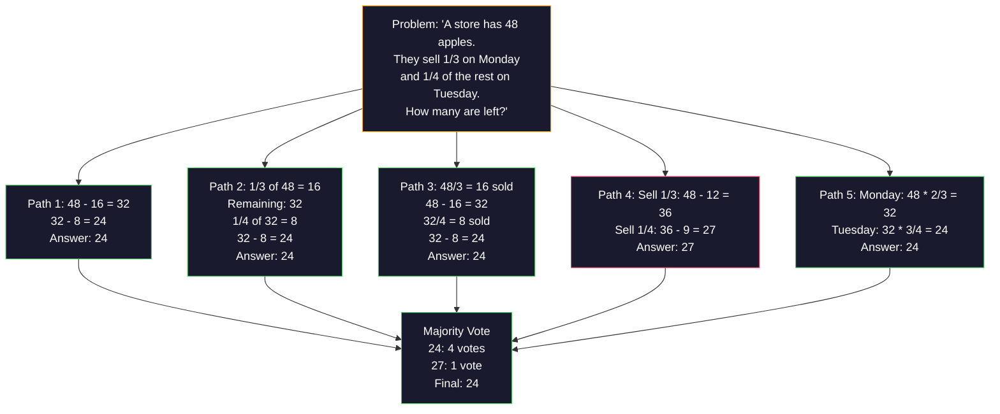
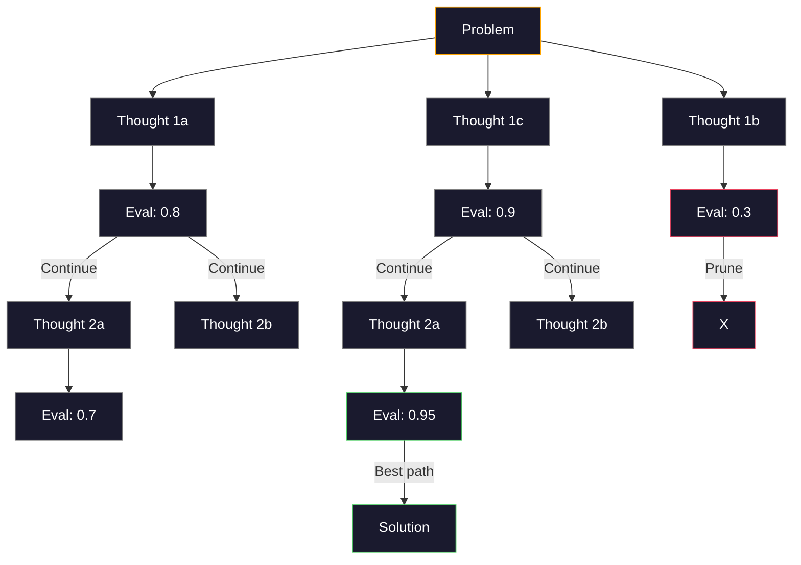

<!-- local-zh-machine-draft: English source is canonical; prose translated automatically, code/math preserved. -->

<a id="few-shot-chain-of-thought-tree-of-thought"></a>

# Few-Shot, Chain-of-Thought, Tree-of-Thought

> 告诉模型要做什么是提示。 显示它如何思考是工程。 在同一个模型上, 78%到91%的精确度之间的差, 同样的任务, 相同的数据不是一个更好的模型。 这是一个更好的推理策略 。

**类型:** Build
**语言:** Python
**先修要求:** 课程11.01(Prompt Engineering)
**时间:** ~45分钟

<a id="learning-objectives"></a>

## 学习目标

- Implement few-shot 通过选择和格式化示例演示,以最大限度地实现任务准确性
- Apply chain-of-thought 提高数学词问题等多步问题的准确性
- 构建一个 tree-of-thought prompt 探索多个推理路径并选择最佳路径
- 测量精确度的提高 zero-shot 与 few-shot 参照标准基准对COT

<a id="the-problem"></a>

## 问题

您正在构建数学辅导应用程序。 您的 prompt 说:"解决这个字的问题。" GPT- 5 得到正确的94%的时间 在标准年级的数学基准GSM8K上。你认为你已经达到顶峰了。你没有—— chain-of-thought 仍然增加了3-4点。

添加五个字 - "让我们一步一步思考" - 精度跳升到91%。 添加几个工作实例, 它达到95%。 同样模式 。 temperature。 API 唯一不同之处在于你给了模型刮痕纸

这不是一个黑客。这是推理如何运作的。人类不会在一个心理跳跃中解决多步问题。 transformers。当您强迫模型生成中间 tokens, 那些 tokens 成为下一个环境的一部分 token。每个推理步骤都为下一个步骤提供素材。该模型可以计算出答案。

但“一步一步思考”是开始,而不是结束。如果你抽样研究五条推理路径并进行多数投票呢?如果你让模型探索一棵可能性树,评估和修剪,会怎么样? branches如果用工具进行断裂推理呢?这些不是假设。它们都是有一定改进的出版技术,你会用这个教训来构建它们。

<a id="the-concept"></a>

## 概念

<a id="zero-shot-vs-few-shot-when-examples-beat-instructions"></a>

### Zero-Shot 与 Few-Shot: 当示例跳过指令时

Zero-shot 推动给模型一个任务, 而不是别的。 Few-shot 促使它先举一些例子。

Wei等人(2022年)通过8个基准衡量了这一点。 zero-shot 和 few-shot 完成的只有2%。对于复杂的任务,比如多步算术和符号推理, few-shot 精确度提高了10-25%。

直觉: 示例是压缩的指令。 您没有描述输出格式, 而是显示它。 您没有解释推理过程, 而是演示它。 示例上的模型模式比对抽象指令的解释更可靠 。



**当 few-shot 赢家 :** 格式敏感的任务、 分类、 结构化提取、 特定域的词典, 任何模型需要匹配特定模式的任务 。

**当 zero-shot 赢家 :** 简单的事实问题,创造性的任务,其中的例子限制创造力, 找到好的例子比写好的指示更困难的任务。

<a id="example-selection-similar-beats-random"></a>

### 示例选择: 类似比特随机

并非全部示例都相等。 选择类似目标输入的示例可以随机选择5-15%( Liu等人, 2022年)。 三个原则:

1. **语义相似性**:选择最接近输入的示例 embedding space
2. **标签多样性**:在示例中涵盖所有输出类别
3. **难以匹配**:匹配目标问题的复杂性

多数任务的最佳例子数为3-5。 在 3 下方, 模型没有足够的信号来提取模式 。 超过 5 , 您会遇到回报减少和浪费 。 context window tokens。对于带有多个标签的分类,每个标签使用一个示例。

<a id="chain-of-thought-giving-models-scratch-paper"></a>

### Chain-of-Thought: 提供模型拼贴纸

Chain-of-Thought (CoT)促销是由Wei等人(2022年)在谷歌脑部推出的。这个想法很简单:与其要求模型提供公正的答案,不如先请它展示其推理步骤。



为什么这能机械地工作? token 一个 transformer 生成成为下一个上下文 token。没有计算机时,模型必须把所有推理压缩到一个隐藏的状态。 forward pass。使用 CoT,该模型将中间计算作为外部值 tokens2. 每一推理 token 扩展有效计算深度。

**GSM8K基准(年级数学,8.5K问题):**

| 模型 | Zero-Shot | Zero-Shot CoT | Few-Shot CoT |
|-------|-----------|---------------|--------------|
| GPT- 4个 | 78% | 91% | 95% |
| GPT-5 | 94% | 97% | 98% |
| o4-mini（推理） | 97% | — | — |
| Claude 行动4.7 | 93% | 97% | 98% |
| Gemini 专业3 | 92% | 96% | 98% |
| Llama 4 70B 资源 | 80% | 89% | 94% |
| DeepSeek- V3.1 电磁脉冲 | 89% | 94% | 96% |

**关于推理模型的说明。** 型号 OpenAIo系列(o3,o4-mini)和 DeepSeek-R1运行 chain-of-thought 在发表答案之前,在推理模型中加上“让我们一步一步思考”是多余的,有时会产生反效果——他们已经这样做了。

两种口味的COT:

**Zero-shot CoT**:在“我们一步一步思考”之后 promptKojima等人(2022年)指出,这一句提高了计算、常识和象征性推理任务的准确性。

**Few-shot CoT**:提供包括推理步骤的例子。 zero-shot 因为模型能理解你所期望的精确推理格式。

**当COT伤害**: 简单的事实回忆 (“ 法国首都是什么 ” ) , 单步分类, 速度比准确性更重要的任务 。 CoT 添加了 50- 200 tokens 对于高通量、低复杂度的任务来说,这是浪费成本。

<a id="self-consistency-sample-many-vote-once"></a>

### 自我一致性: 样本多, 投票一次

Wang等人(2023年)引入了自我一致性。 洞察力: 单一的 CoT 路径可能包含推理错误。 但如果您抽取 N 独立的推理路径( 使用 temperature > 0),并接受对最终答案的多数票,错误取消 。



自我一致性使GSM8K的精确度从56.5%(单一COT)提高到74.4%,在原PALM 540B实验中N=40。 GPT-5 改进幅度很小(97%至98%),因为基准精度已经饱和。该技术最闪耀于60-85%基COT精确度的模型 -- -- 单路径错误经常发生但并非系统性的甜点。对于推理模型(O-series, R1),自我一致性被内部内嵌的内含包含 sampling.

权衡:N样本是指Nx API 在实际操作中,N=5占了大部分福利。N=3是有意义的投票的最低要求。N > 10减少了大多数任务的回报。

<a id="tree-of-thought-branching-exploration"></a>

### Tree-of-Thought:分界线勘探

Yao等人(2023年)介绍 Tree-of-Thought (ToT) 。 当 CoT 遵循一条线性推理路径时, ToT 探索多个 branches 并评估最有希望的,然后继续。



TOT有三个组成部分:

1. **思想一代**: 产生多个候选人的下一步
2. **State evaluation**:每个候选人得分(可以使用 LLM (作为评价员)
3. **搜索算法**: BFS 或DFS 穿过树, 修剪低分数 branches

在游戏中的 24 个任务( 使用算术计算 4 个数字来计算 24) , GPT- 4 使用标准提示解决了7.3%的问题。使用COT,4.0%(因为搜索空间宽,CoT实际上受伤)。使用TOT,74%。

托特很贵 树上每个节点都需要 LLM 树枝3和深度3需要最多39根 LLM 仅用于搜索空间大但可变现的问题 planning解谜 创造性地用限制解决问题

<a id="react-thinking--doing"></a>

### ReAct:思考 + 做

Yao等人(2022年)综合推理 traces 模型将思维(产生推理)与行为(召唤工具、搜索、计算)相交替。

```mermaid
graph LR
    Q["Question:\nWhat is the\npopulation of the\ncountry where\nthe Eiffel Tower\nis located?"]
    T1["Thought: I need to\nfind which country\nhas the Eiffel Tower"]
    A1["Action: search\n'Eiffel Tower location'"]
    O1["Observation:\nParis, France"]
    T2["Thought: Now I need\nFrance's population"]
    A2["Action: search\n'France population 2024'"]
    O2["Observation:\n68.4 million"]
    T3["Thought: I have\nthe answer"]
    F["Answer:\n68.4 million"]

    Q --> T1 --> A1 --> O1 --> T2 --> A2 --> O2 --> T3 --> F

    style Q fill:#1a1a2e,stroke:#ffa500,color:#fff
    style T1 fill:#1a1a2e,stroke:#51cf66,color:#fff
    style A1 fill:#1a1a2e,stroke:#e94560,color:#fff
    style O1 fill:#1a1a2e,stroke:#808080,color:#fff
    style T2 fill:#1a1a2e,stroke:#51cf66,color:#fff
    style A2 fill:#1a1a2e,stroke:#e94560,color:#fff
    style O2 fill:#1a1a2e,stroke:#808080,color:#fff
    style T3 fill:#1a1a2e,stroke:#51cf66,color:#fff
    style F fill:#1a1a2e,stroke:#51cf66,color:#fff
```



ReAct 在知识密集型任务上表现优于纯COT, 因为它可以用真实的数据来说明其推理。 在 HotpotQA (多跳问答) 中, ReAct 与 GPT- 4个达到35.1% exact match 光是COT就占29.4%。真正的力量是推理错误通过观察得到纠正 -- -- 模型可以更新其计划中期执行。

ReAct 是现代人工智能的基础 agents. 每个 agent 框架LangChain, CrewAI, AutoGen) 执行思想-行动-观察环的一些变体。 您将会建立完整 agents 第14阶段:这一课程涵盖了推动模式。

<a id="structured-prompting-xml-tags-delimiters-headers"></a>

### 结构化提示 : XML 标记、 分隔符、 页眉

作为 prompts 变得复杂,结构防止模型 混淆部分。

**XML tags** (工作最顺利 Claude到处都是:
```
<context>
You are reviewing a pull request.
The codebase uses TypeScript and React.
</context>

<task>
Review the following diff for bugs, security issues, and style violations.
</task>

<diff>
{diff_content}
</diff>

<output_format>
List each issue with: file, line, severity (critical/warning/info), description.
</output_format>
```

**Markdown headers** (普遍):
```
## Role
Senior security engineer at a fintech company.

## Task
Analyze this API endpoint for vulnerabilities.

## Input
{api_code}

## Rules
- Focus on OWASP Top 10
- Rate each finding: critical, high, medium, low
- Include remediation steps
```

**Delimiters** (最低限度但有效):
```
---INPUT---
{user_text}
---END INPUT---

---INSTRUCTIONS---
Summarize the above in 3 bullet points.
---END INSTRUCTIONS---
```

<a id="prompt-chaining-sequential-decomposition"></a>

### Prompt 链条:顺序分解

有些任务太复杂了 单次都不行 prompt. Prompt 链条将它们打破到阶梯上, 在那里输出一个 prompt 成为下一个输入。


链条打单 -prompt 基于以下三个原因:

1. **每一步都比较简单**:模型处理一个重点任务,而不是杂耍一切
2. **中间产出可以检查**:您可以在两个步骤之间验证和校正
3. **不同的步骤可以使用不同的模型**:使用一种廉价的提取模型,一种昂贵的推理模型

<a id="performance-comparison"></a>

### 业绩比较

| 技术 | 最适合 | GSM8K 精确度 (GPT-5) | API Calls | Token Overhead | 复杂性 |
|-----------|----------|------------------------|-----------|----------------|------------|
| Zero-Shot | 简单任务 | 94% | 1 | 无 | Trivial |
| Few-Shot | 格式匹配 | 96% | 1 | 200-500 tokens | 低 |
| Zero-Shot CoT | 快速推理促进 | 97% | 1 | 50-200 tokens | Trivial |
| Few-Shot CoT | 最大单调准确度 | 98% | 1 | 300-600 tokens | 低 |
| 自我维持(N=5) | 高考推论 | 98.5% | 5 | 5个 token 成本 | 中等 |
| 解释模型(o4-mini) | 调试器替换 | 97% | 1 | 隐藏( 2 - 10x 内部) | Trivial |
| Tree-of-Thought | 搜索/planning problems | 不适用(24人游戏中的74%) | 10-40+ | 10-40x 目标 token 成本 | 高 |
| ReAct | 基于知识的推理 | 不适用(热锅质量评估为35.1%) | 3-10+ | Variable | 高 |
| Prompt Chaining | 复杂的多步骤任务 | 96%(管道) | 2-5 | 2-5x 级 token 成本 | 中等 |

正确的技术取决于三个因素:精确要求、潜伏预算和成本承受力。 few-shot 具有3个样本的自我一致性备份的计算机技术中心覆盖90%的使用案例。

```figure
few-shot-curve
```

<a id="build-it"></a>

## 动手实现

我们会建立一个数学问题解答器 结合 few-shot 激励, chain-of-thought 推理和自我一致投票 进入一个单一的管道。然后我们再加 tree-of-thought 难找的

全面实施 `code/advanced_prompting.py`。这里是关键部件。

<a id="step-1-few-shot-example-store"></a>

### 步骤1: Few-Shot 示例存储

第一部分管理 few-shot 示例,并选择与特定问题最相关的实例。

```python
GSM8K_EXAMPLES = [
    {
        "question": "Janet's ducks lay 16 eggs per day. She eats three for breakfast every morning and bakes muffins for her friends every day with four. She sells every egg at the farmers' market for $2. How much does she make every day at the farmers' market?",
        "reasoning": "Janet's ducks lay 16 eggs per day. She eats 3 and bakes 4, using 3 + 4 = 7 eggs. So she has 16 - 7 = 9 eggs left. She sells each for $2, so she makes 9 * 2 = $18 per day.",
        "answer": "18"
    },
    ...
]
```

每个例子有三个部分:问题、推理链和最后答案。 推理链是改变常规 few-shot 示例进入 CoT few-shot 示例.

<a id="step-2-chain-of-thought-prompt-builder"></a>

### 步骤2: Chain-of-Thought Prompt Builder

该 prompt 建筑工组 system message, few-shot 以推理链为例,将目标问题纳入一个单一的 prompt.

```python
def build_cot_prompt(question, examples, num_examples=3):
    system = (
        "You are a math problem solver. "
        "For each problem, show your step-by-step reasoning, "
        "then give the final numerical answer on the last line "
        "in the format: 'The answer is [number]'."
    )

    example_text = ""
    for ex in examples[:num_examples]:
        example_text += f"Q: {ex['question']}\n"
        example_text += f"A: {ex['reasoning']} The answer is {ex['answer']}.\n\n"

    user = f"{example_text}Q: {question}\nA:"
    return system, user
```

格式限制 (“ 答案是 ” [number]没有它,自我一致性就无法从样本中提取和比较答案。

<a id="step-3-self-consistency-voting"></a>

### 步骤3:自我统一投票

选N推理路径,接受多数人的答复。

```python
def self_consistency_solve(question, examples, client, model, n_samples=5):
    system, user = build_cot_prompt(question, examples)

    answers = []
    reasonings = []
    for _ in range(n_samples):
        response = client.chat.completions.create(
            model=model,
            messages=[
                {"role": "system", "content": system},
                {"role": "user", "content": user}
            ],
            temperature=0.7
        )
        text = response.choices[0].message.content
        reasonings.append(text)
        answer = extract_answer(text)
        if answer is not None:
            answers.append(answer)

    vote_counts = Counter(answers)
    best_answer = vote_counts.most_common(1)[0][0] if vote_counts else None
    confidence = vote_counts[best_answer] / len(answers) if best_answer else 0

    return best_answer, confidence, reasonings, vote_counts
```

Temperature 0.7很重要,现在 temperature 0.0 , 所有 N 样本都会相同, 无法达到目的 。 您需要足够随机性来选择不同的推理路径, 而不是模型产生胡言乱语 。

<a id="step-4-tree-of-thought-solver"></a>

### 步骤4: Tree-of-Thought Solver

对于线性推理失败的问题,TOT探讨多种办法并评估哪一种方向最有希望。

```python
def tree_of_thought_solve(question, client, model, breadth=3, depth=3):
    thoughts = generate_initial_thoughts(question, client, model, breadth)
    scored = [(t, evaluate_thought(t, question, client, model)) for t in thoughts]
    scored.sort(key=lambda x: x[1], reverse=True)

    for current_depth in range(1, depth):
        next_thoughts = []
        for thought, score in scored[:2]:
            extensions = extend_thought(thought, question, client, model, breadth)
            for ext in extensions:
                ext_score = evaluate_thought(ext, question, client, model)
                next_thoughts.append((ext, ext_score))
        scored = sorted(next_thoughts, key=lambda x: x[1], reverse=True)

    best_thought = scored[0][0] if scored else ""
    return extract_answer(best_thought), best_thought
```

评估员本身是一个 LLM 调用。你问这个模型:“在0.0到1.0的尺度上, 这个推理路径对于解决问题有多有希望?” 这是TTO的关键洞察力——这个模型评价了它自己的部分解决方案。

<a id="step-5-full-pipeline"></a>

### 步骤5:完整管道

输油管将所有技术与升级战略结合起来。

```python
def solve_with_escalation(question, examples, client, model):
    single_answer, _ = few_shot_cot_solve(question, examples, client, model)

    sc_answer, confidence, _, _ = self_consistency_solve(
        question, examples, client, model, n_samples=5
    )

    if confidence >= 0.8 and single_answer == sc_answer:
        return sc_answer, "self_consistency", confidence

    tot_answer, _ = tree_of_thought_solve(question, client, model)
    return tot_answer, "tree_of_thought", None
```

升级逻辑:先尝试廉价(单科特 ) 。 单一的确定性路径不提供投票份额, 因此其质量检查是协议 : temperature-0个答案必须与抽样路径的大多数答案匹配。如果它不匹配,或者如果自我一致性信心低于0.8(5个样本中少于4个),则会升级为 ToT。这种平衡成本和准确性 -- -- 大部分问题都是廉价解决的,困难的问题就会得到更多的计算。

<a id="use-it"></a>

## 实际应用

<a id="template-driven-few-shot-prompts"></a>

### Template-Driven Few-Shot Prompts

LangChain 提供内部支持 prompt 简化模板和输出解析 few-shot 和COT模式:

```python
from langchain_core.prompts import FewShotPromptTemplate, PromptTemplate
from langchain_openai import ChatOpenAI

example_prompt = PromptTemplate(
    input_variables=["question", "reasoning", "answer"],
    template="Q: {question}\nA: {reasoning} The answer is {answer}."
)

few_shot_prompt = FewShotPromptTemplate(
    examples=examples,
    example_prompt=example_prompt,
    suffix="Q: {input}\nA: Let's think step by step.",
    input_variables=["input"]
)

llm = ChatOpenAI(model="gpt-4o", temperature=0.7)
chain = few_shot_prompt | llm
result = chain.invoke({"input": "If a train travels 120 km in 2 hours..."})
```

LangChain 也曾经 `ExampleSelector` 语义相似性选择类别 :

```python
from langchain_core.example_selectors import SemanticSimilarityExampleSelector
from langchain_openai import OpenAIEmbeddings

selector = SemanticSimilarityExampleSelector.from_examples(
    examples,
    OpenAIEmbeddings(),
    k=3
)
```

<a id="compiled-prompts"></a>

### Compiled Prompts

DSPy 将促动策略视为可优化的模块。 prompts,您定义一个签名,让 DSPy 优化 prompt:

```python
import dspy

dspy.configure(lm=dspy.LM("openai/gpt-4o", temperature=0.7))

class MathSolver(dspy.Module):
    def __init__(self):
        self.solve = dspy.ChainOfThought("question -> answer")

    def forward(self, question):
        return self.solve(question=question)

solver = MathSolver()
result = solver(question="Janet's ducks lay 16 eggs per day...")
```

DSPy 的游戏 `ChainOfThought` 自动添加推理 traces. `dspy.majority` 实施自我一致性:

```python
result = dspy.majority(
    [solver(question=q) for _ in range(5)],
    field="answer"
)
```

<a id="comparison-from-scratch-vs-frameworks"></a>

### 比较: 从鼠标对齐框架

| Feature | 从剪辑( 本课) | LangChain | DSPy |
|---------|--------------------------|-----------|------|
| 控制 prompt format | Full | Template-based | 自动 |
| Self-consistency | 手动表决 | 手册 | 内建(`dspy.majority`) |
| 示例选择 | 自定义逻辑 | `ExampleSelector` | `dspy.BootstrapFewShot` |
| Tree-of-Thought | 自定义树搜索 | 社区链条 | 没有内置 |
| Prompt optimization | 手动迭代 | 手册 | 自动编译 |
| 最适合 | 学习、定制输油管 | 标准工作流程 | 研究、优化 |

<a id="ship-it"></a>

## 交付成果

这堂课产生了两件艺术品

**1. 理性链 Prompt** (`outputs/prompt-reasoning-chain.md`: 生产准备 prompt 模板 few-shot 具有自定性的 CoT 。 插入您的例子和问题域 。

**2. 计算机模式选择技能** (`outputs/skill-cot-patterns.md`:根据任务类型、准确性要求和成本限制选择正确推理技术的决定框架。

<a id="exercises"></a>

## 练习

1. **测量差距**: 处理10个GSM8K问题。 zero-shot, few-shot, zero-shot Cot, 和(或) few-shot 电脑记录每部的准确性。哪种技术能提供你模型上最大的电梯?

2. **示例选择实验**:对于相同的10个问题,比较随机示例选择与手选的类似示例。测量精确度差异。在哪个时候,示例质量比示例数量重要?

3. **自我维持费用曲线**N=1、3、5、7、10在20个GSM8K问题上运行自我一致性。 tokens你的模特的膝盖在哪里?

4. **构建一个 ReAct loop**:用计算工具扩展管道。当模型生成数学表达式时,应用 Python的 `eval()` (单位:a) sandbox) 和反馈结果。如果根据工具推理的结果优于纯 CoT,则测量其效果。

5. **用于创造性任务的 ToT**: 调整 Tree-of-Thought 创造性写作任务的解答者: “写一个有趣和悲伤的6个字的故事。” LLM 分支勘探是否产生比单发一代更好的创造性产出?

<a id="key-terms"></a>

## 关键术语

| 术语 | 人们怎么说 | 它实际上意味着什么 |
|------|----------------|----------------------|
| Few-shot prompting | "举几个例子" | 包括投入-产出示范 prompt 以锁定模型输出格式和行为 |
| Chain-of-Thought | 一步一步想着 | 中间推理 tokens 来扩展模型的有效计算,然后才能给出最终答案 |
| Self-Consistency | 跑好多次 | Sampling 不同的推理路径 temperature > 0 以多数票选择最常见的最后答案 |
| Tree-of-Thought | "让它探索各种选择" | 结构化搜索而不是推理 branches 评估每个部分解决方案,只扩大有希望的道路 |
| ReAct | "思考+工具的使用" | 中间推理 traces 带有外部动作( 搜索、 计算、 计算) API (在思想-行动-观察循环中) |
| Prompt chaining | "把它破解成阶梯" | 将复杂任务分解成相继任务 prompts 每个输出都输入下一个输入 |
| Zero-shot CoT | "只要加上" 一步一步想着" | 附加一个推理触发词句 prompt 依据模型的潜在推理能力 |

<a id="further-reading"></a>

## 进一步阅读

- [Chain-of-Thought 大语言模型中提示引用理由](https://arxiv.org/abs/2201.11903) - Wei等人,2022年。谷歌脑部的CoT原始文件。读取核心结果的第2-3节。
- [自我一致性得到改善 Chain of Thought 语言模式中的理由](https://arxiv.org/abs/2203.11171) - Wang等人,2023年。自我一致性文件。表1载有你需要的所有数字。
- [思想树:用大语言模型解决蓄意问题](https://arxiv.org/abs/2305.10601) - Yao等人,2023. ToT纸张。第4节中的24项比赛结果为亮点。
- [ReAct:在语言模型中使理由和行为同步化](https://arxiv.org/abs/2210.03629) - Yao等人,2022年。 现代大赦国际的基础 agents第3节解释了思想-行动-观察循环。
- [大语言模型 Zero-Shot Reasoners](https://arxiv.org/abs/2205.11916) Kojima 等人, 2022年。 “ 让我们一步一步思考” 的论文。 令人惊讶的是, 它是多么简单。
- [DSPy: 将声明语言模式呼吁编译为自我改进管道](https://arxiv.org/abs/2310.03714) - Khattab 等人,2023年。 将提示视为编译问题。 如果您想要超越手动操作, 请阅读 prompt engineering.
- [OpenAI - 讲解模式指南](https://platform.openai.com/docs/guides/reasoning) - 供应商关于何时 chain-of-thought 成为内部,价格 - 每一 -token “ 理由” 模式与 prompt- 级戏法。
- [Lightman等人,“让我们一步一步地核查”(2023年)](https://arxiv.org/abs/2305.20050) -- -- 进程 reward models (PRM) 分级链的每个步骤; 推理监督信号 成功只产生结果的奖励。
- [Snell等人,“扩大 LLM 测试时间计算“ 最佳” (2024)](https://arxiv.org/abs/2408.03314) - 系统研究计算机技术的长度和自定性 sampling和 MCTS ; 当精确度比潜伏更重要时, “ 一步步思考” 就会发生。
