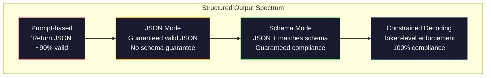
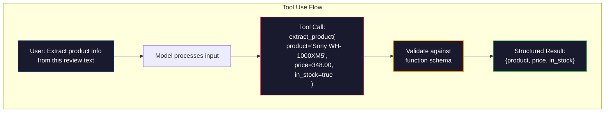

<!-- local-zh-machine-draft: English source is canonical; prose translated automatically, code/math preserved. -->

<a id="structured-outputs-json-schema-validation-constrained-decoding"></a>

# Structured Outputs：JSON、Schema 校验与约束解码

> 你的 LLM 返回字符串。您的应用程序需要 JSON。这个缺口已经摧毁了比任何模型都多的生产系统 hallucination. Structured output 是自然语言和输入数据之间的桥梁。 LLM 变成一个可靠的 API弄错了,你在凌晨3点 和regex对着自由文本进行解读

**类型:** Build
**语言:** Python
**先修要求:** 第10阶段,第01-05期(LLMs 发自Scratch)
**时间:** ~90分钟
**相关内容:** 阶段5 · 20 (Structured Outputs 限制解码) decoder- 等级理论(密克罗尼西亚/CFG 登录处理器、大纲、XGrammar)。 SDK 表面( A)OpenAI `response_format`, Anthropic 工具使用,教官)——读第5阶段 · 20 API.

<a id="learning-objectives"></a>

## 学习目标

- Implement JSON- 使用模式和机率限制的产出 OpenAI 和 Anthropic API parameters
- 构建一个拒绝畸形的 Pydantic 验证层 LLM 带有错误反馈的输出和重试
- 解释受限解码力如何有效 JSON 时间 token 职等(无后处理)
- 设计强力提取 prompts 可靠地将未结构化的文本转换为已输入的数据结构

<a id="the-problem"></a>

## 问题

你问一个 LLM: "摘取产品名称、价格,以及 availability 它回应:

```
The product is the Sony WH-1000XM5 headphones, which cost $348.00 and are currently in stock.
```

这是一个非常正确的答案。 它对于您的应用程序也完全没有用处。 您的库存系统需要 `{"product": "Sony WH-1000XM5", "price": 348.00, "in_stock": true}`。你需要一个 JSON 对象,带有特定键、特定类型和特定值限制。不需要句子。

幼稚的解决办法:加上 "回应 JSON"致你的爱人 prompt。90%的时间都有效。其他10%的模型将 JSON 在 markdown 代码栅栏,或添加一个序言 喜欢"这里是 JSON:”或产生合成无效。 JSON 因为它提前关闭了一个括号。 JSON 解析器崩溃。 您的管道中断 。 您添加试/ 例外和重试循环 。 重试有时产生不同的数据 。 现在您在解析问题上存在一致性问题 。

这不是一个 prompt engineering 问题。这是一个解码问题。 模型生成 tokens 左向右。 在每一个位置, 它选择了最可能的下一个位置 token 从 a 中 vocabulary 100K+的选项。这些选项中的大多数将产生无效 JSON 如果模型刚刚释放 `{"price":`,下一个 token 必须是数字, 引用( 对字符串来说) 。 `null`, `true`, `false`,或负符号。任何其他结果都无效 JSON。没有限制,模型可能会选择一个完全合理的英语词,这个词在逻辑上是灾难性错误的。

<a id="the-concept"></a>

## 概念

<a id="the-structured-output-spectrum"></a>

### 该 Structured Output Spectrum

有四级 structured output 控制,每个比最后一个更可靠。



**Prompt- 基础** (“ 有效响应 ” JSON“ : 没有强制执行。 模型通常符合要求, 但有时没有。 可靠性:~ 90%。 失败模式 : markdown 栅栏、序言文字、短输出、结构错误。

**JSON mode**: 该 API 保证输出有效 JSON. OpenAI的 `response_format: { type: "json_object" }` 启用此选项。 输出将分析无错误。 但可能无法匹配您预期的图案 -- 额外密钥、 错误类型、 缺失字段 。

**计划模式**: 该 API 开一个 JSON 2026年,每个主要供应商都支持这个本地产品: OpenAI的 `response_format: { type: "json_schema", json_schema: {...} }` (也作为 `tool_choice="required"`), Anthropic工具使用 `input_schema`, 和 Gemini的 `response_schema` + `response_mime_type: "application/json"`。输出有您指定的精确键、类型和限制。

**控制解码**: 在每一页 token 生成时的位置, decoder 全部遮盖 tokens 将产生无效输出。如果方案需要一个数字,而模型即将发布一封信件, token 设定为概率为零。该模型只能产生 tokens 导致有效输出。这就是 OpenAI的 structured output 模式和图书馆,如大纲和指导在底层实施。

<a id="json-schema-the-contract-language"></a>

### JSON Schema: 合同语言

JSON Schema 是您如何告诉模型( 或验证层) 输出必须具有何种形状 。 structured output 系统使用它。

```json
{
  "type": "object",
  "properties": {
    "product": { "type": "string" },
    "price": { "type": "number", "minimum": 0 },
    "in_stock": { "type": "boolean" },
    "categories": {
      "type": "array",
      "items": { "type": "string" }
    }
  },
  "required": ["product", "price", "in_stock"]
}
```

这个图案说: 输出必须是带有字符串的对象 `product`,一个非负数 `price`,一个布尔恩 `in_stock`字符串的可选矩阵 `categories`。任何不匹配的输出都会被拒绝。

Schemas 处理硬体大小写: 嵌套对象、 带有打字项的数组、 enum( 将字符串绑在特定值上)、 模式匹配( 字符串上的regex) 和组合器( 其中之一, 任何部分, 用于多形态输出的 ) 。

<a id="the-pydantic-pattern"></a>

### Pydantic 模式( 立体模式)

在 Python,您不写 JSON 手动设计图,你定义一个Pydantic模型, 它产生你的计划。

```python
from pydantic import BaseModel

class Product(BaseModel):
    product: str
    price: float
    in_stock: bool
    categories: list[str] = []
```

产生同样的 JSON 教学图书馆(和 OpenAI的 SDK) 直接接受 Pydantic 模型: 通过模型类, 获得一个验证实例。 如果 LLM 输出不匹配, 教官自动重试 。

<a id="function-calling--tool-use"></a>

### Function Calling / 工具使用

同一问题的替代界面。 而不是要求模型生成 JSON 直接定义“工具”(函数) parameters模式输出函数,带有结构化参数。 OpenAI " 这叫"function calling." Anthropic 结果是相同的:结构化数据。



当模型需要选择要调用哪个函数时, 而不是只填入该函数时, 更倾向于使用工具 parameters。如果您有 10 种不同的提取图案,且模型必须根据输入选择正确的图案,则工具的使用会同时提供选择图案和 structured output.

<a id="common-failure-modes"></a>

### 常见故障模式

即便有计划的执行, structured outputs 可能以微妙的方式失败。

**万能值**:输出与方案匹配,但含有已发明的数据。模型生成 `{"price": 299.99}` 当文本上写着 348.  Schema 验证无法赶上这个 -- 类型是正确的, 值错了 。

**乱七八糟**:将字段限制在 `["in_stock", "out_of_stock", "preorder"]`模型产出 `"available"` - 语义正确,但在允许的场景里不行。好的约束解码阻止了这一点。 Prompt- 基础方法没有。

**嵌套对象深度**: 深嵌套式( 4+ 级) 产生更多的错误。 每一个层次的嵌套都是另一个地方, 模型会失去结构轨迹 。

**数组长度**:模型在数组中可能会产生太多或太少的项目。 `minItems` 和 `maxItems` 但不是所有供应商都在解码一级强制执行。

**可选字段遗漏**:该模型省略了技术上可选但对于您使用的话来说具有语义重要性的字段。设置它们为计划中的要求,即使数据有时缺失 -- -- 迫使模型生成 `null` 明确。

```figure
mx-schema-funnel
```

<a id="build-it"></a>

## 动手实现

<a id="step-1-json-schema-validator"></a>

### 步骤1: JSON Schema 校验器

从零开始构建一个验证符, 检查是否 Python 对象匹配 JSON 计划,这是在产出方面用来核查遵守情况的。

```python
import json

def validate_schema(data, schema):
    errors = []
    _validate(data, schema, "", errors)
    return errors

def _validate(data, schema, path, errors):
    schema_type = schema.get("type")

    if schema_type == "object":
        if not isinstance(data, dict):
            errors.append(f"{path}: expected object, got {type(data).__name__}")
            return
        for key in schema.get("required", []):
            if key not in data:
                errors.append(f"{path}.{key}: required field missing")
        properties = schema.get("properties", {})
        for key, value in data.items():
            if key in properties:
                _validate(value, properties[key], f"{path}.{key}", errors)

    elif schema_type == "array":
        if not isinstance(data, list):
            errors.append(f"{path}: expected array, got {type(data).__name__}")
            return
        min_items = schema.get("minItems", 0)
        max_items = schema.get("maxItems", float("inf"))
        if len(data) < min_items:
            errors.append(f"{path}: array has {len(data)} items, minimum is {min_items}")
        if len(data) > max_items:
            errors.append(f"{path}: array has {len(data)} items, maximum is {max_items}")
        items_schema = schema.get("items", {})
        for i, item in enumerate(data):
            _validate(item, items_schema, f"{path}[{i}]", errors)

    elif schema_type == "string":
        if not isinstance(data, str):
            errors.append(f"{path}: expected string, got {type(data).__name__}")
            return
        enum_values = schema.get("enum")
        if enum_values and data not in enum_values:
            errors.append(f"{path}: '{data}' not in allowed values {enum_values}")

    elif schema_type == "number":
        if not isinstance(data, (int, float)):
            errors.append(f"{path}: expected number, got {type(data).__name__}")
            return
        minimum = schema.get("minimum")
        maximum = schema.get("maximum")
        if minimum is not None and data < minimum:
            errors.append(f"{path}: {data} is less than minimum {minimum}")
        if maximum is not None and data > maximum:
            errors.append(f"{path}: {data} is greater than maximum {maximum}")

    elif schema_type == "boolean":
        if not isinstance(data, bool):
            errors.append(f"{path}: expected boolean, got {type(data).__name__}")

    elif schema_type == "integer":
        if not isinstance(data, int) or isinstance(data, bool):
            errors.append(f"{path}: expected integer, got {type(data).__name__}")
```

<a id="step-2-pydantic-style-model-to-schema"></a>

### 第2步:将俾丹提人-斯图尔特模型转换成Schema

构建一个最小类转换器。定义 Python 分类并生成其 JSON 气管自动。

```python
class SchemaField:
    def __init__(self, field_type, required=True, default=None, enum=None, minimum=None, maximum=None):
        self.field_type = field_type
        self.required = required
        self.default = default
        self.enum = enum
        self.minimum = minimum
        self.maximum = maximum

def python_type_to_schema(field):
    type_map = {
        str: "string",
        int: "integer",
        float: "number",
        bool: "boolean",
    }

    schema = {}

    if field.field_type in type_map:
        schema["type"] = type_map[field.field_type]
    elif field.field_type == list:
        schema["type"] = "array"
        schema["items"] = {"type": "string"}
    elif isinstance(field.field_type, dict):
        schema = field.field_type

    if field.enum:
        schema["enum"] = field.enum
    if field.minimum is not None:
        schema["minimum"] = field.minimum
    if field.maximum is not None:
        schema["maximum"] = field.maximum

    return schema

def model_to_schema(name, fields):
    properties = {}
    required = []

    for field_name, field in fields.items():
        properties[field_name] = python_type_to_schema(field)
        if field.required:
            required.append(field_name)

    return {
        "type": "object",
        "properties": properties,
        "required": required,
    }
```

<a id="step-3-constrained-token-filter"></a>

### 步骤3:受约束 Token Filter

模拟限制解码。 给部分 JSON 字符串和图案,确定 token 类别在当前位置中有效。

```python
def next_valid_tokens(partial_json, schema):
    stripped = partial_json.strip()

    if not stripped:
        return ["{"]

    try:
        json.loads(stripped)
        return ["<EOS>"]
    except json.JSONDecodeError:
        pass

    last_char = stripped[-1] if stripped else ""

    if last_char == "{":
        return ['"', "}"]
    elif last_char == '"':
        if stripped.endswith('":'):
            return ['"', "0-9", "true", "false", "null", "[", "{"]
        return ["a-z", '"']
    elif last_char == ":":
        return [" ", '"', "0-9", "true", "false", "null", "[", "{"]
    elif last_char == ",":
        return [" ", '"', "{", "["]
    elif last_char in "0123456789":
        return ["0-9", ".", ",", "}", "]"]
    elif last_char == "}":
        return [",", "}", "]", "<EOS>"]
    elif last_char == "]":
        return [",", "}", "<EOS>"]
    elif last_char == "[":
        return ['"', "0-9", "true", "false", "null", "{", "[", "]"]
    else:
        return ["any"]

def demonstrate_constrained_decoding():
    partial_states = [
        '',
        '{',
        '{"product"',
        '{"product":',
        '{"product": "Sony"',
        '{"product": "Sony",',
        '{"product": "Sony", "price":',
        '{"product": "Sony", "price": 348',
        '{"product": "Sony", "price": 348}',
    ]

    print(f"{'Partial JSON':<45} {'Valid Next Tokens'}")
    print("-" * 80)
    for state in partial_states:
        valid = next_valid_tokens(state, {})
        display = state if state else "(empty)"
        print(f"{display:<45} {valid}")
```

<a id="step-4-extraction-pipeline"></a>

### 步骤4:抽取管道

将一切组合成提取管道:定义一个方案,模拟一个 LLM producing structured output,验证输出并处理重试。

```python
def simulate_llm_extraction(text, schema, attempt=0):
    if "headphones" in text.lower() or "sony" in text.lower():
        if attempt == 0:
            return '{"product": "Sony WH-1000XM5", "price": 348.00, "in_stock": true, "categories": ["audio", "headphones"]}'
        return '{"product": "Sony WH-1000XM5", "price": 348.00, "in_stock": true}'

    if "laptop" in text.lower():
        return '{"product": "MacBook Pro 16", "price": 2499.00, "in_stock": false, "categories": ["computers"]}'

    return '{"product": "Unknown", "price": 0, "in_stock": false}'

def extract_with_retry(text, schema, max_retries=3):
    for attempt in range(max_retries):
        raw = simulate_llm_extraction(text, schema, attempt)

        try:
            data = json.loads(raw)
        except json.JSONDecodeError as e:
            print(f"  Attempt {attempt + 1}: JSON parse error -- {e}")
            continue

        errors = validate_schema(data, schema)
        if not errors:
            return data

        print(f"  Attempt {attempt + 1}: Schema validation errors -- {errors}")

    return None

product_schema = {
    "type": "object",
    "properties": {
        "product": {"type": "string"},
        "price": {"type": "number", "minimum": 0},
        "in_stock": {"type": "boolean"},
        "categories": {"type": "array", "items": {"type": "string"}},
    },
    "required": ["product", "price", "in_stock"],
}
```

<a id="step-5-run-the-full-pipeline"></a>

### 步骤5:运行完整管道

```python
def run_demo():
    print("=" * 60)
    print("  Structured Output Pipeline Demo")
    print("=" * 60)

    print("\n--- Schema Definition ---")
    product_fields = {
        "product": SchemaField(str),
        "price": SchemaField(float, minimum=0),
        "in_stock": SchemaField(bool),
        "categories": SchemaField(list, required=False),
    }
    generated_schema = model_to_schema("Product", product_fields)
    print(json.dumps(generated_schema, indent=2))

    print("\n--- Schema Validation ---")
    test_cases = [
        ({"product": "Test", "price": 10.0, "in_stock": True}, "Valid object"),
        ({"product": "Test", "price": -5.0, "in_stock": True}, "Negative price"),
        ({"product": "Test", "in_stock": True}, "Missing price"),
        ({"product": "Test", "price": "ten", "in_stock": True}, "String as price"),
        ("not an object", "String instead of object"),
    ]

    for data, label in test_cases:
        errors = validate_schema(data, product_schema)
        status = "PASS" if not errors else f"FAIL: {errors}"
        print(f"  {label}: {status}")

    print("\n--- Constrained Decoding Simulation ---")
    demonstrate_constrained_decoding()

    print("\n--- Extraction Pipeline ---")
    texts = [
        "The Sony WH-1000XM5 headphones are priced at $348 and currently available.",
        "The new MacBook Pro 16-inch laptop costs $2499 but is sold out.",
        "This is a random sentence with no product info.",
    ]

    for text in texts:
        print(f"\n  Input: {text[:60]}...")
        result = extract_with_retry(text, product_schema)
        if result:
            print(f"  Output: {json.dumps(result)}")
        else:
            print(f"  Output: FAILED after retries")
```

<a id="use-it"></a>

## 实际应用

<a id="openai-structured-outputs"></a>

### OpenAI Structured Outputs

```python
# from openai import OpenAI
# from pydantic import BaseModel
#
# client = OpenAI()
#
# class Product(BaseModel):
#     product: str
#     price: float
#     in_stock: bool
#
# response = client.beta.chat.completions.parse(
#     model="gpt-5-mini",
#     messages=[
#         {"role": "system", "content": "Extract product information."},
#         {"role": "user", "content": "Sony WH-1000XM5, $348, in stock"},
#     ],
#     response_format=Product,
# )
#
# product = response.choices[0].message.parsed
# print(product.product, product.price, product.in_stock)
```

OpenAI的 structured output 模式使用内部限制解码。 token 模型生成的输出保证与 Pydantic schema 相匹配。 不需要回溯。 不需要验证。 限制会被压缩到解码过程中 。

<a id="anthropic-tool-use"></a>

### Anthropic 工具使用

```python
# import anthropic
#
# client = anthropic.Anthropic()
#
# response = client.messages.create(
#     model="claude-opus-4-7",
#     max_tokens=1024,
#     tools=[{
#         "name": "extract_product",
#         "description": "Extract product information from text",
#         "input_schema": {
#             "type": "object",
#             "properties": {
#                 "product": {"type": "string"},
#                 "price": {"type": "number"},
#                 "in_stock": {"type": "boolean"},
#             },
#             "required": ["product", "price", "in_stock"],
#         },
#     }],
#     messages=[{"role": "user", "content": "Extract: Sony WH-1000XM5, $348, in stock"}],
# )
```

Anthropic achieves structured output 通过工具使用。 模型释放 a tool call 与输入匹配的结构化参数_一样的结果,不同 API 表面。

<a id="instructor-library"></a>

### 教官图书馆

```python
# pip install instructor
# import instructor
# from openai import OpenAI
# from pydantic import BaseModel
#
# client = instructor.from_openai(OpenAI())
#
# class Product(BaseModel):
#     product: str
#     price: float
#     in_stock: bool
#
# product = client.chat.completions.create(
#     model="gpt-5-mini",
#     response_model=Product,
#     messages=[{"role": "user", "content": "Sony WH-1000XM5, $348, in stock"}],
# )
```

教官将任何 LLM 客户端, 并添加自动重试 。 如果第一次尝试失败验证, 它会将错误作为上下文发回模型, 并要求它修正输出 。 这与任何提供者都有效, 而不仅仅是 OpenAI.

<a id="ship-it"></a>

## 交付成果

这个课程产生 `outputs/prompt-structured-extractor.md` - 一个可重复使用 prompt 模板, 从任何文本中提取结构化数据, 给定一个 schema 定义。 feed a JSON Schema 和非结构化文本, 它返回验证 JSON.

还能产生 `outputs/skill-structured-outputs.md` - 选择权利的决定框架 structured output 战略基于你的提供者, 可靠性要求, 和计划的复杂性。

<a id="exercises"></a>

## 练习

1. 扩展方案验证符以支持 `oneOf` (数据必须完全匹配数种图案之一) 这处理多形态输出, 例如, 一个字段可以是 `Product` 或一个 `Service` 对象的形状不同。

2. 构建一个“ schema diff” 工具, 比较两个图案并确定断裂变化( 移动所需字段、 更改类型) 与非断裂变化( 添加可选字段、 放松限制) 。 这对您在生产中配置提取图案至关重要 。

3. 执行一个更现实的限制性解码模拟器。 JSON 方案a和 vocabulary 100项 tokens (字母、数字、标点、关键词),一步一步走过一代,掩码无效 tokens 度量每个位置的百分比 vocabulary 每一步都有效。

4. 建立一个提取 eval 套件。 创建50个带有手贴标签的产品描述 JSON 输出。运行您所有 50 和测量的提取管道 exact match、 外地一级的准确度和类型合规性。确定哪些领域最难正确提取。

5. 添加“ 信任评分” 到您的抽取管道。 对于每个提取的字段, 估计模型( 基于 token 人类审查的标志是低信任度。

<a id="key-terms"></a>

## 关键术语

| 术语 | 人们怎么说 | 它实际上意味着什么 |
|------|----------------|----------------------|
| JSON mode | "返回 JSON" | API 保证合成有效的旗帜 JSON 输出,但不执行任何特定的方案 |
| Structured output | 调皮 JSON" | 符合特定输出 JSON 具有正确钥匙、类型和制约因素的 " 方案 " |
| 受限解码 | "指导的一代" | 每一个 token 位置, 掩码出来 tokens 这将产生无效输出 -- -- 保证100%的机率合规 |
| JSON Schema | "一个 JSON 模板" | 描述《公约》的结构、类型和制约因素的宣示性语言 JSON 数据(OpenAPI、 JSON 表格等) |
| Pydantic | "Python 数据类+” | Python 用于定义带有类型验证的数据模型的库 FastAPI 和导师生成 JSON Schemas |
| Function calling | "工具的使用" | LLM 输出结构化函数引用(名称+键入参数),而不是自由文本 -- OpenAI 和 Anthropic 两者都支持这一点 |
| 导师 | "Pydantis为 LLMs" | Python 环绕的库 LLM 客户端返回已验证的 Pydantic 实例, 验证失败时自动重试 |
| Token masking | 纵火 vocabulary" | 具体设定 token 代间概率为零, 模型无法生成 |
| 符合方案要求 | "切开形状" | 输出包含所有需要的字段、 正确的类型、 在限制范围内的值, 没有额外的不允许字段 |
| 重试循环 | "再试一次,直到它起作用" | 将校验错误发回模型, 并要求它修正输出 -- 教官自动这样做, 最多可配置 |

<a id="further-reading"></a>

## 进一步阅读

- [OpenAI Structured Outputs Guide](https://platform.openai.com/docs/guides/structured-outputs) -- 正式文件 JSON 以气管为基础的限制解码 OpenAI API
- [Willard & Louf, 2023年 -- -- “高语言模型的高效导师一代”](https://arxiv.org/abs/2307.09702) - 大纲文件,说明如何汇编 JSON 将方案纳入有限的国家机器 token- 等级限制
- [教员文件](https://python.useinstructor.com/) - 用于获取 structured outputs 从任何 LLM 带有弹簧验证和重试
- [Anthropic 工具使用指南](https://docs.anthropic.com/en/docs/tool-use) - 怎么样? Claude implements structured output 通过工具使用 JSON 方案输入_schema
- [JSON 方案说明](https://json-schema.org/) - 每个大人物使用的方略语的全貌。 structured output system
- [大纲库](https://github.com/outlines-dev/outlines) - 使用正方形和 JSON 编译为限定状态机器的 Schema
- [Dong 等人,“XGrammar:大语言模型的灵活和高效结构生成引擎”(MLSys 2025)](https://arxiv.org/abs/2411.15100) - 当前最先进的语法引擎; 隐藏的按下- automaton 编译 tokens 在~100 ns/时 token.
- [Beurer-Kellner等人,“程序的启动:大语言模型的查询语言”(LMQL)](https://arxiv.org/abs/2212.06094) - LMQL 纸张的解码受限,作为带有类型和价值限制的查询语言。
- [微软指导(框架文件)](https://github.com/guidance-ai/guidance) -- 模板驱动的受限制生成;对大纲和Xgrammar的供应商-不可知性补充。
