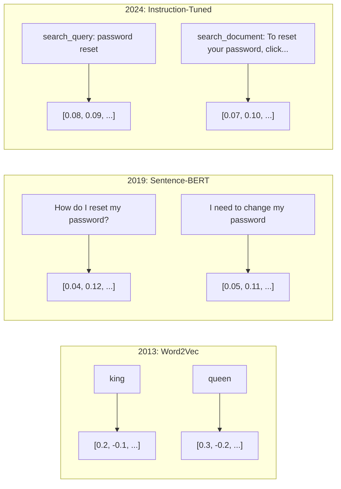
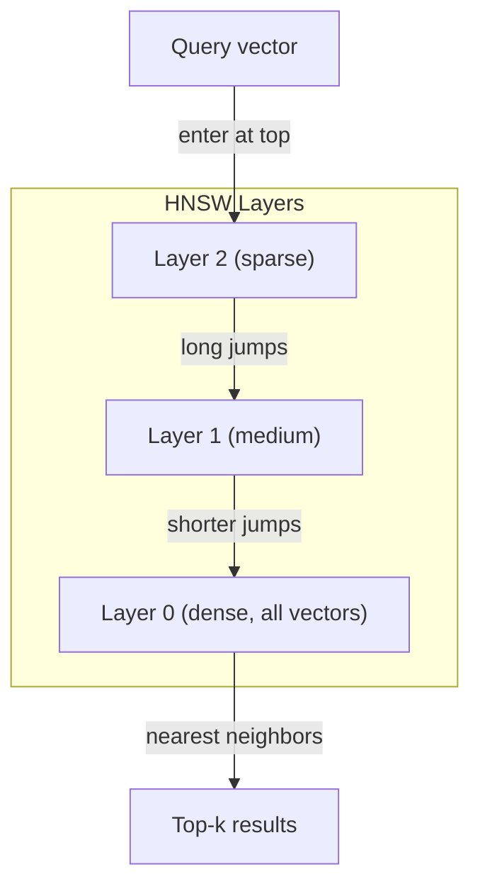

<!-- local-zh-machine-draft: English source is canonical; prose translated automatically, code/math preserved. -->

<a id="embeddings--vector-representations"></a>

# Embeddings 与向量表示

> 文字是独立的。数学是连续的。 每次您询问 LLM 查找“相似”文档,比较含义,或者搜索超出关键词的范围, 你依赖这两个世界之间的桥梁。 embedding。如果你不明白的话 embeddings你不懂现代人工智能 你只要用它就行了

**类型：** 构建
**语言:** Python
**先修要求:** 第11阶段,第1课(Prompt Engineering)
**时间：** ~75分钟
**相关内容:** 阶段5 · 22 (Embedding 模型深底)覆盖密度和稀疏与多矢量, Matryoshka 截断和每个轴模型选择。 此课侧重于生产管道( 矢量 DBs, 和 QV) 。 HNSW读第5阶段 22,然后选一个模型

<a id="learning-objectives"></a>

## 学习目标

- 生成文本 embeddings 使用 API 供应商和开放源码模型,并计算 cosine similarity 两者间
- 解释为什么 embeddings 解析 vocabulary 关键字搜索无法处理的不匹配问题
- 构建一个 semantic search 索引,该索引根据含义检索文档,而不是精确的关键字匹配
- Evaluate embedding 使用检索基准的质量( 精度@ k, 回溯) 并选择右侧 embedding 任务模式

<a id="the-problem"></a>

## 问题

您有一万张支持票。 一位客户写道“ 我的付款没有通过 ” 。 您需要找到类似的旧票 。 关键词搜索找到含有“ 支付” 和“ 没有通过” 的票 。 它忽略了“ 交易失败 ” 、 “ 收费被拒绝 ” 和“ 收费错误 ” 。 这些票用完全不同的词来描述同样的问题 。

这是... vocabulary 不匹配问题。 人类语言有几十种表达同样观点的方式。 关键词搜索将每个单词都视为一个没有意义的独立符号。 它不能知道“ 下降” 和“ 未通过” 指的是同一个概念 。

您需要一个文本的表达方式, 其含义不是拼写, 而是决定相似性 。 您需要一种方法, 将“ 我的付款没有经过” 和“ 交易被拒绝” 紧密地放在一起, 同时又在遥远的距离里推动“ 我的付款按时到来 ” , 尽管共享“ 付款” 一词 。

这种代表是一种 embedding.

<a id="the-concept"></a>

## 概念

<a id="what-is-an-embedding"></a>

### 什么东西 Embedding?

一个 embedding 是一个含浮点数的密集矢量,代表文字的含义。“强烈”一词很重要——每个维度都含有信息,而与大多数维度为零的稀疏表达方式(字包、TF-IDF)不同。

"猫坐在垫子上" 变得像 `[0.023, -0.041, 0.087, ..., 0.012]` - 768至3072个数字的列表,取决于模型。这些数字编码的含义。你从不直接检查它们。你比较它们。

<a id="the-word2vec-breakthrough"></a>

### 该 Word2Vec Breakthrough

2013年,托马斯·米科洛夫和谷歌的同事发表 Word2Vec核心洞察力: 训练神经网络来预测来自邻居(或一个词的邻居)和隐藏层的一字 weights 成为有意义的矢量表达方式。

著名的结果是:

```
king - man + woman = queen
```

单词矢量计算 embeddings 捕捉语义关系。 从“ 男人” 到“ 女人” 的方向大致和从“ 国王” 到“ 女王” 的方向相同。 这是这个字段意识到几何可以编码的含义的那一刻。

Word2Vec 生成了300维矢量。 每个单词都有一个矢量, 不论上下文如何 。 “ 河边银行” 和“ 银行账户” 的矢量相同 。 embedding这一限制推动了下一个十年的研究。

<a id="from-words-to-sentences"></a>

### 从单词到句子

Word embeddings 代表单身 tokens生产系统需要嵌入整个句子、段落或文件。

**Averaging**: 采取句子中所有文字矢量的平均值。 低劣、 失落、 令人惊讶的短文本体面。 完全失去单词顺序 : “ 狗咬人” 和“ 人咬狗” 完全相同 embeddings.

**CLS token**: transformer 模型 (BERT, 2018) 输出一个特殊 [CLS] token embedding 表示整个输入。比平均值好,但 [CLS] token 接受过关于下一个判决预测的培训,而不是相似性。

**Contrastive learning**: 明确训练模型将相似的对子和不同的对子分开。 句号BERT (Reimers & Gurevych, 2019年)采用这种方法,成为现代技术的基础。 embedding 模型。鉴于“ 我如何重设密码?” 和“ 我需要更改我的密码”, 模型知道这些应该有几乎相同的矢量。

**Instruction-tuned embeddings**: 最新方法。 E5 和 GTE 等模型接受任务前缀(“搜索”_查询:, “搜索”_文档 :” embedding 来制作。这样可以让一个模型服务于多重任务。



<a id="modern-embedding-models"></a>

### Modern Embedding 模型

市场已经进入了几种生产级选择(MTEB分数截至2026年初,MTEB v2):

| 模型 | 提供商 | 尺寸 | MTEB | 上下文 | 费用 / 1M tokens |
|-------|----------|-----------|------|---------|------------------|
| Gemini Embedding 2 | 谷歌 | 3072(马特罗什卡) | 67.7(检索) | 8192 | $0.15 |
| embed-v4 | Cohere | 1024(马特罗什卡) | 65.2 | 128K | $0.12 |
| voyage-4 | 旅行协会 | 1024/2048(马特罗什卡) | 66.8 | 32K | $0.12 |
| text-embedding- 3个大 | OpenAI | 3072(马特罗什卡) | 64.6 | 8192 | $0.13 |
| text-embedding- 3个小 | OpenAI | 1536(马特罗什卡) | 62.3 | 8192 | $0.02 |
| BGE-M3 | BAAI | 1024(浓度+粗度+彩色) | 63.0 多种语文 | 8192 | Open-weight |
| Qwen3-Embedding | Alibaba | 4096(马特罗什卡) | 66.9 | 32K | Open-weight |
| Nomic-embed-v2 | Nomic | 768(马特罗什卡) | 63.1 | 8192 | Open-weight |

MTEB(千兆字节文字) Embedding 基准) v2 覆盖了所有检索、分类、分组、重新排序和汇总的100+项任务。 更高则更好。 到2026年, 打开weight 型号(千分之3-Embedding,BGE-M3)在大多数轴上匹配或击败封闭主机模型。 Gemini Embedding 2 导致纯粹的检索; 旅行/ Cohere 领导特定领域( 金融、 法律、 代码) 。 在承诺前总是以自己的查询为基准 。

<a id="similarity-metrics"></a>

### 相似度数

给两个 embedding 矢量,衡量其相似程度的三种方法:

**Cosine similarity**:两个矢量之间的角的余弦值。范围从-1(对齐)到1(相同方向)。忽略星级 -- -- 一个10个字句和一个500个字文档,如果它们指向相同的方向,则可以得分1.0。这是90%使用的案例的默认值。

```
cosine_sim(a, b) = dot(a, b) / (||a|| * ||b||)
```

**点数产品**:两个矢量的原始内产物。 cosine similarity 当向量( 单位长度) 正常化时。 要快速计算 。 OpenAI的 embeddings 所以点产品和余弦给予相同的排名。

```
dot(a, b) = sum(a_i * b_i)
```

**Euclidean (L2) 距离**:矢量空间的直线距离。小于 = 更相似。对大小差异敏感。在空间绝对位置重要时使用,而不仅仅是方向。

```
L2(a, b) = sqrt(sum((a_i - b_i)^2))
```

何时使用:

| 公制 | 使用时 | 避免当 |
|--------|----------|------------|
| Cosine similarity | 比较不同长度的文本; 大多数检索任务 | 磁度包含信息 |
| 点积 | Embeddings 已经正常化; 最大速度 | 矢量的大小不同 |
| 欧几里德距离 | 集群;空间最接近邻里的问题 | 对比长度大不相同的文档 |

<a id="vector-databases-and-hnsw"></a>

### Vector Databases 和 HNSW

粗力相似性搜索将查询比对每个存储矢量。 100万矢量为1,536维,即每个查询增加15亿倍数操作。太慢了 。

Vector databases 以 Approximate Nearest Neighbor (ANN)算法。主要算法是 HNSW (历史可控的小世界):

1. 构建矢量多层图
2. 顶层稀少 -- -- 远端集群之间的远程连接
3. 底层密度 -- -- 附近矢量之间的细微连接
4. 搜索从顶层开始,贪婪地下降到精细
5. 返回以 O(log n) 时间而不是 O(n) 时的近似顶部结果

HNSW 以快速增速来交换微小的精度损失(通常为95-99%回想 ) 。 在1,000万矢量中,野蛮力量需要几秒钟。 HNSW 需要毫秒。



生产选择:

| Database | 类型 | 最适合 | 最大比例 |
|----------|------|----------|-----------|
| Pinecone | 管理 SaaS | 零生产 | Billions |
| Weaviate | 开源 | 自我托管、混合搜索 | 100米以上 |
| Qdrant | 开源 | 高性能, 过滤 | 100米以上 |
| ChromaDB | 嵌入式 | 原型, 本地 dev | 1分钟 |
| pgvector | 后盖扩展 | 已经使用 Postgres | 10时 |
| FAISS | 图书馆 | 正在处理,研究 | 1个B+ |

<a id="chunking-strategies"></a>

### Chunking Strategies

文件太长,无法作为单一矢量嵌入。 embedding 成为每件事的平均数, 类似无具体内容。 您将文档分成块并嵌入每个块 。

**Fixed-size chunking**: 每 N 拆分 tokens 与M -token 如果文档结构不明确, 简单且可预测。 A512token 块50 -token 重叠: 第 1 块 tokens 0-511, 2块是 tokens 462-973.

**Sentence-based chunking**:按句号界限拆分,将句子分组,直至达到 token 限制。 每个块至少是一个完整的句子。 比固定大小更好, 因为你从来没有切开一个想法的一半。

**Recursive chunking**:尝试先在最大边界处分割(部分页眉)。如果仍然太大,请尝试段落边界。然后句子边界。然后字符界限。这是 LangChain的 `RecursiveCharacterTextSplitter` 并且对混合格式的公司很管用

**Semantic chunking**:嵌入每个句子,然后组合连续的句子 embeddings 相似。 当 embedding 相似性降低到阈值以下, 开始新块。 昂贵( 需要) embedding 每一句,都是单曲的,但能创造出最坚固的部分。

| 策略 | 复杂性 | 品质 | 最适合 |
|----------|-----------|---------|----------|
| Fixed-size | 低 | Decent | 无结构文本, 日志 |
| Sentence-based | 低 | 好 | 文章、电子邮件 |
| Recursive | 中等 | 好 | Markdown, HTML,混合文档 |
| 语义学 | 高 | Best | 关键检索质量 |

多数系统的甜点:256-512 token 50块token 重叠。

<a id="bi-encoders-vs-cross-encoders"></a>

### Bi-Encoders 十字架对...Encoders

一个双 -encoder 独立嵌入查询和文档, 然后比较矢量。 快 -- 您一次嵌入查询并与预编的文档比较 embeddings。这是你用来检索的。

一个十字架...encoder 将查询和文档作为单一输入和输出的关联性评分。 慢 -- 它将通过完整模式处理每个查询和文档配对。 但是要准确得多, 因为它可以跨查询和文档访问 tokens 同时。

生产模式:双-encoder 获取100名顶级候选人,交叉...encoder 重排到10级,这是回收时的输油管


重新排序模型:Cohere Rerank 3.5(每1,000个查询2美元),BGE-reranker-v2(自由、开放源码),Jina Reranker v2(自由、开放源码)。

<a id="matryoshka-embeddings"></a>

### Matryoshka Embeddings

Traditional embeddings 1536维矢量使用 1536 个浮点。没有再培训,您无法跳至 256 个维度。

Matryoshka 演示学习( Kusupati 等人, 2022) 修补了这个模型。 该模型经过训练, 以便第一个 N 维能捕捉到最重要的信息, 比如俄罗斯的嵌套娃娃 。 embedding 至256个维度失去一些准确性,但依然有效。

OpenAI文本 :embedding- 3小和文字 - 3小和文字embedding- 3大支持 Matryoshka通过 `dimensions` parameter要求使用256维,而不是1 536的削减储存量,减少6x,在MTEB基准中,精确度损失约为3-5%。

<a id="binary-quantization"></a>

### Binary Quantization

1536维 embedding 以浮点32存储的文档使用 6,144 字节。乘以 1 000万个文档:61GB 仅用于矢量。

Binary quantization 将每个浮点转换为一个位数:正值变为 1, 负值变为 0。 存储量从 6,144 字节下降到 192 字节 -- 减少 32x 。 使用 Hamming 距离( 计算不同的位数) 来计算相似性 。 CPUs 可在单项指令中完成。

检索回溯时的精确度约为 5-10%。 常见模式: 二进制 quantization 用于在百万矢量上进行第一通道搜索,然后用全精度矢量重排至上1 000。这可以使您获得完全精度精确度为32x内存的95%+。

```figure
cosine-similarity
```

<a id="build-it"></a>

## 动手实现

我们造一个 semantic search 引擎从头开始。 vector database。无外部 embedding API纯度 Python 与 numpy 为了数学

<a id="step-1-text-chunking"></a>

### 步骤1:文本 Chunking

```python
def chunk_text(text, chunk_size=200, overlap=50):
    words = text.split()
    chunks = []
    start = 0
    while start < len(words):
        end = start + chunk_size
        chunk = " ".join(words[start:end])
        chunks.append(chunk)
        start += chunk_size - overlap
    return chunks


def chunk_by_sentences(text, max_chunk_tokens=200):
    sentences = text.replace("\n", " ").split(".")
    sentences = [s.strip() + "." for s in sentences if s.strip()]
    chunks = []
    current_chunk = []
    current_length = 0
    for sentence in sentences:
        sentence_length = len(sentence.split())
        if current_length + sentence_length > max_chunk_tokens and current_chunk:
            chunks.append(" ".join(current_chunk))
            current_chunk = []
            current_length = 0
        current_chunk.append(sentence)
        current_length += sentence_length
    if current_chunk:
        chunks.append(" ".join(current_chunk))
    return chunks
```

<a id="step-2-building-embeddings-from-scratch"></a>

### 步骤2:建筑 Embeddings 从剪辑

我们执行一个简单的密度 embedding 使用 L2 的 TF- IDF normalization。这不是神经 embedding,但采用同样的合同:用固定尺寸的矢量排出文字,类似的文字产生类似的矢量。

```python
import math
import numpy as np
from collections import Counter

class SimpleEmbedder:
    def __init__(self):
        self.vocab = []
        self.idf = []
        self.word_to_idx = {}

    def fit(self, documents):
        vocab_set = set()
        for doc in documents:
            vocab_set.update(doc.lower().split())
        self.vocab = sorted(vocab_set)
        self.word_to_idx = {w: i for i, w in enumerate(self.vocab)}
        n = len(documents)
        self.idf = np.zeros(len(self.vocab))
        for i, word in enumerate(self.vocab):
            doc_count = sum(1 for doc in documents if word in doc.lower().split())
            self.idf[i] = math.log((n + 1) / (doc_count + 1)) + 1

    def embed(self, text):
        words = text.lower().split()
        count = Counter(words)
        total = len(words) if words else 1
        vec = np.zeros(len(self.vocab))
        for word, freq in count.items():
            if word in self.word_to_idx:
                tf = freq / total
                vec[self.word_to_idx[word]] = tf * self.idf[self.word_to_idx[word]]
        norm = np.linalg.norm(vec)
        if norm > 0:
            vec = vec / norm
        return vec
```

<a id="step-3-similarity-functions"></a>

### 第3步:相似函数

```python
def cosine_similarity(a, b):
    dot = np.dot(a, b)
    norm_a = np.linalg.norm(a)
    norm_b = np.linalg.norm(b)
    if norm_a == 0 or norm_b == 0:
        return 0.0
    return float(dot / (norm_a * norm_b))


def dot_product(a, b):
    return float(np.dot(a, b))


def euclidean_distance(a, b):
    return float(np.linalg.norm(a - b))
```

<a id="step-4-vector-index-with-brute-force-search"></a>

### 步骤4: 使用布鲁特- 力搜索的矢量索引

```python
class VectorIndex:
    def __init__(self):
        self.vectors = []
        self.texts = []
        self.metadata = []

    def add(self, vector, text, meta=None):
        self.vectors.append(vector)
        self.texts.append(text)
        self.metadata.append(meta or {})

    def search(self, query_vector, top_k=5, metric="cosine"):
        scores = []
        for i, vec in enumerate(self.vectors):
            if metric == "cosine":
                score = cosine_similarity(query_vector, vec)
            elif metric == "dot":
                score = dot_product(query_vector, vec)
            elif metric == "euclidean":
                score = -euclidean_distance(query_vector, vec)
            else:
                raise ValueError(f"Unknown metric: {metric}")
            scores.append((i, score))
        scores.sort(key=lambda x: x[1], reverse=True)
        results = []
        for idx, score in scores[:top_k]:
            results.append({
                "text": self.texts[idx],
                "score": score,
                "metadata": self.metadata[idx],
                "index": idx
            })
        return results

    def size(self):
        return len(self.vectors)
```

<a id="step-5-the-semantic-search-engine"></a>

### 步骤5: Semantic Search Engine

```python
class SemanticSearchEngine:
    def __init__(self, chunk_size=200, overlap=50):
        self.embedder = SimpleEmbedder()
        self.index = VectorIndex()
        self.chunk_size = chunk_size
        self.overlap = overlap

    def index_documents(self, documents, source_names=None):
        all_chunks = []
        all_sources = []
        for i, doc in enumerate(documents):
            chunks = chunk_text(doc, self.chunk_size, self.overlap)
            all_chunks.extend(chunks)
            name = source_names[i] if source_names else f"doc_{i}"
            all_sources.extend([name] * len(chunks))
        self.embedder.fit(all_chunks)
        for chunk, source in zip(all_chunks, all_sources):
            vec = self.embedder.embed(chunk)
            self.index.add(vec, chunk, {"source": source})
        return len(all_chunks)

    def search(self, query, top_k=5, metric="cosine"):
        query_vec = self.embedder.embed(query)
        return self.index.search(query_vec, top_k, metric)

    def search_with_scores(self, query, top_k=5):
        results = self.search(query, top_k)
        return [
            {
                "text": r["text"][:200],
                "source": r["metadata"].get("source", "unknown"),
                "score": round(r["score"], 4)
            }
            for r in results
        ]
```

<a id="step-6-comparing-similarity-metrics"></a>

### 步骤6:比较相似度

```python
def compare_metrics(engine, query, top_k=3):
    results = {}
    for metric in ["cosine", "dot", "euclidean"]:
        hits = engine.search(query, top_k=top_k, metric=metric)
        results[metric] = [
            {"score": round(h["score"], 4), "preview": h["text"][:80]}
            for h in hits
        ]
    return results
```

<a id="use-it"></a>

## 实际应用

与生产 embedding API,结构保持相同。只有嵌入器才会改变:

```python
from openai import OpenAI

client = OpenAI()

def openai_embed(texts, model="text-embedding-3-small", dimensions=None):
    kwargs = {"model": model, "input": texts}
    if dimensions:
        kwargs["dimensions"] = dimensions
    response = client.embeddings.create(**kwargs)
    return [item.embedding for item in response.data]
```

马特约什卡省略 OpenAI - 相同的模型, 更少的尺寸, 更低的储存量 :

```python
full = openai_embed(["semantic search query"], dimensions=1536)
compact = openai_embed(["semantic search query"], dimensions=256)
```

256d矢量使用6x减去存储量。 对于1,000万个文档,即10GB对61GB, 精确度损失在标准基准上约为3-5%。

换到Coher:

```python
import cohere

co = cohere.ClientV2()

results = co.rerank(
    model="rerank-v3.5",
    query="What is the refund policy?",
    documents=["Full refund within 30 days...", "No refunds after 90 days..."],
    top_n=3
)
```

当地 embeddings 无 API 依赖性 :

```python
from sentence_transformers import SentenceTransformer

model = SentenceTransformer("BAAI/bge-small-en-v1.5")
embeddings = model.encode(["semantic search query", "another document"])
```

我们建筑中的矢量指数类 和这些一起工作。 embedding 函数,保持搜索逻辑。

<a id="ship-it"></a>

## 交付成果

本课产生：
- `outputs/prompt-embedding-advisor.md` -- 一个 prompt 用于选择 embedding 具体用途案例的模式和战略
- `outputs/skill-embedding-patterns.md` - 教书的技巧 agents 如何使用 embeddings 有效生产

<a id="exercises"></a>

## 练习

1. **计量比较**:对样本文档使用相同的5个查询 cosine similarity, dot 产品, 和 euclidean 距离。 记录每个文件的顶端 - 3 结果。 对于哪个问题, 度量标准不一致? 为什么?

2. **块大小实验**:将样本文档索引,其块大小为50、100、200和500个字。每个文件运行5个查询并记录上一个相似分。绘制块大小与检索质量之间的关系。找到大块开始受伤的点。

3. **马特约什卡模拟**: 构建一个生成500天矢量的简单 Embeder。 调速到50、 100、 200和 500 维度。 测量每次减速时回溯会如何降解。 这模拟了 Matryoshka 的行为, 而不需要真正的训练技巧 。

4. **Binary quantization**: 采取 embeddings 从搜索引擎中,将其转换为二进制( 1 如果是正, 0 如果是负) , 并执行 Hamming 远程搜索 。 比较前10 个结果与完整精度 cosine similarity。衡量重叠的百分比。

5. **Sentence-based chunking**:更换固定大小 chunking 与 `chunk_by_sentences`。运行相同的查询并比较检索分数。尊重句号的界限是否可以改善结果?

<a id="key-terms"></a>

## 关键术语

| 术语 | 人们怎么说 | 它实际上意味着什么 |
|------|----------------|----------------------|
| Embedding | "数字的文字" | 密度的矢量,其中几何接近度编码语义相似性 |
| Word2Vec | "OG"(奥古斯丁) embedding" | 2013年模型,通过预测上下文单词来学习文字矢量;经证明的矢量计算编码含义 |
| Cosine similarity | "两个矢量有多相似" | 矢量之间角的余弦; 1 = 相同方向, 0 = 正弦, - 1 = 对面 |
| HNSW | "快速矢量搜索" | 可级导航小世界图 -- -- 启用 O(log n)的多层结构 approximate nearest neighbor search |
| Bi-encoder | "分开床,比较快" | 将查询和文档独立编码为矢量; 允许预译和快速检索 |
| Cross-encoder | "慢点,但准确 reranker" | 通过完整模型共同处理查询文件对齐;更准确,不进行预先计算 |
| Matryoshka embeddings | "可运行矢量" | Embeddings 训练后,第一个N维 捕捉最重要的信息, 使可变大小的存储成为可能 |
| Binary quantization | "1 - 位数 embeddings" | 将浮控矢量转换为二进制( 仅签名位) , 以使用 Hamming 距离搜索来减少 3x 存储 |
| Chunking | "为... embedding" | 将文档分解为 256-512 token 使每个区段能够独立嵌入和检索 |
| Vector database | 搜索引擎 embeddings" | 为存储矢量和性能优化的数据储存 approximate nearest neighbor 缩放搜索 |
| Contrastive learning | 比较训练 | 推动类似对式的培训办法 embeddings 一对一对一对一对 embeddings apart |
| MTEB | "该 embedding 基准" | 粗体文字 Embedding 基准 -- -- 8项任务的56个数据集;比较标准 embedding 模型 |

<a id="further-reading"></a>

## 进一步阅读

- Mikolov等人,“矢量空间文字表达的高效估计”(2013年) Word2Vec 开始于 embedding 革命与王后类比
- 雷默斯和格瑞维奇,"准备...BERT:句子 Embeddings 使用暹罗语 BERT-网络"(2019年) 如何训练双encoders 判决的相似性, embedding 模型
- Kusupati等人,“Metryoshka代表性学习”(2022年)——变数组合背后的技术 embeddings 该 OpenAI 案文-embedding-3
- Malkov & Yashunin, “高效和强劲” Approximate Nearest Neighbor (2018年) 使用等级导航小世界图 HNSW 纸张, 大多数生产矢量搜索背后的算法
- OpenAI Embeddings 向导(平台)openai.com/docs/guides/embeddings) -- -- 案文的实际参考 --embedding- 3种模型,包括马特约什卡尺寸减小
- MTEB 头板(厚脸孔.co/spaces/mteb/leadboard) -- -- 对所有基准进行实时比较 embedding 不同任务和语言的模型
- [Muennighoff等人,“MTEB: 大量文本” Embedding 基准”(ECL 2023)](https://arxiv.org/abs/2210.07316) - 界定领导板报告的8项任务类别(分类、集群、对等分类、重新排序、检索、STS、总结、比特采矿)的基准;在相信任何单一的MTEB分数之前读取。
- [Sentence Transformers documentation](https://www.sbert.net/) - 双 - 双encoder 横跨...encoder集思广益的策略, 和最分散的堆积层 RAG 编导这一课程。
