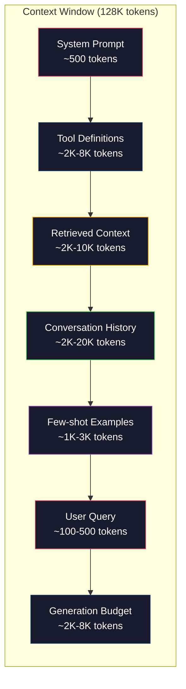
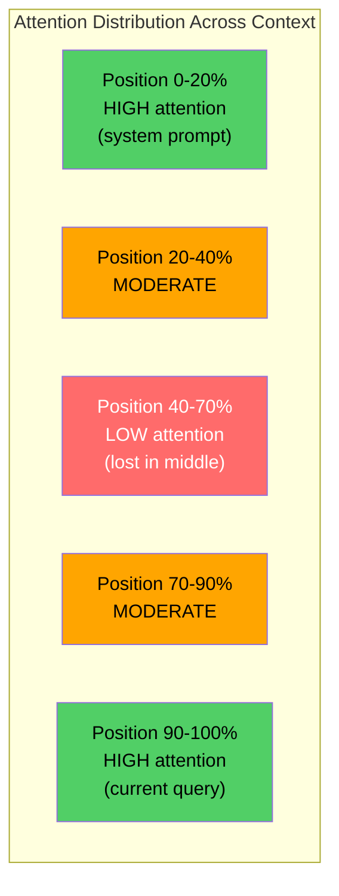
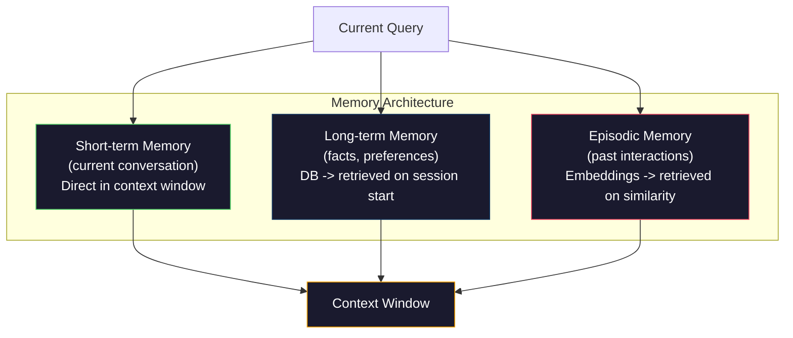

<!-- local-zh-machine-draft: English source is canonical; prose translated automatically, code/math preserved. -->

<a id="context-engineering-windows-budgets-memory-and-retrieval"></a>

# Context Engineering: 窗口、 预算、 记忆和检索

> Prompt engineering 是一个子集 。 Context engineering 是整个游戏。 prompt 是一个您输入的字符串。上下文是进入模型窗口的所有内容:系统指令、检索到的文档、工具定义、对话历史、 few-shot 示例,以及 prompt 2026年最好的人工智能工程师是环境工程师。他们决定什么进入,什么退出,什么顺序。

**类型:** Build
**语言:** Python
**先修要求:** 第10阶段(LLMs 从Scratch,第11阶段 课程01-02
**时间:** ~90分钟
**相关内容:** 阶段11 · 15 (Prompt 缓冲)——方便缓存的布局是 context engineering阶段5 - 28(全文) Evaluation如何测量与NIAH/RULER的中途失落。

<a id="learning-objectives"></a>

## 学习目标

- Calculate token budgets 横跨所有 context window (单位:美元)system prompt、工具、历史、检索的文档、新一代主机)
- Implement context window 管理战略:缩短、总结和滑动窗口,供对话历史使用
- 优先排序上下文组件,以最大限度地实现模型的 attention 关于最相关信息的报告
- 构建一个动态分配的上下文组装器 tokens 基于查询类型和可用的窗口空间

<a id="the-problem"></a>

## 问题

Claude 欧普斯4.7有一个200K token 窗口 (1M in beta) 。 GPT- 5有400K - 5有400K - Five has 400K. Gemini 3号有2M Llama 4个分数是10M 这些数字听起来很大 直到你填满它们

代码助理的解密 System prompt: 500 tokens50个工具的工具定义:8 000 tokens检索文件:4 000 tokens对话历史(10轮):6 000 tokens。当前用户查询:200 tokens生成预算(最高产出):4 000 tokens共计:22 700 tokens。这只是128K窗口的18%。

但 attention 不以上下文长度线性缩放。 具有 128K 的模型 tokens 上下文的二次曲线 attention (O(n)2) 香草 transformers尽管大多数生产模型都使用高效 attention 更重要的是,检索精确度会降低。“Haystack中的需要”测试表明模型很难找到在长期背景下的信息。刘等人(2023年)的研究显示, LLMs 在长环境的开始和结束时检索信息,其准确性几乎是完美的,但对于位于中间的信息来说,精确度下降了10-20%(占上下文的40-70%)。这种“中位损失”效应因模型而异,但影响着所有当前的结构。

实际教训:拥有200K tokens 可用不表示使用 200K tokens 有效。 仔细整理的 10K 。 token 上下文往往优于倾弃的100K token 上下文。 Context engineering 是否在最大范围内实现信号对噪音比率 context window.

每个 token 你放进窗户 取代了 token 每一个不相关的工具定义,每个老旧的谈话,每一个不回答问题的回收文本块 -- 每一个都使模型在任务中变得略为糟糕。

<a id="the-concept"></a>

## 概念

<a id="the-context-window-is-a-scarce-resource"></a>

### 该 Context Window 是一个稀缺的资源

想想这 context window 作为 RAM , 不是磁盘。 它是快速且直接可访问的, 但有限制。 您无法满足所有条件 。 您必须选择 。



每个组件都与空间竞争。添加更多工具定义意味着对话历史的空间更少。添加更多检索的上下文意味着减少空间 few-shot 示例. Context engineering 是分配这一预算以最大限度地实现任务绩效的艺术。

<a id="lost-in-the-middle"></a>

### 中间信息易被忽略（Lost-in-the-Middle）

最重要的经验发现 context engineering。在上下文的开头和结尾,模型对信息的关注要好一些。 attention 并更有可能被忽略。

Liu等人(2023年)系统地测试了这一点,他们在不同位置的20个相关文档中放置了一个相关的文档,并测量了回答准确度。当相关文档为第一或最后一文档时,精确度为85-90%。当它处于中间时(20分第10位),精确度下降到60-70%。

这具有直接的工程影响:

- 将最重要的信息放在第一位system prompt,关键指示)
- 将当前查询和最相关的上下文排在最后( 时间偏差有助于)
- 将环境中部作为最低优先区
- 如果您必须在中间包含信息, 请在结尾处重复关键点



<a id="context-components"></a>

### 上下文组件

**System prompt**: 设置人性、 约束和行为规则。 首先, 并保持同步 。 Claude 代码使用大约6000 tokens 用于其 system prompt 包括工具定义和行为指示。 保持它紧紧。 每一个单词 system prompt 在每个 API 电话

**工具定义**:每个工具增加50-200个 tokens (名称、说明、 parameter 50个工具 150 tokens 每人7 500个 tokens 在任何对话发生之前。 动态工具选择( 仅包括与当前查询相关的工具) 可以将它减少60- 80% 。

**检索上下文**:来自 a/ vector database,搜索结果,文件内容。检索的质量直接决定了响应的质量。错误的检索比没有检索更糟糕,它以噪音填充窗口并积极误导模型。

**对话历史**: 以往的每个 user message 和助理回复。 以谈话长度线性增长。 以200计的50回合对话 tokens 每转一圈就是一万 tokens 与当前查询无关。

**Few-shot 示例**: 显示理想行为的投入/产出对。二至三个选择良好的实例往往能提高产出质量,超过数千个 tokens 说明,但花费空间。

**生成预算**: 该 tokens 用于模型响应。 如果您将窗口填满容量, 该模型没有回应空间 。 保留至少 2000 - 4,000 tokens 代际关系。

<a id="context-compression-strategies"></a>

### Context Compression Strategies

**历史总结**: 而不是将先前所有的转盘都逐字逐句地保存, 定期总结对话。 “ 我们讨论了 X, 决定了 Y , 用户想要 Z ” 。 tokens 更换了10个转弯,花了2000 tokens。当历史超过阈值时运行汇总(例如5,000) tokens).

**相关性过滤**:根据当前查询对每个检索的文档进行评分,并将文档降到一个阈值之下。如果您回收了10块但只有3块相关,则丢弃其他7块,最好拥有3块高度相关的块,而不是10个平庸的块。

**工具修剪**:对用户的查询意图进行分类,只包括与该意图相关的工具。代码问题不需要日历工具。调度问题不需要文件系统工具。这可以将工具定义从8,000个减少到8000个 tokens 至1,000个。

**递归总结**:对于篇幅很长的文件,要分阶段总结。首先总结每一节,然后总结摘要。50页的文件变成500-token 记录关键点的文摘。

<a id="memory-systems"></a>

### 内存系统

Context engineering 横跨三个时空。

**短期内存**: 当前的对话。 保存在 context window 直接。 每转一转, 由总结和短跑管理 。

**长期内存**:在对话中始终存在的事实和偏好。 TypeScript"项目使用 PostgreSQL" 存储在数据库中, 在会话开始时检索 。 Claude 代码存储于 CLAUDE. md 文件 。 ChatGPT 保存在记忆中 feature.

**笔记内存**: 可能相关的特定过去的互动。 “上周二,我们在批注模块中调试了类似问题。” 被存储为 embeddings,当当前对话与过去一集相吻合时,即可检索到。



<a id="dynamic-context-assembly"></a>

### 动态背景大会

关键洞察力:不同的查询需要不同的上下文。 system prompt +静态工具+静态历史是浪费的。最好的系统根据每个查询动态组合上下文。

1. 分类查询意图
2. 选择相关工具( 不是全部工具)
3. 获取相关文件(非固定集)
4. 包含相关的历史转转( 不是全部历史)
5. Add few-shot 符合任务类型的示例
6. 按重要性排列一切: 关键第一,重要最后,在中间可选

这是将一个好的 AI 应用程序与一个伟大的应用程序区分开来。 模型是相同的。 上下文是不同的 。

```figure
lost-in-the-middle
```

<a id="build-it"></a>

## 动手实现

<a id="step-1-token-counter"></a>

### 步骤1: Token Counter

您无法为无法测量的东西编制预算。 构建一个简单的 token 对应( 接近使用空白分割, 因为精确的计数取决于 tokenizer).

```python
import json
import numpy as np
from collections import OrderedDict

def count_tokens(text):
    if not text:
        return 0
    return int(len(text.split()) * 1.3)

def count_tokens_json(obj):
    return count_tokens(json.dumps(obj))
```

<a id="step-2-context-budget-manager"></a>

### 第2步:背景预算管理人

核心抽象。 一个预算管理器跟踪了多少 tokens 每个部件的使用和执行限制。

```python
class ContextBudget:
    def __init__(self, max_tokens=128000, generation_reserve=4000):
        self.max_tokens = max_tokens
        self.generation_reserve = generation_reserve
        self.available = max_tokens - generation_reserve
        self.allocations = OrderedDict()

    def allocate(self, component, content, max_tokens=None):
        tokens = count_tokens(content)
        if max_tokens and tokens > max_tokens:
            words = content.split()
            target_words = int(max_tokens / 1.3)
            content = " ".join(words[:target_words])
            tokens = count_tokens(content)

        used = sum(self.allocations.values())
        if used + tokens > self.available:
            allowed = self.available - used
            if allowed <= 0:
                return None, 0
            words = content.split()
            target_words = int(allowed / 1.3)
            content = " ".join(words[:target_words])
            tokens = count_tokens(content)

        self.allocations[component] = tokens
        return content, tokens

    def remaining(self):
        used = sum(self.allocations.values())
        return self.available - used

    def utilization(self):
        used = sum(self.allocations.values())
        return used / self.max_tokens

    def report(self):
        total_used = sum(self.allocations.values())
        lines = []
        lines.append(f"Context Budget Report ({self.max_tokens:,} token window)")
        lines.append("-" * 50)
        for component, tokens in self.allocations.items():
            pct = tokens / self.max_tokens * 100
            bar = "#" * int(pct / 2)
            lines.append(f"  {component:<25} {tokens:>6} tokens ({pct:>5.1f}%) {bar}")
        lines.append("-" * 50)
        lines.append(f"  {'Used':<25} {total_used:>6} tokens ({total_used/self.max_tokens*100:.1f}%)")
        lines.append(f"  {'Generation reserve':<25} {self.generation_reserve:>6} tokens")
        lines.append(f"  {'Remaining':<25} {self.remaining():>6} tokens")
        return "\n".join(lines)
```

<a id="step-3-lost-in-the-middle-reordering"></a>

### 步骤3:中途失落的重新排序

执行重新排序战略:最重要的项目先于最后,最不重要的项目在中间。

```python
def reorder_lost_in_middle(items, scores):
    paired = sorted(zip(scores, items), reverse=True)
    sorted_items = [item for _, item in paired]

    if len(sorted_items) <= 2:
        return sorted_items

    first_half = sorted_items[::2]
    second_half = sorted_items[1::2]
    second_half.reverse()

    return first_half + second_half

def score_relevance(query, documents):
    query_words = set(query.lower().split())
    scores = []
    for doc in documents:
        doc_words = set(doc.lower().split())
        if not query_words:
            scores.append(0.0)
            continue
        overlap = len(query_words & doc_words) / len(query_words)
        scores.append(round(overlap, 3))
    return scores
```

<a id="step-4-conversation-history-compressor"></a>

### 步骤4:对话历史压缩器

总结旧的谈话转而回溯 token budget.

```python
class ConversationManager:
    def __init__(self, max_history_tokens=5000):
        self.turns = []
        self.summaries = []
        self.max_history_tokens = max_history_tokens

    def add_turn(self, role, content):
        self.turns.append({"role": role, "content": content})
        self._compress_if_needed()

    def _compress_if_needed(self):
        total = sum(count_tokens(t["content"]) for t in self.turns)
        if total <= self.max_history_tokens:
            return

        while total > self.max_history_tokens and len(self.turns) > 4:
            old_turns = self.turns[:2]
            summary = self._summarize_turns(old_turns)
            self.summaries.append(summary)
            self.turns = self.turns[2:]
            total = sum(count_tokens(t["content"]) for t in self.turns)

    def _summarize_turns(self, turns):
        parts = []
        for t in turns:
            content = t["content"]
            if len(content) > 100:
                content = content[:100] + "..."
            parts.append(f"{t['role']}: {content}")
        return "Previous: " + " | ".join(parts)

    def get_context(self):
        parts = []
        if self.summaries:
            parts.append("[Conversation Summary]")
            for s in self.summaries:
                parts.append(s)
        parts.append("[Recent Conversation]")
        for t in self.turns:
            parts.append(f"{t['role']}: {t['content']}")
        return "\n".join(parts)

    def token_count(self):
        return count_tokens(self.get_context())
```

<a id="step-5-dynamic-tool-selector"></a>

### 第5步:动态工具选择器

只包括与当前查询相关的工具。 分类意图, 然后过滤 。

```python
TOOL_REGISTRY = {
    "read_file": {
        "description": "Read contents of a file",
        "tokens": 120,
        "categories": ["code", "files"],
    },
    "write_file": {
        "description": "Write content to a file",
        "tokens": 150,
        "categories": ["code", "files"],
    },
    "search_code": {
        "description": "Search for patterns in codebase",
        "tokens": 130,
        "categories": ["code"],
    },
    "run_command": {
        "description": "Execute a shell command",
        "tokens": 140,
        "categories": ["code", "system"],
    },
    "create_calendar_event": {
        "description": "Create a new calendar event",
        "tokens": 180,
        "categories": ["calendar"],
    },
    "list_emails": {
        "description": "List recent emails",
        "tokens": 160,
        "categories": ["email"],
    },
    "send_email": {
        "description": "Send an email message",
        "tokens": 200,
        "categories": ["email"],
    },
    "web_search": {
        "description": "Search the web for information",
        "tokens": 140,
        "categories": ["research"],
    },
    "query_database": {
        "description": "Run a SQL query on the database",
        "tokens": 170,
        "categories": ["code", "data"],
    },
    "generate_chart": {
        "description": "Generate a chart from data",
        "tokens": 190,
        "categories": ["data", "visualization"],
    },
}

def classify_intent(query):
    query_lower = query.lower()

    intent_keywords = {
        "code": ["code", "function", "bug", "error", "file", "implement", "refactor", "debug", "test"],
        "calendar": ["meeting", "schedule", "calendar", "appointment", "event"],
        "email": ["email", "mail", "send", "inbox", "message"],
        "research": ["search", "find", "what is", "how does", "explain", "look up"],
        "data": ["data", "query", "database", "chart", "graph", "analytics", "sql"],
    }

    scores = {}
    for intent, keywords in intent_keywords.items():
        score = sum(1 for kw in keywords if kw in query_lower)
        if score > 0:
            scores[intent] = score

    if not scores:
        return ["code"]

    max_score = max(scores.values())
    return [intent for intent, score in scores.items() if score >= max_score * 0.5]

def select_tools(query, token_budget=2000):
    intents = classify_intent(query)
    relevant = {}
    total_tokens = 0

    for name, tool in TOOL_REGISTRY.items():
        if any(cat in intents for cat in tool["categories"]):
            if total_tokens + tool["tokens"] <= token_budget:
                relevant[name] = tool
                total_tokens += tool["tokens"]

    return relevant, total_tokens
```

<a id="step-6-full-context-assembly-pipeline"></a>

### 步骤6:全背景组装管道

把所有的东西都连接起来,如果有问题, 动态地组合最佳环境。

```python
class ContextEngine:
    def __init__(self, max_tokens=128000, generation_reserve=4000):
        self.budget = ContextBudget(max_tokens, generation_reserve)
        self.conversation = ConversationManager(max_history_tokens=5000)
        self.system_prompt = (
            "You are a helpful AI assistant. You have access to tools for "
            "code editing, file management, web search, and data analysis. "
            "Use the appropriate tools for each task. Be concise and accurate."
        )
        self.knowledge_base = [
            "Python 3.12 introduced type parameter syntax for generic classes using bracket notation.",
            "The project uses PostgreSQL 16 with pgvector for embedding storage.",
            "Authentication is handled by Supabase Auth with JWT tokens.",
            "The frontend is built with Next.js 15 using the App Router.",
            "API rate limits are set to 100 requests per minute per user.",
            "The deployment pipeline uses GitHub Actions with Docker multi-stage builds.",
            "Test coverage must be above 80% for all new modules.",
            "The codebase follows the repository pattern for data access.",
        ]

    def assemble(self, query):
        self.budget = ContextBudget(self.budget.max_tokens, self.budget.generation_reserve)

        system_content, _ = self.budget.allocate("system_prompt", self.system_prompt, max_tokens=1000)

        tools, tool_tokens = select_tools(query, token_budget=2000)
        tool_text = json.dumps(list(tools.keys()))
        tool_content, _ = self.budget.allocate("tools", tool_text, max_tokens=2000)

        relevance = score_relevance(query, self.knowledge_base)
        threshold = 0.1
        relevant_docs = [
            doc for doc, score in zip(self.knowledge_base, relevance)
            if score >= threshold
        ]

        if relevant_docs:
            doc_scores = [s for s in relevance if s >= threshold]
            reordered = reorder_lost_in_middle(relevant_docs, doc_scores)
            doc_text = "\n".join(reordered)
            doc_content, _ = self.budget.allocate("retrieved_context", doc_text, max_tokens=3000)

        history_text = self.conversation.get_context()
        if history_text.strip():
            history_content, _ = self.budget.allocate("conversation_history", history_text, max_tokens=5000)

        query_content, _ = self.budget.allocate("user_query", query, max_tokens=500)

        return self.budget

    def chat(self, query):
        self.conversation.add_turn("user", query)
        budget = self.assemble(query)
        response = f"[Response to: {query[:50]}...]"
        self.conversation.add_turn("assistant", response)
        return budget


def run_demo():
    print("=" * 60)
    print("  Context Engineering Pipeline Demo")
    print("=" * 60)

    engine = ContextEngine(max_tokens=128000, generation_reserve=4000)

    print("\n--- Query 1: Code task ---")
    budget = engine.chat("Fix the bug in the authentication module where JWT tokens expire too early")
    print(budget.report())

    print("\n--- Query 2: Research task ---")
    budget = engine.chat("What is the best approach for implementing vector search in PostgreSQL?")
    print(budget.report())

    print("\n--- Query 3: After conversation history builds up ---")
    for i in range(8):
        engine.conversation.add_turn("user", f"Follow-up question number {i+1} about the implementation details of the system")
        engine.conversation.add_turn("assistant", f"Here is the response to follow-up {i+1} with technical details about the architecture")

    budget = engine.chat("Now implement the changes we discussed")
    print(budget.report())

    print("\n--- Tool Selection Examples ---")
    test_queries = [
        "Fix the bug in auth.py",
        "Schedule a meeting with the team for Tuesday",
        "Show me the database query performance stats",
        "Search for best practices on error handling",
    ]

    for q in test_queries:
        tools, tokens = select_tools(q)
        intents = classify_intent(q)
        print(f"\n  Query: {q}")
        print(f"  Intents: {intents}")
        print(f"  Tools: {list(tools.keys())} ({tokens} tokens)")

    print("\n--- Lost-in-the-Middle Reordering ---")
    docs = ["Doc A (most relevant)", "Doc B (somewhat relevant)", "Doc C (least relevant)",
            "Doc D (relevant)", "Doc E (moderately relevant)"]
    scores = [0.95, 0.60, 0.20, 0.80, 0.50]
    reordered = reorder_lost_in_middle(docs, scores)
    print(f"  Original order: {docs}")
    print(f"  Scores:         {scores}")
    print(f"  Reordered:      {reordered}")
    print(f"  (Most relevant at start and end, least relevant in middle)")
```

<a id="use-it"></a>

## 实际应用

<a id="harness-managed-context"></a>

### Harness- 管理上下文

Claude 代码以分层方式管理上下文。 system prompt 包括行为规则和工具定义(~ 6K) tokens)打开文件时,其内容作为上下文被输入。搜索时,结果被添加。旧的谈话转折将被摘要化。 CLAUDE.md提供历次会议长期记忆。

关键的工程决定: Claude 代码不会将您的全部代码库倾弃到上下文中。 它会按要求获取相关文件。 这是 context engineering 在实践中。

<a id="dynamic-context-loading"></a>

### 动态上下文装入

光标将整个代码库索引到 embeddings。键入查询时,它会使用矢量相似性获取最相关的文件和代码块。只有那些部分会进入 context window。500K线代码库压缩为5-10个最相关的代码块。

这就是模式: 嵌入一切,按需检索, 仅包括重要的东西。

<a id="assistant-long-term-memory"></a>

### 助理长期内存

ChatGPT 将用户偏好和事实存储为长期记忆。 每次对话开始时,都会检索相关记忆并包含在 system prompt用户喜欢 Python" 费用. 5 tokens 但拯救了数百个 tokens 反复指示谈话。

<a id="rag-as-context-engineering"></a>

### RAG 作为 Context Engineering

检索推荐的一代是 context engineering 而不是把知识塞进模型 weights (培训)或 system prompt (静态上下文),您在查询时检索相关文档并将其输入 context window。整个 RAG 管道 -- chunking, embedding,检索,重新排序 - 存在来解决一个问题: 在 context window.

<a id="ship-it"></a>

## 交付成果

这个课程产生 `outputs/prompt-context-optimizer.md` - 一个可重复使用 prompt 检查背景组装策略并推荐优化。 system prompt,工具计数,平均历史长度和检索策略,并标明 token 废物,建议改进。

还能产生 `outputs/skill-context-engineering.md` - 设计基于任务类型的背景组装管道的决定框架, context window 和潜伏预算。

<a id="exercises"></a>

## 练习

1. 增加 "token 废物检测器“ ” 添加到上下文预算类中。 它应该使用超过30%的预算来标记组件, 并针对每个部件类型( 总结历史、 精密工具、 重新排序文档) 建议压缩策略 。

2. 对检索的上下文应用语义重复。 如果两个检索的文档相似于80%以上( 单位为文字重叠 或) cosine similarity 其 embeddings),只保留高分数的。 token budget 这恢复了。

3. 构建一个“ 文体重放” 工具。 如果有一个对话记录, 请通过上下文引擎重播它, 并直观预算分配如何转动 。 token 使用每个组件的时间。 确定上下文开始压缩的转折点 。

4. 执行基于优先级的工具选择器。 使用二进制包含/ 排除, 给当前查询为每个工具指定一个相关评分。 在工具预算用尽之前, 以递减关联顺序包含工具 。 比较任务绩效时包含 5、 10、 20 和 50 个工具 。

5. 构建多战略背景压缩器。 执行三种压缩策略( 缩短、 汇总、 提取关键句) , 并以一组 20 个文档为基准 。 测量压缩比例与信息保存之间的取舍( 压缩版本是否仍然包含查询的答案 ? ) 。

<a id="key-terms"></a>

## 关键术语

| 术语 | 人们怎么说 | 它实际上意味着什么 |
|------|----------------|----------------------|
| Context window | "模型能读到多少" | 最大数目 tokens (投入+输出) 模型进程在一个单 forward pass -- 400K(400K) GPT5,200K(1M贝塔) Claude 行动4.7,2M Gemini 专业3 |
| Context engineering | 进步 prompt engineering" | 如何决定 context window,按什么顺序和优先次序 -- -- 包括检索、压缩、工具选择和记忆管理 |
| 中间信息易被忽略（Lost-in-the-middle） | "模特儿忘记了中间的东西" | 经验发现 LLMs 更好地关注上下文的开始和结束, 信息在中间的精确度下降 10-20% |
| Token budget | "有多少个" tokens 你离开了" | 明确分配 context window 跨构成部分的能力system prompt(工具、历史、检索、生成) |
| 动态上下文 | "在飞翔上搭便车" | 组装 context window 根据意图分类、相关工具选择和检索结果对每个查询的不同 |
| 历史总结 | "压抑谈话" | 以简洁的总结取代旧式的逐字对话 token 保存关键信息的成本 |
| 工具修剪 | "只包括相关工具" | 分类查询意图,仅包括匹配、减少工具的工具定义 token 费用减少60-80% |
| 长期内存 | "记得历次会议" | 事实和喜好存储在数据库中,并在会议开始时检索 -- CLAUDE. md, . . . 时间轴: ChatGPT 内存和类似的系统 |
| 笔记内存 | (记得过去的具体事件) | 过去的互动存储为 embeddings 当当前查询与过去的对话相似时, 并获取 |
| 生成预算 | "答案的场所" | Tokens 预留给模型的输出 - 如果上下文完全填满窗口, 模式没有响应空间 |

<a id="further-reading"></a>

## 进一步阅读

- [Liu等人,2023年 -- "Lost in the Middle:语言模型如何使用长局”](https://arxiv.org/abs/2307.03172) - 有关取决于地位问题的决定性研究 attention,显示模型在长期环境中与信息挣扎
- [Anthropic'背景检索'博客文章](https://www.anthropic.com/news/contextual-retrieval) - 怎么样? Anthropic 处理上下文识别块回收,将检索失败减少49%
- [西蒙・威利森的"Context Engineering"](https://simonwillison.net/2025/Jun/27/context-engineering/) - 博客文章命名了纪律,将其与 prompt engineering
- [LangChain 文 件 清 单 RAG](https://python.langchain.com/docs/tutorials/rag/) - 实际实施回收型 context engineering pattern
- [格雷格·卡姆拉德特在海斯塔克测试中的针](https://github.com/gkamradt/LLMTest_NeedleInAHaystack) - 显示所有主要模型依赖位置的检索失败的基准
- [Pope等人,“有效扩大” Transformer Inference" (2022)](https://arxiv.org/abs/2211.05102) - 为什么上下文长度会驱动内存和潜伏,以及 KV cache、 MQA 和 GQA 改变预算计算。
- [Agrawal等人,“SARATHI:效率 LLM Inference 与 Chunked Prefills" (2023)](https://arxiv.org/abs/2308.16369) - 两个阶段: inference 长 prompts 在TTFT中成本昂贵,但在TPOT中成本低廉;在背景组合交易背后的地面真相。
- [Ainslie等人,“GQA:培训通用多查询” Transformer 多头模型 Checkpoints" (EMNLP 2023)](https://arxiv.org/abs/2305.13245) - 组合式尖叫 attention 剪切 KV 内存的纸张 decoders 没有质量损失。
