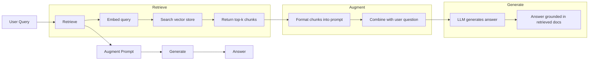
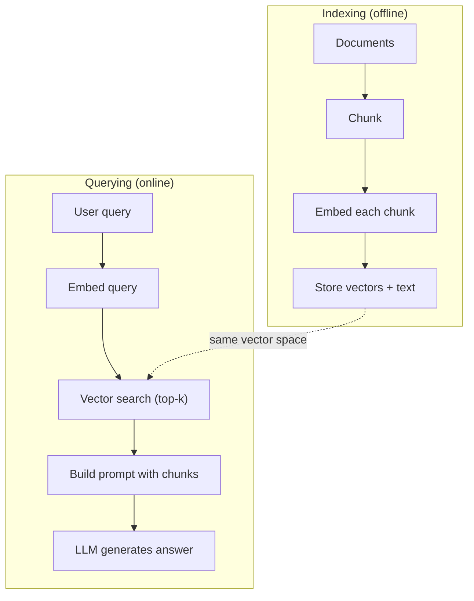

<!-- local-zh-machine-draft: English source is canonical; prose translated automatically, code/math preserved. -->

<a id="rag-retrieval-augmented-generation"></a>

# RAG（检索增强生成）

> 你的 LLM 它对你们公司的医生 代码库 或上周的会议记录一无所知 RAG 获取相关文档并将其装入 prompt。这是生产人工智能中最常用的模式。如果你从这个课程中建起一样东西, RAG 输油管

**类型:** Build
**语言:** Python
**先修要求:** 第10阶段(LLMs 第11阶段 课程01-05
**时间:** ~90分钟
**相关内容:** 第5阶段 23(b)Chunking 战略 RAG(六点) chunking 算法和每次获胜时。Embedding 选取嵌入器的模型。 RAG用于混合搜索、重新排序和查询转换。

<a id="learning-objectives"></a>

## 学习目标

- 构建一个完整的 RAG 管道:文档装入, chunking, embedding、矢量储存、检索和生成
- Implement semantic search 使用 vector database (夏玛斯数据库、FAISS或松果)
- 解释为什么 RAG 首选 fine-tuning 用于知识型应用(成本、新鲜度、归属)
- Evaluate RAG 使用检索测量(精确率、回溯)和生成测量(忠诚、相关性)的质量

<a id="the-problem"></a>

## 问题

你为公司建了个聊天室 顾客问"企业计划要什么退款?" LLM 以一般的回答回应了典型的 SaaS 退款政策。 实际政策被埋在200页的内部维基里, 说企业客户得到一个60天的窗口, 并有按比例计算的退款。 LLM 从来没有见过这份文件,它不知道没有受过什么训练。

Fine-tuning 只有一个办法 LLM,在内部文档上进行训练,并使用更新的模型。这工作了,但有严重的问题。 Fine-tuning 计算成本是数千美元。 模型在文档修改时就会变形。 您无法知道模型来自哪个来源。 如果公司下个月获得另一条产品线, 您将会再次微调 。

RAG 是另一个解决方案。 保持模型的不动。 当有问题出现时, 请搜索您的文档存储处, 并粘贴到 prompt 在问题之前,让模型解答时使用这些段落作为上下文。文档存储可以在分钟内更新。您可以查看哪些文档被检索。模型本身不会改变。这就是为什么 RAG 生产的主要模式是 更便宜,更新鲜,更可审计, 与任何 LLM.

<a id="the-concept"></a>

## 概念

<a id="the-rag-pattern"></a>

### 该 RAG Pattern

整个图案分为四个步骤:



查询 - > 检索 - > 增强 prompt - 产生,每个 RAG 系统遵循此模式。 RAG 系统在每一个步骤的细节中: 你如何块, 如何嵌入, 如何搜索, 以及如何构建 prompt.

<a id="why-rag-beats-fine-tuning"></a>

### Why RAG Beats Fine-Tuning

| Concern | Fine-tuning | RAG |
|---------|------------|-----|
| 成本 | 每期训练1 000至100 000美元+ | 每个查询0.01美元-0.10美元embedding + LLM) |
| Freshness | 再训练前会变形 | 通过重新索引文档在分钟内更新 |
| Auditability | 无法 trace 回复源 | 能够显示精确检索的段落 |
| Hallucination | 仍然可以自由产生幻觉 | 以检索到的文件为基础 |
| 数据隐私 | 训练数据 weights | 文档留在向量仓库 |

Fine-tuning 更改模型 weights 永远 RAG 临时修改模型的上下文。 对于大多数应用程序来说,临时上下文是您想要的。

其中一个案子 fine-tuning 赢家: 当您需要模型来采用特定的方式、 语气或推理模式, 而这种模式无法单靠激发来实现时。 对于实际的知识检索来说, RAG 每次都赢

<a id="embedding-models"></a>

### Embedding 模型

一个 embedding 模型将文本转换为密度矢量。 类似的文本生成的矢量在此高维空间中非常接近。 “ 我如何重设密码? ” 和“ 我需要更改密码” 产生几乎相同的矢量, 尽管共享了很少的单词 。 “ 猫坐在垫上” 产生一个非常不同的矢量 。

Common embedding 模型(2026年排队——全面分析见第5阶段第22段):

| 模型 | 尺寸 | 提供商 | 注释 |
|-------|-----------|----------|-------|
| text-embedding- 3个小 | 1536(马特罗什卡) | OpenAI | 多数使用情况的最佳价格/业绩 |
| text-embedding- 3个大 | 3072(马特罗什卡) | OpenAI | 精确度提高,可达256/512/1024 |
| Gemini Embedding 2 | 3072(马特罗什卡) | 谷歌 | 最大 MTEB 检索; 8K 上下文 |
| voyage-4 | 1024/2048(马特罗什卡) | 旅行协会 | 域变(代码、金融、法律) |
| 嵌入式 v4 | 1024(马特罗什卡) | Cohere | 强烈的多语种背景,128K |
| BGE-M3 | 1024(密集+稀少+COBERT) | BAAI(开放-weight) | 一种模式的三种观点 |
| Qwen3-Embedding | 4096(马特罗什卡) | Alibaba(开放-weight) | 顶部打开 -weight 检索分数 |
| all-MiniLM-L6-v2 | 384 | Open-weight (静脉 Transformers) | 原型基准 |

为了这个教训,我们建立自己的简单 embedding 使用TF- IDF。不是因为TF- IDF是生产系统所使用的,而是因为它使概念变得具体:文字进入,矢量出来,类似的文字产生类似的矢量。

<a id="vector-similarity"></a>

### 矢量相似性

在两种矢量的情况下,如何测量相似性?

**Cosine similarity**:两个矢量之间角的余弦。范围从 -1 (对齐) 到 1 (相同)。忽略音量,只关心方向。这是默认值 RAG.

```
cosine_sim(a, b) = dot(a, b) / (||a|| * ||b||)
```

**点数产品**:原始内产物。较大的矢量得分更高。当星级传递信息时有用(较长的文档可能更相关)。

```
dot(a, b) = sum(a_i * b_i)
```

**L2 (欧几里德)距离**:矢量空间中的直线距离。小的距离 = 更相似。敏感于大小差异。

```
L2(a, b) = sqrt(sum((a_i - b_i)^2))
```

Cosine similarity 是标准。 它会优雅地处理不同长度的文档, 因为它会按星等进行正常化。 当有人说“ 矢量搜索 ” 时, 它们几乎总是意味着 cosine similarity.

<a id="chunking-strategies"></a>

### Chunking Strategies

文件太长,无法作为单一矢量嵌入。 embedding 因为它包含几十个主题。相反,你将文档分成块,并将每个块分别嵌入。

**Fixed-size chunking**: 每 N 拆分 tokens简单和可预见。 A512token 块50 -token 重叠是指块 1 是 tokens 0-511, 2块是 tokens 462-973,等等。这些重叠确保了您不会在不幸的边界上分割一个句子。

**Semantic chunking**:在自然边界上分割。 markdown 信头。 每个块都是一个一致的含义单位。 执行起来要复杂得多, 但可以产生更好的检索 。

**Recursive chunking**:尝试先在最大边界处分割(部分页眉)。如果一个区域仍然太大,则在段落边界处分割。如果一个段落仍然太大,则在句子边界处分割。这就是 LangChain 递归字条TextSplit 方法,在实践中运作良好。

块的大小比人们想象的更重要:

- 太小(64-128) tokens:每个块缺少上下文。“最后一个季度增加了15%”意味着不知道“它”指的是什么。
- 太大(2048+) tokens:每个块覆盖多个主题, 淡化关联性。当您搜索收入数据时, 你得到的块数是10%左右的收入, 90%左右的人口统计 。
- 甜点(256-512) tokens) :足够具备自足性、重点足够明确、切合需要。

大部分生产 RAG 系统使用率 token 50块token 重叠。 Anthropic的 RAG 准则建议这一范围。

<a id="vector-databases"></a>

### Vector Databases

一旦你已经 embeddings,您需要保存和搜索它们。

| Database | 类型 | 最适合 |
|----------|------|----------|
| FAISS | 图书馆(正在处理) | 中小型原型数据集 |
| Chroma | 轻量级 DB | 地方发展,小规模部署 |
| Pinecone | 管理服务 | 生产,无业务管理 |
| Weaviate | 开源 DB | 自营生产 |
| pgvector | 后盖扩展 | 已经使用 Postgres |
| Qdrant | 开源 DB | 高性能自我托管 |

为了学习这个课程, 我们建立一个简单的模拟矢量仓库。 它将矢量存储在列表中, 并且使用粗力 cosine similarity 搜索。 这相当于使用平面索引的 FAISS 。 它在慢速前缩放到大约100,000 个矢量 。 approximate nearest neighbor (ANN) 算法如 HNSW 以毫秒搜索数百万矢量。

<a id="the-full-pipeline"></a>

### 完整的管道



索引阶段每份文件一次( 或当文档更新时) 。 查询阶段根据每个用户的要求进行。 在制作时, 索引阶段可能会处理数以百万计的文档。 查询必须在第二位以下做出回应 。

<a id="real-numbers"></a>

### 实数

大部分生产 RAG 系统使用这些 parameters:

- **k = 5至10岁** 每个查询回收块
- **块大小 = 256-512 tokens** 与50 -token overlap
- **背景预算**: 2,500-5,000 tokens 每个查询中检索的内容
- **Total prompt**: ~8,000-16,000 tokens (system prompt + 检索的块 + 对话历史 + 用户查询)
- **Embedding dimension**:384-3072,视型号而定
- **编制产出索引**:每秒100-1 000份文件 API embeddings
- **查询延迟**:50-200米用于检索,500-3000米用于生成

```figure
rag-chunking
```

<a id="build-it"></a>

## 动手实现

<a id="step-1-document-chunking"></a>

### 第1步:文档 Chunking

```python
def chunk_text(text, chunk_size=200, overlap=50):
    words = text.split()
    chunks = []
    start = 0
    while start < len(words):
        end = start + chunk_size
        chunk = " ".join(words[start:end])
        chunks.append(chunk)
        start += chunk_size - overlap
    return chunks
```

<a id="step-2-tf-idf-embeddings"></a>

### 步骤2:TF-IDF Embeddings

我们做一个简单的 embedding 函数。TF- IDF(定期频率-反向文档频率)不是神经 embedding,但它将文字转换为矢量,从而捕捉到单词的重要性。文档中常见的单词会得到更高的 TF 。所有元素中稀有的单词会得到更高的 以国防军。产品给出一个矢量,其中重要、独特的单词具有很高的价值。

```python
import math
from collections import Counter

def build_vocabulary(documents):
    vocab = set()
    for doc in documents:
        vocab.update(doc.lower().split())
    return sorted(vocab)

def compute_tf(text, vocab):
    words = text.lower().split()
    count = Counter(words)
    total = len(words)
    return [count.get(word, 0) / total for word in vocab]

def compute_idf(documents, vocab):
    n = len(documents)
    idf = []
    for word in vocab:
        doc_count = sum(1 for doc in documents if word in doc.lower().split())
        idf.append(math.log((n + 1) / (doc_count + 1)) + 1)
    return idf

def tfidf_embed(text, vocab, idf):
    tf = compute_tf(text, vocab)
    return [t * i for t, i in zip(tf, idf)]
```

<a id="step-3-cosine-similarity-search"></a>

### 步骤3: Cosine Similarity Search

```python
def cosine_similarity(a, b):
    dot = sum(x * y for x, y in zip(a, b))
    norm_a = math.sqrt(sum(x * x for x in a))
    norm_b = math.sqrt(sum(x * x for x in b))
    if norm_a == 0 or norm_b == 0:
        return 0.0
    return dot / (norm_a * norm_b)

def search(query_embedding, stored_embeddings, top_k=5):
    scores = []
    for i, emb in enumerate(stored_embeddings):
        sim = cosine_similarity(query_embedding, emb)
        scores.append((i, sim))
    scores.sort(key=lambda x: x[1], reverse=True)
    return scores[:top_k]
```

<a id="step-4-prompt-construction"></a>

### 步骤4: Prompt Construction

这就是"加价"的地方 RAG 发生。 将回收的部分格式化成 prompt,然后问 LLM 根据所提供的背景回答。

```python
def build_rag_prompt(query, retrieved_chunks):
    context = "\n\n---\n\n".join(
        f"[Source {i+1}]\n{chunk}"
        for i, chunk in enumerate(retrieved_chunks)
    )
    return f"""Answer the question based ONLY on the following context.
If the context doesn't contain enough information, say "I don't have enough information to answer that."

Context:
{context}

Question: {query}

Answer:"""
```

<a id="step-5-the-complete-rag-pipeline"></a>

### 步骤5:完成 RAG Pipeline

```python
class RAGPipeline:
    def __init__(self):
        self.chunks = []
        self.embeddings = []
        self.vocab = []
        self.idf = []

    def index(self, documents):
        all_chunks = []
        for doc in documents:
            all_chunks.extend(chunk_text(doc))
        self.chunks = all_chunks
        self.vocab = build_vocabulary(all_chunks)
        self.idf = compute_idf(all_chunks, self.vocab)
        self.embeddings = [
            tfidf_embed(chunk, self.vocab, self.idf)
            for chunk in all_chunks
        ]

    def query(self, question, top_k=5):
        query_emb = tfidf_embed(question, self.vocab, self.idf)
        results = search(query_emb, self.embeddings, top_k)
        retrieved = [(self.chunks[i], score) for i, score in results]
        prompt = build_rag_prompt(
            question, [chunk for chunk, _ in retrieved]
        )
        return prompt, retrieved
```

<a id="step-6-generation-simulated"></a>

### 第6步: 代号(模拟)

制作时,这里是您所谓的 LLM API。为此,我们通过从检索的上下文中提取最相关的句子来模拟生成。

```python
def simple_generate(prompt, retrieved_chunks):
    query_words = set(prompt.lower().split("question:")[-1].split())
    best_sentence = ""
    best_score = 0
    for chunk in retrieved_chunks:
        for sentence in chunk.split("."):
            sentence = sentence.strip()
            if not sentence:
                continue
            words = set(sentence.lower().split())
            overlap = len(query_words & words)
            if overlap > best_score:
                best_score = overlap
                best_sentence = sentence
    return best_sentence if best_sentence else "I don't have enough information."
```

<a id="use-it"></a>

## 实际应用

与真实的 embedding 型号 LLM,代码几乎没有改变:

```python
from openai import OpenAI

client = OpenAI()

def embed(text):
    response = client.embeddings.create(
        model="text-embedding-3-small",
        input=text
    )
    return response.data[0].embedding

def generate(prompt):
    response = client.chat.completions.create(
        model="gpt-4o-mini",
        messages=[{"role": "user", "content": prompt}],
        temperature=0
    )
    return response.choices[0].message.content
```

或与 Anthropic:

```python
import anthropic

client = anthropic.Anthropic()

def generate(prompt):
    response = client.messages.create(
        model="claude-sonnet-5",
        max_tokens=1024,
        messages=[{"role": "user", "content": prompt}]
    )
    return response.content[0].text
```

输油管是相同的 交换 embedding 函数。交换生成函数。检索逻辑, chunking, prompt 构造 - 不论您使用哪种模型, 都是一样的 。

对于规模的矢量存储,将粗力搜索改为适当的 vector database:

```python
import chromadb

client = chromadb.Client()
collection = client.create_collection("my_docs")

collection.add(
    documents=chunks,
    ids=[f"chunk_{i}" for i in range(len(chunks))]
)

results = collection.query(
    query_texts=["What is the refund policy?"],
    n_results=5
)
```

克罗马语处理 embedding 内部 (默认情况下使用全 MiniLM- L6- v2) 并将矢量存储在本地数据库中。 相同的模式, 不同的管道 。

<a id="ship-it"></a>

## 交付成果

本课产生：
- `outputs/prompt-rag-architect.md` -- 一个 prompt 设计 RAG 用于具体用途个案的系统
- `outputs/skill-rag-pipeline.md` - 教书的技巧 agents 如何构建和调试 RAG pipelines

<a id="exercises"></a>

## 练习

1. 替换 TF- IDF embeddings 使用简单的字包方法(二进制: 1 如果单词存在, 0 如果不是) 比较样本文档的检索质量。 TF- IDF 应该表现优于此 weights 稀有的字数更高。

2. 实验块大小: 在相同的文档集中尝试 50, 100, 200 和 500 个单词。 对于每个大小, 运行相同的5个查询, 并计算返回上3 中相关块的数量。 找到回收质量峰值的甜点 。

3. 将元数据添加到每个块( 源文档名称、 块位置) 。 修改 prompt 包含源属性的模板 LLM 引用其资料来源。

4. 执行一个简单的 evaluation:给10个问题,每个问题都通过 RAG 管道, 并测量回收的块中包含答案的百分比 。 这是在 k 处检索 。

5. 建立对话意识 RAG 管道:保存最后3个交换器的历史,并将它们纳入 prompt 与回收的块一起进行测试。在询问价格后,再用后续问题来测试“企业呢?”

<a id="key-terms"></a>

## 关键术语

| 术语 | 人们怎么说 | 它实际上意味着什么 |
|------|----------------|----------------------|
| RAG | "读你医生的AI" | 获取相关文件,将其粘贴到 prompt,并产生基于这些文件的答案 |
| Embedding | "将文字转换为数字" | 文本的密度矢量表示,其中类似的含义产生类似的矢量 |
| Vector database | 人工智能搜索引擎 | 用于存储向量和通过相似性找到近邻的数据存储器 |
| Chunking | "把医生切成碎片" | 将文档分解成较小的部分(通常为256-512) tokens) 这样每一个都可以独立嵌入和检索 |
| Cosine similarity | "两个矢量有多相似" | 两个矢量之间的角的余弦; 1 = 相同方向, 0 = 正弦, - 1 = 对面 |
| 顶级检索 | "得到K最好的火柴" | 返回矢量仓库中最相似的 k 块到查询 |
| Context window | "多少文字, LLM 可以看到" | 最大数目 tokens 该 LLM 可在单个请求中处理; 回收的块必须适合此 |
| 扩大的一代 | “使用给定上下文进行反射” | 使用检索到的文档作为上下文而不是仅仅依靠受过培训的知识来生成回复 |
| TF-IDF | "重要评分" | 周期乘以反向文档频率; weights 语言,它们是如何在物质中的独特性 |
| Indexing | "准备搜索文件" | 离线过程 chunking, embedding,并存储文件,以便查询时可以搜索 |

<a id="further-reading"></a>

## 进一步阅读

- Lewis等人,“知识密集型NLP任务回收-提款一代”(2020年)——原版 RAG Facebook AI 研究的论文 正式化了检索 - 即时生成模式
- Anthropic的 RAG 文献资料(文件)anthropiccom) -- -- 块大小实用指南, prompt 建筑,以及 evaluation
- 松果学习中心 RAG"--清晰的视觉解释 RAG 含有生产考虑的管道
- Sentence-BERT(2019年) -- -- 全MiniLM背后的纸张 embedding 模特儿,示范如何训练双 -encoders 语义相似
- [Karpukhin等人,“开放域问答的频繁通过检索”(EMNLP 2020)](https://arxiv.org/abs/2004.04906) - 证明是浓密的DPR纸...encoder 检索节 BM25 设置现代模式 RAG 寻回者
- [LlamaIndex 高级别概念](https://docs.llamaindex.ai/en/stable/getting_started/concepts.html) - 建设时需要了解的主要概念 RAG 管道:数据装载器、节点分析器、指数、检索器、反应合成器。
- [LangChain RAG tutorial](https://python.langchain.com/docs/tutorials/rag/) - 反壁管弦; 运行链的视图 同样的检索 - 即时生成模式。
